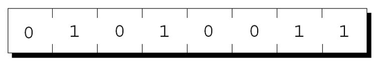
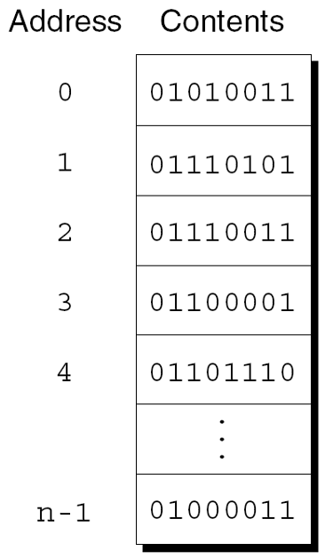
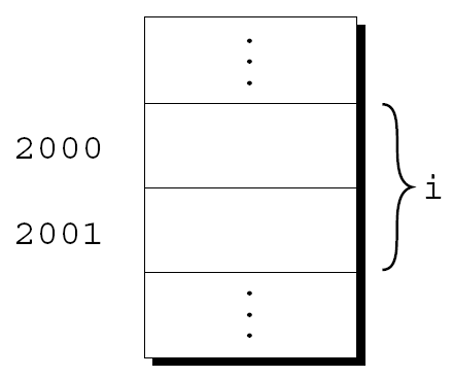
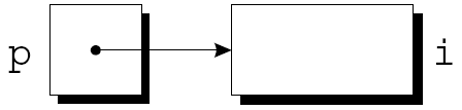
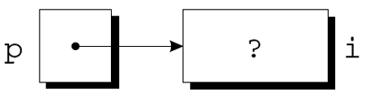

@import "../css/font-awesome-4.7.0/css/font-awesome.css"
@import "../css/theme/solarized.css"
@import "../css/logo.css"
@import "../css/font.css"
@import "../css/color.css"
@import "../css/margin.css"
@import "../css/table.css"
@import "../css/main.css"
@import "../plugin/zoom/zoom.js"
@import "../plugin/customcontrols/plugin.js"
@import "../plugin/customcontrols/style.css"
@import "../plugin/chalkboard/plugin.js"
@import "../plugin/chalkboard/style.css"
@import "../plugin/menu/menu.js"
@import "../js/anychart/anychart-core.min.js"
@import "../js/anychart/anychart-venn.min.js"
@import "../js/anychart/pastel.min.js"
@import "../js/anychart/venn-ml.js"
@import "https://cdn.bootcdn.net/ajax/libs/jquery/3.5.0/jquery.js"

<!-- slide data-notes="" -->

<div class="bottom20"></div>

# 智能程序设计（C语言）

<hr class="width50 center">

## 指针基础 (上)

<div class="bottom8"></div>

### 计算机学院 &nbsp;&nbsp; 杨已彪

#### [yangyibiao@nju.edu.cn](mailto:yangyibiao@nju.edu.cn)


<!-- slide data-notes="" -->

##### 提纲

---

- 指针变量: 什么是地址

- 声明指针变量

- & 和 * 两个运算符

- 指针赋值

- 任务: 指针追踪

- 课堂小测

---


<!-- slide data-notes="" -->


##### 指针变量

---

<div style="display:flex;align-items:flex-start;gap:24px;">

<div style="flex:1;">

理解指针的第一步是在机器级别观察它们表示的内容. 
内存按==字节==划分, 每个字节存 8 位: 

<div class="top-2">
    
</div>

每个字节都有==唯一的地址==。

内存共 n 个字节, 地址就是从 $0$ 到 $n-1$ 的编号: 

</div>

<div style="flex:0 0 337px;">



</div>

</div>

---


<!-- slide data-notes="" -->


##### 指针变量: 为什么需要地址

---

<div style="display:flex;align-items:flex-start;gap:24px;">

<div style="flex:1;">

程序中的每个变量都占用一个或多个字节的内存. 
变量占的第一个字节的地址, 就是==变量的地址==。
下图中变量 i 的地址是 2000: 

<div class="top-2">
    
</div>

</div>

<div style="flex:1;">

地址可以存储在特殊的指针变量中. 
把变量 i 的地址存进指针变量 p, 就说 p==指向==i。
图形表示: 

<div class="top-2">
    
</div>

</div>

</div>

---


<!-- slide data-notes="" -->


##### 声明指针变量

---

<div style="display:flex;flex-direction:column;gap:10px;">

<div style="display:flex;align-items:center;gap:24px;">
<div style="flex:1.2;font-size:0.62em;">

```C
int* p;
```

</div>
<div style="flex:1;font-size:0.62em;line-height:1.5;">

声明指针变量时, 名字前面==必须有星号==: p 是一个指针变量, 能够指向 int 类型的==对象== (用"对象"而非"变量", 因 p 可能指向不属于变量的内存区域)

</div>
</div>

<div style="display:flex;align-items:center;gap:24px;">
<div style="flex:1.2;font-size:0.62em;">

```C
int i, j, a[10], b[20], *p, *q;
```

</div>
<div style="flex:1;font-size:0.62em;line-height:1.5;">

指针变量可以与其他变量==一起声明==

</div>
</div>

<div style="display:flex;align-items:center;gap:24px;">
<div style="flex:1.2;font-size:0.62em;">

```C
int* p;    /* 只指向整数 */
double *q; /* 只指向双精度 */
char *r;   /* 只指向字符 */
```

</div>
<div style="flex:1;font-size:0.62em;line-height:1.5;">

C 要求每个指针变量==只能指向特定类型==的对象; `void *` 较特殊: 可存放任意类型对象的地址

</div>
</div>

</div>

<!-- slide data-notes="" -->


##### 取地址运算符 &

---

<div style="display:flex;align-items:flex-start;gap:24px;">

<div style="flex:1.2;font-size:0.62em;">

```C
int *p;  /* 没有指向特定对象 */
```

```C
int i, *p;
…
p = &i;
```

```C
int i;
int *p = &i;
```

```C
int i, *p = &i;
```

</div>

<div style="flex:1;font-size:0.6em;">

声明指针只给它==留了空间==, 还没指向任何对象:

在使用p之前需要初始化它.


初始化指针的一种方法: 把变量的地址赋给它:

把 i 的地址赋给 p, 让 p 指向 i: 

<div class="top-2">
    
</div>


也可以在声明时就初始化:

i的声明甚至可以与p的声明合并:


</div>

</div>

<!-- slide data-notes="" -->


##### 间接寻址运算符 *

---

<div style="display:flex;align-items:flex-start;gap:24px;">

<div style="flex:1.2;font-size:0.62em;">

```C
printf("%d\n", *p);
```

```C
j = *&i; /* 等同于 j = i; */
```

</div>

<div style="flex:1;font-size:0.6em;">

一旦指针变量指向一个对象, 就可以使用`*`(间接寻址)运算符来访问对象中存储的内容. 

如果p指向i, 我们可以打印i的值如下:

- 对变量用 `&` 得到它的==地址== (一个指针值); 把该值赋给指针变量后, 指针==指向==该变量

- 对指针用 `*` 则==解引用==: 顺着地址找到原变量, 读写它

只要p指向i, `*p`就是i的别名. 
`*p`与i具有相同的值. 
更改`*p`的值会更改i的值. 
下一张幻灯片上的示例说明了`*p`和i的等价性.

</div>

</div>

<svg viewBox="0 0 420 200" width="620" height="295" xmlns="http://www.w3.org/2000/svg" font-family="LXGWWenKai, 'Noto Sans SC', sans-serif" font-weight="700">
<defs>
<marker id="ahAssign" viewBox="0 0 10 10" refX="9" refY="5" markerWidth="6" markerHeight="6" orient="auto"><path d="M0,0 L10,5 L0,10 z" fill="#859900"/></marker>
<marker id="ahPoint" viewBox="0 0 10 10" refX="9" refY="5" markerWidth="6" markerHeight="6" orient="auto"><path d="M0,0 L10,5 L0,10 z" fill="#268bd2"/></marker>
</defs>
<text x="210" y="18" font-size="12" fill="#073642" text-anchor="middle">p 的盒子里存"i 的地址"; 顺着地址就能找到 i</text>

<rect x="46" y="40" width="120" height="66" rx="8" fill="#fdf6e3" stroke="#268bd2" stroke-width="2"/>
<text x="58" y="58" font-size="12" fill="#268bd2">p</text>
<text x="58" y="72" font-size="8.5" fill="#93a1a1">int *</text>
<text x="106" y="86" font-size="16" fill="#268bd2" text-anchor="middle">2000</text>
<text x="106" y="99" font-size="9" fill="#268bd2" text-anchor="middle">存的是地址</text>

<rect x="254" y="40" width="120" height="66" rx="8" fill="#fdf6e3" stroke="#b58900" stroke-width="2"/>
<text x="266" y="58" font-size="12" fill="#b58900">i</text>
<text x="266" y="72" font-size="8.5" fill="#93a1a1">int</text>
<text x="314" y="86" font-size="18" fill="#073642" text-anchor="middle">1</text>
<text x="314" y="99" font-size="9" fill="#93a1a1" text-anchor="middle">地址恰好是 2000</text>

<line x1="168" y1="73" x2="250" y2="73" stroke="#268bd2" stroke-width="2" stroke-dasharray="5 3" marker-end="url(#ahPoint)"/>
<text x="209" y="64" font-size="9.5" fill="#268bd2" text-anchor="middle">p 指向 i</text>

<text x="106" y="150" font-size="12" fill="#859900" text-anchor="middle">&amp;i 得到 2000</text>
<text x="106" y="164" font-size="9" fill="#859900" text-anchor="middle">(i 的地址, 是一个值)</text>
<line x1="106" y1="140" x2="106" y2="110" stroke="#859900" stroke-width="2" marker-end="url(#ahAssign)"/>
<text x="116" y="128" font-size="10" fill="#859900">赋给 p</text>

<text x="210" y="188" font-size="10.5" fill="#073642" text-anchor="middle">*p 就是 i (同一块内存): 读 *p 得 1, 写 *p = 2 就把 i 改成 2</text>
</svg>

<!-- slide data-notes="" -->##### 间接寻址运算符 * (上)

---

<div style="display:flex;align-items:flex-start;gap:24px;">

<div style="flex:1.2;font-size:0.62em;">

```C
printf("%d\n", i); /* 打印 1 */
printf("%d\n", *p); /* 打印 1 */
*p = 2;
```

```C
printf("%d\n", i); /* 打印 2 */
printf("%d\n", *p); /* 打印 2 */
```

</div>

<div style="flex:1;font-size:0.6em;">

`p = &i;`


`i = 1;`


<div class="top-2">
  
</div><div class="top-2">
  
</div><div class="top-2">
  
</div>

</div>

</div>
<!-- slide data-notes="" -->##### 间接寻址运算符 * (下)

---

<div style="display:flex;align-items:flex-start;gap:24px;">

<div style="flex:1.2;font-size:0.62em;">

```C
int* p;
printf("%d", *p); /*** 错误的 ***/
```

```C
int* p;
*p = 1; /*** 错误的 ***/
```

</div>

<div style="flex:1;font-size:0.6em;">

将间接寻址运算符应用于未初始化的指针变量会导致未定义的行为.

给*p赋值是特别危险的:


</div>

</div>

<svg viewBox="0 0 400 160" width="620" height="248" xmlns="http://www.w3.org/2000/svg" font-family="LXGWWenKai, 'Noto Sans SC', sans-serif" font-weight="700">
<defs><marker id="arrUninitR" viewBox="0 0 10 10" refX="9" refY="5" markerWidth="6" markerHeight="6" orient="auto"><path d="M0,0 L10,5 L0,10 z" fill="#dc322f"/></marker></defs>
<rect x="55" y="42" width="100" height="58" rx="8" fill="#fdf6e3" stroke="#268bd2" stroke-width="2"/>
<text x="67" y="60" font-size="12" fill="#268bd2">p</text>
<text x="105" y="82" font-size="15" fill="#dc322f" text-anchor="middle">???</text>
<text x="105" y="95" font-size="9" fill="#93a1a1" text-anchor="middle">未初始化的指针</text>
<line x1="157" y1="71" x2="246" y2="71" stroke="#dc322f" stroke-width="2" stroke-dasharray="6 4" marker-end="url(#arrUninitR)"/>
<text x="201" y="60" font-size="9.5" fill="#dc322f" text-anchor="middle">指向哪里？</text>
<rect x="250" y="42" width="100" height="58" rx="8" fill="none" stroke="#93a1a1" stroke-width="2" stroke-dasharray="6 4"/>
<text x="300" y="86" font-size="26" fill="#93a1a1" text-anchor="middle">?</text>
<text x="300" y="118" font-size="9.5" fill="#93a1a1" text-anchor="middle">未知内存</text>
<circle cx="348" cy="40" r="11" fill="#dc322f"/>
<path d="M344,36 l8,8 M352,36 l-8,8" stroke="#fdf6e3" stroke-width="2" stroke-linecap="round"/>
<text x="105" y="118" font-size="9.5" fill="#dc322f" text-anchor="middle">垃圾值，不是有效地址</text>
<text x="200" y="144" font-size="11" fill="#073642" text-anchor="middle">解引用未初始化的指针：写到未知内存，未定义行为</text>
</svg>

<!-- slide data-notes="" -->


##### 指针赋值 (上)

---

<div style="display:flex;align-items:flex-start;gap:24px;">

<div style="flex:1.2;font-size:0.62em;">

```C
int i, j, *p, *q;
```

```C
p = &i;
```

```C
q = p;
```

```C
*p = 1;
```

```C
*q = 2;
```

</div>

<div style="flex:1;font-size:0.6em;">

C 允许使用赋值运算符来复制相同类型的指针. 
假设有以下声明:

q现在指向与p相同的位置: 
<div class="top-2">
    
</div>


如果p和q都指向i, 就可以通过为`*p`或`*q`赋一个新值来更改i:

<div style="display:flex;align-items:flex-start;gap:16px;">

<div class="top-2">
    
</div>

<div class="top-2">
    
</div>

</div>

任意数量的指针变量都可以指向同一个对象.

</div>

</div>

<!-- slide data-notes="" -->


##### 指针赋值 (下): 不要混淆 q=p 与 *q=*p

---

<div style="display:flex;align-items:flex-start;gap:24px;">

<div style="flex:1;">

注意不要混淆

```C
q = p;
```
和
```C
*q = *p;
```
第一条语句是指针赋值, 但第二条不是. 
下面的示例显示了第二个语句的效果.

</div>

<div style="flex:1;">

```C
p = &i;
q = &j;
i = 1;
```
<div class="top-2">
    
</div>

```C
*q = *p;
```
<div class="top-2">
    
</div>

</div>

</div>

---

<!-- slide data-notes="" -->##### 任务: 指针追踪

---

<div style="font-size:1.0em;line-height:1.75;">

==任务==: 令 `int a = 3, *p = &a;`, 打印 `a`、`&a`、`p`、`*p`; 再执行 `*p = 7`, 重新打印 `a` 和 `*p`

样例 (地址每次运行都不同):

```
a = 3, &a = 0x7ffd1a2b, p = 0x7ffd1a2b, *p = 3
改写 *p 之后: a = 7, *p = 7
```

==提示==:

- 打印地址用 `%p`, 打印整数用 `%d`——占位符要和参数类型对应

- 观察 `&a` 与 `p` 是否相等; 改写 `*p` 之后 `a` 是否跟着变

<a href="vscode://file/Users/yangyibiao/Documents/Seafile/GitRepo/yangyibiao.github.io/cpl/slides/10-pointers/code/task-pointer-trace.c" style="display:inline-block;margin-top:8px;padding:5px 14px;background:#268bd2;color:#fff;border-radius:6px;font-size:0.85em;text-decoration:none;">⚡ 在 VS Code 中打开 task-pointer-trace.c (骨架)</a>

</div>

---

<!-- slide data-notes="" -->##### 任务: 参考代码与要点

---

<div style="display:flex;align-items:flex-start;gap:24px;">

<div style="flex:1.1;font-size:0.62em;">

```C{.line-numbers}
#include <stdio.h>

int main(void)
{
  int a = 3;
  int *p = &a;                 /* p 指向 a */

  printf("a = %d, &a = %p, p = %p, *p = %d\n",
         a, (void *)&a, (void *)p, *p);

  *p = 7;                      /* 通过 p 改写 a */
  printf("改写 *p 之后: a = %d, *p = %d\n", a, *p);
  return 0;
}
```

</div>

<div style="flex:1;font-size:0.9em;line-height:1.7;">

- `p = &a`: p 里存的是 a 的==地址==; 所以 `&a` 与 `p` 打印结果相同

- `*p` 是 a 的==别名==: 读 `*p` 就是读 a, 写 `*p = 7` 就是写 a

- `%p` 打印指针 (地址); 每次运行的地址不同, ==不要硬编码比较==

- 指针类型要匹配: `int *p` 只能指向 `int` 对象

</div>

</div>

---


<!-- slide data-notes="" -->

##### 课堂小测

---

1. 概念: 指针变量里存的是什么？`int *p;` 中 p 的类型是什么？

2. 概念: `&x` 和 `*p` 分别做什么？它们互为逆运算吗？

3. 代码阅读: `int i = 1, *p = &i; *p = 2; printf("%d", i);` 输出什么？

4. 纠错: `int *p; *p = 1;` 错在哪里？

---


<!-- slide data-notes="" -->

#####

---

<div class="bottom20"></div>

<hr class="width50 center">

## 未完待续

---


