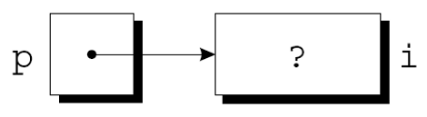
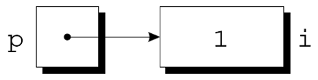
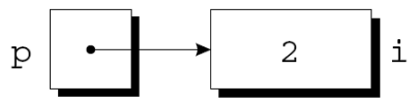
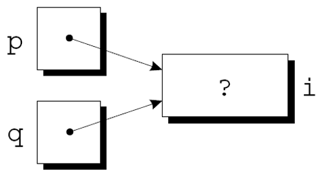
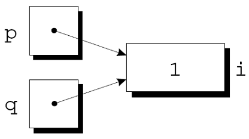
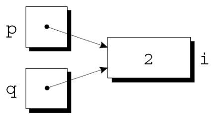
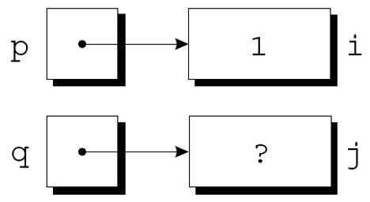
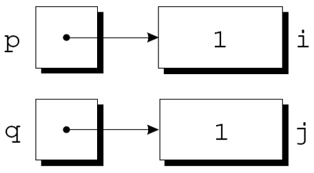

---
presentation:
  margin: 0
  center: false
  transition: "convex"
  enableSpeakerNotes: true
  slideNumber: "c/t"
  navigationMode: "linear"
---

@import "../css/font-awesome-4.7.0/css/font-awesome.css"
@import "../css/theme/solarized.css"
@import "../css/logo.css"
@import "../css/font.css"
@import "../css/color.css"
@import "../css/margin.css"
@import "../css/table.css"
@import "../css/main.css"
@import "../plugin/zoom/zoom.js"
@import "../plugin/customcontrols/plugin.js"
@import "../plugin/customcontrols/style.css"
@import "../plugin/chalkboard/plugin.js"
@import "../plugin/chalkboard/style.css"
@import "../plugin/menu/menu.js"
@import "../js/anychart/anychart-core.min.js"
@import "../js/anychart/anychart-venn.min.js"
@import "../js/anychart/pastel.min.js"
@import "../js/anychart/venn-ml.js"
@import "https://cdn.bootcdn.net/ajax/libs/jquery/3.5.0/jquery.js"

<!-- slide data-notes="" -->

<div class="bottom20"></div>

# 智能程序设计（C语言）

<hr class="width50 center">

## 指针基础 (上)

<div class="bottom8"></div>

### 计算机学院 &nbsp;&nbsp; 杨已彪

#### [yangyibiao@nju.edu.cn](mailto:yangyibiao@nju.edu.cn)


<!-- slide data-notes="" -->

##### 提纲

---

- 指针变量: 什么是地址

- 声明指针变量

- & 和 * 两个运算符

- 指针赋值

- 任务: 指针追踪

- 课堂小测

---


<!-- slide data-notes="" -->##### 内存地址: 每个字节一个编号
---

<style>.addr-intro mark{white-space:nowrap}</style>

<div style="display:flex;align-items:stretch;gap:24px;">

<div class="addr-intro" style="flex:0.78;display:flex;flex-direction:column;font-size:0.84em;line-height:1.6;">

内存按==字节==划分, 每个字节存 8 位. 给每个字节编一个号, 这个编号就是==地址==.

<div style="margin:16px 2rem 0;padding:12px 16px;background:#fdf6e3;border-left:4px solid #268bd2;border-radius:4px;">
<div style="font-size:0.88em;color:#586e75;">内存共 n 个字节</div>
<div style="font-size:1.05em;font-weight:700;color:#268bd2;margin-top:2px;">地址: 0, 1, 2, …, n-1</div>
</div>

<div style="margin:14px 2rem 0;line-height:1.6;">
<div><span style="color:#859900;">✓</span> 每个字节的地址唯一</div>
<div><span style="color:#859900;">✓</span> 相邻字节的地址差 1</div>
<div><span style="color:#859900;">✓</span> 地址是位置, 不是内容</div>
</div>

<div style="margin:auto 2rem 0;padding:8px 14px;background:#fdf6e3;border-left:4px solid #268bd2;border-radius:4px;font-size:0.9em;">
一句话: <b>地址 = 字节的编号 (<span style="white-space:nowrap">门牌号</span>)</b>; 编号与字节一一对应.
</div>

</div>

<div style="flex:1.22;display:flex;flex-direction:column;justify-content:center;">

<svg viewBox="0 0 520 260" style="max-width:720px;width:100%;height:auto;display:block;margin:0 auto;" role="img" aria-label="整个内存按字节编号, 地址从 0 到 n-1">
  <g font-family="LXGWWenKai, 'Noto Sans SC', sans-serif">
    <text x="260" y="20" font-size="13" fill="#073642" text-anchor="middle">整个内存 = 一长排字节, 每个字节一个编号</text>

    <text x="49" y="52" font-size="11.5" fill="#268bd2" text-anchor="middle" font-family="Menlo, monospace">0</text>
    <text x="113" y="52" font-size="11.5" fill="#268bd2" text-anchor="middle" font-family="Menlo, monospace">1</text>
    <rect x="150" y="34" width="54" height="22" rx="4" fill="#e3eef7" stroke="#268bd2" stroke-width="1.1"/>
    <text x="177" y="49" font-size="10" fill="#268bd2" text-anchor="middle">门牌 <tspan font-family="Menlo, monospace">2</tspan></text>
    <line x1="177" y1="56" x2="177" y2="62" stroke="#268bd2" stroke-width="1"/>
    <text x="241" y="52" font-size="11.5" fill="#268bd2" text-anchor="middle" font-family="Menlo, monospace">3</text>
    <text x="309" y="54" font-size="13" fill="#93a1a1" text-anchor="middle">…</text>
    <text x="377" y="52" font-size="9.5" fill="#268bd2" text-anchor="middle" font-family="Menlo, monospace">n-2</text>
    <text x="441" y="52" font-size="9.5" fill="#268bd2" text-anchor="middle" font-family="Menlo, monospace">n-1</text>

    <rect x="20" y="62" width="58" height="46" rx="4" fill="#fdf6e3" stroke="#93a1a1" stroke-width="1.2"/>
    <rect x="84" y="62" width="58" height="46" rx="4" fill="#fdf6e3" stroke="#93a1a1" stroke-width="1.2"/>
    <rect x="148" y="62" width="58" height="46" rx="4" fill="#dceaf5" stroke="#268bd2" stroke-width="1.8"/>
    <rect x="212" y="62" width="58" height="46" rx="4" fill="#fdf6e3" stroke="#93a1a1" stroke-width="1.2"/>
    <rect x="348" y="62" width="58" height="46" rx="4" fill="#fdf6e3" stroke="#93a1a1" stroke-width="1.2"/>
    <rect x="412" y="62" width="58" height="46" rx="4" fill="#fdf6e3" stroke="#93a1a1" stroke-width="1.2"/>

    <text x="49" y="90" font-size="9" fill="#586e75" text-anchor="middle" font-family="Menlo, monospace">01010011</text>
    <text x="113" y="90" font-size="9" fill="#586e75" text-anchor="middle" font-family="Menlo, monospace">01110101</text>
    <text x="177" y="90" font-size="9" fill="#586e75" text-anchor="middle" font-family="Menlo, monospace">01110011</text>
    <text x="241" y="90" font-size="9" fill="#586e75" text-anchor="middle" font-family="Menlo, monospace">01100001</text>
    <text x="309" y="90" font-size="15" fill="#93a1a1" text-anchor="middle">…</text>
    <text x="377" y="90" font-size="9" fill="#586e75" text-anchor="middle" font-family="Menlo, monospace">01101001</text>
    <text x="441" y="90" font-size="9" fill="#586e75" text-anchor="middle" font-family="Menlo, monospace">01000011</text>

    <path d="M20 124 V134 H470 V124" fill="none" stroke="#268bd2" stroke-width="1.5"/>
    <text x="245" y="158" font-size="12.5" fill="#073642" text-anchor="middle">整个内存共 n 个字节 → n 个地址: 0 ~ n-1</text>
    <text x="245" y="184" font-size="11" fill="#586e75" text-anchor="middle">地址是编号, 不是字节里存的内容; 相邻字节的地址差 1</text>
    <text x="245" y="208" font-size="11" fill="#268bd2" text-anchor="middle">实际写法常用十六进制, 如 0x1000</text>
  </g>
</svg>

</div>

</div>

---

<!-- slide data-notes="" -->##### 变量住在内存里: 地址
---

<div style="display:flex;align-items:stretch;gap:24px;">

<div class="addr-intro" style="flex:0.88;display:flex;flex-direction:column;font-size:0.84em;line-height:1.55;">

变量 `i` 也住在这条内存街上, 占了 4 个==连续==字节, 从 `0x1000` 开始.

<div style="display:flex;flex-direction:column;gap:8px;margin:14px 2rem 0;">

<div style="display:flex;align-items:baseline;padding:7px 12px;background:#fdf6e3;border-left:4px solid #b58900;border-radius:4px;">
<span style="color:#586e75;">i 的值</span>
<span style="margin-left:auto;font-family:Menlo,monospace;font-size:1.0em;font-weight:700;color:#b58900;">42</span>
</div>

<div style="display:flex;align-items:baseline;padding:7px 12px;background:#fdf6e3;border-left:4px solid #268bd2;border-radius:4px;">
<span style="color:#586e75;">i 的地址</span>
<span style="margin-left:auto;font-family:Menlo,monospace;font-size:1.0em;font-weight:700;color:#268bd2;">0x1000</span>
</div>

<div style="display:flex;align-items:baseline;padding:7px 12px;background:#f2f4f0;border-left:4px solid #93a1a1;border-radius:4px;">
<span style="color:#586e75;">i 占的字节</span>
<span style="margin-left:auto;font-family:Menlo,monospace;font-size:0.95em;color:#586e75;">0x1000 ~ 0x1003</span>
</div>

</div>

<div style="margin:auto 2rem 0;padding:8px 14px;background:#fdf6e3;border-left:4px solid #268bd2;border-radius:4px;font-size:0.9em;">
一句话: <b>变量地址 = 第一个字节的地址</b>; `0x1000`~`0x1003` 是 `i` 的 4 个字节, 但 `&i` 只取 `0x1000`.
</div>

</div>

<div style="flex:1.12;">

<svg viewBox="0 0 460 230" style="max-width:640px;width:100%;height:auto;display:block;margin:0 auto;" role="img" aria-label="内存字节格与变量 i 的地址">
  <g font-family="LXGWWenKai, 'Noto Sans SC', sans-serif">
    <text x="230" y="18" font-size="13" fill="#073642" text-anchor="middle">内存 = 一排带门牌的字节格 (只画其中一段)</text>
    <text x="22" y="45" font-size="9.5" fill="#268bd2">地址</text>
    <text x="10" y="64" font-size="13" fill="#93a1a1" text-anchor="middle">…</text>
    <text x="430" y="64" font-size="13" fill="#93a1a1" text-anchor="middle">…</text>
    <text x="10" y="96" font-size="13" fill="#93a1a1" text-anchor="middle">…</text>
    <text x="430" y="96" font-size="13" fill="#93a1a1" text-anchor="middle">…</text>
    <text x="46" y="64" font-size="10.5" fill="#268bd2" text-anchor="middle">0x1000</text>
    <text x="94" y="64" font-size="10.5" fill="#268bd2" text-anchor="middle">0x1001</text>
    <text x="142" y="64" font-size="10.5" fill="#268bd2" text-anchor="middle">0x1002</text>
    <text x="190" y="64" font-size="10.5" fill="#268bd2" text-anchor="middle">0x1003</text>
    <text x="238" y="64" font-size="10.5" fill="#268bd2" text-anchor="middle">0x1004</text>
    <text x="286" y="64" font-size="10.5" fill="#268bd2" text-anchor="middle">0x1005</text>
    <text x="334" y="64" font-size="10.5" fill="#268bd2" text-anchor="middle">0x1006</text>
    <text x="382" y="64" font-size="10.5" fill="#268bd2" text-anchor="middle">0x1007</text>

    <rect x="24" y="72" width="44" height="36" rx="3" fill="#dceaf5" stroke="#268bd2" stroke-width="1.6"/>
    <rect x="72" y="72" width="44" height="36" rx="3" fill="#dceaf5" stroke="#268bd2" stroke-width="1.6"/>
    <rect x="120" y="72" width="44" height="36" rx="3" fill="#dceaf5" stroke="#268bd2" stroke-width="1.6"/>
    <rect x="168" y="72" width="44" height="36" rx="3" fill="#dceaf5" stroke="#268bd2" stroke-width="1.6"/>
    <rect x="216" y="72" width="44" height="36" rx="3" fill="#fdf6e3" stroke="#93a1a1" stroke-width="1.4"/>
    <rect x="264" y="72" width="44" height="36" rx="3" fill="#fdf6e3" stroke="#93a1a1" stroke-width="1.4"/>
    <rect x="312" y="72" width="44" height="36" rx="3" fill="#fdf6e3" stroke="#93a1a1" stroke-width="1.4"/>
    <rect x="360" y="72" width="44" height="36" rx="3" fill="#fdf6e3" stroke="#93a1a1" stroke-width="1.4"/>

    <text x="46" y="96" font-size="15" fill="#073642" text-anchor="middle">2A</text>
    <text x="94" y="96" font-size="13" fill="#93a1a1" text-anchor="middle">00</text>
    <text x="142" y="96" font-size="13" fill="#93a1a1" text-anchor="middle">00</text>
    <text x="190" y="96" font-size="13" fill="#93a1a1" text-anchor="middle">00</text>
    <text x="238" y="96" font-size="13" fill="#c9c9c9" text-anchor="middle">—</text>
    <text x="286" y="96" font-size="13" fill="#c9c9c9" text-anchor="middle">—</text>
    <text x="334" y="96" font-size="13" fill="#c9c9c9" text-anchor="middle">—</text>
    <text x="382" y="96" font-size="13" fill="#c9c9c9" text-anchor="middle">—</text>

    <path d="M24 120 V130 H212 V120" fill="none" stroke="#268bd2" stroke-width="1.5"/>
    <text x="118" y="146" font-size="11.5" fill="#268bd2" text-anchor="middle">i 占 4 个字节</text>
    <text x="230" y="178" font-size="12.5" fill="#073642" text-anchor="middle"><tspan font-family="Menlo, monospace">int i = 42;</tspan> 的地址 <tspan font-family="Menlo, monospace" fill="#268bd2">&amp;i = 0x1000</tspan></text>
    <text x="230" y="202" font-size="11" fill="#268bd2" text-anchor="middle">0x1001 是下一个字节的地址, 不是 i 的地址</text>
  </g>
</svg>

<div style="max-width:640px;width:100%;margin:8px auto 0;padding:9px 13px 11px;background:#f8f4e6;border:1px solid #e7ddc2;border-radius:8px;">

<div style="display:flex;align-items:center;gap:8px;">
<span style="padding:2px 9px;border-radius:10px;background:#b58900;color:#fff;font-size:0.60em;font-weight:700;">x86 小端</span>
<span style="font-family:Menlo,monospace;font-size:0.72em;font-weight:700;color:#b58900;">42 = 0x0000002A</span>
</div>

<div style="display:flex;align-items:center;justify-content:space-between;margin-top:7px;font-family:Menlo,monospace;font-size:0.72em;">
<span style="font-family:LXGWWenKai, 'Noto Sans SC', sans-serif;font-size:0.88em;color:#93a1a1;">低地址</span>
<span><span style="color:#268bd2;font-weight:700;">2A</span> &nbsp; <span style="color:#93a1a1;">00</span> &nbsp; <span style="color:#93a1a1;">00</span> &nbsp; <span style="color:#93a1a1;">00</span></span>
<span style="font-family:LXGWWenKai, 'Noto Sans SC', sans-serif;font-size:0.88em;color:#93a1a1;">高地址</span>
</div>

<div style="margin-top:5px;font-size:0.62em;color:#586e75;line-height:1.45;">
2A 00 00 00 按地址从低到高拼成 0x0000002A = 42, 不能把字节顺序反过来当成 0x2A000000.
</div>

</div>

</div>

</div>


---

<!-- slide data-notes="" -->##### 指针变量也是变量: 它存的是地址
---

<div style="display:flex;align-items:flex-start;gap:24px;">

<div style="flex:1;font-size:0.82em;line-height:1.55;">

`int i = 42; int *p = &i;` 之后, 内存里==有两个变量==:

- `p` 自己也在内存里, 住在 `0x2000`

- `p` 的==值==是 `0x1000`——也就是 `i` 的地址

- 所以 `&i` 和 `p` 都是 `0x1000`; `&p` 是 `0x2000`; `*p` 是 `42`

<div style="margin-top:6px;padding:6px 10px;background:#fdf6e3;border-left:4px solid #b58900;border-radius:4px;font-size:0.9em;">
一句话: <b>指针变量 = 普通变量, 只是它的值恰好是一个地址.</b>
</div>

</div>

<div style="flex:1.25;">

<svg viewBox="0 0 460 300" style="max-width:100%;height:auto;display:block;margin:0 auto;" role="img" aria-label="i 与 p 在内存中的关系">
  <g font-family="LXGWWenKai, 'Noto Sans SC', sans-serif">
    <text x="230" y="18" font-size="12" fill="#073642" text-anchor="middle">p 和 i 都在内存里</text>

    <!-- 门牌: 小圆角地址牌贴住变量框左侧 (右端压在框下, 只露出左段) -->
    <rect x="42" y="81" width="66" height="22" rx="4" fill="#e3eef7" stroke="#268bd2" stroke-width="1.1"/>
    <text x="72" y="96" font-size="10.5" fill="#268bd2" text-anchor="middle" font-family="Menlo, monospace">0x1000</text>
    <rect x="100" y="60" width="190" height="64" rx="6" fill="#fdf6e3" stroke="#b58900" stroke-width="2"/>
    <text x="112" y="82" font-size="13" fill="#b58900">int i</text>
    <text x="195" y="104" font-size="17" fill="#073642" text-anchor="middle">42</text>

    <rect x="42" y="231" width="66" height="22" rx="4" fill="#e3eef7" stroke="#268bd2" stroke-width="1.1"/>
    <text x="72" y="246" font-size="10.5" fill="#268bd2" text-anchor="middle" font-family="Menlo, monospace">0x2000</text>
    <rect x="100" y="210" width="190" height="64" rx="6" fill="#fdf6e3" stroke="#268bd2" stroke-width="2"/>
    <text x="112" y="232" font-size="13" fill="#268bd2">int *p</text>
    <text x="195" y="254" font-size="14" fill="#268bd2" text-anchor="middle">0x1000</text>

    <defs>
      <marker id="ptr-arrow" viewBox="0 0 10 10" refX="9" refY="5" markerWidth="6" markerHeight="6" orient="auto">
        <path d="M0,0 L10,5 L0,10 Z" fill="#268bd2"/>
      </marker>
    </defs>
    <path d="M292 242 C 350 242, 350 84, 292 84" fill="none" stroke="#268bd2" stroke-width="2" marker-end="url(#ptr-arrow)"/>
    <text x="358" y="168" font-size="11.5" fill="#268bd2">p 指向 i</text>
    <text x="230" y="292" font-size="11" fill="#586e75" text-anchor="middle">p 的值是 i 的地址; p 自己也有地址</text>
  </g>
</svg>

</div>

</div>

---

<!-- slide data-notes="" -->##### 先看一个完整的例子: 指针能做什么

---

<div style="display:flex;align-items:flex-start;gap:24px;">

<div style="flex:1.05;font-size:0.78em;">

<div class="col-label">代码</div>

```C
int i = 42;
int *p = &i;          /* 声明 p, 让它指向 i */

printf("%d\n", *p);   /* 读 *p: 输出 42 */
*p = 7;               /* 写 *p: 把 i 改成 7 */
printf("%d\n", i);    /* 输出 7 */
```

<div style="display:flex;gap:10px;margin-top:12px;font-size:0.68em;line-height:1.45;">
<div style="flex:1;padding:8px 10px;background:#f2f4f0;border-left:3px solid #859900;border-radius:4px;">
<b>① 声明</b><br>`int *p = &i;`
</div>
<div style="flex:1;padding:8px 10px;background:#f2f4f0;border-left:3px solid #268bd2;border-radius:4px;">
<b>② 读</b><br>`*p` → 42
</div>
<div style="flex:1;padding:8px 10px;background:#f2f4f0;border-left:3px solid #b58900;border-radius:4px;">
<b>③ 写</b><br>`*p = 7` → `i = 7`
</div>
</div>

</div>

<div style="flex:1.05;">

<svg viewBox="0 0 460 230" style="max-width:640px;width:100%;height:auto;display:block;margin:0 auto;" role="img" aria-label="指针 p 指向变量 i, 通过 *p 读写 i">
  <defs>
    <marker id="p6arrow" viewBox="0 0 10 10" refX="9" refY="5" markerWidth="6" markerHeight="6" orient="auto">
      <path d="M0,0 L10,5 L0,10 Z" fill="#268bd2"/>
    </marker>
  </defs>
  <g font-family="LXGWWenKai, 'Noto Sans SC', sans-serif">
    <text x="230" y="18" font-size="12" fill="#073642" text-anchor="middle">p 里存 i 的地址, 顺着地址就能读写 i</text>

    <rect x="34" y="70" width="130" height="66" rx="8" fill="#fdf6e3" stroke="#268bd2" stroke-width="2"/>
    <text x="46" y="90" font-size="13" fill="#268bd2">p</text>
    <text x="46" y="104" font-size="9" fill="#93a1a1">int *</text>
    <text x="99" y="120" font-size="15" fill="#268bd2" text-anchor="middle" font-family="Menlo, monospace">0x1000</text>
    <text x="99" y="133" font-size="9" fill="#268bd2" text-anchor="middle">存的是地址</text>

    <rect x="280" y="70" width="140" height="66" rx="8" fill="#fdf6e3" stroke="#b58900" stroke-width="2"/>
    <text x="292" y="90" font-size="13" fill="#b58900">i</text>
    <text x="292" y="104" font-size="9" fill="#93a1a1">int</text>
    <text x="350" y="120" font-size="18" fill="#073642" text-anchor="middle">42</text>
    <text x="350" y="133" font-size="9" fill="#93a1a1" text-anchor="middle">地址是 0x1000</text>

    <line x1="168" y1="103" x2="276" y2="103" stroke="#268bd2" stroke-width="2" stroke-dasharray="5 3" marker-end="url(#p6arrow)"/>
    <text x="222" y="94" font-size="9.5" fill="#268bd2" text-anchor="middle">p 指向 i</text>

    <text x="99" y="172" font-size="11" fill="#859900" text-anchor="middle">读 *p 得到 42</text>
    <text x="350" y="172" font-size="11" fill="#b58900" text-anchor="middle">写 *p = 7, i 变成 7</text>
    <text x="230" y="208" font-size="10.5" fill="#586e75" text-anchor="middle">*p 与 i 是同一块内存: 读 *p 就是读 i, 写 *p 就是写 i</text>
  </g>
</svg>

</div>

</div>

<div style="margin-top:12px;padding:8px 14px;background:#fdf6e3;border-left:4px solid #b58900;border-radius:4px;font-size:0.72em;text-align:left;">
<b>指针能做什么:</b> 通过地址间接读写变量; 让多个指针指向同一对象 (`q = p`); 让函数修改实参、遍历数组 (后面细讲).
</div>

<!-- slide data-notes="" -->##### 声明与初始化: 让 p 指向 i

---

<div style="display:flex;align-items:flex-start;gap:24px;">

<div style="flex:0.95;font-size:0.84em;line-height:1.45;">

<div class="col-label">声明</div>

```C
int *p;        /* p 存 int 对象的地址 */
double *q;     /* 只能指向 double */
char *r;       /* 只能指向 char */
```

- 类型要匹配: `int *` 只能指向 `int` 对象
- 可以和其他变量一起声明: `int i, *p;`

<div class="col-label" style="margin-top:10px;">初始化: 把地址赋给 p</div>

```C
int i = 42;
int *p = &i;   /* 声明时初始化 */
```

```C
int i = 42, *p;
p = &i;        /* 先声明, 后赋值 */
```

</div>

<div style="flex:1.05;">

<svg viewBox="0 0 520 300" style="max-width:680px;width:100%;height:auto;display:block;margin:0 auto;" role="img" aria-label="指针 p 初始化前后: 从未初始化到指向 i">
  <defs>
    <marker id="p7arrow" viewBox="0 0 10 10" refX="9" refY="5" markerWidth="6" markerHeight="6" orient="auto">
      <path d="M0,0 L10,5 L0,10 Z" fill="#268bd2"/>
    </marker>
  </defs>
  <g font-family="LXGWWenKai, 'Noto Sans SC', sans-serif">
    <text x="130" y="20" font-size="13.5" fill="#586e75" text-anchor="middle">声明后: p 还没有指向</text>
    <rect x="70" y="40" width="120" height="56" rx="6" fill="#fdf6e3" stroke="#b58900" stroke-width="1.8"/>
    <text x="82" y="58" font-size="12.5" fill="#b58900">int i</text>
    <text x="130" y="80" font-size="17" fill="#073642" text-anchor="middle">42</text>
    <rect x="70" y="140" width="120" height="56" rx="6" fill="#fdf6e3" stroke="#268bd2" stroke-width="1.8"/>
    <text x="82" y="158" font-size="12.5" fill="#268bd2">int *p</text>
    <text x="130" y="180" font-size="17" fill="#dc322f" text-anchor="middle">?</text>
    <text x="130" y="218" font-size="11" fill="#dc322f" text-anchor="middle">未初始化, 不知道指向哪</text>

    <text x="390" y="20" font-size="13.5" fill="#586e75" text-anchor="middle">p = &amp;i 后: p 指向 i</text>
    <rect x="330" y="40" width="120" height="56" rx="6" fill="#fdf6e3" stroke="#b58900" stroke-width="1.8"/>
    <text x="342" y="58" font-size="12.5" fill="#b58900">int i</text>
    <text x="390" y="80" font-size="17" fill="#073642" text-anchor="middle">42</text>
    <rect x="330" y="140" width="120" height="56" rx="6" fill="#fdf6e3" stroke="#268bd2" stroke-width="1.8"/>
    <text x="342" y="158" font-size="12.5" fill="#268bd2">int *p</text>
    <text x="390" y="180" font-size="15" fill="#268bd2" text-anchor="middle" font-family="Menlo, monospace">0x1000</text>
    <line x1="390" y1="136" x2="390" y2="100" stroke="#268bd2" stroke-width="2" stroke-dasharray="5 3" marker-end="url(#p7arrow)"/>
    <text x="402" y="122" font-size="10.5" fill="#268bd2">指向</text>
    <text x="390" y="218" font-size="11" fill="#268bd2" text-anchor="middle">&amp;i = 0x1000</text>

    <text x="260" y="260" font-size="12.5" fill="#586e75" text-anchor="middle">声明只给 p 留了空间; 用 &amp;i 取地址并赋给 p 后, p 才指向 i</text>
    <text x="260" y="285" font-size="12.5" fill="#268bd2" text-anchor="middle">未初始化的指针不能解引用 (比如 *p)</text>
  </g>
</svg>

<div style="margin-top:10px;font-size:0.86em;line-height:1.5;">

- `&i` 得到 i 的地址; 赋值后 p 指向 i
- 声明只给 p 留了空间; 没有初始化就使用, 行为未定义

</div>

</div>

</div>

<!-- slide data-notes="" -->##### 通过指针访问: *p 就是 i

---

<div style="display:flex;align-items:flex-start;gap:24px;">

<div style="flex:1.0;font-size:0.85em;line-height:1.5;">

<div class="col-label">代码</div>

```C
int i = 42, *p = &i;

printf("%d\n", *p);   /* 读 *p: 输出 42 */
*p = 7;               /* 写 *p: i 变成 7 */
printf("%d\n", i);    /* 输出 7 */
```

<div style="margin-top:10px;padding:8px 12px;background:#f2f4f0;border-left:4px solid #268bd2;border-radius:4px;font-size:0.9em;line-height:1.55;">
`*p` 是 i 的==别名==: 读 `*p` 就是读 i, 写 `*p` 就是写 i.<br>
`&` 取地址, `*` 解引用; 两者互为逆运算: `*&i` 就是 i.
</div>

- p 必须已经指向一个有效对象; 未初始化的指针不能解引用
- 下一张先看打印地址的程序, 后面的示例逐行演示 `*p` 如何改变 i

</div>

<div style="flex:1.0;">

<svg viewBox="0 0 420 200" style="max-width:620px;width:100%;height:auto;display:block;margin:0 auto;" xmlns="http://www.w3.org/2000/svg" font-family="LXGWWenKai, 'Noto Sans SC', sans-serif" font-weight="700">
<defs>
<marker id="ahAssign" viewBox="0 0 10 10" refX="9" refY="5" markerWidth="6" markerHeight="6" orient="auto"><path d="M0,0 L10,5 L0,10 z" fill="#859900"/></marker>
<marker id="ahPoint" viewBox="0 0 10 10" refX="9" refY="5" markerWidth="6" markerHeight="6" orient="auto"><path d="M0,0 L10,5 L0,10 z" fill="#268bd2"/></marker>
</defs>
<text x="210" y="18" font-size="13.5" fill="#073642" text-anchor="middle">p 的盒子里存"i 的地址"; 顺着地址就能找到 i</text>
<text x="106" y="34" font-size="10" fill="#586e75" text-anchor="middle">&amp;p = 0x2000 (p 自己的地址)</text>

<rect x="46" y="40" width="120" height="66" rx="8" fill="#fdf6e3" stroke="#268bd2" stroke-width="2"/>
<text x="58" y="58" font-size="13.5" fill="#268bd2">p</text>
<text x="58" y="72" font-size="9.5" fill="#93a1a1">int *</text>
<text x="106" y="86" font-size="15.5" fill="#268bd2" text-anchor="middle">0x1000</text>
<text x="106" y="99" font-size="10.5" fill="#268bd2" text-anchor="middle">存的是地址</text>

<rect x="254" y="40" width="120" height="66" rx="8" fill="#fdf6e3" stroke="#b58900" stroke-width="2"/>
<text x="266" y="58" font-size="13.5" fill="#b58900">i</text>
<text x="266" y="72" font-size="9.5" fill="#93a1a1">int</text>
<text x="314" y="86" font-size="20" fill="#073642" text-anchor="middle">42</text>
<text x="314" y="99" font-size="10.5" fill="#93a1a1" text-anchor="middle">地址是 0x1000</text>

<line x1="168" y1="73" x2="250" y2="73" stroke="#268bd2" stroke-width="2" stroke-dasharray="5 3" marker-end="url(#ahPoint)"/>
<text x="209" y="64" font-size="11" fill="#268bd2" text-anchor="middle">p 指向 i</text>

<text x="106" y="150" font-size="13.5" fill="#859900" text-anchor="middle">&amp;i 得到 0x1000</text>
<text x="106" y="164" font-size="10.5" fill="#859900" text-anchor="middle">(i 的地址, 是一个值)</text>
<line x1="106" y1="140" x2="106" y2="110" stroke="#859900" stroke-width="2" marker-end="url(#ahAssign)"/>
<text x="116" y="128" font-size="11.5" fill="#859900">赋给 p</text>

<text x="210" y="188" font-size="12" fill="#073642" text-anchor="middle">*p 就是 i (同一块内存): 读 *p 得 42, 写 *p = 7 就把 i 改成 7</text>
</svg>

</div>

</div>

<!-- slide data-notes="" -->##### 把地址打出来
---

<div style="display:flex;align-items:flex-start;gap:24px;">

<div style="flex:1.2;font-size:0.68em;">

```C{.line-numbers}
#include <stdio.h>

int main(void)
{
  int i = 42;
  int *p = &i;

  printf("&i = %p\n", (void *)&i);
  printf(" p = %p\n", (void *)p);
  printf("&p = %p\n", (void *)&p);
  printf("*p = %d\n", *p);
  return 0;
}
```

</div>

<div style="flex:1;font-size:0.85em;line-height:1.65;">

运行结果 (地址每次运行都不同):

```text
&i = 0x7ffd5a3c1c
 p = 0x7ffd5a3c1c
&p = 0x7ffd5a3c20
*p = 42
```

- `&i` 与 `p` ==相同==: `p` 里存的就是 `i` 的地址

- `&p` ==不同==: `p` 自己也有地址, 它住在 `0x7ffd5a3c20`

- `*p` 等于 `i`: 顺着 `p` 里的地址找到 `i`

- `%p` 用来打印地址; 地址每次运行可能不同, ==不要硬编码比较==

</div>

</div>

---

<!-- slide data-notes="" -->##### 间接寻址运算符 * (上)

---

<div style="display:flex;align-items:flex-start;gap:24px;">

<div style="flex:1.2;font-size:0.85em;">

```C
printf("%d\n", i); /* 打印 1 */
printf("%d\n", *p); /* 打印 1 */
*p = 2;
```

```C
printf("%d\n", i); /* 打印 2 */
printf("%d\n", *p); /* 打印 2 */
```

</div>

<div style="flex:1;font-size:0.80em;">

`p = &i;`


`i = 1;`


<div class="top-2">
  
</div><div class="top-2">
  
</div><div class="top-2">
  
</div>

</div>

</div>

<div style="margin-top:10px;padding:8px 14px;background:#f2f4f0;border-left:4px solid #93a1a1;border-radius:4px;font-size:0.78em;text-align:left;">
以上结果的前提是 <b>p 已经指向 i</b>. 如果 p 没有初始化, `*p` 会怎样? 下一张看反例.
</div>

<!-- slide data-notes="" -->##### 间接寻址运算符 * (下): 未初始化指针

---

<div style="display:flex;align-items:flex-start;gap:24px;">

<div style="flex:0.95;font-size:0.82em;">

<div class="col-label">反例: p 没有初始化</div>

```C
int *p;                          /* 未初始化: p 里是垃圾值 */
printf("p  = %p\n", (void *)p);  /* 看看 p 里到底是什么 */
printf("*p = %d\n", *p);         /* 未定义行为 */
*p = 1;                          /* 更危险: 可能改写未知内存 */
```

<div style="margin-top:8px;padding:8px 12px;background:#fff4f2;border-left:4px solid #dc322f;border-radius:4px;font-size:0.88em;line-height:1.5;">
<b>某次运行的实际输出:</b><br>
<span style="font-family:Menlo,monospace;color:#586e75;">p  = 0x1f1b34100<br>*p = -239910720<br>Bus error (core dumped)</span><br>
实际值每次/每台机器可能不同, 也可能是 Segmentation fault.
</div>

</div>

<div style="flex:1.05;">

<svg viewBox="0 0 400 160" style="max-width:560px;width:100%;height:auto;display:block;margin:0 auto;" xmlns="http://www.w3.org/2000/svg" font-family="LXGWWenKai, 'Noto Sans SC', sans-serif" font-weight="700">
<defs><marker id="arrUninitR" viewBox="0 0 10 10" refX="9" refY="5" markerWidth="6" markerHeight="6" orient="auto"><path d="M0,0 L10,5 L0,10 z" fill="#dc322f"/></marker></defs>
<rect x="55" y="42" width="100" height="58" rx="8" fill="#fdf6e3" stroke="#268bd2" stroke-width="2"/>
<text x="67" y="60" font-size="13.5" fill="#268bd2">p</text>
<text x="105" y="82" font-size="17" fill="#dc322f" text-anchor="middle">???</text>
<text x="105" y="95" font-size="10.5" fill="#93a1a1" text-anchor="middle">未初始化的指针</text>
<line x1="157" y1="71" x2="246" y2="71" stroke="#dc322f" stroke-width="2" stroke-dasharray="6 4" marker-end="url(#arrUninitR)"/>
<text x="201" y="60" font-size="10.5" fill="#dc322f" text-anchor="middle">指向哪里？</text>
<rect x="250" y="42" width="100" height="58" rx="8" fill="none" stroke="#93a1a1" stroke-width="2" stroke-dasharray="6 4"/>
<text x="300" y="86" font-size="26" fill="#93a1a1" text-anchor="middle">?</text>
<text x="300" y="118" font-size="10.5" fill="#93a1a1" text-anchor="middle">未知内存</text>
<circle cx="348" cy="40" r="11" fill="#dc322f"/>
<path d="M344,36 l8,8 M352,36 l-8,8" stroke="#fdf6e3" stroke-width="2" stroke-linecap="round"/>
<text x="105" y="118" font-size="10.5" fill="#dc322f" text-anchor="middle">垃圾值, 不是有效地址</text>
<text x="200" y="144" font-size="12" fill="#073642" text-anchor="middle">解引用未初始化的指针: 写到未知内存, 未定义行为</text>
</svg>

<div style="margin-top:8px;font-size:0.8em;line-height:1.6;">

- <b style="color:#dc322f;">崩溃</b> (段错误/总线错误) — 这其实是"最好"的结果
- <b style="color:#b58900;">读到/写入垃圾值</b> — 程序继续跑, 但结果不可信
- <b style="color:#dc322f;">悄悄改坏其他变量</b> — 最危险, 很难发现

</div>

</div>

</div>

<div style="margin-top:10px;padding:8px 14px;background:#fdf6e3;border-left:4px solid #268bd2;border-radius:4px;font-size:0.78em;text-align:left;">
正确做法: 先 `p = &i;`, 确认 p 指向有效对象, 再使用 `*p`; 声明后未初始化的指针不能解引用.
</div>

<!-- slide data-notes="" -->


##### 指针赋值 (上)

---

<div style="display:flex;align-items:flex-start;gap:24px;">

<div style="flex:1.2;font-size:0.69em;">

```C
int i, j, *p, *q;
```

```C
p = &i;
```

```C
q = p;
```

```C
*p = 1;
```

```C
*q = 2;
```

</div>

<div style="flex:1;font-size:0.66em;">

C 允许使用赋值运算符来复制相同类型的指针. 
假设有以下声明:

q现在指向与p相同的位置: 
<div class="top-2">
    
</div>


如果p和q都指向i, 就可以通过为`*p`或`*q`赋一个新值来更改i:

<div style="display:flex;align-items:flex-start;gap:16px;">

<div class="top-2">
    
</div>

<div class="top-2">
    
</div>

</div>

任意数量的指针变量都可以指向同一个对象.

</div>

</div>

<!-- slide data-notes="" -->


##### 指针赋值 (下): 不要混淆 q=p 与 *q=*p

---

<div style="display:flex;align-items:flex-start;gap:24px;">

<div style="flex:1;">

注意不要混淆

```C
q = p;
```
和
```C
*q = *p;
```
第一条语句是指针赋值, 但第二条不是. 
下面的示例显示了第二个语句的效果.

</div>

<div style="flex:1;">

```C
p = &i;
q = &j;
i = 1;
```
<div class="top-2">
    
</div>

```C
*q = *p;
```
<div class="top-2">
    
</div>

</div>

</div>

---

<!-- slide data-notes="" -->##### 任务: 指针追踪

---

<div style="font-size:1.0em;line-height:1.75;">

==任务==: 令 `int a = 3, *p = &a;`, 打印 `a`、`&a`、`p`、`*p`; 再执行 `*p = 7`, 重新打印 `a` 和 `*p`

样例 (地址每次运行都不同):

```
a = 3, &a = 0x7ffd1a2b, p = 0x7ffd1a2b, *p = 3
改写 *p 之后: a = 7, *p = 7
```

==提示==:

- 打印地址用 `%p`, 打印整数用 `%d`——占位符要和参数类型对应

- 观察 `&a` 与 `p` 是否相等; 改写 `*p` 之后 `a` 是否跟着变

<a href="vscode://file/Users/yangyibiao/Documents/Seafile/GitRepo/yangyibiao.github.io/cpl/slides/10-pointers/code/task-pointer-trace.c" style="display:inline-block;margin-top:8px;padding:5px 14px;background:#268bd2;color:#fff;border-radius:6px;font-size:0.85em;text-decoration:none;">⚡ 在 VS Code 中打开 task-pointer-trace.c (骨架)</a>

</div>

---

<!-- slide data-notes="" -->##### 任务: 参考代码与要点

---

<div style="display:flex;align-items:flex-start;gap:24px;">

<div style="flex:1.1;font-size:0.74em;">

```C{.line-numbers}
#include <stdio.h>

int main(void)
{
  int a = 3;
  int *p = &a;                 /* p 指向 a */

  printf("a = %d, &a = %p, p = %p, *p = %d\n",
         a, (void *)&a, (void *)p, *p);

  *p = 7;                      /* 通过 p 改写 a */
  printf("改写 *p 之后: a = %d, *p = %d\n", a, *p);
  return 0;
}
```

</div>

<div style="flex:1;font-size:0.9em;line-height:1.7;">

- `p = &a`: p 里存的是 a 的==地址==; 所以 `&a` 与 `p` 打印结果相同

- `*p` 是 a 的==别名==: 读 `*p` 就是读 a, 写 `*p = 7` 就是写 a

- `%p` 打印指针 (地址); 每次运行的地址不同, ==不要硬编码比较==

- 指针类型要匹配: `int *p` 只能指向 `int` 对象

</div>

</div>

---


<!-- slide data-notes="" -->

##### 课堂小测

---

1. 概念: 指针变量里存的是什么？`int *p;` 中 p 的类型是什么？

2. 概念: `&x` 和 `*p` 分别做什么？它们互为逆运算吗？

3. 代码阅读: `int i = 1, *p = &i; *p = 2; printf("%d", i);` 输出什么？

4. 纠错: `int *p; *p = 1;` 错在哪里？

---


<!-- slide data-notes="" -->

#####

---

<div class="bottom20"></div>

<hr class="width50 center">

## 未完待续

---


