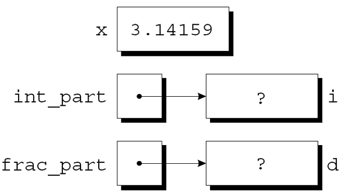
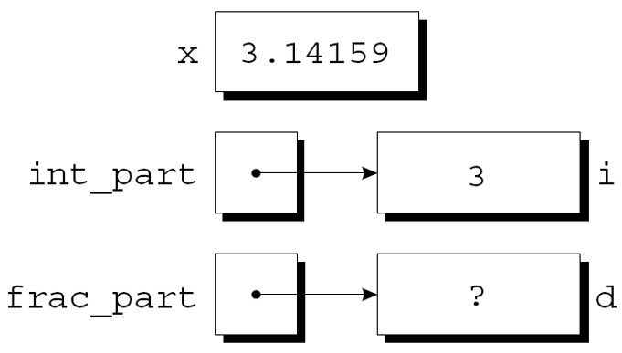
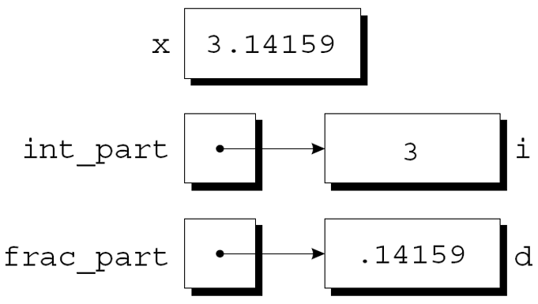

@import "../css/font-awesome-4.7.0/css/font-awesome.css"
@import "../css/theme/solarized.css"
@import "../css/logo.css"
@import "../css/font.css"
@import "../css/color.css"
@import "../css/margin.css"
@import "../css/table.css"
@import "../css/main.css"
@import "../plugin/zoom/zoom.js"
@import "../plugin/customcontrols/plugin.js"
@import "../plugin/customcontrols/style.css"
@import "../plugin/chalkboard/plugin.js"
@import "../plugin/chalkboard/style.css"
@import "../plugin/menu/menu.js"
@import "../js/anychart/anychart-core.min.js"
@import "../js/anychart/anychart-venn.min.js"
@import "../js/anychart/pastel.min.js"
@import "../js/anychart/venn-ml.js"
@import "https://cdn.bootcdn.net/ajax/libs/jquery/3.5.0/jquery.js"

<!-- slide data-notes="" -->

<div class="bottom20"></div>

# 智能程序设计（C语言）

<hr class="width50 center">

## 指针基础 (下): 传址调用

<div class="bottom8"></div>

### 计算机学院 &nbsp;&nbsp; 杨已彪

#### [yangyibiao@nju.edu.cn](mailto:yangyibiao@nju.edu.cn)


<!-- slide data-notes="" -->

##### 提纲

---

- 指针作为参数: 传址调用

- 传址调用要点与 scanf 的参数

- 案例: 查找最大最小

- const 保护参数与指针返回值

- 课堂编码与小测

---


<!-- slide data-notes="" -->


##### 指针作为参数: 传址调用

---

<div style="display:flex;align-items:flex-start;gap:24px;">

<div style="flex:1.2;font-size:0.62em;">

```C
void decompose(double x, long * int_part, double *frac_part)
{
    *int_part = (long) x;
    *frac_part = x - *int_part;
}
```

```C
void decompose(double x, long * int_part, double *frac_part);
```

```C
void decompose(double, long *, double *);
```

```C
decompose(3.14159, &i, &d);
```

</div>

<div style="flex:1;font-size:0.6em;">

<div style="display:flex;align-items:flex-start;gap:24px;">


<div style="flex:1;font-size:0.6em;">

之前的 swap 演示还记得吗: 传值改不了实参。传递==变量的地址==而不是变量的值, 函数就能改到调用者的变量——decompose 就是靠这个思路起死回生的.

decompose的新定义:

decompose的原型可以是:

也可以是:

调用decompose:

作为调用的结果, 指向i的指针存储在int_part中, 指向d的指针存储在frac_part中: 

<div class="top-2">
    
</div>

</div>

</div>

</div>

</div>

<!-- slide data-notes="" -->


##### 指针作为参数: decompose 与 scanf

---

<div style="display:flex;align-items:flex-start;gap:32px;font-size:0.68em;line-height:1.5;">

<div style="flex:1;">

<div style="font-weight:700;color:#268bd2;margin-bottom:4px;">① 第一个赋值</div>

把 x 转换为 long 类型, 存入 ==int_part 指向的对象==中:

<div class="top-2">
    
</div>

</div>

<div style="flex:1;">

<div style="font-weight:700;color:#268bd2;margin-bottom:4px;">② 第二个赋值</div>

把 `x - *int_part` 的值存储到 ==frac_part 指向的对象==中:

<div class="top-2">
    
</div>

</div>

</div>

<div style="margin-top:10px;font-size:0.72em;line-height:1.5;">

==scanf 调用中的参数是指针==——scanf 需要地址, 才能把读入的结果写回调用者的变量:

```C
int i;
…
scanf("%d", &i);
```

如果没有 `&`, 传递给 scanf 的将是 i 的==值==而不是地址——scanf 无处写回结果.

</div>

---


<!-- slide data-notes="" -->


##### 指针作为参数: 常见错误

---

<style>.err-pre pre{margin:0.3rem 0 !important;}</style>

<div style="display:flex;align-items:flex-start;gap:24px;">

<div class="err-pre" style="flex:1.2;font-size:0.62em;">

```C
int i, *p;
…
p = &i;
scanf("%d", p);
```

```C
scanf("%d", &p); /*** 错误的 ***/
```

```C
decompose(3.14159, i, d);
```

</div>

<div style="flex:1;font-size:0.6em;">

尽管scanf的参数必须是指针, 但并不总是需要`&`运算符:

使用&运算符是错误的:

传递指针失败可能导致灾难性后果; 缺少 & 的 decompose 调用:

当decompose在 `*int_part` 和 `*frac_part` 中存储值时, 它将修改未知的内存地址, 而不是修改 i 和 d . 
若为 decompose 提供了原型, 编译器会检测到错误; scanf 的参数类型不匹配在开 `-Wall` 时也会被 `-Wformat` 检查出来——但仍不能完全依赖编译器, 传参前先想清楚类型

</div>

</div>

<svg viewBox="0 0 400 180" width="660" height="297" style="display:block;flex-shrink:0;margin:0 auto;" xmlns="http://www.w3.org/2000/svg" font-family="LXGWWenKai, 'Noto Sans SC', sans-serif" font-weight="700">
<defs><marker id="arrScanB" viewBox="0 0 10 10" refX="9" refY="5" markerWidth="6" markerHeight="6" orient="auto"><path d="M0,0 L10,5 L0,10 z" fill="#268bd2"/></marker><marker id="arrScanR" viewBox="0 0 10 10" refX="9" refY="5" markerWidth="6" markerHeight="6" orient="auto"><path d="M0,0 L10,5 L0,10 z" fill="#dc322f"/></marker></defs>
<line x1="200" y1="8" x2="200" y2="172" stroke="#93a1a1" stroke-width="1" stroke-dasharray="4 4"/>
<text x="100" y="20" font-size="11.5" fill="#859900" text-anchor="middle">scanf("%d", p)</text>
<circle cx="158" cy="16" r="8" fill="#859900"/>
<path d="M154,16 l3,3 l6,-7" fill="none" stroke="#fdf6e3" stroke-width="1.8" stroke-linecap="round" stroke-linejoin="round"/>
<rect x="58" y="34" width="84" height="44" rx="7" fill="#fdf6e3" stroke="#268bd2" stroke-width="2"/>
<text x="68" y="48" font-size="10" fill="#268bd2">p</text>
<text x="100" y="64" font-size="15" fill="#268bd2" text-anchor="middle">2000</text>
<line x1="100" y1="80" x2="100" y2="100" stroke="#268bd2" stroke-width="2" marker-end="url(#arrScanB)"/>
<text x="96" y="94" font-size="8.5" fill="#268bd2" text-anchor="end">p 已保存 &amp;i</text>
<rect x="58" y="102" width="84" height="44" rx="7" fill="#fdf6e3" stroke="#b58900" stroke-width="2"/>
<text x="68" y="116" font-size="10" fill="#b58900">i</text>
<text x="100" y="134" font-size="18" fill="#073642" text-anchor="middle">42</text>
<text x="100" y="166" font-size="10" fill="#859900" text-anchor="middle">scanf 通过 p 写入 i</text>
<text x="300" y="20" font-size="11.5" fill="#dc322f" text-anchor="middle">scanf("%d", &amp;p)</text>
<circle cx="360" cy="16" r="8" fill="#dc322f"/>
<path d="M356,12 l8,8 M364,12 l-8,8" stroke="#fdf6e3" stroke-width="1.8" stroke-linecap="round"/>
<rect x="258" y="34" width="84" height="44" rx="7" fill="#fdf6e3" stroke="#dc322f" stroke-width="2"/>
<text x="268" y="48" font-size="10" fill="#dc322f">p</text>
<text x="300" y="55" font-size="9" fill="#93a1a1" text-anchor="middle">2000</text>
<line x1="284" y1="55" x2="316" y2="55" stroke="#93a1a1" stroke-width="1.2"/>
<text x="300" y="72" font-size="15" fill="#dc322f" text-anchor="middle">42</text>
<text x="398" y="48" font-size="9" fill="#dc322f" text-anchor="end">输入 42</text>
<line x1="396" y1="52" x2="344" y2="52" stroke="#dc322f" stroke-width="1.4" marker-end="url(#arrScanR)"/>
<line x1="300" y1="80" x2="300" y2="100" stroke="#dc322f" stroke-width="1.6" stroke-dasharray="4 3"/>
<path d="M295,86 l10,10 M305,86 l-10,10" stroke="#dc322f" stroke-width="2" stroke-linecap="round"/>
<rect x="258" y="102" width="84" height="44" rx="7" fill="#fdf6e3" stroke="#93a1a1" stroke-width="1.6"/>
<text x="268" y="116" font-size="10" fill="#93a1a1">i</text>
<text x="300" y="130" font-size="16" fill="#93a1a1" text-anchor="middle">?</text>
<text x="300" y="141" font-size="8.5" fill="#93a1a1" text-anchor="middle">未被写入</text>
<text x="300" y="166" font-size="10" fill="#dc322f" text-anchor="middle">&amp;p 是 p 自己的地址</text>
</svg>

<!-- slide data-notes="" -->##### 程序: 查找数组中最大和最小的元素

---

==现场演示==: 输入 10 个数, 输出其中最大和最小值——用函数完成, 且函数要==带回两个结果==

样例:

```
输入 10 个数: 3 8 1 9 2 7 4 6 5 0
最大: 9
最小: 0
```

<a href="vscode://file/Users/yangyibiao/Documents/Seafile/GitRepo/yangyibiao.github.io/cpl/slides/10-pointers/code/minmax.c" style="display:inline-block;margin-top:8px;padding:5px 14px;background:#268bd2;color:#fff;border-radius:6px;font-size:0.85em;text-decoration:none;">⚡ 在 VS Code 中打开 minmax.c</a>

<span class="blue">:fa-lightbulb-o:</span> 提示: `return` 只能带回一个值, 两个结果怎么传出来? (想想地址的作用)

---


<!-- slide data-notes="" -->

##### 程序: 查找数组中最大和最小的元素 (参考代码)

---

<div style="display:flex;align-items:flex-start;gap:24px;">

<div style="flex:1.4;font-size:0.5em;">

```C{.line-numbers}
/* Finds the largest and smallest elements in an array */
#include <stdio.h>
#define N 10
void max_min(int a[], int n, int *max, int *min);
int main(void)
{
  int b[N], big, small;
  printf("输入 %d 个数: ", N);
  for (int i = 0; i < N; i++) {
    scanf("%d", &b[i]);
  }
  max_min(b, N, &big, &small);
  printf("最大: %d\n", big);
  printf("最小: %d\n", small);
  return 0;
}
void max_min(int a[], int n, int *max, int *min)
{
  *max = *min = a[0];
  for (int i = 1; i < n; i++) {
    if (a[i] > *max) {
      *max = a[i];
    } else if (a[i] < *min) {
      *min = a[i];
    }
  }
}
```

</div>

<div style="flex:1;font-size:0.6em;">

- `max_min(b, N, &big, &small)`——把 big、small 的==地址==传给函数, 函数通过指针把结果写回去

- `*max = a[0]` 先假设, 遍历中更大/更小就更新——指针参数让函数一次"带回"两个值

- 这也是 `return` 单值限制的经典解法

</div>

</div>

---

<!-- slide data-notes="" -->


##### 使用const保护参数

---

<div style="display:flex;align-items:flex-start;gap:24px;">

<div style="flex:1.3;font-size:0.6em;">

```C
f(&x);
```

```C
void f(const int *p)
{
  *p = 0; /*** 错误 ***/
  p = &x; /*** 合法 ***/
}
```

```C
void f(int * const p)
{
  *p = 0; /*** 合法 ***/
  p = &x; /*** 错误 ***/
}
```

```C
void f(const int * const p)
{
  *p = 0; /*** 错误 ***/
  p = &x; /*** 错误 ***/
}
```

</div>

<div style="flex:1;font-size:0.6em;">

当参数是指向变量x的指针时, 我们通常假设x将被修改:

但是, 有可能 f 只需要检查 x 的值, 而不是更改它. 

使用指针的原因可能主要是因为效率: 如果变量需要大量的存储空间, 则传递变量的值会浪费时间和空间.


可以使用const来表明函数不会更改指针参数所指向的对象. 

把 const 写在类型说明符之前（const int *p）表示不能通过 p 修改 *p；const 位置不同，保护的对象不同，见下列三种写法

尝试修改`*p`, 编译器会报错.


</div>

</div>

<!-- slide data-notes="" -->


##### 指针作为返回值

---

<div style="display:flex;align-items:flex-start;gap:24px;">

<div style="flex:1.3;font-size:0.6em;">

```C{.line-numbers}
int *max(int *a, int *b)
{
  if (*a > *b)
    return a;
  else
    return b;
}
```

```C
int *f(void)
{
    int i;
    …
    return &i;
}
```

```C
int *find_middle(int a[], int n) {
    return &a[n/2];
}
```

</div>

<div style="flex:1;font-size:0.6em;">

允许函数返回指针:

调用max函数: `p = max(&i, &j);`

调用后, p 指向 i 或 j .


尽管这个例子中max返回作为参数传递给它的指针之一, 但这不是唯一的可能性. 
函数还可以返回指向全局变量（文件作用域变量）或静态局部变量的指针. 
永远不要返回指向自动局部变量的指针:

f返回后变量i将不存在.


指针可以指向数组元素. 
如果a是一个数组, 则`&a[i]`是指向a中元素i的指针. 
函数返回指向数组中某个元素的指针有时很有用. 
下面的函数假设a有n个元素, 返回一个指向数组中间元素的指针:


</div>

</div>

<!-- slide data-notes="" -->


##### 课堂编码

---

==现场演示==

1. 写 `void swap(int *a, int *b)`, 在 main 里验证真的交换了——之前传值版的悬念今天揭晓 (样例: 交换前 `x=1, y=2`, 调用后 `x=2, y=1`)

2. 在第7页参考代码基础上增加 `avg` 指针参数, 写 `void max_min(int a[], int n, int *max, int *min, double *avg)`, 一次带回最大、最小和平均值

3. 挑战: 写 `int *last_max(int *a, int n)`, 返回指向==最后一个==最大元素的指针

<span class="blue">:fa-lightbulb-o:</span> 提示: 先想清楚"函数要改谁的什么", 再决定传什么地址

<a href="vscode://file/Users/yangyibiao/Documents/Seafile/GitRepo/yangyibiao.github.io/cpl/slides/10-pointers/code/skeleton.c" style="display:inline-block;margin-top:8px;padding:5px 14px;background:#268bd2;color:#fff;border-radius:6px;font-size:0.85em;text-decoration:none;">⚡ 在 VS Code 中打开 skeleton.c</a>

---


<!-- slide data-notes="" -->

##### 课堂小测

---

1. 概念: 为什么 `void swap(int *a, int *b)` 的参数要用指针？

2. 概念: `const int *p` 与 `int * const p` 的区别是什么？

3. 代码阅读: `void f(int x, int *p) { x = 10; *p = 20; }`，执行 `int a = 1, b = 2; f(a, &b); printf("%d %d", a, b);` 输出什么？

4. 纠错: `int *f(void) { int i = 1; return &i; }` 错在哪里？应该怎么改？

---


<!-- slide data-notes="" -->

#####

---

<div class="bottom20"></div>

<hr class="width50 center">

## 未完待续

---


