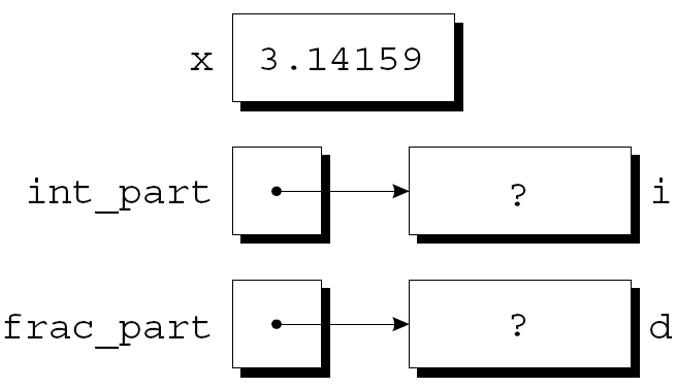
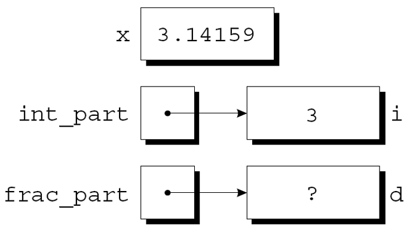
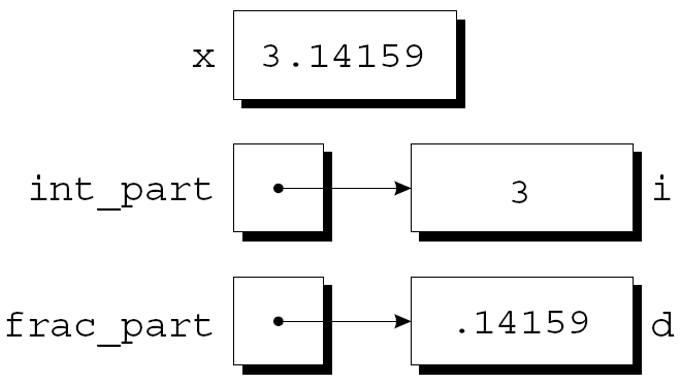

---
presentation:
  margin: 0
  center: false
  transition: "convex"
  enableSpeakerNotes: true
  slideNumber: "c/t"
  navigationMode: "linear"
---

@import "../css/font-awesome-4.7.0/css/font-awesome.css"
@import "../css/theme/solarized.css"
@import "../css/logo.css"
@import "../css/font.css"
@import "../css/color.css"
@import "../css/margin.css"
@import "../css/table.css"
@import "../css/main.css"
@import "../plugin/zoom/zoom.js"
@import "../plugin/customcontrols/plugin.js"
@import "../plugin/customcontrols/style.css"
@import "../plugin/chalkboard/plugin.js"
@import "../plugin/chalkboard/style.css"
@import "../plugin/menu/menu.js"
@import "../js/anychart/anychart-core.min.js"
@import "../js/anychart/anychart-venn.min.js"
@import "../js/anychart/pastel.min.js"
@import "../js/anychart/venn-ml.js"
@import "https://cdn.bootcdn.net/ajax/libs/jquery/3.5.0/jquery.js"

<!-- slide data-notes="" -->

<div class="bottom20"></div>

# 智能程序设计（C语言）

<hr class="width50 center">

## 指针基础 (下): 传址调用

<div class="bottom8"></div>

### 计算机学院 &nbsp;&nbsp; 杨已彪

#### [yangyibiao@nju.edu.cn](mailto:yangyibiao@nju.edu.cn)


<!-- slide data-notes="" -->

##### 提纲

---

- 指针作为参数: 传址调用

- swap 与 scanf 的秘密

- 案例: 查找最大最小

- const 保护参数与指针返回值

- 课堂编码与小测

---


<!-- slide data-notes="" -->


##### 指针作为参数: 传址调用

---

<div style="display:flex;align-items:flex-start;gap:24px;">

<div style="flex:1.2;font-size:0.62em;">

```C
void decompose(double x, long * int_part, double *frac_part)
{
    *int_part = (long) x;
    *frac_part = x - *int_part;
}
```

```C
void decompose(double x, long * int_part, double *frac_part);
```

```C
void decompose(double, long *, double *);
```

```C
decompose(3.14159, &i, &d);
```

</div>

<div style="flex:1;font-size:0.6em;">

<div style="display:flex;align-items:flex-start;gap:24px;">


<div style="flex:1;font-size:0.6em;">

第 8 周的 swap 演示还记得吗: 传值改不了实参。传递==变量的地址==而不是变量的值, 函数就能改到调用者的变量——decompose 就是靠这个思路起死回生的.

decompose的新定义:

decompose的原型可以是:

也可以是:

调用decompose:

作为调用的结果, 指向i的指针存储在int_part中, 指向d的指针存储在frac_part中: 

<div class="top-2">
    
</div>

</div>

</div>

</div>

</div>

<!-- slide data-notes="" -->


##### 指针作为参数: decompose 与 scanf

---

decompose函数体中的第一个赋值将x的值转换为long类型, 并将其存储在int_part指向的对象中: 
<div class="top-2">
    
</div>


第二个赋值把`x - *int_part`的值存储到frac_part指向的对象中: 
<div class="top-2">
    
</div>


scanf调用中的参数是指针: 
```C
int i;
…
scanf("%d", &i);
```
如果没有&, 传递给scanf函数的将是i的值.

---


<!-- slide data-notes="" -->


##### 指针作为参数

---

<div style="display:flex;align-items:flex-start;gap:24px;">

<div style="flex:1.2;font-size:0.62em;">

```C
int i, *p;
…
p = &i;
scanf("%d", p);
```

```C
scanf("%d", &p); /*** 错误的 ***/
```

```C
decompose(3.14159, i, d);
```

</div>

<div style="flex:1;font-size:0.6em;">

尽管scanf的参数必须是指针, 但并不总是需要`&`运算符:

使用&运算符是错误的:

传递指针失败可能导致灾难性后果; 缺少 & 的 decompose 调用:

当decompose在 `*int_part` 和 `*frac_part` 中存储值时, 它将修改未知的内存地址, 而不是修改 i 和 d . 
若为 decompose 提供了原型, 编译器会检测到错误; scanf 的参数类型不匹配在开 `-Wall` 时也会被 `-Wformat` 检查出来——但仍不能完全依赖编译器, 传参前先想清楚类型

</div>

</div>

<!-- slide data-notes="" -->##### 程序: 查找数组中最大和最小的元素

---

==现场演示==: 输入 10 个数, 输出其中最大和最小值——用函数完成, 且函数要==带回两个结果==

样例:

```
输入 10 个数: 3 8 1 9 2 7 4 6 5 0
最大: 9
最小: 0
```

<span class="blue">:fa-lightbulb-o:</span> 提示: `return` 只能带回一个值, 两个结果怎么传出来? (想想地址的作用)

---


<!-- slide data-notes="" -->


##### 程序: 查找数组中最大和最小的元素 (参考代码)

---

<div style="display:flex;align-items:flex-start;gap:24px;">

<div style="flex:1.4;font-size:0.5em;">

```C{.line-numbers}
/* Finds the largest and smallest elements in an array */
#include <stdio.h>
#define N 10
void max_min(int a[], int n, int *max, int *min);
int main(void)
{
  int b[N], i, big, small;
  printf("输入 %d 个数: ", N);
  for (i = 0; i < N; i++) {
    scanf("%d", &b[i]);
  }
  max_min(b, N, &big, &small);
  printf("最大: %d\n", big);
  printf("最小: %d\n", small);
  return 0;
}
void max_min(int a[], int n, int *max, int *min)
{
  int i;
  *max = *min = a[0];
  for (i = 1; i < n; i++) {
    if (a[i] > *max) {
      *max = a[i];
    } else if (a[i] < *min) {
      *min = a[i];
    }
  }
}
```

</div>

<div style="flex:1;font-size:0.6em;">

- `max_min(b, N, &big, &small)`——把 big、small 的==地址==传给函数, 函数通过指针把结果写回去

- `*max = a[0]` 先假设, 遍历中更大/更小就更新——指针参数让函数一次"带回"两个值

- 这也是 `return` 单值限制的经典解法

</div>

</div>

---

<!-- slide data-notes="" -->


##### 使用const保护参数

---

<div style="display:flex;align-items:flex-start;gap:24px;">

<div style="flex:1.3;font-size:0.6em;">

```C
f(&x);
```

```C
void f(const int *p)
{
  int j;
  *p = 0; /*** 错误 ***/
  p = &j; /*** 合法 ***/
}
```

```C
void f(int * const p)
{
  int j;
  *p = 0; /*** 合法 ***/
  p = &j; /*** 错误 ***/
}
```

```C
void f(const int * const p)
{
  int j;
  *p = 0; /*** 错误 ***/
  p = &j; /*** 错误 ***/
}
```

</div>

<div style="flex:1;font-size:0.6em;">

当参数是指向变量x的指针时, 我们通常假设x将被修改:

但是, 有可能 f 只需要检查 x 的值, 而不是更改它. 

使用指针的原因可能主要是因为效率: 如果变量需要大量的存储空间, 则传递变量的值会浪费时间和空间.


可以使用const来表明函数不会更改指针参数所指向的对象. 

const放置在形式参数的声明中, 后面紧跟着其类型说明:

尝试修改\*p, 编译器会报错.


</div>

</div>

<!-- slide data-notes="" -->


##### 指针作为返回值

---

<div style="display:flex;align-items:flex-start;gap:24px;">

<div style="flex:1.3;font-size:0.6em;">

```C{.line-numbers}
int *max(int *a, int *b)
{
  if (*a > *b)
    return a;
  else
    return b;
}
```

```C
int *p, i, j;
…
p = max(&i, &j);
```

```C
int *f(void)
{
    int i;
    …
    return &i;
}
```

```C
int *find_middle(int a[], int n) {
    return &a[n/2];
}
```

</div>

<div style="flex:1;font-size:0.6em;">

允许函数返回指针:

调用max函数:

调用后,  p指向i或j .


尽管这个例子中max返回作为参数传递给它的指针之一, 但这不是唯一的可能性. 
函数还可以返回指向外部变量或静态局部变量的指针. 
永远不要返回指向自动局部变量的指针:

f返回后变量i将不存在.


指针可以指向数组元素. 
如果a是一个数组, 则`&a[i]`是指向a中元素i的指针. 
函数返回指向数组中某个元素的指针有时很有用. 
下面的函数假设a有n个元素, 返回一个指向数组中间元素的指针:


</div>

</div>

<!-- slide data-notes="" -->


##### 课堂编码

---

==现场演示==

1. 写 `void swap(int *a, int *b)`, 在 main 里验证真的交换了——第 8 周传值版的悬念今天揭晓 (样例: 交换前 `x=1, y=2`, 调用后 `x=2, y=1`)

2. 写 `void max_min(int a[], int n, int *max, int *min, double *avg)`, 一次带回最大、最小和平均值

3. 挑战: 写 `int *last_max(int *a, int n)`, 返回指向==最后一个==最大元素的指针

<span class="blue">:fa-lightbulb-o:</span> 提示: 先想清楚"函数要改谁的什么", 再决定传什么地址

---


<!-- slide data-notes="" -->

##### 课堂小测

---

1. 为什么 `void swap(int *a, int *b)` 的参数要用指针？

2. `decompose(3.14159, i, d)` 少写了 & 会发生什么？编译器能发现吗？

3. 函数能不能返回指向自己局部变量的指针？为什么？

4. `const int *p` 与 `int * const p` 的区别是什么？

---


<!-- slide data-notes="" -->

#####

---

<div class="bottom20"></div>

<hr class="width50 center">

## 未完待续

---


