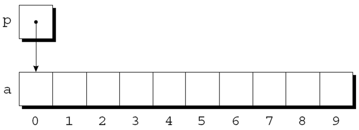
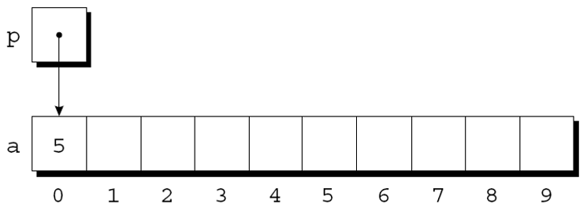
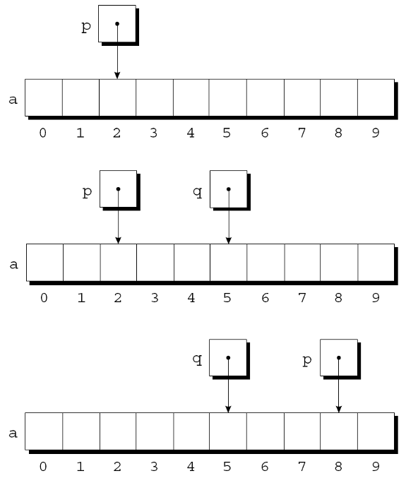
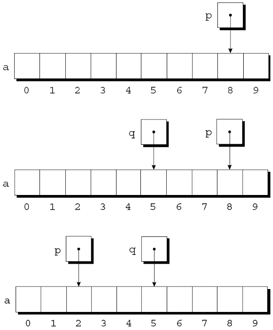
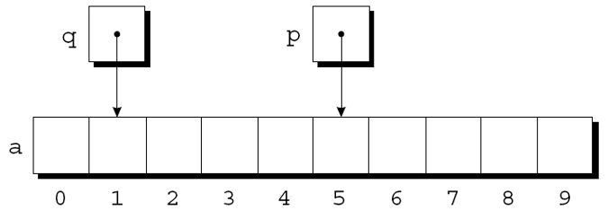
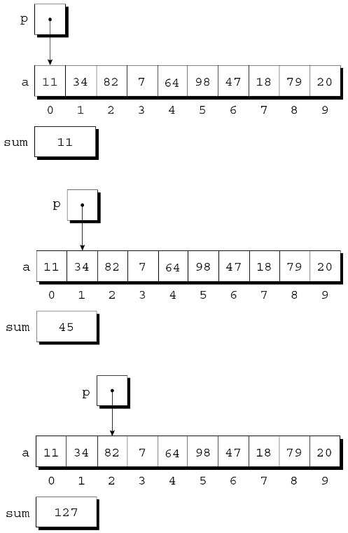

---
presentation:
  margin: 0
  center: false
  transition: "convex"
  enableSpeakerNotes: true
  slideNumber: "c/t"
  navigationMode: "linear"
---

@import "../css/font-awesome-4.7.0/css/font-awesome.css"
@import "../css/theme/solarized.css"
@import "../css/logo.css"
@import "../css/font.css"
@import "../css/color.css"
@import "../css/margin.css"
@import "../css/table.css"
@import "../css/main.css"
@import "../plugin/zoom/zoom.js"
@import "../plugin/customcontrols/plugin.js"
@import "../plugin/customcontrols/style.css"
@import "../plugin/chalkboard/plugin.js"
@import "../plugin/chalkboard/style.css"
@import "../plugin/menu/menu.js"
@import "../js/anychart/anychart-core.min.js"
@import "../js/anychart/anychart-venn.min.js"
@import "../js/anychart/pastel.min.js"
@import "../js/anychart/venn-ml.js"
@import "https://cdn.bootcdn.net/ajax/libs/jquery/3.5.0/jquery.js"

<!-- slide data-notes="" -->

<div class="bottom20"></div>

# 智能程序设计（C语言）

<hr class="width50 center">

## 指针与数组 (上)

<div class="bottom8"></div>

### 计算机学院 &nbsp;&nbsp; 杨已彪

#### [yangyibiao@nju.edu.cn](mailto:yangyibiao@nju.edu.cn)


<!-- slide data-notes="" -->

##### 提纲

---

- 指针的算术运算

- 比较指针

- 用指针处理数组

- 结合 * 和 ++ 运算符

- 课堂小测

---


<!-- slide data-notes="" -->


##### 指针的算术运算

---

<div style="display:flex;align-items:flex-start;gap:24px;">

<div style="flex:1.2;font-size:0.62em;">

```C
int a[10], *p;
p = &a[0];
```

</div>

<div style="flex:1;font-size:0.6em;">

指针可以指向==数组元素==:

图示: 

<div class="top-2">
    
</div>


通过 p 可以访问 a[0]——比如把 5 存进 a[0]: 

`*p = 5;`

如下图: 

<div class="top-2">
    
</div>


p 指向数组 a 的某个元素时, 对 p 做==指针算术==(也叫地址运算)就能访问其他元素

C支持三种(且只有三种)==指针运算==形式:

- 指针加上整数

- 指针减去整数

- 两个指针相减

</div>

</div>

<!-- slide data-notes="" -->


##### 指针加减整数

---

<div style="display:flex;align-items:flex-start;gap:24px;">

<div style="flex:1.2;font-size:0.62em;">

```C
int a[10], *p, *q, i;
```

```C
p = &a[2];
q = p + 3;
p += 6;
```

```C
p = &a[8]; 
q = p - 3;
p -= 6;
```

</div>

<div style="flex:1;font-size:0.6em;">

将整数j添加到指针p会产生一个指向第j个元素的指针, 该元素位于p指向的元素之后. 

准确地说: p 指向 a[i], 则 p + j 指向 a[i+j]。

假设声明如下:

指针加法示例:

<div class="top-2"></div>


p 指向 a[i], 则 p - j 指向 a[i-j]。指针减法示例:

<div class="top-2">
    
</div>

</div>

</div>

<!-- slide data-notes="" -->


##### 两个指针相减

---

当一个指针从另一个指针中减去时, 结果是==指针之间的距离==(数组元素的个数). 

p 指向 a[i]、q 指向 a[j], 则 $p - q = i - j$。示例: 

```C
p = &a[5];
q = &a[1];
```

<div class="top-2">
    
</div>

```C
i = p - q; /* i is  4 */
i = q - p; /* i is -4 */
```


<span class="blue">:fa-lightbulb-o:</span> 对不指向数组元素的指针执行算术运算导致未定义的行为

<span class="blue">:fa-lightbulb-o:</span> 只有两个指针指向同一个数组时, 把它们相减才有意义

---


<!-- slide data-notes="" -->


##### 比较指针

---

关系运算符(<, <=, >, >=)和判等运算符(==, !=)进行指针比较. 

使用关系运算符仅对指向同一数组元素的指针有意义. 比较的结果取决于数组中两个元素的相对位置. 

```C
p = &a[5];
q = &a[1];
p <= q; // expression value: 0
p >= q; // expression value: 1
```

完成后: 
- p<=q的值为0
- p>=q的值为1.

---


<!-- slide data-notes="" -->


##### 使用指针进行数组处理

---

- 在第一次迭代结束时: 
- 在第二次迭代结束时: 
- 在第三次迭代结束时: 

<div class="top-2">
    
</div>


`for`语句中的条件`p < &a[N]`值得特别提及. 
将地址运算符应用于`a[N]`是合法的, 即使此元素不存在.

---


<!-- slide data-notes="" -->


##### 结合 * 和 ++ 运算符

---

<div style="display:flex;align-items:flex-start;gap:24px;">

<div style="flex:1.2;font-size:0.6em;">

```C
for (p = &a[0]; p < &a[N]; p++)
    sum += *p;
```

```C
p = &a[0];
while (p < &a[N])
    sum += *p++;
```

</div>

<div style="flex:1;font-size:0.6em;">

C程序员经常结合使用`*`(间接寻址)和`++`运算符. 

修改数组元素后前进到下一个元素的语句:
`a[i++] = j;`

对应的指针版本: 
`*p++ = j;`

因为后缀++的优先级高于*, 编译器将其视为
`*(p++) = j;`


`*`和`++`的可能组合: 

<div class="fullborder">

| 表达  | 意义 |
| :--: | :--: |  
| `*p++或*(p++)` | 表达式的值是`*p`在递增之前, 之后自增p |
| `(*p)++`      | 表达式的值为`*p`在递增之前, 稍后增加`*p` |
| `*++p或*(++p)` | 先递增`p`, 表达式的值为`*p` |
| `++*p或++(*p)` | 先递增`*p`, 表达式的值为`*p` |

</div>

- *(p++) 指针自增(指向下一个对象)
- (*p)++ 指向的对象自增(p本身不变)


\*和++最常见的组合是`*p++`, 在循环中很常用. 

对数组a的元素求和时, 可以把

改写成


</div>

</div>

<!-- slide data-notes="" -->


##### 结合 * 和 ++ 运算符 (续)

---

<div style="display:flex;align-items:flex-start;gap:24px;">

<div style="flex:1.2;font-size:0.6em;">

```C
int *top_ptr = &contents[0]; 
```

```C {.line-numbers}
void push(int i)
{
    if (is_full())
        stack_overflow();
    else
        *top_ptr++ = i;
}

int pop(void)
{
    if (is_empty())
        stack_underflow();
    else
        return *--top_ptr;
}
```

</div>

<div style="flex:1;font-size:0.6em;">

\*和`--`运算符的组合方式与\*和`++`相同. 

看一个 `*` 和 `--` 组合的例子——用数组模拟一个==栈== (后进先出):

用整型变量 top 记录 contents 数组的==栈顶==位置:

现在把 top 换成初始指向 contents[0] 的指针变量:

新的push和pop函数:

指针的算术运算是数组和指针相互关联的一种方法. 

此外, 数组的名称可以用作指向数组中第一个元素的指针. 

这种关系简化了指针的算术运算, 并使数组和指针更加通用.

</div>

</div>

<!-- slide data-notes="" -->


##### 课堂小测

---

1. `int a[5]; int *p = a;` 中 `p + 1` 表示什么？`p + 1` 的地址比 p 大多少字节？

2. `p2 - p1` 得到的是地址差还是元素个数差？

3. `*p++` 等价于什么？先取 p 指向的值，还是先移动 p？

4. 纠错: `int a[10], *p; for (p = a; p <= a + 10; p++) ...` 有什么问题？

---


<!-- slide data-notes="" -->

#####

---

<div class="bottom20"></div>

# 周三见!

<hr class="width50 center">

## 未完待续

---


