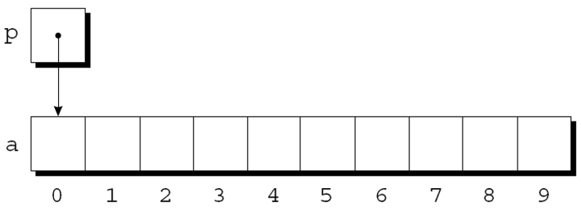
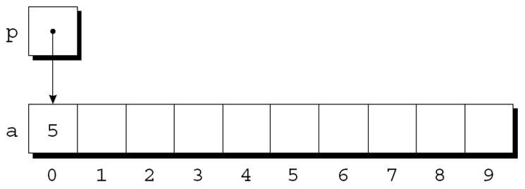
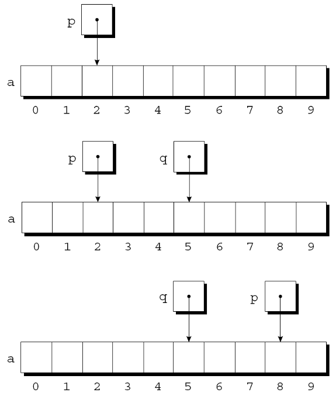
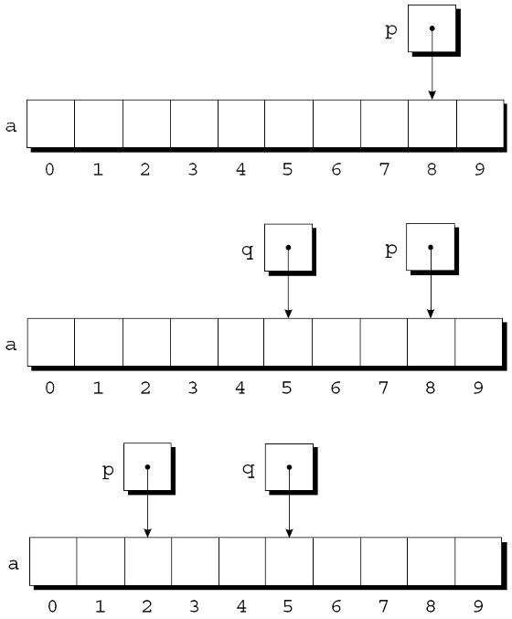
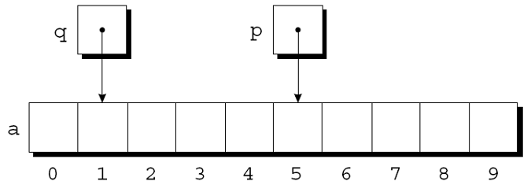
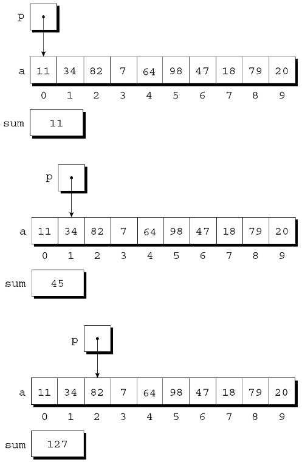

---
presentation:
  margin: 0
  center: false
  transition: "convex"
  enableSpeakerNotes: true
  slideNumber: "c/t"
  navigationMode: "linear"
---

@import "../css/font-awesome-4.7.0/css/font-awesome.css"
@import "../css/theme/solarized.css"
@import "../css/logo.css"
@import "../css/font.css"
@import "../css/color.css"
@import "../css/margin.css"
@import "../css/table.css"
@import "../css/main.css"
@import "../plugin/zoom/zoom.js"
@import "../plugin/customcontrols/plugin.js"
@import "../plugin/customcontrols/style.css"
@import "../plugin/chalkboard/plugin.js"
@import "../plugin/chalkboard/style.css"
@import "../plugin/menu/menu.js"
@import "../js/anychart/anychart-core.min.js"
@import "../js/anychart/anychart-venn.min.js"
@import "../js/anychart/pastel.min.js"
@import "../js/anychart/venn-ml.js"
@import "https://cdn.bootcdn.net/ajax/libs/jquery/3.5.0/jquery.js"

<!-- slide data-notes="" -->

<div class="bottom20"></div>

# 智能程序设计（C语言）

<hr class="width50 center">

## 指针与数组 (上)

<div class="bottom8"></div>

### 计算机学院 &nbsp;&nbsp; 杨已彪

#### [yangyibiao@nju.edu.cn](mailto:yangyibiao@nju.edu.cn)


<!-- slide data-notes="" -->

##### 提纲

---

- 指针的算术运算
  - 指针 + 整数
  - 指针 - 整数
  - 两个指针相减

- 比较指针

- 使用指针进行数组处理

- 课堂编码: 指针遍历数组

- 结合 * 和 ++ 运算符

- 课堂编码: 补全栈的 push/pop

- 课堂小测

---


<!-- slide data-notes="" -->##### 指针算术: 三种运算

---

<div style="display:flex;align-items:flex-start;gap:24px;">

<div style="flex:1.05;font-size:0.7em;line-height:1.55;text-align:left;">

指针指向数组元素后, 可以做==指针算术==:

```C
int a[10], *p;
p = &a[0];   /* p 指向 a[0] */
*p = 5;      /* a[0] = 5 */
```

C 的指针算术只有三种形式:

- 指针 + 整数: `p + j`
- 指针 - 整数: `p - j`
- 两个指针相减: `p - q`

`p + q`、`p * 2` 等写法==不合法==. 比较指针（`<`、`==` 等）不属于算术运算, 后面单独讲.

</div>

<div style="flex:0.95;font-size:0.68em;line-height:1.5;">

<div class="top-2" style="text-align:center;"><br><span style="font-size:0.9em;color:#586e75;">p = &amp;a[0]</span></div>
<div class="top-2" style="text-align:center;"><br><span style="font-size:0.9em;color:#586e75;">*p = 5</span></div>

</div>

</div>

---
<!-- slide data-notes="" -->##### 指针 + 整数

---

<div style="display:flex;align-items:flex-start;gap:24px;">

<div style="flex:1;font-size:0.62em;">

```C
int a[10], *p, *q;
p = &a[2];
q = p + 3;   /* q 指向 a[5] */
p += 6;      /* p 指向 a[8] */
```

<div style="margin-top:18px;font-size:1.15em;line-height:1.6;">
观察:
<div>· q 指向哪个元素?</div>
<div>· p += 6 后, p 指向哪个元素?</div>
<div>· p、q 中保存的地址值怎么变? 下一页说明.</div>
</div>

<div style="margin-top:14px;">
<a href="vscode://file/Users/yangyibiao/Documents/Seafile/GitRepo/yangyibiao.github.io/cpl/slides/11-pointers/code/pointer-plus.c" style="display:inline-block;padding:5px 14px;background:#268bd2;color:#fff;border-radius:6px;font-size:1.0em;text-decoration:none;">⚡ 在 VS Code 中打开 pointer-plus.c (现场演示)</a>
</div>

</div>

<div style="flex:1;text-align:center;">
<div class="top-2"></div>
</div>

</div>

---
<!-- slide data-notes="" -->##### 指针 - 整数

---

<div style="display:flex;align-items:flex-start;gap:24px;">

<div style="flex:1;font-size:0.62em;">

```C
int a[10], *p, *q;
p = &a[8];
q = p - 3;   /* q 指向 a[5] */
p -= 6;      /* p 指向 a[2] */
```

<div style="margin-top:18px;font-size:1.15em;line-height:1.6;">
观察:
<div>· q 指向哪个元素?</div>
<div>· p -= 6 后, p 指向哪个元素?</div>
<div>· 地址值的变化和加法一样, 按 sizeof(*p) 缩放; 下一页统一说明.</div>
</div>

<div style="margin-top:14px;">
<a href="vscode://file/Users/yangyibiao/Documents/Seafile/GitRepo/yangyibiao.github.io/cpl/slides/11-pointers/code/pointer-minus.c" style="display:inline-block;padding:5px 14px;background:#268bd2;color:#fff;border-radius:6px;font-size:1.0em;text-decoration:none;">⚡ 在 VS Code 中打开 pointer-minus.c (现场演示)</a>
</div>

</div>

<div style="flex:1;text-align:center;">
<div class="top-2"></div>
</div>

</div>

---
<!-- slide data-notes="" -->##### 指针算术: 地址值怎么变

---

<div style="display:flex;align-items:flex-start;gap:24px;">

<div style="flex:1;font-size:0.7em;line-height:1.55;text-align:left;">

==公式==:

<div><code>(p + j)</code> 的值 = <code>p</code> 的值 + <code>j × sizeof(*p)</code></div>
<div style="margin-top:6px;"><code>(p - j)</code> 的值 = <code>p</code> 的值 − <code>j × sizeof(*p)</code></div>

<div style="margin-top:10px;padding:6px 10px;background:#fdf6e3;border-left:4px solid #268bd2;border-radius:4px;">
依据: C 的指针算术以所指对象为单位, 编译器按 <code>sizeof(*p)</code> 缩放.<br>
不同指针类型的 <code>sizeof(*p)</code> 不同: <code>char *</code> 为 1、<code>int *</code> 为 4、<code>double *</code> 为 8 (常见平台), 所以 <code>p + 1</code> 分别增加 1/4/8 字节.
</div>

<div style="margin-top:8px;padding:6px 10px;background:#f2f4f0;border-left:4px solid #93a1a1;border-radius:4px;">
注意: <code>p</code> 的值是 p 中保存的地址, 不是指针变量 p 自身的地址 <code>&amp;p</code>.
</div>

<div style="margin-top:8px;padding:6px 10px;background:#fff4f2;border-left:4px solid #dc322f;border-radius:4px;">
结果必须仍指向同一数组(或最后一个元素之后); 移出数组范围是未定义行为.
</div>

</div>

<div style="flex:1;font-size:0.7em;line-height:1.5;text-align:left;">

<div class="col-label">+ 整数（假设 <code>int *p</code>）</div>

<table style="width:100%;font-size:0.92em;border-collapse:collapse;">
<tr style="color:#586e75;">
<th style="text-align:left;padding:2px 4px;border-bottom:1px solid #d6d6c8;">表达式</th>
<th style="text-align:left;padding:2px 4px;border-bottom:1px solid #d6d6c8;">值（地址）</th>
<th style="text-align:left;padding:2px 4px;border-bottom:1px solid #d6d6c8;">指向</th>
</tr>
<tr><td style="padding:2px 4px;"><code>p</code></td><td style="padding:2px 4px;">0x1008</td><td style="padding:2px 4px;"><code>a[2]</code></td></tr>
<tr><td style="padding:2px 4px;"><code>p + 3</code></td><td style="padding:2px 4px;">0x1014</td><td style="padding:2px 4px;"><code>a[5]</code></td></tr>
</table>

<div class="col-label" style="margin-top:12px;">− 整数（假设 <code>int *p</code>）</div>

<table style="width:100%;font-size:0.92em;border-collapse:collapse;">
<tr style="color:#586e75;">
<th style="text-align:left;padding:2px 4px;border-bottom:1px solid #d6d6c8;">表达式</th>
<th style="text-align:left;padding:2px 4px;border-bottom:1px solid #d6d6c8;">值（地址）</th>
<th style="text-align:left;padding:2px 4px;border-bottom:1px solid #d6d6c8;">指向</th>
</tr>
<tr><td style="padding:2px 4px;"><code>p</code></td><td style="padding:2px 4px;">0x1020</td><td style="padding:2px 4px;"><code>a[8]</code></td></tr>
<tr><td style="padding:2px 4px;"><code>p - 3</code></td><td style="padding:2px 4px;">0x1014</td><td style="padding:2px 4px;"><code>a[5]</code></td></tr>
</table>

<div style="margin-top:12px;padding:6px 10px;background:#f2f4f0;border-left:4px solid #93a1a1;border-radius:4px;">
两个指针相减是同一原理的逆运算: <code>(p - q)</code> 的值 = (p 的值 − q 的值) / <code>sizeof(*p)</code>, 结果是元素个数——下一页.
</div>

</div>

</div>

---
<!-- slide data-notes="" -->##### 两个指针相减

---

<div style="display:flex;align-items:flex-start;gap:24px;font-size:0.68em;line-height:1.45;text-align:left;">

<div style="flex:1.05;">

当一个指针从另一个指针中减去时, 结果是==指针之间的距离==(数组元素的个数).

p 指向 a[i]、q 指向 a[j], 则 $p - q = i - j$. 示例:

```C
p = &a[5];
q = &a[1];
```

<div style="margin-top:8px;padding:6px 10px;background:#fdf6e3;border-left:4px solid #268bd2;border-radius:4px;font-size:0.93em;">
<b>依据:</b> 指针相减和指针加减整数是同一个原理: 地址值之差要除以 <code>sizeof(*p)</code>, 得到元素个数.<br>
<code>(p - q)</code> 的值 = (p 的值 − q 的值) / <code>sizeof(*p)</code>.<br>
例如 <code>int *</code>: p 的值 0x1020、q 的值 0x1010, 则 <code>(0x1020 - 0x1010) / 4 = 4</code> 个元素.
</div>

<div style="margin-top:8px;padding:6px 10px;background:#f2f4f0;border-left:4px solid #93a1a1;border-radius:4px;font-size:0.93em;">
- 只有两个指针指向同一个数组时, 相减才有意义
- 对不指向数组元素的指针做算术运算会导致未定义行为
</div>

</div>

<div style="flex:0.95;text-align:center;">

<div class="top-2"></div>

```C
i = p - q; /* i is  4 */
i = q - p; /* i is -4 */
```

</div>

</div>

---
<!-- slide data-notes="" -->


##### 比较指针

---

关系运算符(<, <=, >, >=)和判等运算符(==, !=)进行指针比较. 

使用关系运算符仅对指向同一数组元素的指针有意义. 比较的结果取决于数组中两个元素的相对位置. 

<div style="display:flex;align-items:flex-start;gap:24px;">

<div style="flex:0.9;">

```C
p = &a[5];
q = &a[1];
p <= q; // expression value: 0
p >= q; // expression value: 1
```

</div>

<div style="flex:1.1;">

<svg viewBox="0 0 400 170" width="620" height="264" xmlns="http://www.w3.org/2000/svg" font-family="LXGWWenKai, 'Noto Sans SC', sans-serif" font-weight="700">
<defs><marker id="arrCmpB" viewBox="0 0 10 10" refX="9" refY="5" markerWidth="6" markerHeight="6" orient="auto"><path d="M0,0 L10,5 L0,10 z" fill="#268bd2"/></marker><marker id="arrCmpG" viewBox="0 0 10 10" refX="9" refY="5" markerWidth="6" markerHeight="6" orient="auto"><path d="M0,0 L10,5 L0,10 z" fill="#859900"/></marker></defs>
<text x="22" y="72" font-size="13" fill="#93a1a1">a</text>
<rect x="35" y="52" width="40" height="36" fill="#eee8d5" stroke="#93a1a1" stroke-width="1.2"/>
<rect x="75" y="52" width="40" height="36" fill="#859900" fill-opacity="0.17" stroke="#859900" stroke-width="2"/>
<rect x="115" y="52" width="40" height="36" fill="#eee8d5" stroke="#93a1a1" stroke-width="1.2"/>
<rect x="155" y="52" width="40" height="36" fill="#eee8d5" stroke="#93a1a1" stroke-width="1.2"/>
<rect x="195" y="52" width="40" height="36" fill="#eee8d5" stroke="#93a1a1" stroke-width="1.2"/>
<rect x="235" y="52" width="40" height="36" fill="#268bd2" fill-opacity="0.17" stroke="#268bd2" stroke-width="2"/>
<rect x="275" y="52" width="40" height="36" fill="#eee8d5" stroke="#93a1a1" stroke-width="1.2"/>
<rect x="315" y="52" width="40" height="36" fill="#eee8d5" stroke="#93a1a1" stroke-width="1.2"/>
<text x="55" y="104" font-size="9" fill="#93a1a1" text-anchor="middle">0</text>
<text x="95" y="104" font-size="9" fill="#93a1a1" text-anchor="middle">1</text>
<text x="135" y="104" font-size="9" fill="#93a1a1" text-anchor="middle">2</text>
<text x="175" y="104" font-size="9" fill="#93a1a1" text-anchor="middle">3</text>
<text x="215" y="104" font-size="9" fill="#93a1a1" text-anchor="middle">4</text>
<text x="255" y="104" font-size="9" fill="#93a1a1" text-anchor="middle">5</text>
<text x="295" y="104" font-size="9" fill="#93a1a1" text-anchor="middle">6</text>
<text x="335" y="104" font-size="9" fill="#93a1a1" text-anchor="middle">7</text>
<rect x="75" y="12" width="40" height="24" rx="5" fill="#fdf6e3" stroke="#859900" stroke-width="1.8"/>
<text x="95" y="29" font-size="13" fill="#859900" text-anchor="middle">q</text>
<line x1="95" y1="36" x2="95" y2="50" stroke="#859900" stroke-width="1.6" marker-end="url(#arrCmpG)"/>
<rect x="235" y="12" width="40" height="24" rx="5" fill="#fdf6e3" stroke="#268bd2" stroke-width="1.8"/>
<text x="255" y="29" font-size="13" fill="#268bd2" text-anchor="middle">p</text>
<line x1="255" y1="36" x2="255" y2="50" stroke="#268bd2" stroke-width="1.6" marker-end="url(#arrCmpB)"/>
<text x="105" y="130" font-size="11.5" fill="#dc322f" text-anchor="middle">p &lt;= q → 0（假）</text>
<text x="295" y="130" font-size="11.5" fill="#859900" text-anchor="middle">p &gt;= q → 1（真）</text>
<text x="200" y="154" font-size="10" fill="#586e75" text-anchor="middle">同一数组中，地址越大元素越靠后</text>
</svg>

</div>

</div>

---


<!-- slide data-notes="" -->


##### 使用指针进行数组处理

---

<div style="display:flex;align-items:flex-start;gap:24px;font-size:0.6em;">

<div style="flex:1.35;">

```C
#define N 10
int a[N] = {11, 34, 82, 7, 64, 98, 47, 18, 79, 20};
int sum = 0, *p;
…
for (p = &a[0]; p < &a[N]; p++)
    sum += *p;
```

- 在第一次迭代结束时：`p` 指向 `a[1]`，`sum` 为 11（已加上 `a[0]`）

- 在第二次迭代结束时：`p` 指向 `a[2]`，`sum` 为 45（又加上 `a[1]`）

- 在第三次迭代结束时：`p` 指向 `a[3]`，`sum` 为 127（又加上 `a[2]`）

`for` 语句中的条件 `p < &a[N]` 值得特别提及。将地址运算符应用于 `a[N]` 是合法的，即使此元素不存在。

</div>

<div style="flex:0.65;">

<div class="top-2">
    
</div>

</div>

</div>

---


<!-- slide data-notes="" -->


##### 课堂编码: 指针遍历数组

---

<div style="display:flex;align-items:flex-start;gap:24px;">

<div style="flex:1.15;font-size:0.75em;">

==任务==：用指针遍历数组，实现两个函数。

- `int find_sum(int *a, int n)`：返回数组所有元素之和。

- `int find_max(int *a, int n)`：返回数组元素的最大值。

要求：只用指针 `*p` 访问元素，不使用下标 `a[i]`；循环变量在 `for` 中自声明。

样例输入：`34 82 49 102 7 94 23 11 50 31`

样例输出：`sum = 483`、`max = 102`

<div class="task-criteria" style="margin:8px 0 0;padding:6px 10px;background:#f2f4f0;border-left:4px solid #93a1a1;border-radius:4px;">
<b>完成标准:</b>
<div>· 只用 `*p` 遍历, 不使用下标 `a[i]`</div>
<div>· 输出 `sum = 483`、`max = 102`</div>
<div>· 循环变量在 `for` 中自声明</div>
</div>

</div>

<div style="flex:1;font-size:0.75em;">

<span class="blue">:fa-lightbulb-o:</span> 提示：求和让 `p` 从 `a` 走到 `a + n`，每次把 `*p` 累加；求最大值先把 `max` 初始化为 `*a`，再从 `a + 1` 开始逐个比较。

==先想参数==：函数需要数组首元素地址 `a` 和元素个数 `n`——指针本身不知道数组有多长。

<a href="vscode://file/Users/yangyibiao/Documents/Seafile/GitRepo/yangyibiao.github.io/cpl/slides/11-pointers/code/skeleton.c" style="display:inline-block;margin-top:8px;padding:5px 14px;background:#268bd2;color:#fff;border-radius:6px;font-size:0.85em;text-decoration:none;">⚡ 在 VS Code 中打开 skeleton.c (框架已备好)</a>

</div>

</div>

---

<!-- slide data-notes="" -->##### 课堂编码参考: 指针遍历数组

---

<div style="display:flex;align-items:flex-start;gap:24px;">

<div class="findsummax-code" style="flex:1.1;font-size:0.58em;">

<style>.findsummax-code pre code{max-height:none!important;font-size:13.5px;line-height:1.08;}</style>

<div class="col-label">参考实现 · find-sum-max.c</div>

```C{.line-numbers}
#include <stdio.h>

#define N 10

int find_sum(int *a, int n)
{
    int sum = 0;
    for (int *p = a; p < a + n; p++)
        sum += *p;
    return sum;
}

int find_max(int *a, int n)
{
    int max = *a;
    for (int *p = a + 1; p < a + n; p++)
        if (*p > max)
            max = *p;
    return max;
}

int main(void)
{
    int b[N] = {34, 82, 49, 102, 7, 94, 23, 11, 50, 31};

    printf("sum = %d\n", find_sum(b, N));   /* 483 */
    printf("max = %d\n", find_max(b, N));   /* 102 */
    return 0;
}
```

<div style="margin-top:8px;">
<a href="vscode://file/Users/yangyibiao/Documents/Seafile/GitRepo/yangyibiao.github.io/cpl/slides/11-pointers/code/find-sum-max.c" style="display:inline-block;padding:5px 14px;background:#268bd2;color:#fff;border-radius:6px;font-size:0.85em;text-decoration:none;">⚡ 在 VS Code 中打开 find-sum-max.c</a>
</div>

</div>

<div style="flex:0.9;font-size:0.78em;line-height:1.5;">

<div class="col-label">运行结果</div>

```text
sum = 483
max = 102
```

<div style="margin-top:8px;padding:6px 10px;background:#fdf6e3;border-left:4px solid #268bd2;border-radius:4px;">
- 两个函数都用指针遍历: `for (int *p = a; p < a + n; p++)`
- `find_sum` 累加 `*p`; `find_max` 先取 `*a`, 再从 `a + 1` 开始比较
</div>

<div style="margin-top:8px;padding:6px 10px;background:#f2f4f0;border-left:4px solid #93a1a1;border-radius:4px;">
两个循环都用 `p < a + n` 作条件, 指针不会走到数组之外; 调用时数组名 `b` 自动作为 `&b[0]` 传入.
</div>

</div>

</div>

---
<!-- slide data-notes="" -->


##### 结合 * 和 ++ 运算符

---

<div style="display:flex;align-items:flex-start;gap:24px;">

<div style="flex:1.2;font-size:0.6em;">

```C
p = &a[0];
while (p < &a[N])
    sum += *p++;
```

<div class="fullborder">

| 表达式 | 意义 |
| :--: | :--: |  
| `*p++或*(p++)` | 表达式的值是`*p`在递增之前, 之后自增p |
| `(*p)++`      | 表达式的值为`*p`在递增之前, 稍后增加`*p` |
| `*++p或*(++p)` | 先递增`p`, 表达式的值为`*p` |
| `++*p或++(*p)` | 先递增`*p`, 表达式的值为`*p` |

</div>

</div>

<div style="flex:1;font-size:0.6em;">

C程序员经常结合使用`*`(间接寻址)和`++`运算符. 

修改数组元素后前进到下一个元素的语句:
`a[i++] = j;`

对应的指针版本: 
`*p++ = j;`

因为后缀++的优先级高于*, 编译器将其视为
`*(p++) = j;`


`*`和`++`的可能组合见左栏表格. 

- *(p++) 指针自增(指向下一个对象)
- (*p)++ 指向的对象自增(p本身不变)


\*和++最常见的组合是`*p++`, 在循环中很常用. 前面「使用指针进行数组处理」的求和 `for` 循环可以改写成左栏的 `while` 版.


</div>

</div>

<!-- slide data-notes="" -->##### 结合 * 和 ++: 现场演示

---

<div style="display:flex;align-items:flex-start;gap:24px;font-size:0.6em;line-height:1.45;text-align:left;">

<div style="flex:1.15;">

<div class="col-label">完整代码 · pointer-inc-demo.c</div>

<style>.pinc-code pre code{font-size:13.5px;line-height:1.2;}</style>

<div class="pinc-code">

```C{.line-numbers}
#include <stdio.h>

int main(void)
{
    int a[5] = {10, 20, 30, 40, 50};
    int *p = a;
    int v;

    v = *p++;
    printf("*p++   = %d, p -> a[%d]\n", v, (int)(p - a));
    printf("*p     = %d\n", *p);

    p = a;
    v = (*p)++;
    printf("(*p)++ = %d, a[0] = %d, p -> a[%d]\n", v, a[0], (int)(p - a));
    printf("a[0]   = %d\n", a[0]);

    p = a;
    v = *++p;
    printf("*++p   = %d, p -> a[%d]\n", v, (int)(p - a));

    p = a;
    v = ++*p;
    printf("++*p   = %d, a[0] = %d\n", v, a[0]);
    return 0;
}
```

</div>

<div style="margin-top:8px;">
<a href="vscode://file/Users/yangyibiao/Documents/Seafile/GitRepo/yangyibiao.github.io/cpl/slides/11-pointers/code/pointer-inc-demo.c" style="display:inline-block;padding:5px 14px;background:#268bd2;color:#fff;border-radius:6px;font-size:0.9em;text-decoration:none;">⚡ 在 VS Code 中打开 pointer-inc-demo.c (现场演示)</a>
</div>

</div>

<div style="flex:0.85;font-size:0.78em;line-height:1.45;">

<div class="col-label">运行结果</div>

```text
*p++   = 10, p -> a[1]
*p     = 20
(*p)++ = 10, a[0] = 11, p -> a[0]
a[0]   = 11
*++p   = 20, p -> a[1]
++*p   = 12, a[0] = 12
```

<div style="margin-top:8px;padding:6px 10px;background:#fdf6e3;border-left:4px solid #268bd2;border-radius:4px;">
- `*p++`: 先取值, 再后移
- `(*p)++`: 值加 1, p 不动
- `*++p`: 先后移, 再取值
- `++*p`: 所指值先加 1
</div>

</div>

</div>

---
<!-- slide data-notes="" -->##### 结合 * 和 ++: 栈的应用

---

<div style="display:flex;align-items:flex-start;gap:24px;font-size:0.62em;line-height:1.45;text-align:left;">

<div style="flex:1;">

<div class="col-label">索引版</div>

<style>.stackidx-code pre code{font-size:14px;line-height:1.25;}</style>

<div class="stackidx-code">

```C
#define N 100
int contents[N];
int top = 0;

void push(int i) { contents[top++] = i; }
int pop(void)   { return contents[--top]; }
```

</div>

</div>

<div style="flex:1;">

<div class="col-label">指针版</div>

<style>.stackptr-code pre code{font-size:14px;line-height:1.25;}</style>

<div class="stackptr-code">

```C
int *top_ptr = contents;

void push(int i) { *top_ptr++ = i; }
int pop(void)   { return *--top_ptr; }
```

</div>

</div>

</div>

<div style="font-size:0.62em;line-height:1.5;text-align:left;margin-top:6px;">

- `top` / `top_ptr` 都指向==下一个空位==.
- push: 先存入, 再后移——`contents[top++] = i` 对应 `*top_ptr++ = i`.
- pop: 先前移, 再读取——`contents[--top]` 对应 `*--top_ptr`.
- `*p++` 等价于 `*(p++)`; `*--p` 等价于 `*(--p)`.
- 这里假设栈不溢出/不下溢; 工程代码要加边界检查 (下一页演示).

</div>

---
<!-- slide data-notes="" -->##### 课堂编码: 补全栈的 push/pop

---

<div style="display:flex;align-items:flex-start;gap:24px;font-size:0.68em;line-height:1.4;text-align:left;">

<div style="flex:1.1;">

==任务==: 打开 `task-stack.c`, 补全 `push` 和 `pop` 里的两条语句, 用 `*` 与 `++/--` 实现栈.

- `push`: 用 `*top_ptr++` 把 `i` 存入当前空位, 再后移
- `pop`: 用 `*--top_ptr` 先回退, 再返回该位置的值

`main` 和栈满/栈空检查已给出; 运行应输出:

```text
pop = 9
pop = 8
pop = 10
pop = 7
```

</div>

<div style="flex:0.9;">

==提示==: `*top_ptr++` 等价于 `*(top_ptr++)`; `*--top_ptr` 等价于 `*(--top_ptr)`.

<div class="task-criteria" style="margin:8px 0 0;padding:6px 10px;background:#f2f4f0;border-left:4px solid #93a1a1;border-radius:4px;">
<b>完成标准:</b>
<div>· push 用 `*top_ptr++`, pop 用 `*--top_ptr`</div>
<div>· 输出 `9`、`8`、`10`、`7`</div>
<div>· 不破坏栈满/栈空检查</div>
</div>

<div style="margin-top:10px;">
<a href="vscode://file/Users/yangyibiao/Documents/Seafile/GitRepo/yangyibiao.github.io/cpl/slides/11-pointers/code/task-stack.c" style="display:inline-block;padding:5px 14px;background:#268bd2;color:#fff;border-radius:6px;font-size:0.85em;text-decoration:none;">⚡ 在 VS Code 中打开 task-stack.c (骨架)</a>
</div>

</div>

</div>

---
<!-- slide data-notes="" -->##### 栈的现场演示: stack-demo.c

---

<div style="display:flex;align-items:flex-start;gap:24px;font-size:0.6em;line-height:1.45;text-align:left;">

<div style="flex:1.1;">

<div class="col-label">完整代码 · stack-demo.c</div>

<style>.stackdemo-code pre code{font-size:12px;line-height:1.15;}</style>

<div class="stackdemo-code">

```C{.line-numbers}
#include <stdio.h>

#define N 5

int contents[N];
int *top_ptr = contents;

void push(int i)
{
    if (top_ptr == contents + N) {
        printf("栈满\n");
        return;
    }
    *top_ptr++ = i;
}

int pop(void)
{
    if (top_ptr == contents) {
        printf("栈空\n");
        return -1;
    }
    return *--top_ptr;
}

int main(void)
{
    push(7);
    push(8);
    push(9);
    printf("pop = %d\n", pop());
    printf("pop = %d\n", pop());
    push(10);
    printf("pop = %d\n", pop());
    printf("pop = %d\n", pop());
    return 0;
}
```

</div>

<div style="margin-top:8px;">
<a href="vscode://file/Users/yangyibiao/Documents/Seafile/GitRepo/yangyibiao.github.io/cpl/slides/11-pointers/code/stack-demo.c" style="display:inline-block;padding:5px 14px;background:#268bd2;color:#fff;border-radius:6px;font-size:0.9em;text-decoration:none;">⚡ 在 VS Code 中打开 stack-demo.c (现场演示)</a>
</div>

</div>

<div style="flex:0.9;font-size:0.78em;line-height:1.45;">

<div class="col-label">运行结果</div>

```text
pop = 9
pop = 8
pop = 10
pop = 7
```

<div style="margin-top:8px;padding:6px 10px;background:#fdf6e3;border-left:4px solid #268bd2;border-radius:4px;">
- 先 push 7、8、9; 两次 pop 得到 9、8.
- 再 push 10; 两次 pop 得到 10、7.
- `*top_ptr++` 先写入当前位置, 再自增; `*--top_ptr` 先自减, 再读取.
</div>

<div style="margin-top:8px;padding:6px 10px;background:#f2f4f0;border-left:4px solid #93a1a1;border-radius:4px;">
边界检查: 栈满/栈空时直接返回, 避免越界.
</div>

</div>

</div>

---
<!-- slide data-notes="" -->


##### 课堂小测

---

1. `int a[5]; int *p = a;` 中 `p + 1` 表示什么？`p + 1` 的地址比 p 大多少字节？

2. `p2 - p1` 得到的是地址差还是元素个数差？

3. 阅读代码：`int a[3] = {1, 2, 3}, *p = a; (*p)++; *++p;` 执行后，数组 `a` 的三个元素各是多少？`p` 指向哪个元素？

4. 纠错: `int a[10], *p; for (p = a; p <= a + 10; p++) ...` 有什么问题？

---


<!-- slide data-notes="" -->

#####

---

<div class="bottom20"></div>

<hr class="width50 center">

## 未完待续

<p style="font-size:0.8em;color:#586e75;">下节: 数组名作为指针、数组参数、多维数组、动态内存.</p>

---


