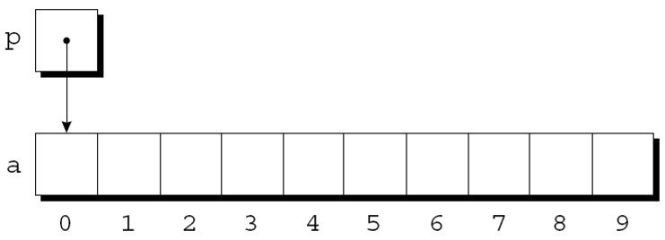
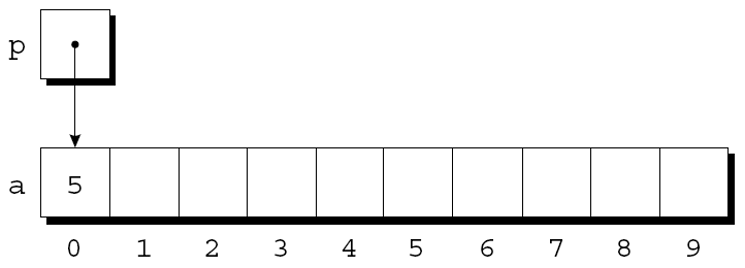
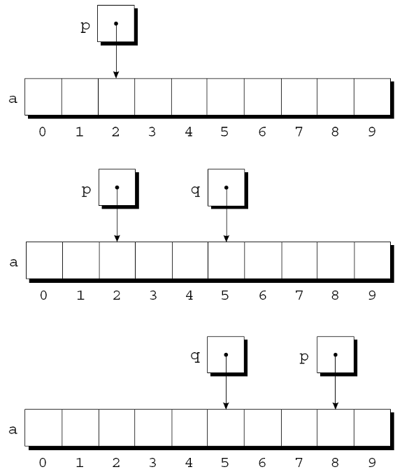
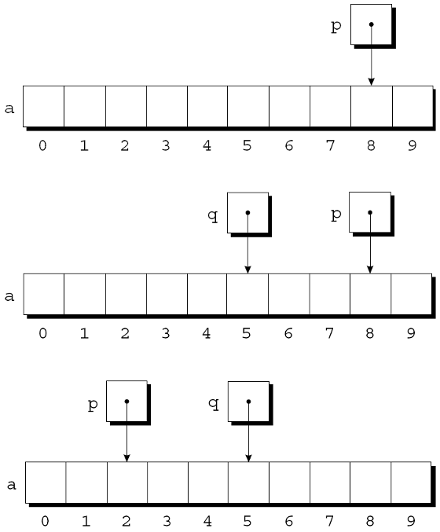
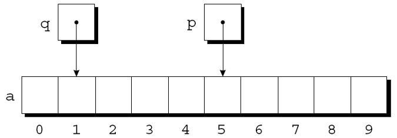
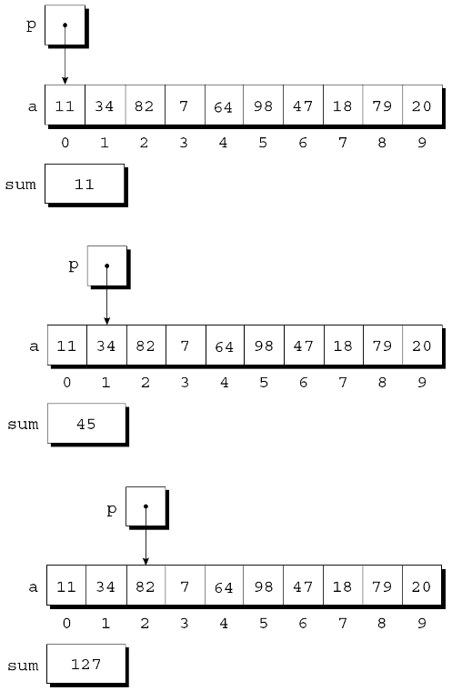

@import "../css/font-awesome-4.7.0/css/font-awesome.css"
@import "../css/theme/solarized.css"
@import "../css/logo.css"
@import "../css/font.css"
@import "../css/color.css"
@import "../css/margin.css"
@import "../css/table.css"
@import "../css/main.css"
@import "../plugin/zoom/zoom.js"
@import "../plugin/customcontrols/plugin.js"
@import "../plugin/customcontrols/style.css"
@import "../plugin/chalkboard/plugin.js"
@import "../plugin/chalkboard/style.css"
@import "../plugin/menu/menu.js"
@import "../js/anychart/anychart-core.min.js"
@import "../js/anychart/anychart-venn.min.js"
@import "../js/anychart/pastel.min.js"
@import "../js/anychart/venn-ml.js"
@import "https://cdn.bootcdn.net/ajax/libs/jquery/3.5.0/jquery.js"

<!-- slide data-notes="" -->

<div class="bottom20"></div>

# 智能程序设计（C语言）

<hr class="width50 center">

## 指针与数组 (上)

<div class="bottom8"></div>

### 计算机学院 &nbsp;&nbsp; 杨已彪

#### [yangyibiao@nju.edu.cn](mailto:yangyibiao@nju.edu.cn)


<!-- slide data-notes="" -->

##### 提纲

---

- 指针的算术运算

- 比较指针

- 使用指针进行数组处理

- 结合 * 和 ++ 运算符

- 课堂编码

- 课堂小测

---


<!-- slide data-notes="" -->


##### 指针的算术运算

---

<div style="display:flex;align-items:flex-start;gap:24px;">

<div style="flex:1;font-size:0.6em;">

```C
int a[10], *p;
p = &a[0];
```

指针可以指向==数组元素==:

图示: 

<div class="top-2">
    
</div>

</div>

<div style="flex:1;font-size:0.6em;">

通过 p 可以访问 a[0]——比如把 5 存进 a[0]: 

`*p = 5;`

如下图: 

<div class="top-2">
    
</div>

p 指向数组元素时, 对 p 做==指针算术==就能访问其他元素

C支持三种(且只有三种)==指针运算==形式:

- 指针加上整数

- 指针减去整数

- 两个指针相减

</div>

</div>

<!-- slide data-notes="" -->


##### 指针加减整数

---

<div style="display:flex;align-items:flex-start;gap:24px;">

<div style="flex:1.2;font-size:0.62em;">

```C
int a[10], *p, *q, i;
```

```C
p = &a[2];
q = p + 3;
p += 6;
```

```C
p = &a[8]; 
q = p - 3;
p -= 6;
```

</div>

<div style="flex:1;font-size:0.6em;">

将整数j添加到指针p会产生一个指向第j个元素的指针, 该元素位于p指向的元素之后. 

准确地说: p 指向 a[i], 则 p + j 指向 a[i+j]。

假设声明如下:

<div style="display:flex;align-items:flex-start;gap:24px;">

<div style="flex:1;">

指针加法示例:

<div class="top-2"></div>

</div>

<div style="flex:1;">

p 指向 a[i], 则 p - j 指向 a[i-j]。指针减法示例:

<div class="top-2">
    
</div>

</div>

</div>

</div>

</div>

<!-- slide data-notes="" -->


##### 两个指针相减

---

当一个指针从另一个指针中减去时, 结果是==指针之间的距离==(数组元素的个数). 

p 指向 a[i]、q 指向 a[j], 则 $p - q = i - j$。示例: 

```C
p = &a[5];
q = &a[1];
```

<div style="display:flex;align-items:center;gap:24px;">

<div class="top-2">
    
</div>

```C
i = p - q; /* i is  4 */
i = q - p; /* i is -4 */
```

</div>


<span class="blue">:fa-lightbulb-o:</span> 对不指向数组元素的指针执行算术运算导致未定义的行为

<span class="blue">:fa-lightbulb-o:</span> 只有两个指针指向同一个数组时, 把它们相减才有意义

---


<!-- slide data-notes="" -->


##### 比较指针

---

关系运算符(<, <=, >, >=)和判等运算符(==, !=)进行指针比较. 

使用关系运算符仅对指向同一数组元素的指针有意义. 比较的结果取决于数组中两个元素的相对位置. 

<div style="display:flex;align-items:flex-start;gap:24px;">

<div style="flex:1.1;">

```C
p = &a[5];
q = &a[1];
p <= q; // expression value: 0
p >= q; // expression value: 1
```

</div>

<div style="flex:0.9;">

<svg viewBox="0 0 400 170" width="460" height="196" xmlns="http://www.w3.org/2000/svg" font-family="LXGWWenKai, 'Noto Sans SC', sans-serif" font-weight="700">
<defs><marker id="arrCmpB" viewBox="0 0 10 10" refX="9" refY="5" markerWidth="6" markerHeight="6" orient="auto"><path d="M0,0 L10,5 L0,10 z" fill="#268bd2"/></marker><marker id="arrCmpG" viewBox="0 0 10 10" refX="9" refY="5" markerWidth="6" markerHeight="6" orient="auto"><path d="M0,0 L10,5 L0,10 z" fill="#859900"/></marker></defs>
<text x="22" y="72" font-size="13" fill="#93a1a1">a</text>
<rect x="35" y="52" width="40" height="36" fill="#eee8d5" stroke="#93a1a1" stroke-width="1.2"/>
<rect x="75" y="52" width="40" height="36" fill="#859900" fill-opacity="0.17" stroke="#859900" stroke-width="2"/>
<rect x="115" y="52" width="40" height="36" fill="#eee8d5" stroke="#93a1a1" stroke-width="1.2"/>
<rect x="155" y="52" width="40" height="36" fill="#eee8d5" stroke="#93a1a1" stroke-width="1.2"/>
<rect x="195" y="52" width="40" height="36" fill="#eee8d5" stroke="#93a1a1" stroke-width="1.2"/>
<rect x="235" y="52" width="40" height="36" fill="#268bd2" fill-opacity="0.17" stroke="#268bd2" stroke-width="2"/>
<rect x="275" y="52" width="40" height="36" fill="#eee8d5" stroke="#93a1a1" stroke-width="1.2"/>
<rect x="315" y="52" width="40" height="36" fill="#eee8d5" stroke="#93a1a1" stroke-width="1.2"/>
<text x="55" y="104" font-size="9" fill="#93a1a1" text-anchor="middle">0</text>
<text x="95" y="104" font-size="9" fill="#93a1a1" text-anchor="middle">1</text>
<text x="135" y="104" font-size="9" fill="#93a1a1" text-anchor="middle">2</text>
<text x="175" y="104" font-size="9" fill="#93a1a1" text-anchor="middle">3</text>
<text x="215" y="104" font-size="9" fill="#93a1a1" text-anchor="middle">4</text>
<text x="255" y="104" font-size="9" fill="#93a1a1" text-anchor="middle">5</text>
<text x="295" y="104" font-size="9" fill="#93a1a1" text-anchor="middle">6</text>
<text x="335" y="104" font-size="9" fill="#93a1a1" text-anchor="middle">7</text>
<rect x="75" y="12" width="40" height="24" rx="5" fill="#fdf6e3" stroke="#859900" stroke-width="1.8"/>
<text x="95" y="29" font-size="13" fill="#859900" text-anchor="middle">q</text>
<line x1="95" y1="36" x2="95" y2="50" stroke="#859900" stroke-width="1.6" marker-end="url(#arrCmpG)"/>
<rect x="235" y="12" width="40" height="24" rx="5" fill="#fdf6e3" stroke="#268bd2" stroke-width="1.8"/>
<text x="255" y="29" font-size="13" fill="#268bd2" text-anchor="middle">p</text>
<line x1="255" y1="36" x2="255" y2="50" stroke="#268bd2" stroke-width="1.6" marker-end="url(#arrCmpB)"/>
<text x="105" y="130" font-size="11.5" fill="#dc322f" text-anchor="middle">p &lt;= q → 0（假）</text>
<text x="295" y="130" font-size="11.5" fill="#859900" text-anchor="middle">p &gt;= q → 1（真）</text>
<text x="200" y="154" font-size="10" fill="#586e75" text-anchor="middle">同一数组中，地址越大元素越靠后</text>
</svg>

</div>

</div>

---


<!-- slide data-notes="" -->


##### 使用指针进行数组处理

---

<div style="font-size:0.6em;">

```C
#define N 10
int a[N] = {11, 34, 82, 7, 64, 98, 47, 18, 79, 20};
int sum = 0, *p;
…
for (p = &a[0]; p < &a[N]; p++)
    sum += *p;
```

<div style="display:flex;align-items:flex-start;gap:24px;">

<div style="flex:1;">

- 在第一次迭代结束时：`p` 指向 `a[1]`，`sum` 为 11（已加上 `a[0]`）

- 在第二次迭代结束时：`p` 指向 `a[2]`，`sum` 为 45（又加上 `a[1]`）

- 在第三次迭代结束时：`p` 指向 `a[3]`，`sum` 为 127（又加上 `a[2]`）

`for` 语句中的条件 `p < &a[N]` 值得特别提及。将地址运算符应用于 `a[N]` 是合法的，即使此元素不存在。

</div>

<div style="flex:0.7;">

<div class="top-2">
    
</div>

</div>

</div>

</div>

---


<!-- slide data-notes="" -->


##### 结合 * 和 ++ 运算符

---

<div style="display:flex;align-items:flex-start;gap:24px;">

<div style="flex:1.2;font-size:0.6em;">

```C
p = &a[0];
while (p < &a[N])
    sum += *p++;
```

<div class="fullborder">

| 表达式 | 意义 |
| :--: | :--: |  
| `*p++或*(p++)` | 表达式的值是`*p`在递增之前, 之后自增p |
| `(*p)++`      | 表达式的值为`*p`在递增之前, 稍后增加`*p` |
| `*++p或*(++p)` | 先递增`p`, 表达式的值为`*p` |
| `++*p或++(*p)` | 先递增`*p`, 表达式的值为`*p` |

</div>

</div>

<div style="flex:1;font-size:0.6em;">

C程序员经常结合使用`*`(间接寻址)和`++`运算符. 

修改数组元素后前进到下一个元素的语句:
`a[i++] = j;`

对应的指针版本: 
`*p++ = j;`

因为后缀++的优先级高于*, 编译器将其视为
`*(p++) = j;`


`*`和`++`的可能组合见左栏表格. 

- *(p++) 指针自增(指向下一个对象)
- (*p)++ 指向的对象自增(p本身不变)


\*和++最常见的组合是`*p++`, 在循环中很常用. 上一页的求和 `for` 循环可以改写成左栏的 `while` 版.


</div>

</div>

<!-- slide data-notes="" -->


##### 结合 * 和 ++ 运算符 (续)

---

<div style="display:flex;align-items:flex-start;gap:24px;">

<div style="flex:1.2;font-size:0.5em;">

```C
int contents[100];
int top = 0;

void push(int i) { contents[top++] = i; }
int pop(void)   { return contents[--top]; }
```

```C {.line-numbers}
int *top_ptr = &contents[0];

void push(int i)
{
  if (is_full()) stack_overflow();
  else           *top_ptr++ = i;
}

int pop(void)
{
  if (is_empty()) stack_underflow();
  else            return *--top_ptr;
}
```

</div>

<div style="flex:1;font-size:0.6em;">

\*和`--`运算符的组合方式与\*和`++`相同. 

看一个 `*` 和 `--` 组合的例子——用数组模拟一个==栈== (后进先出):

索引版：用整型变量 top 记录 contents 数组的==下一个空位==——push 把元素存到 top 处，再让 top 后移；pop 先让 top 前移，再返回该处的元素（见左栏）。

指针版：把 top 换成初始指向 contents[0] 的 top_ptr，它同样指向==下一个空位==，新的 push 和 pop 函数见左栏。

<svg viewBox="0 0 400 170" width="376" height="160" xmlns="http://www.w3.org/2000/svg" font-family="LXGWWenKai, 'Noto Sans SC', sans-serif" font-weight="700">
<defs><marker id="arrStkB" viewBox="0 0 10 10" refX="9" refY="5" markerWidth="6" markerHeight="6" orient="auto"><path d="M0,0 L10,5 L0,10 z" fill="#268bd2"/></marker><marker id="arrStkG" viewBox="0 0 10 10" refX="9" refY="5" markerWidth="6" markerHeight="6" orient="auto"><path d="M0,0 L10,5 L0,10 z" fill="#859900"/></marker></defs>
<rect x="186" y="14" width="74" height="26" rx="6" fill="#fdf6e3" stroke="#268bd2" stroke-width="2"/>
<text x="223" y="31" font-size="10.5" fill="#268bd2" text-anchor="middle">top_ptr</text>
<line x1="223" y1="40" x2="223" y2="74" stroke="#268bd2" stroke-width="2" marker-end="url(#arrStkB)"/>
<text x="216" y="62" font-size="9" fill="#268bd2" text-anchor="end">下一空位</text>
<rect x="48" y="76" width="50" height="36" fill="#859900" fill-opacity="0.15" stroke="#859900" stroke-width="1.5"/>
<text x="73" y="99" font-size="15" fill="#073642" text-anchor="middle">7</text>
<rect x="98" y="76" width="50" height="36" fill="#859900" fill-opacity="0.15" stroke="#859900" stroke-width="1.5"/>
<text x="123" y="99" font-size="15" fill="#073642" text-anchor="middle">8</text>
<rect x="148" y="76" width="50" height="36" fill="#859900" fill-opacity="0.15" stroke="#859900" stroke-width="1.5"/>
<text x="173" y="99" font-size="15" fill="#073642" text-anchor="middle">9</text>
<rect x="198" y="76" width="50" height="36" fill="#eee8d5" stroke="#93a1a1" stroke-width="1.4"/>
<rect x="248" y="76" width="50" height="36" fill="#eee8d5" stroke="#93a1a1" stroke-width="1.4"/>
<rect x="298" y="76" width="50" height="36" fill="#eee8d5" stroke="#93a1a1" stroke-width="1.4"/>
<line x1="246" y1="70" x2="270" y2="70" stroke="#268bd2" stroke-width="1.8" stroke-dasharray="4 3" marker-end="url(#arrStkB)"/>
<text x="276" y="66" font-size="9" fill="#268bd2">push 后 ++</text>
<path d="M223,114 L223,122 L173,122 L173,114" fill="none" stroke="#859900" stroke-width="1.8" stroke-dasharray="4 3" marker-end="url(#arrStkG)"/>
<text x="198" y="140" font-size="9.5" fill="#859900" text-anchor="middle">pop：先 -- 再读</text>
<text x="200" y="162" font-size="10" fill="#586e75" text-anchor="middle">后进先出（LIFO）</text>
</svg>

</div>

</div>

<!-- slide data-notes="" -->


##### 课堂编码

---

<div style="display:flex;align-items:flex-start;gap:24px;">

<div style="flex:1.15;font-size:0.75em;">

==任务==：用指针遍历数组，实现两个函数。

- `int find_sum(int *a, int n)`：返回数组所有元素之和。

- `int find_max(int *a, int n)`：返回数组元素的最大值。

要求：只用指针 `*p` 访问元素，不使用下标 `a[i]`；循环变量在 `for` 中自声明。

样例输入：`34 82 49 102 7 94 23 11 50 31`

样例输出：`sum = 483`、`max = 102`

</div>

<div style="flex:1;font-size:0.75em;">

<span class="blue">:fa-lightbulb-o:</span> 提示：求和让 `p` 从 `a` 走到 `a + n`，每次把 `*p` 累加；求最大值先把 `max` 初始化为 `*a`，再从 `a + 1` 开始逐个比较。

==先想参数==：函数需要数组首元素地址 `a` 和元素个数 `n`——指针本身不知道数组有多长。

<a href="vscode://file/Users/yangyibiao/Documents/Seafile/GitRepo/yangyibiao.github.io/cpl/slides/11-pointers/code/skeleton.c" style="display:inline-block;margin-top:8px;padding:5px 14px;background:#268bd2;color:#fff;border-radius:6px;font-size:0.85em;text-decoration:none;">⚡ 在 VS Code 中打开 skeleton.c (框架已备好)</a>

</div>

</div>

---

<!-- slide data-notes="" -->


##### 课堂编码 · 参考实现

---

<div style="display:flex;align-items:flex-start;gap:24px;">

<div style="flex:1;font-size:0.5em;">

```C{.line-numbers}
int find_sum(int *a, int n)
{
  int sum = 0;
  for (int *p = a; p < a + n; p++)
    sum += *p;
  return sum;
}
```

</div>

<div style="flex:1;font-size:0.5em;">

```C{.line-numbers}
int find_max(int *a, int n)
{
  int max = *a;
  for (int *p = a + 1; p < a + n; p++)
    if (*p > max)
      max = *p;
  return max;
}
```

</div>

</div>

<div style="font-size:0.5em;">

```C{.line-numbers}
#include <stdio.h>

int main(void)
{
  int b[10] = {34, 82, 49, 102, 7, 94, 23, 11, 50, 31};
  printf("sum = %d\n", find_sum(b, 10));   /* 期望输出: sum = 483 */
  printf("max = %d\n", find_max(b, 10));   /* 期望输出: max = 102 */
  return 0;
}
```

</div>

<div style="font-size:0.6em;">

两个循环都用 `p < a + n` 作条件，指针不会走到数组之外；调用时数组名 `b` 自动作为 `&b[0]` 传入。

</div>

---

<!-- slide data-notes="" -->


##### 课堂小测

---

1. `int a[5]; int *p = a;` 中 `p + 1` 表示什么？`p + 1` 的地址比 p 大多少字节？

2. `p2 - p1` 得到的是地址差还是元素个数差？

3. 阅读代码：`int a[3] = {1, 2, 3}, *p = a; (*p)++; *++p;` 执行后，数组 `a` 的三个元素各是多少？`p` 指向哪个元素？

4. 纠错: `int a[10], *p; for (p = a; p <= a + 10; p++) ...` 有什么问题？

---


<!-- slide data-notes="" -->

#####

---

<div class="bottom20"></div>

<hr class="width50 center">

## 未完待续

---


