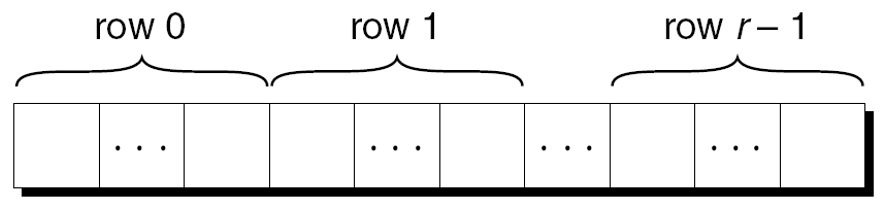

---
presentation:
  margin: 0
  center: false
  transition: "convex"
  enableSpeakerNotes: true
  slideNumber: "c/t"
  navigationMode: "linear"
---

@import "../css/font-awesome-4.7.0/css/font-awesome.css"
@import "../css/theme/solarized.css"
@import "../css/logo.css"
@import "../css/font.css"
@import "../css/color.css"
@import "../css/margin.css"
@import "../css/table.css"
@import "../css/main.css"
@import "../plugin/zoom/zoom.js"
@import "../plugin/customcontrols/plugin.js"
@import "../plugin/customcontrols/style.css"
@import "../plugin/chalkboard/plugin.js"
@import "../plugin/chalkboard/style.css"
@import "../plugin/menu/menu.js"
@import "../js/anychart/anychart-core.min.js"
@import "../js/anychart/anychart-venn.min.js"
@import "../js/anychart/pastel.min.js"
@import "../js/anychart/venn-ml.js"
@import "https://cdn.bootcdn.net/ajax/libs/jquery/3.5.0/jquery.js"

<!-- slide data-notes="" -->

<div class="bottom20"></div>

# 智能程序设计（C语言）

<hr class="width50 center">

## 指针与数组 (下)

<div class="bottom8"></div>

### 计算机学院 &nbsp;&nbsp; 杨已彪

#### [yangyibiao@nju.edu.cn](mailto:yangyibiao@nju.edu.cn)


<!-- slide data-notes="" -->

##### 提纲

---

- 回顾: 用指针遍历数组

- 数组名作为指针

- 任务: 数组名与指针

- 任务: 数列反向 (指针版)

- 数组型实际参数

- 多维数组与指针

- 动态内存初识: malloc 与 free

- 课堂小测

---


<!-- slide data-notes="" -->##### 回顾 11-1: 从 p 遍历到 a 遍历

---

<div class="bridge-wrap" style="display:flex;align-items:flex-start;gap:24px;font-size:0.68em;line-height:1.45;text-align:left;">

<style>.bridge-wrap pre code{font-size:14px;line-height:1.3;}</style>

<div style="flex:1;">

<div class="col-label">11-1: 用指针变量 p 遍历</div>

```C
int a[N], *p, sum = 0;
for (p = &a[0]; p < &a[N]; p++)
    sum += *p;
```

</div>

<div style="flex:1;">

<div class="col-label">11-2: 把数组名 a 当指针</div>

```C
int a[N], sum = 0;
for (int i = 0; i < N; i++)
    sum += *(a + i);
```

</div>

</div>

<div style="font-size:0.68em;line-height:1.5;text-align:left;margin-top:6px;">

- 11-1 的重点: 指针算术、比较、`*p++`; 用指针变量 `p` 遍历数组.
- 11-2 的重点: 数组名 `a` 本身作为指针; `a[i]` ≡ `*(a + i)`; 数组参数、多维数组、动态内存.
- 同一个求和, 两种写法: 11-2 把 `p` 省略掉, 直接用数组名; 但 `a` 不能自增, 要移动还是用 `p`.

</div>

---
<!-- slide data-notes="" -->##### 使用数组名称作为指针

---

<div style="display:flex;align-items:flex-start;gap:24px;font-size:0.68em;line-height:1.45;text-align:left;">

<div style="flex:1.15;">

<div class="col-label">代码节选 · array-name-pointer.c</div>

<style>.array-name-code pre code{font-size:14px;line-height:1.25;}</style>

<div class="array-name-code">

```C{.line-numbers}
#define N 10
int a[N] = {1, 2, 3, 4, 5, 6, 7, 8, 9, 0};
int *p, sum = 0;

*a = 7;             /* a[0] = 7 */
*(a + 1) = 12;      /* a[1] = 12 */

for (p = a; p < a + N; p++)   /* a 就是 &a[0] */
    sum += *p;

p = a;
while (*p != 0)     /* 第一个 0 */
    p++;

/* a++;  非法: 数组名不能被赋值 */
```

</div>

<div style="margin-top:8px;">
<a href="vscode://file/Users/yangyibiao/Documents/Seafile/GitRepo/yangyibiao.github.io/cpl/slides/11-pointers/code/array-name-pointer.c" style="display:inline-block;padding:5px 14px;background:#268bd2;color:#fff;border-radius:6px;font-size:0.95em;text-decoration:none;">⚡ 在 VS Code 中打开 array-name-pointer.c (完整代码)</a>
</div>

</div>

<div style="flex:0.85;font-size:0.78em;line-height:1.5;">

<div class="col-label">要点</div>

- `a` 与 `&a[0]` 的值相同; `a + i` 等价于 `&a[i]`.
- `*(a + i)` 等价于 `a[i]`.
- `a` 是数组名, ==不能自增/赋值==; 要移动指针就复制到 `int *p`.

<div style="margin-top:8px;padding:6px 10px;background:#fdf6e3;border-left:4px solid #268bd2;border-radius:4px;">
运行结果: `a[0] = 7`, `a[1] = 12`; `sum = 61`; 第一个 0 在 `a[9]`.
</div>

<div style="margin-top:8px;padding:6px 10px;background:#f2f4f0;border-left:4px solid #93a1a1;border-radius:4px;">
`a` 是“数组名”, 不是指针变量; `p = a` 只是把首地址复制给 p.
</div>

</div>

</div>

---
<!-- slide data-notes="" -->##### 任务: 数组名与指针

---

<div style="display:flex;align-items:flex-start;gap:24px;font-size:0.68em;line-height:1.4;text-align:left;">

<div style="flex:1.1;">

==任务==: 令 `int a[6] = {2, 4, 6, 8, 10, 12};`

1. 用指针 `p` 从 `a` 遍历到 `a + 6`, 求所有元素之和

2. 对每个下标 `i`, 打印 `a[i]` 与 `*(a + i)`——两列的值应当相同

3. 打印 `a`、`&a[0]`、`a + 1`、`&a[1]`, 观察数组名与首元素地址的关系

样例:

```
i=0: a[0]=2, *(a+0)=2
...
i=5: a[5]=12, *(a+5)=12
sum = 42
a = 0x7ffd1a2b, &a[0] = 0x7ffd1a2b
a + 1 = 0x7ffd1a2f, &a[1] = 0x7ffd1a2f
```

</div>

<div style="flex:0.9;">

==提示==: `a + i` 等价于 `&a[i]`, `*(a + i)` 等价于 `a[i]`; 数组名不能自增 (`a++` 非法), 遍历要用指针变量 `p`

<div class="task-criteria" style="margin:8px 0 0;padding:6px 10px;background:#f2f4f0;border-left:4px solid #93a1a1;border-radius:4px;">
<b>完成标准:</b>
<div>· 用指针 `p` 遍历, 求和得到 `42`</div>
<div>· 打印 `a[i]` 与 `*(a + i)` 两列值相同</div>
<div>· 能说明 `a` 与 `&a[0]` 的关系; 不使用 `a++`</div>
</div>

<div style="margin-top:10px;">
<a href="vscode://file/Users/yangyibiao/Documents/Seafile/GitRepo/yangyibiao.github.io/cpl/slides/11-pointers/code/task-array-pointer.c" style="display:inline-block;padding:5px 14px;background:#268bd2;color:#fff;border-radius:6px;font-size:0.85em;text-decoration:none;">⚡ 在 VS Code 中打开 task-array-pointer.c (骨架)</a>
</div>

</div>

</div>

---

<!-- slide data-notes="" -->##### 任务参考: 数组名与指针

---

<div style="display:flex;align-items:flex-start;gap:24px;">

<div style="flex:1.1;font-size:0.6em;">

```C{.line-numbers}
#include <stdio.h>
#define N 6

int main(void)
{
  int a[N] = {2, 4, 6, 8, 10, 12};
  int sum = 0;

  for (int *p = a; p < a + N; p++)
    sum += *p;

  for (int i = 0; i < N; i++)
    printf("i=%d: a[%d]=%d, *(a+%d)=%d\n",
           i, i, a[i], i, *(a + i));

  printf("sum = %d\n", sum);
  printf("a = %p, &a[0] = %p\n",
         (void *)a, (void *)&a[0]);
  printf("a + 1 = %p, &a[1] = %p\n",
         (void *)(a + 1), (void *)&a[1]);
  return 0;
}
```

<div style="margin-top:8px;">
<a href="vscode://file/Users/yangyibiao/Documents/Seafile/GitRepo/yangyibiao.github.io/cpl/slides/11-pointers/code/array-pointer.c" style="display:inline-block;padding:5px 14px;background:#268bd2;color:#fff;border-radius:6px;font-size:0.85em;text-decoration:none;">⚡ 在 VS Code 中打开 array-pointer.c</a>
</div>

</div>

<div style="flex:1;font-size:0.78em;line-height:1.5;">

<div class="col-label">运行结果</div>

```text
sum = 42
i=0: a[0]=2, *(a+0)=2
...
i=5: a[5]=12, *(a+5)=12
```

<div style="margin-top:6px;padding:6px 10px;background:#f2f4f0;border-left:4px solid #93a1a1;border-radius:4px;font-size:0.9em;">
地址依运行环境而变; `a` 与 `&a[0]` 的值始终相同.
</div>

<div class="col-label">要点</div>

- 数组名 `a` 在表达式中就是指向首元素的指针: `a` 与 `&a[0]` 的值相同

- `a[i]` 是 `*(a + i)` 的==语法糖==——下标运算的本质就是"地址 + 偏移再解引用"

- `a + N` 是==最后一个元素之后==的地址: 可以取、可以比较, 但不能解引用

- `a` 是数组名不是指针变量, ==不能被赋值==; 要移动就复制到 `int *p`

</div>

</div>

---

<!-- slide data-notes="" -->##### 任务: 数列反向(指针版)

---

<div style="display:flex;align-items:flex-start;gap:24px;font-size:0.68em;line-height:1.4;text-align:left;">

<div style="flex:1.1;">

==现场演示==: 用==指针==重写之前的数列反向程序——不用下标 `a[i]`, 全部用指针完成

样例:

```
输入 10 个数: 34 82 49 102 7 94 23 11 50 31
逆序输出: 31 50 11 23 94 7 102 49 82 34
```

</div>

<div style="flex:0.9;">

<span class="blue">:fa-lightbulb-o:</span> 提示: 两个循环——一个负责读入, 一个负责倒序输出; 全程不要出现 `a[i]`

<div class="task-criteria" style="margin:8px 0 0;padding:6px 10px;background:#f2f4f0;border-left:4px solid #93a1a1;border-radius:4px;">
<b>完成标准:</b>
<div>· 读入和输出都用指针, 不出现 `a[i]`</div>
<div>· 逆序输出 `31 50 11 23 94 7 102 49 82 34`</div>
<div>· 指针不走出数组</div>
</div>

<div style="margin-top:8px;padding:6px 10px;background:#fdf6e3;border-left:4px solid #268bd2;border-radius:4px;">
和 11-1 栈演示一样: `*--p` 先自减, 再取值.
</div>

<div style="margin-top:10px;">
<a href="vscode://file/Users/yangyibiao/Documents/Seafile/GitRepo/yangyibiao.github.io/cpl/slides/11-pointers/code/task-reverse.c" style="display:inline-block;padding:5px 14px;background:#268bd2;color:#fff;border-radius:6px;font-size:0.85em;text-decoration:none;">⚡ 在 VS Code 中打开 task-reverse.c (骨架)</a>
</div>

</div>

</div>

---


<!-- slide data-notes="" -->


##### 任务参考: 数列反向(指针版)

---

<div style="display:flex;align-items:flex-start;gap:24px;" class="split-rule">

<div style="flex:1.15;font-size:0.58em;">

<div class="col-label">代码</div>


```C{.line-numbers}
/* 数列反向（指针版本） */
#include <stdio.h>
#define N 10
int main(void)
{
  int a[N], *p;
  printf("输入 %d 个数: ", N);
  for (p = a; p < a + N; p++)
    scanf("%d", p);
  printf("逆序输出:");
  /* 先回退再打印 */
  for (p = a + N; p != a; )
    printf(" %d", *--p);
  printf("\n");
  return 0;
}
```

<div style="margin-top:8px;">
<a href="vscode://file/Users/yangyibiao/Documents/Seafile/GitRepo/yangyibiao.github.io/cpl/slides/11-pointers/code/reverse-pointer.c" style="display:inline-block;padding:5px 14px;background:#268bd2;color:#fff;border-radius:6px;font-size:0.85em;text-decoration:none;">⚡ 在 VS Code 中打开 reverse-pointer.c</a>
</div>

</div>

<div style="flex:1.2;font-size:0.78em;line-height:1.5;">

<div class="col-label">运行结果</div>

```text
输入 10 个数: 34 82 49 102 7 94 23 11 50 31
逆序输出: 31 50 11 23 94 7 102 49 82 34
```

<div class="col-label">要点</div>


- 正着读: `p` 从 `a` 到 `a + N` (注意 `p++` 就是下一个元素)

- 倒着打: `p` 从 `a + N` 开始, 先 `--p` 再打印, 走到 `a` 为止——p 始终==不走出数组== (指针跑到数组外是未定义行为)

- 对比之前下标版: `a[i]` 与 `*p` 一一对应, 指针版没有下标变量 i

</div>

</div>

---

<!-- slide data-notes="" -->##### 数组型实际参数: 数组名被视为指针

---

<div style="display:flex;align-items:flex-start;gap:24px;font-size:0.68em;line-height:1.45;text-align:left;">

<div class="arrayparam-code" style="flex:1.2;">

<style>.arrayparam-code pre code{font-size:14px;line-height:1.2;}</style>

```C{.line-numbers}
#define N 10
int find_largest(int a[], int n)
{
    int max;

    max = a[0];
    for (int i = 1; i < n; i++)
        if (a[i] > max)
            max = a[i];
    return max;
}

int main(void) {
    int b[N] = {0}, largest;
    ...
    /* 传递的是指向 b[0] 的指针, 数组本身不会被复制 */
    largest = find_largest(b, N);
    ...
}
```

</div>

<div style="flex:0.8;">

<div class="col-label" style="font-size:1.15em;">数组名传参 = 传首地址</div>

- 数组名 `b` 作为实参时, 传递的是指向 `b[0]` 的指针; 数组本身不会被复制.
- 形参 `int a[]` 收到这个指针, 函数通过 `a` 访问原数组.
- 所以函数对 `a[i]` 的修改会写回调用者的 `b[i]`.

<div style="margin-top:8px;padding:6px 10px;background:#fff4f2;border-left:4px solid #dc322f;border-radius:4px;">
普通变量传值: 改形参不影响实参; 数组是例外——数组名传的是地址.
</div>

</div>

</div>

---
<!-- slide data-notes="" -->##### 数组型实际参数: 修改与 const 保护

---

<div style="display:flex;align-items:flex-start;gap:24px;font-size:0.68em;line-height:1.45;text-align:left;">

<div class="store-code" style="flex:1.1;">

<style>.store-code pre code{font-size:15px;line-height:1.25;}</style>

```C
void store_zeros(int a[], int n)
{
    for (int i = 0; i < n; i++)
        a[i] = 0;
}
```

```C
int find_largest(const int a[], int n)
{
    ...
}
```

</div>

<div style="flex:0.9;">

- `store_zeros(b, N)` 会把调用者的数组清零——数组参数可以被修改.
- 如果函数只读, 在形参前加 `const`: `const int a[]`; 编译器会检查函数体没有对 `a` 的元素赋值.
- 这既表达意图, 也能在误改时直接报错.

<div style="margin-top:8px;padding:6px 10px;background:#f2f4f0;border-left:4px solid #93a1a1;border-radius:4px;">
普通变量传值, 改形参不影响原变量; 数组传的是地址, 函数能改原数组——不想被改就加 <code>const</code>.
</div>

</div>

</div>

---
<!-- slide data-notes="" -->##### 数组型实际参数: 形参 int a[] 与 int *a 等价

---

<div style="display:flex;align-items:flex-start;gap:24px;font-size:0.65em;line-height:1.45;text-align:left;">

<div style="flex:1.1;">

<div class="col-label">两种写法完全等价</div>

<style>.equiv-code pre code{font-size:14px;line-height:1.2;}</style>

<div class="equiv-code">

```C{.line-numbers}
int find_largest(int *a, int n)
{
    int max = a[0];
    for (int i = 1; i < n; i++)
        if (a[i] > max)
            max = a[i];
    return max;
}

/* 下面两种声明等价 */
int find_largest(int *a, int n);
int find_largest(int a[], int n);
```

</div>

</div>

<div style="flex:0.9;">

- 形参 `int a[]` 与 `int *a` **完全等价**; 编译器都把它当指针.
- 调用 `find_largest(b, N)` 时, 数组名 `b` 传的是 `&b[0]`; 函数通过指针访问原数组.
- 数组参数可以被修改; 如果函数只读, 用 `const int a[]`.

<div style="margin-top:8px;padding:6px 10px;background:#f2f4f0;border-left:4px solid #93a1a1;border-radius:4px;">
数组名传参不复制整个数组, 只传首地址.
</div>

</div>

</div>

---
<!-- slide data-notes="" -->##### 声明 int a[10] 与 int *p 不同

---

<div style="display:flex;align-items:flex-start;gap:24px;font-size:0.68em;line-height:1.45;text-align:left;">

<div style="flex:1.05;">

<div class="col-label">作为声明</div>

```C
int a[10];   /* 10 个 int 的空间 */
int *p;      /* 1 个指针的空间 */
```

- `int a[10];`: 分配 10 个 int; `sizeof(a) = 40`; `a` 不能被赋值.
- `int *p;`: 只分配一个指针; `sizeof(p) = 8`; `p` 可以改指向.

<div style="margin-top:8px;padding:6px 10px;background:#fff4f2;border-left:4px solid #dc322f;border-radius:4px;">
不要和“形参等价”混淆: 形参位置的 <code>int a[]</code> 会被编译器调整为 <code>int *a</code>; 声明位置的 <code>int a[10]</code> 和 <code>int *p</code> 是两回事.
</div>

</div>

<div style="flex:0.95;">

<div class="col-label">对比</div>

<table style="width:100%;font-size:0.9em;border-collapse:collapse;">
<tr style="color:#586e75;">
<th style="text-align:left;padding:2px 4px;border-bottom:1px solid #d6d6c8;">写法</th>
<th style="text-align:left;padding:2px 4px;border-bottom:1px solid #d6d6c8;">分配</th>
<th style="text-align:left;padding:2px 4px;border-bottom:1px solid #d6d6c8;">sizeof</th>
<th style="text-align:left;padding:2px 4px;border-bottom:1px solid #d6d6c8;">可否赋值</th>
</tr>
<tr><td style="padding:2px 4px;"><code>int a[10]</code></td><td style="padding:2px 4px;">10 个 int</td><td style="padding:2px 4px;">40</td><td style="padding:2px 4px;color:#dc322f;">不可</td></tr>
<tr><td style="padding:2px 4px;"><code>int *p</code></td><td style="padding:2px 4px;">1 个指针</td><td style="padding:2px 4px;">8</td><td style="padding:2px 4px;color:#859900;">可</td></tr>
</table>

<div style="margin-top:8px;padding:6px 10px;background:#f2f4f0;border-left:4px solid #93a1a1;border-radius:4px;">
<code>*a = 0</code> 对数组是给 <code>a[0]</code> 赋值; 对未初始化的指针 <code>*p = 0</code> 是未定义行为.
</div>

<div style="margin-top:6px;font-size:0.85em;color:#93a1a1;">
（常见 64 位平台: int 4 字节, 指针 8 字节）
</div>

</div>

</div>

---
<!-- slide data-notes="" -->##### 数组型实际参数: 可以传数组的片段

---

<div style="display:flex;align-items:flex-start;gap:24px;font-size:0.68em;line-height:1.45;text-align:left;">

<div style="flex:0.95;">

数组名传参的另一个结果: 可以给形参传==数组的片段==——一段连续的元素.

<div class="col-label">示例: 传 b[5] ~ b[14]</div>

<style>.slice-code pre code{font-size:14px;line-height:1.2;}</style>

<div class="slice-code">

```C{.line-numbers}
int b[20] = {0};
int largest;
largest = find_largest(&b[5], 10);
```

</div>

- `&b[5]` 是片段首元素地址
- `10` 是片段长度
- `find_largest` 只访问从 `b[5]` 开始的 10 个元素, 不知道原数组有 20 个

</div>

<div style="flex:1.05;text-align:center;">

<div class="top-2">
<svg viewBox="0 0 400 180" width="560" height="252" xmlns="http://www.w3.org/2000/svg" font-family="LXGWWenKai, 'Noto Sans SC', sans-serif" font-weight="700">
<defs><marker id="arrSliceB" viewBox="0 0 10 10" refX="9" refY="5" markerWidth="6" markerHeight="6" orient="auto"><path d="M0,0 L10,5 L0,10 z" fill="#268bd2"/></marker></defs>
<text x="40" y="18" font-size="12" fill="#073642">int b[20]</text>
<rect x="40" y="30" width="16" height="32" fill="#eee8d5" stroke="#93a1a1" stroke-width="1"/>
<rect x="56" y="30" width="16" height="32" fill="#eee8d5" stroke="#93a1a1" stroke-width="1"/>
<rect x="72" y="30" width="16" height="32" fill="#eee8d5" stroke="#93a1a1" stroke-width="1"/>
<rect x="88" y="30" width="16" height="32" fill="#eee8d5" stroke="#93a1a1" stroke-width="1"/>
<rect x="104" y="30" width="16" height="32" fill="#eee8d5" stroke="#93a1a1" stroke-width="1"/>
<rect x="120" y="30" width="16" height="32" fill="#859900" fill-opacity="0.16" stroke="#859900" stroke-width="1.4"/>
<rect x="136" y="30" width="16" height="32" fill="#859900" fill-opacity="0.16" stroke="#859900" stroke-width="1.4"/>
<rect x="152" y="30" width="16" height="32" fill="#859900" fill-opacity="0.16" stroke="#859900" stroke-width="1.4"/>
<rect x="168" y="30" width="16" height="32" fill="#859900" fill-opacity="0.16" stroke="#859900" stroke-width="1.4"/>
<rect x="184" y="30" width="16" height="32" fill="#859900" fill-opacity="0.16" stroke="#859900" stroke-width="1.4"/>
<rect x="200" y="30" width="16" height="32" fill="#859900" fill-opacity="0.16" stroke="#859900" stroke-width="1.4"/>
<rect x="216" y="30" width="16" height="32" fill="#859900" fill-opacity="0.16" stroke="#859900" stroke-width="1.4"/>
<rect x="232" y="30" width="16" height="32" fill="#859900" fill-opacity="0.16" stroke="#859900" stroke-width="1.4"/>
<rect x="248" y="30" width="16" height="32" fill="#859900" fill-opacity="0.16" stroke="#859900" stroke-width="1.4"/>
<rect x="264" y="30" width="16" height="32" fill="#859900" fill-opacity="0.16" stroke="#859900" stroke-width="1.4"/>
<rect x="280" y="30" width="16" height="32" fill="#eee8d5" stroke="#93a1a1" stroke-width="1"/>
<rect x="296" y="30" width="16" height="32" fill="#eee8d5" stroke="#93a1a1" stroke-width="1"/>
<rect x="312" y="30" width="16" height="32" fill="#eee8d5" stroke="#93a1a1" stroke-width="1"/>
<rect x="328" y="30" width="16" height="32" fill="#eee8d5" stroke="#93a1a1" stroke-width="1"/>
<rect x="344" y="30" width="16" height="32" fill="#eee8d5" stroke="#93a1a1" stroke-width="1"/>
<rect x="120" y="26" width="160" height="40" rx="3" fill="none" stroke="#859900" stroke-width="2.2"/>
<text x="48" y="78" font-size="9" fill="#93a1a1" text-anchor="middle">0</text>
<text x="128" y="78" font-size="9" fill="#859900">b[5]</text>
<text x="272" y="78" font-size="9" fill="#859900" text-anchor="end">b[14]</text>
<text x="352" y="78" font-size="9" fill="#93a1a1" text-anchor="middle">19</text>
<text x="200" y="96" font-size="10.5" fill="#859900" text-anchor="middle">10 个连续元素（n = 10）</text>
<line x1="120" y1="150" x2="120" y2="70" stroke="#268bd2" stroke-width="2" marker-end="url(#arrSliceB)"/>
<text x="128" y="126" font-size="10.5" fill="#268bd2">形参 a</text>
<text x="128" y="148" font-size="10.5" fill="#586e75">find_largest(&amp;b[5], 10)</text>
<text x="200" y="170" font-size="9.5" fill="#93a1a1" text-anchor="middle">函数只访问绿色片段，不能越过 n</text>
</svg>
</div>

</div>

</div>

---
<!-- slide data-notes="" -->##### 使用指针作为数组名

---

<div style="display:flex;align-items:flex-start;gap:24px;font-size:0.68em;line-height:1.45;text-align:left;">

<div style="flex:1.05;">

<div class="col-label">指针也能取下标</div>

<style>.parray-code pre code{font-size:14px;line-height:1.25;}</style>

<div class="parray-code">

```C{.line-numbers}
#include <stdio.h>
#define N 10

int main(void)
{
    int a[N] = {11, 34, 82, 7, 64, 98, 47, 18, 79, 20};
    int *p = a, sum = 0;

    for (int i = 0; i < N; i++)
        sum += p[i];       /* p[i] 等价于 *(p + i) */
    printf("sum = %d
", sum);
    return 0;
}
```

</div>

<div style="margin-top:8px;padding:6px 10px;background:#f2f4f0;border-left:4px solid #93a1a1;border-radius:4px;">
`p` 指向数组首元素后, `p[i]` 与 `a[i]` 一样使用; 编译器把 `p[i]` 视为 `*(p + i)`.
</div>

</div>

<div style="flex:0.95;">

<div class="col-label">两种写法对照</div>

<table style="width:100%;font-size:0.92em;border-collapse:collapse;">
<tr style="color:#586e75;">
<th style="text-align:left;padding:2px 4px;border-bottom:1px solid #d6d6c8;">写法</th>
<th style="text-align:left;padding:2px 4px;border-bottom:1px solid #d6d6c8;">等价于</th>
<th style="text-align:left;padding:2px 4px;border-bottom:1px solid #d6d6c8;">说明</th>
</tr>
<tr><td style="padding:2px 4px;"><code>a[i]</code></td><td style="padding:2px 4px;"><code>*(a + i)</code></td><td style="padding:2px 4px;">数组名当指针</td></tr>
<tr><td style="padding:2px 4px;"><code>p[i]</code></td><td style="padding:2px 4px;"><code>*(p + i)</code></td><td style="padding:2px 4px;">指针当数组名</td></tr>
</table>

<div style="margin-top:8px;padding:6px 10px;background:#f2f4f0;border-left:4px solid #93a1a1;border-radius:4px;">
`p` 必须指向足够的元素; 这里 `p` 指向 `a[0]`, 所以 `p[0]..p[N-1]` 都合法.
</div>

<div style="margin-top:8px;padding:6px 10px;background:#fdf6e3;border-left:4px solid #268bd2;border-radius:4px;">
接下来: 指针也可以指向多维数组的元素——下一节看二维数组的<strong>元素</strong>、<strong>行</strong>、<strong>列</strong>.
</div>

</div>

</div>

---
<!-- slide data-notes="" -->##### 二维数组的存储: 行优先

---

<div style="margin-bottom:8px;padding:6px 10px;background:#eef4e6;border-left:4px solid #859900;border-radius:4px;">
从一维到二维: 二维数组本质是“数组的数组”.
</div>

<div style="display:flex;align-items:flex-start;gap:24px;font-size:0.68em;line-height:1.45;text-align:left;">

<div style="flex:1;">

C 以==行优先==顺序存储二维数组:

- 先存第 0 行, 再存第 1 行, ...
- 同一行内的元素地址连续

`a[0][0], a[0][1], ..., a[0][COLS-1], a[1][0], ...`

<div style="margin-top:8px;padding:6px 10px;background:#fdf6e3;border-left:4px solid #268bd2;border-radius:4px;">
所以 `p = &a[0][0]` 后, `p++` 会按行优先顺序依次走过每个元素.
</div>

</div>

<div style="flex:1;text-align:center;">
<div class="top-2"></div>
</div>

</div>

---
<!-- slide data-notes="" -->##### 二维数组的类型 1/3: 声明决定层级

---

<div style="max-width:1200px;margin:0 auto;">

<div style="display:flex;align-items:flex-start;gap:24px;font-size:0.66em;line-height:1.5;text-align:left;">

<div style="flex:1.1;">

<div class="col-label">规则 1: 声明决定层级</div>

`int a[ROWS][COLS];` 是:

- `ROWS` 个元素的数组
- 每个元素是 `int[COLS]` —— 也就是“一行”

<div style="margin-top:10px;padding:6px 10px;background:#f2f4f0;border-left:4px solid #93a1a1;border-radius:4px;">
读法: 先看“有多少个什么”, 再往里看一层.
</div>

<div class="col-label" style="margin-top:14px;">降一层</div>

- 一整栋 `a`: 整个二维数组
- 一层 `a[i]`: 第 i 行, 类型 `int [COLS]`
- 一间 `a[i][j]`: 第 i 行第 j 个 int

<div style="margin-top:10px;padding:6px 10px;background:#eef4e6;border-left:4px solid #859900;border-radius:4px;">
口诀: 先降层——一整栋 → 一层 → 一间.<br>
这一页只看声明和下标; 数组名怎么变成指针, 下一页讲.
</div>

</div>

<div style="flex:0.9;">

<div class="col-label">三层模型</div>

<div style="margin-top:4px;padding:8px 10px;background:#f7f9fc;border-left:4px solid #268bd2;border-radius:4px;">
<b>一整栋</b> <code>a</code><br>
<span style="color:#586e75;font-size:0.9em;"><code>int [ROWS][COLS]</code></span>
</div>
<div style="text-align:center;color:#93a1a1;font-size:0.9em;">↓ 取一次下标 (得到一层)</div>
<div style="padding:8px 10px;background:#f6f9f1;border-left:4px solid #859900;border-radius:4px;">
<b>一层</b> <code>a[i]</code><br>
<span style="color:#586e75;font-size:0.9em;"><code>int [COLS]</code></span>
</div>
<div style="text-align:center;color:#93a1a1;font-size:0.9em;">↓ 再取一次下标 (得到一个元素)</div>
<div style="padding:8px 10px;background:#fafaf7;border-left:4px solid #93a1a1;border-radius:4px;">
<b>一间</b> <code>a[i][j]</code><br>
<span style="color:#586e75;font-size:0.9em;"><code>int</code></span>
</div>

<div style="margin-top:6px;font-size:0.85em;color:#93a1a1;">↓ = 取下标</div>

</div>

</div>

</div>

---
<!-- slide data-notes="" -->##### 二维数组的类型 2/3: 数组转首元素指针

---

<div style="max-width:1200px;margin:0 auto;">

<div style="font-size:0.66em;line-height:1.5;text-align:left;">

<div style="padding:8px 12px;background:#eef4e6;border-left:4px solid #859900;border-radius:4px;">
<b>规则 2:</b> 数组名在大多数表达式里 → 指向第一个元素的指针; 第一个元素是什么类型, 指针就指向什么类型.
</div>

<div style="margin-top:6px;font-size:0.85em;color:#93a1a1;">上一页: 声明决定层级; 这一页: 数组名在表达式里转成指针.</div>

<div style="display:flex;align-items:flex-start;gap:20px;margin-top:12px;">

<div style="flex:1;padding:10px 12px;background:#f7f9fc;border-left:4px solid #268bd2;border-radius:4px;">
<div class="col-label">一维: 元素是 int</div>
<div style="margin-top:6px;"><code>int b[5];</code></div>
<div style="margin-top:8px;">
- `b` 本身: `int [5]`
- 表达式里: → `&b[0]`, `int *`
- `b + 1` → 下一个 int
</div>
</div>

<div style="flex:1;padding:10px 12px;background:#f6f9f1;border-left:4px solid #859900;border-radius:4px;">
<div class="col-label">二维: 元素是一行</div>
<div style="margin-top:6px;"><code>int a[3][4];</code></div>
<div style="margin-top:8px;">
- `a` 的元素: `int [4]`
- 首元素 `a[0]` → `&a[0]`, `int (*)[4]`
- `a + 1` → 下一行 (4 个 int)
</div>
</div>

</div>

<div style="display:flex;align-items:flex-start;gap:20px;margin-top:12px;">

<div style="flex:1;padding:10px 12px;background:#f6f9f1;border-left:4px solid #859900;border-radius:4px;">
<div class="col-label">a[i] 也一样</div>
<div style="margin-top:8px;">
- `a[i]` 本身: `int [4]`
- 首元素 `a[i][0]` → `&a[i][0]`, `int *`
- `a[i] + 1` → 下一个 int
</div>
</div>

<div style="flex:1;padding:10px 12px;background:#fdf6e3;border-left:4px solid #b58900;border-radius:4px;">
<div class="col-label">两个例外: 不转换</div>
<div style="margin-top:8px;">
- `sizeof(a)` = `3 * 4 * 4` = 48 字节
- `&a` → 指向整个二维数组
- `sizeof(a[0])` = 一行
</div>
</div>

</div>

<div style="margin-top:12px;padding:7px 12px;background:#f2f4f0;border-left:4px solid #93a1a1;border-radius:4px;text-align:center;">
<code>a</code> 的首元素是“一行” → 行指针; <code>a[i]</code> 的首元素是“一个 int” → int 指针.
</div>

</div>

</div>

---
<!-- slide data-notes="" -->##### 二维数组的类型 3/3: 表达式类型表

---

<div style="max-width:1200px;margin:0 auto;">

<div style="display:flex;align-items:flex-start;gap:24px;font-size:0.66em;line-height:1.5;text-align:left;">

<div style="flex:1.25;">

<div style="padding:10px 12px;background:#fff;border:1px solid #e5e5dc;border-radius:6px;">

<table style="width:100%;font-size:0.94em;border-collapse:collapse;">
<thead>
<tr style="background:#f2f4f0;color:#586e75;">
<th style="text-align:left;padding:6px 8px;">表达式</th>
<th style="text-align:left;padding:6px 8px;">本身的类型</th>
<th style="text-align:left;padding:6px 8px;">表达式中转成</th>
<th style="text-align:left;padding:6px 8px;">含义</th>
</tr>
</thead>
<tbody>
<tr style="background:#fff;"><td style="padding:6px 8px;"><code>a</code></td><td style="padding:6px 8px;"><code>int [ROWS][COLS]</code></td><td style="padding:6px 8px;"><code>int (*)[COLS]</code></td><td style="padding:6px 8px;">指向一行</td></tr>
<tr style="background:#fafaf7;"><td style="padding:6px 8px;"><code>a + i</code></td><td style="padding:6px 8px;">—</td><td style="padding:6px 8px;"><code>int (*)[COLS]</code></td><td style="padding:6px 8px;">第 i 行</td></tr>
<tr style="background:#fff;"><td style="padding:6px 8px;"><code>*(a + i)</code></td><td style="padding:6px 8px;"><code>int [COLS]</code></td><td style="padding:6px 8px;"><code>int *</code></td><td style="padding:6px 8px;">第 i 行数组</td></tr>
<tr style="background:#fafaf7;"><td style="padding:6px 8px;"><code>a[i]</code></td><td style="padding:6px 8px;"><code>int [COLS]</code></td><td style="padding:6px 8px;"><code>int *</code></td><td style="padding:6px 8px;">第 i 行数组</td></tr>
<tr style="background:#fff;"><td style="padding:6px 8px;"><code>&amp;a[i][0]</code></td><td style="padding:6px 8px;">—</td><td style="padding:6px 8px;"><code>int *</code></td><td style="padding:6px 8px;">行首元素地址</td></tr>
<tr style="background:#fafaf7;"><td style="padding:6px 8px;"><code>a[i][j]</code></td><td style="padding:6px 8px;">—</td><td style="padding:6px 8px;"><code>int</code></td><td style="padding:6px 8px;">元素</td></tr>
</tbody>
</table>

</div>

</div>

<div style="flex:0.85;">

<div style="padding:10px 12px;background:#f7f9fc;border-left:4px solid #268bd2;border-radius:4px;">
<div class="col-label">怎么用这张表</div>
<div style="margin-top:8px;">
- `a` 和 `a[i]` 本身是数组; 在表达式里才转成指针.
- `a + 1` 跳一行; `a[i] + 1` 跳一个 int.
- `sizeof` 不转换:
  - `sizeof(a) = ROWS * COLS * 4`
  - `sizeof(a[0]) = COLS * 4`
  - `sizeof(&a[0][0]) = 8`
</div>
</div>

<div style="margin-top:12px;padding:10px 12px;background:#fafaf7;border-left:4px solid #93a1a1;border-radius:4px;">
<div class="col-label">小例子</div>
<style>.types-code pre code{font-size:13px;line-height:1.25;}</style>
<div class="types-code">

```C
int (*pr)[COLS] = a;   /* 指向一行 */
int *pi = a[1];        /* 指向 a[1][0] */
```

</div>
</div>

<div style="margin-top:10px;padding:6px 10px;background:#f2f4f0;border-left:4px solid #93a1a1;border-radius:4px;">
不用背; 记住前两页的两条规则, 表可以现推.
</div>

</div>

</div>

</div>

---
<!-- slide data-notes="" -->##### 初始化二维数组: 两种写法

---

<div style="display:flex;align-items:flex-start;gap:24px;font-size:0.68em;line-height:1.45;text-align:left;">

<div style="flex:1.2;">

<div class="col-label">两种写法</div>

<style>.init2d-code pre code{font-size:15px;line-height:1.2;}</style>

<div class="init2d-code">

```C{.line-numbers}
int a[ROWS][COLS];

/* 方法1: 嵌套循环 (标准写法) */
for (int row = 0; row < ROWS; row++)
    for (int col = 0; col < COLS; col++)
        a[row][col] = 0;

/* 方法2: 按行优先顺序用指针扁平遍历 */
int *p;
for (p = &a[0][0]; p <= &a[ROWS-1][COLS-1]; p++)
    *p = 0;
```

</div>

<div style="margin-top:8px;">
<a href="vscode://file/Users/yangyibiao/Documents/Seafile/GitRepo/yangyibiao.github.io/cpl/slides/11-pointers/code/multidim-elements.c" style="display:inline-block;padding:5px 14px;background:#268bd2;color:#fff;border-radius:6px;font-size:1.0em;text-decoration:none;">⚡ 在 VS Code 中打开 multidim-elements.c (现场演示)</a>
</div>

</div>

<div style="flex:0.8;">

<div class="col-label">要点</div>

- 方法1 是标准写法, 可读性好.
- 方法2 依赖二维数组按行优先连续存储; 把二维数组当一维扁平遍历在标准层面并不完全可移植, 了解思路即可.
- 现代编译器上, 方法2 通常没有明显速度优势, 还损害可读性.
- 需要按行处理时, 用后面的行指针更自然.

</div>

</div>

---
<!-- slide data-notes="" -->##### 二维数组的行: a[i] 是一行

---

<div style="display:flex;align-items:flex-start;gap:24px;font-size:0.68em;line-height:1.5;text-align:left;">

<div style="flex:1.05;">

`int a[3][4];` 可以看成 3 行, 每行是一个一维数组:

- `a[0]`、`a[1]`、`a[2]` 分别是第 0、1、2 行
- `a[i]` 是第 i 行这个一维数组
- `a[i][j]` 是第 i 行第 j 个元素

```C
int a[3][4];

a[1][2] = 7;            /* 第 1 行第 2 列 */
int *p = a[1];          /* p 指向第 1 行第 0 个元素 */
printf("%d\n", p[2]);  /* 7 */
```

</div>

<div style="flex:0.95;">

<div class="col-label">记住三件事</div>

- `a[i]` 是一行, 不是第 i 个 int.
- `a[i][j]` 才是元素.
- 把 `a[i]` 当指针用时, 它就是 `&a[i][0]`.

<div style="margin-top:10px;padding:6px 10px;background:#fdf6e3;border-left:4px solid #268bd2;border-radius:4px;">
先把这个“行”的模型记牢; 类型表和 <code>sizeof</code> 的细节见前面的类型页.
</div>

</div>

</div>

---
<!-- slide data-notes="" -->##### 用 sizeof 看二维数组的表达式类型

---

<div style="max-width:1200px;margin:0 auto;">

<div style="display:flex;align-items:flex-start;gap:24px;font-size:0.68em;line-height:1.45;text-align:left;">

<div style="flex:1.1;">

<div class="col-label">代码节选 · multidim-type-size.c</div>

<style>.size-code pre code{font-size:14px;line-height:1.25;}</style>

<div class="size-code">

```C{.line-numbers}
int a[ROWS][COLS] = {0};
int (*rowp)[COLS] = a + 0;

printf("sizeof(a)        = %zu\n", sizeof(a));
printf("sizeof(a[1])     = %zu\n", sizeof(a[1]));
printf("sizeof(a[0][0])  = %zu\n", sizeof(a[0][0]));
printf("sizeof(*a)       = %zu\n", sizeof(*a));
printf("sizeof(rowp)     = %zu\n", sizeof(rowp));
printf("sizeof(&a[0][0]) = %zu\n", sizeof(&a[0][0]));

printf("a + 1        = %p\n", (void *)(a + 1));
printf("&a[0][0] + 1 = %p\n", (void *)(&a[0][0] + 1));
```

</div>

<div style="margin-top:8px;">
<a href="vscode://file/Users/yangyibiao/Documents/Seafile/GitRepo/yangyibiao.github.io/cpl/slides/11-pointers/code/multidim-type-size.c" style="display:inline-block;padding:5px 14px;background:#268bd2;color:#fff;border-radius:6px;font-size:0.95em;text-decoration:none;">⚡ 在 VS Code 中打开 multidim-type-size.c (完整代码)</a>
</div>

</div>

<div style="flex:0.9;font-size:0.78em;line-height:1.45;">

<div class="col-label">运行结果</div>

```text
sizeof(a)        = 48
sizeof(a[1])     = 16
sizeof(a[0][0])  = 4
sizeof(*a)       = 16
sizeof(rowp)     = 8
sizeof(&a[0][0]) = 8
a + 1        = 基址 + 16 字节
&a[0][0] + 1 = 基址 + 4 字节
```

<div style="margin-top:8px;padding:6px 10px;background:#fdf6e3;border-left:4px solid #268bd2;border-radius:4px;">
- `sizeof(a)` = 整个二维数组; `sizeof(a[1])` = 一行; `sizeof(a[0][0])` = 一个 int.
- `a[1]` 与 `&a[1][0]` 地址相同, 但 `sizeof` 不同: 前者是数组 (16), 后者是指针 (8).
- `a + 1` 跳一行; `&a[0][0] + 1` 跳一个 int.
- 数组形参的 `sizeof` 见下一页.
</div>

</div>

</div>

</div>

---
<!-- slide data-notes="" -->##### 补充: 数组形参的 sizeof

---

<div style="max-width:1200px;margin:0 auto;">

<div style="display:flex;align-items:flex-start;gap:24px;font-size:0.68em;line-height:1.45;text-align:left;">

<div style="flex:1.1;">

<div class="col-label">代码节选 · multidim-type-size.c</div>

<style>.param-size-code pre code{font-size:13.5px;line-height:1.25;}</style>

<div class="param-size-code">

```C{.line-numbers}
int find_largest(int a[], int n)
{
    int max = a[0];
    printf("sizeof(a) = %zu\n", sizeof(a));  /* 8: 形参是指针 */
    for (int i = 1; i < n; i++)
        if (a[i] > max)
            max = a[i];
    return max;
}

int main(void)
{
    int b[10] = {0};
    printf("sizeof(b) = %zu\n", sizeof(b));  /* 40: 数组本身 */
    find_largest(b, 10);
    return 0;
}
```

</div>

<div style="margin-top:8px;">
<a href="vscode://file/Users/yangyibiao/Documents/Seafile/GitRepo/yangyibiao.github.io/cpl/slides/11-pointers/code/multidim-type-size.c" style="display:inline-block;padding:5px 14px;background:#268bd2;color:#fff;border-radius:6px;font-size:0.95em;text-decoration:none;">⚡ 在 VS Code 中打开 multidim-type-size.c (完整代码)</a>
</div>

</div>

<div style="flex:0.9;font-size:0.78em;line-height:1.5;">

<div class="col-label">运行结果</div>

```text
sizeof(b) = 40
sizeof(a) = 8
```

<div style="margin-top:8px;padding:6px 10px;background:#fdf6e3;border-left:4px solid #268bd2;border-radius:4px;">
- `b` 是数组, `sizeof(b) = 40`.
- 形参 `int a[]` 会调整为 `int *`; `sizeof(a) = 8`.
- 编译器可能警告 `-Wsizeof-array-argument`; 这里故意保留, 用来看清“数组形参不是数组”.
- `sizeof` 不会把 main 里的数组转成指针; 但形参已经是指针.
</div>

</div>

</div>

</div>

---
<!-- slide data-notes="" -->##### 用 a[i] 处理第 i 行

---

<div style="display:flex;align-items:flex-start;gap:24px;font-size:0.65em;line-height:1.45;text-align:left;">

<div style="flex:1.15;">

<div class="col-label">代码</div>

<style>.row-code pre code{font-size:14px;line-height:1.25;}</style>

<div class="row-code">

```C{.line-numbers}
/* 将 p 初始化为指向第 i 行第 0 个元素 */
p = &a[i][0];

/* 可简化为 */
p = a[i];

/* 遍历第 i 行 */
for (p = a[i]; p < a[i] + COLS; p++)
    *p = 0;

/* 把第 i 行传给处理一维数组的函数 */
largest = find_largest(a[i], COLS);
```

</div>

<div style="margin-top:8px;">
<a href="vscode://file/Users/yangyibiao/Documents/Seafile/GitRepo/yangyibiao.github.io/cpl/slides/11-pointers/code/multidim-row.c" style="display:inline-block;padding:5px 14px;background:#268bd2;color:#fff;border-radius:6px;font-size:1.0em;text-decoration:none;">⚡ 在 VS Code 中打开 multidim-row.c (现场演示)</a>
</div>

</div>

<div style="flex:0.85;">

- `p = a[i]` 与 `p = &a[i][0]` 等价.
- `p < a[i] + COLS` 保证只在第 i 行内遍历.
- `a[i]` 可以直接传给形参为 `int a[]` 的函数.

<div style="margin-top:8px;padding:6px 10px;background:#f2f4f0;border-left:4px solid #93a1a1;border-radius:4px;">
`a[i]` 是行数组; 用作表达式时退化为行首地址.
</div>

</div>

</div>

---
<!-- slide data-notes="" -->##### 二维数组的列: 行指针

---

<div style="display:flex;align-items:flex-start;gap:24px;font-size:0.68em;line-height:1.45;text-align:left;">

<div style="flex:1;">

处理二维数组一列的元素, 需要==行指针==:

<style>.rowptr-code pre code{font-size:14px;line-height:1.3;}</style>

<div class="rowptr-code">

```C
int (*p)[COLS];
for (p = &a[0]; p < &a[ROWS]; p++)
    (*p)[i] = 0;
```

</div>

- `(*p)` 的括号必需; 否则 `int *p[COLS]` 是指针数组.
- `p++` 把 p 移到下一行的开始 (跨过一整行).
- `(*p)[i]` 选中第 i 列; 括号必需, 否则 `*p[i]` 是 `*(p[i])`.

<div style="margin-top:8px;padding:6px 10px;background:#f2f4f0;border-left:4px solid #93a1a1;border-radius:4px;">
行指针的 `p++` 跨过一整行, 因为 `sizeof(*p) = sizeof(int[COLS])`; 和 11-1 的指针缩放规则相同.<br>
它也叫==指向数组的指针==; 和 `int *p[N]` (指针数组) 的区别在 12-2 讲.
</div>

</div>

<div style="flex:1;text-align:center;">
<div class="top-2"><svg viewBox="0 0 400 184" width="560" height="258" xmlns="http://www.w3.org/2000/svg" font-family="LXGWWenKai, 'Noto Sans SC', sans-serif" font-weight="700">
<defs><marker id="arrColB" viewBox="0 0 10 10" refX="9" refY="5" markerWidth="6" markerHeight="6" orient="auto"><path d="M0,0 L10,5 L0,10 z" fill="#268bd2"/></marker><marker id="arrColY" viewBox="0 0 10 10" refX="9" refY="5" markerWidth="6" markerHeight="6" orient="auto"><path d="M0,0 L10,5 L0,10 z" fill="#b58900"/></marker><marker id="arrColR" viewBox="0 0 10 10" refX="9" refY="5" markerWidth="6" markerHeight="6" orient="auto"><path d="M0,0 L10,5 L0,10 z" fill="#dc322f"/></marker></defs>
<text x="133" y="24" font-size="10" fill="#93a1a1" text-anchor="middle">0</text>
<text x="175" y="24" font-size="10" fill="#93a1a1" text-anchor="middle">1</text>
<text x="217" y="24" font-size="12" fill="#268bd2" text-anchor="middle">i</text>
<text x="259" y="24" font-size="10" fill="#93a1a1" text-anchor="middle">3</text>
<rect x="112" y="34" width="42" height="32" fill="#eee8d5" stroke="#93a1a1" stroke-width="1.2"/>
<rect x="154" y="34" width="42" height="32" fill="#eee8d5" stroke="#93a1a1" stroke-width="1.2"/>
<rect x="196" y="34" width="42" height="32" fill="#dc322f" fill-opacity="0.10" stroke="#dc322f" stroke-width="2.6"/>
<rect x="238" y="34" width="42" height="32" fill="#eee8d5" stroke="#93a1a1" stroke-width="1.2"/>
<rect x="112" y="66" width="42" height="32" fill="#eee8d5" stroke="#93a1a1" stroke-width="1.2"/>
<rect x="154" y="66" width="42" height="32" fill="#eee8d5" stroke="#93a1a1" stroke-width="1.2"/>
<rect x="196" y="66" width="42" height="32" fill="#268bd2" fill-opacity="0.13" stroke="#268bd2" stroke-width="1.4"/>
<rect x="238" y="66" width="42" height="32" fill="#eee8d5" stroke="#93a1a1" stroke-width="1.2"/>
<rect x="112" y="98" width="42" height="32" fill="#eee8d5" stroke="#93a1a1" stroke-width="1.2"/>
<rect x="154" y="98" width="42" height="32" fill="#eee8d5" stroke="#93a1a1" stroke-width="1.2"/>
<rect x="196" y="98" width="42" height="32" fill="#268bd2" fill-opacity="0.13" stroke="#268bd2" stroke-width="1.4"/>
<rect x="238" y="98" width="42" height="32" fill="#eee8d5" stroke="#93a1a1" stroke-width="1.2"/>
<text x="41" y="28" font-size="9" fill="#268bd2" text-anchor="middle">行指针</text>
<rect x="10" y="35" width="62" height="30" rx="7" fill="#fdf6e3" stroke="#268bd2" stroke-width="2"/>
<text x="41" y="55" font-size="14" fill="#268bd2" text-anchor="middle">p</text>
<line x1="72" y1="50" x2="110" y2="50" stroke="#268bd2" stroke-width="2" marker-end="url(#arrColB)"/>
<path d="M41,65 C41,100 80,82 108,82" fill="none" stroke="#b58900" stroke-width="1.8" stroke-dasharray="5 3" marker-end="url(#arrColY)"/>
<text x="66" y="118" font-size="10" fill="#b58900" text-anchor="middle">p++ 跨一行</text>
<text x="288" y="54" font-size="10.5" fill="#dc322f">(*p)[i]</text>
<line x1="284" y1="50" x2="242" y2="50" stroke="#dc322f" stroke-width="1.4" marker-end="url(#arrColR)"/>
<text x="112" y="178" font-size="10.5" fill="#586e75">p++ 一次跨过一整行（COLS 个 int）</text>
</svg></div>
</div>

</div>

---
<!-- slide data-notes="" -->##### 处理第 i 列: 代码与演示

---

<div style="display:flex;align-items:flex-start;gap:24px;font-size:0.62em;line-height:1.45;text-align:left;">

<div style="flex:1.1;">

<div class="col-label">完整代码 · multidim-col.c</div>

<style>.col-code pre code{font-size:13.5px;line-height:1.2;}</style>

<div class="col-code">

```C{.line-numbers}
#include <stdio.h>

#define ROWS 3
#define COLS 4

int main(void)
{
    int a[ROWS][COLS] = {
        {1, 2, 3, 4},
        {5, 6, 7, 8},
        {9, 10, 11, 12}
    };
    int (*p)[COLS];
    int i = 2;

    printf("第 %d 列: ", i);
    for (p = &a[0]; p < &a[ROWS]; p++)
        printf("%d ", (*p)[i]);
    printf("\n");

    for (p = &a[0]; p < &a[ROWS]; p++)
        (*p)[i] = 0;

    printf("清零后第 %d 列: ", i);
    for (p = &a[0]; p < &a[ROWS]; p++)
        printf("%d ", (*p)[i]);
    printf("\n");
    return 0;
}
```

</div>

<div style="margin-top:8px;">
<a href="vscode://file/Users/yangyibiao/Documents/Seafile/GitRepo/yangyibiao.github.io/cpl/slides/11-pointers/code/multidim-col.c" style="display:inline-block;padding:5px 14px;background:#268bd2;color:#fff;border-radius:6px;font-size:1.0em;text-decoration:none;">⚡ 在 VS Code 中打开 multidim-col.c (现场演示)</a>
</div>

</div>

<div style="flex:0.9;">

<div class="col-label">运行结果</div>

```text
第 2 列: 3 7 11
清零后第 2 列: 0 0 0
```

<div style="margin-top:8px;padding:6px 10px;background:#f2f4f0;border-left:4px solid #93a1a1;border-radius:4px;">
- `(*p)` 先得到一整行, 再 `[i]` 取该行第 i 个元素.
- `p++` 一次跨过一整行.
</div>

</div>

</div>

---
<!-- slide data-notes="" -->##### 二维数组作参数: int a[][COLS] 与 int (*a)[COLS]

---

<div style="display:flex;align-items:flex-start;gap:24px;font-size:0.66em;line-height:1.45;text-align:left;">

<div style="flex:1.1;">

<div class="col-label">完整代码 · matrix-param.c</div>

<style>.matrix-code pre code{font-size:13.5px;line-height:1.2;}</style>

<div class="matrix-code">

```C{.line-numbers}
#include <stdio.h>

#define ROWS 3
#define COLS 4

void print_matrix(int a[][COLS], int rows)
{
    for (int i = 0; i < rows; i++) {
        for (int j = 0; j < COLS; j++)
            printf("%3d", a[i][j]);
        printf("\n");
    }
}

int main(void)
{
    int m[ROWS][COLS] = {
        {1, 2, 3, 4},
        {5, 6, 7, 8},
        {9, 10, 11, 12}
    };
    print_matrix(m, ROWS);
    return 0;
}
```

</div>

<div style="margin-top:8px;">
<a href="vscode://file/Users/yangyibiao/Documents/Seafile/GitRepo/yangyibiao.github.io/cpl/slides/11-pointers/code/matrix-param.c" style="display:inline-block;padding:5px 14px;background:#268bd2;color:#fff;border-radius:6px;font-size:0.95em;text-decoration:none;">⚡ 在 VS Code 中打开 matrix-param.c (现场演示)</a>
</div>

</div>

<div style="flex:0.9;font-size:0.78em;line-height:1.45;">

- 列数 `COLS` 必须写在形参类型里; 行数另传 `rows`.
- `int a[][COLS]` 与 `int (*a)[COLS]` **完全等价**; 编译器把 `a` 当行指针.
- `a[i]` 是第 i 行, 退化成 `int *`; `a[i][j]` 才是元素.
- 不能写 `int a[][]`; `int **` 不能直接接收二维数组 (内存布局不同).

<div style="margin-top:8px;padding:6px 10px;background:#f2f4f0;border-left:4px solid #93a1a1;border-radius:4px;">
和前面一维数组参数一样: 数组名传的是首地址; 只是这里"首元素"是一整行, 所以形参是行指针.
</div>

</div>

</div>

---
<!-- slide data-notes="" -->##### 为什么需要动态内存

---

<div style="display:flex;align-items:flex-start;gap:24px;font-size:0.7em;line-height:1.5;text-align:left;">

<div style="flex:1.05;">

==问题==: `int a[10];` 的大小在编译时固定.

- 运行时读入的 n 可能大于 10, 固定数组放不下
- n 很小时又会浪费空间
- 局部数组在函数返回后自动消失, 不能长期保存数据

==动态内存==: 在运行时向堆申请一块内存; 大小由程序决定, 生存期到 `free` 为止.

</div>

<div style="flex:0.95;">

<table style="width:100%;margin-top:8px;font-size:0.92em;border-collapse:collapse;">
<tr style="color:#586e75;">
<th style="text-align:left;padding:2px 4px;border-bottom:1px solid #d6d6c8;">栈上数组 <code>int a[10]</code></th>
<th style="text-align:left;padding:2px 4px;border-bottom:1px solid #d6d6c8;">堆上 <code>malloc</code></th>
</tr>
<tr><td style="padding:2px 4px;">大小编译时固定</td><td style="padding:2px 4px;">大小运行时决定</td></tr>
<tr><td style="padding:2px 4px;">函数返回自动释放</td><td style="padding:2px 4px;">手动 <code>free</code></td></tr>
<tr><td style="padding:2px 4px;">大数组可能栈溢出</td><td style="padding:2px 4px;">堆空间更大</td></tr>
</table>

<div style="margin-top:8px;padding:6px 10px;background:#fdf6e3;border-left:4px solid #268bd2;border-radius:4px;">
动态内存 = 运行时按需申请, 手动归还.
</div>

</div>

</div>

---
<!-- slide data-notes="" -->##### malloc 的用法

---

<div style="display:flex;align-items:flex-start;gap:24px;font-size:0.68em;line-height:1.45;text-align:left;">

<div style="flex:1.05;">

<div class="col-label">函数原型</div>

```C
#include <stdlib.h>
void *malloc(size_t size);
```

- 参数 `size`: 要申请的==字节数==; 申请 n 个 int 要写 `n * sizeof(int)`.
- 返回 `void *`: 指向申请到的内存首地址; C 中可以直接赋给 `int *`.
- 失败返回 `NULL`; ==必须检查==.
- 内存内容==未初始化==, 不能假设为 0.

</div>

<div style="flex:0.95;">

<div class="col-label">典型写法</div>

```C
#include <stdlib.h>

int *make_array(int n)
{
    int *a = malloc(n * sizeof(int));
    if (a == NULL)
        return NULL;       /* 申请失败 */
    return a;              /* 调用者负责 free */
}
```

<div style="margin-top:8px;padding:6px 10px;background:#fff4f2;border-left:4px solid #dc322f;border-radius:4px;">
常见错误: <code>malloc(n)</code> 只申请 n 个字节, 不是 n 个 int; 应写 <code>n * sizeof(int)</code> (或 <code>n * sizeof(*a)</code>).
</div>

</div>

</div>

---
<!-- slide data-notes="" -->##### free 的用法

---

<div style="display:flex;align-items:flex-start;gap:24px;font-size:0.68em;line-height:1.45;text-align:left;">

<div style="flex:1.05;">

<div class="col-label">函数原型</div>

```C
#include <stdlib.h>
void free(void *ptr);
```

- 归还 `malloc/calloc/realloc` 申请的内存.
- `free(NULL)` 是安全的 (什么也不做).
- 只能 free 一次; 重复 free 是==未定义行为==.
- free 后指针悬空; 置 `NULL`, 不要再访问.

</div>

<div style="flex:0.95;">

<div class="col-label">正确 / 错误</div>

<table style="width:100%;font-size:0.9em;border-collapse:collapse;">
<tr style="color:#586e75;">
<th style="text-align:left;padding:2px 4px;border-bottom:1px solid #d6d6c8;">写法</th>
<th style="text-align:left;padding:2px 4px;border-bottom:1px solid #d6d6c8;">结果</th>
</tr>
<tr><td style="padding:2px 4px;"><code>free(a); a = NULL;</code></td><td style="padding:2px 4px;color:#859900;">正确</td></tr>
<tr><td style="padding:2px 4px;"><code>free(a); free(a);</code></td><td style="padding:2px 4px;color:#dc322f;">重复 free, UB</td></tr>
<tr><td style="padding:2px 4px;">不 free</td><td style="padding:2px 4px;color:#dc322f;">内存泄漏</td></tr>
<tr><td style="padding:2px 4px;"><code>free(&amp;x)</code> / free 局部数组</td><td style="padding:2px 4px;color:#dc322f;">不是 malloc 的指针</td></tr>
</table>

<div style="margin-top:8px;padding:6px 10px;background:#fdf6e3;border-left:4px solid #268bd2;border-radius:4px;">
忘记 free 是内存泄漏; free 后继续访问是悬空指针.
</div>

</div>

</div>

---
<!-- slide data-notes="" -->##### 不 free 会怎样: 内存持续增长

---

<div style="display:flex;align-items:flex-start;gap:24px;font-size:0.6em;line-height:1.45;text-align:left;">

<div style="flex:1.15;">

<div class="col-label">完整代码 · malloc-exhaust.c</div>

<style>.exhaust-code pre code{font-size:13px;line-height:1.2;}</style>

<div class="exhaust-code">

```C{.line-numbers}
#include <stdio.h>
#include <stdlib.h>
#include <string.h>
#include <sys/resource.h>

#define BLOCK_MB 1
#define LIMIT_MB 128

static long rss_mb(void)
{
    struct rusage ru;
    getrusage(RUSAGE_SELF, &ru);
#ifdef __APPLE__
    return ru.ru_maxrss / (1024 * 1024);
#else
    return ru.ru_maxrss / 1024;
#endif
}

int main(void)
{
    int used = 0;
    for (;;) {
        if (used >= LIMIT_MB) {
            printf("已分配 %d MB, 达到演示上限 %d MB\n", used, LIMIT_MB);
            printf("真实程序会继续增长, 最终 malloc 返回 NULL 或被 OOM 杀死.\n");
            break;
        }
        unsigned char *p = malloc(BLOCK_MB * 1024 * 1024);
        if (p == NULL) {
            printf("malloc failed after %d MB\n", used);
            break;
        }
        memset(p, 0, BLOCK_MB * 1024 * 1024);
        used += BLOCK_MB;
        if (used % 16 == 0)
            printf("allocated %3d MB, RSS ~ %ld MB\n", used, rss_mb());
    }
    return 0;
}
```

</div>

<div style="margin-top:8px;">
<a href="vscode://file/Users/yangyibiao/Documents/Seafile/GitRepo/yangyibiao.github.io/cpl/slides/11-pointers/code/malloc-exhaust.c" style="display:inline-block;padding:5px 14px;background:#268bd2;color:#fff;border-radius:6px;font-size:0.95em;text-decoration:none;">⚡ 在 VS Code 中打开 malloc-exhaust.c (现场演示)</a>
</div>

</div>

<div style="flex:0.85;font-size:0.78em;line-height:1.45;">

<div class="col-label">运行结果</div>

```text
allocated  16 MB, RSS ~ 17 MB
allocated  32 MB, RSS ~ 33 MB
...
allocated 128 MB, RSS ~ 129 MB
已分配 128 MB, 达到演示上限 128 MB
真实程序会继续增长, 最终 malloc 返回 NULL 或被 OOM 杀死.
```

<div style="margin-top:8px;padding:6px 10px;background:#fdf6e3;border-left:4px solid #268bd2;border-radius:4px;">
- 每轮 `malloc` 都不 `free`, 已分配内存无法复用, RSS 持续增长.
- 为了不拖垮机器, 演示到 128 MB 停止; 真实程序会继续到 `malloc` 失败/OOM.
- 修复: 每轮 `free(p)` 或复用同一块.
- 小规模泄漏可以用 `leaks --atExit` 查看.
</div>

</div>

</div>

---
<!-- slide data-notes="" -->##### free 后不置 NULL: 悬空指针现场演示

---

<div style="display:flex;align-items:flex-start;gap:24px;font-size:0.6em;line-height:1.45;text-align:left;">

<div style="flex:1.15;">

<div class="col-label">完整代码 · use-after-free.c</div>

<style>.uaf-code pre code{font-size:13px;line-height:1.2;}</style>

<div class="uaf-code">

```C{.line-numbers}
#include <stdio.h>
#include <stdlib.h>

int main(void)
{
    int *p = malloc(sizeof(int));
    if (p == NULL) return 1;

    *p = 42;
    printf("*p = %d\n", *p);

    free(p);
    /* p = NULL; 忘记 */

    printf("p after free = %p\n", (void *)p);
    printf("*p after free = %d\n", *p);   /* use-after-free */
    return 0;
}
```

</div>

<div style="margin-top:8px;">
<a href="vscode://file/Users/yangyibiao/Documents/Seafile/GitRepo/yangyibiao.github.io/cpl/slides/11-pointers/code/use-after-free.c" style="display:inline-block;padding:5px 14px;background:#268bd2;color:#fff;border-radius:6px;font-size:0.95em;text-decoration:none;">⚡ 在 VS Code 中打开 use-after-free.c (现场演示)</a>
</div>

</div>

<div style="flex:0.85;font-size:0.75em;line-height:1.4;">

<div class="col-label">普通编译: 看起来正常</div>

```text
$ cc use-after-free.c -o uaf
$ ./uaf
*p = 42
*p after free = 3     ← 本机; 实际是未定义行为
```

<div class="col-label" style="margin-top:6px;">AddressSanitizer: 报错</div>

```text
$ cc -g -fsanitize=address use-after-free.c -o uaf-asan
$ ./uaf-asan
==ERROR: AddressSanitizer: heap-use-after-free ...
READ of size 4 ...
    #0 main use-after-free.c:17
freed by thread T0 here:
    #1 main use-after-free.c:13
SUMMARY: AddressSanitizer: heap-use-after-free ...
```

<div style="margin-top:8px;padding:6px 10px;background:#fff4f2;border-left:4px solid #dc322f;border-radius:4px;">
- `free(p)` 不会把 p 变成 NULL; p 中仍是旧地址 (悬空指针).
- 不置 NULL 继续访问是未定义行为: 可能读到 3/42, 也可能崩溃.
- `p = NULL` 后误用会立即 NULL 解引用 (容易定位); 也允许 `free(NULL)`.
- 规则: free 后立即 `p = NULL`.
</div>

</div>

</div>

---
<!-- slide data-notes="" -->##### 完整示例: dynamic-array.c

---

<div style="display:flex;align-items:flex-start;gap:24px;">

<div class="dyn-code" style="flex:1.1;font-size:0.62em;">

<style>.dyn-code pre code{max-height:none!important;font-size:13.5px;line-height:1.2;}</style>

<div class="col-label">完整代码 · dynamic-array.c</div>

```C{.line-numbers}
#include <stdio.h>
#include <stdlib.h>

int main(void)
{
    int n;
    scanf("%d", &n);

    int *a = malloc(n * sizeof(int));   /* 借 n 个 int */
    if (a == NULL) {
        printf("内存不足\n");
        return 1;
    }

    for (int i = 0; i < n; i++) a[i] = i + 1;
    for (int i = 0; i < n; i++) printf("%d ", a[i]);
    printf("\n");

    free(a);                            /* 用完归还 */
    a = NULL;
    return 0;
}
```

<div style="margin-top:8px;">
<a href="vscode://file/Users/yangyibiao/Documents/Seafile/GitRepo/yangyibiao.github.io/cpl/slides/11-pointers/code/dynamic-array.c" style="display:inline-block;padding:5px 14px;background:#268bd2;color:#fff;border-radius:6px;font-size:0.85em;text-decoration:none;">⚡ 在 VS Code 中打开 dynamic-array.c (示例)</a>
</div>

</div>

<div style="flex:0.9;font-size:0.78em;line-height:1.45;">

<div class="col-label">样例运行</div>

```text
输入: 5
输出: 1 2 3 4 5
```

<div style="margin-top:8px;padding:6px 10px;background:#fdf6e3;border-left:4px solid #268bd2;border-radius:4px;">
- `malloc(n * sizeof(int))` 借 n 个 int
- 借不到返回 `NULL`, 必须检查
- 用完 `free(a)`, 再把 `a = NULL`
</div>

<div style="margin-top:8px;padding:6px 10px;background:#f2f4f0;border-left:4px solid #93a1a1;border-radius:4px;">
数组大小可以==运行时决定==, 不用像 `int a[10]` 那样把长度定死.
</div>

</div>

</div>

---
<!-- slide data-notes="" -->##### 任务: 动态数组逆序

---

<div style="display:flex;align-items:flex-start;gap:24px;font-size:0.68em;line-height:1.4;text-align:left;">

<div style="flex:1.1;">

==任务==: 读入 n, 用 `malloc` 建 n 个 int 的数组, 填入 1..n, 逆序输出, 最后 `free`.

样例:

```text
输入: 5
输出: 5 4 3 2 1
```

</div>

<div style="flex:0.9;">

==提示==: 参照 `dynamic-array.c`, 把输出循环改成从 n-1 到 0.

<div class="task-criteria" style="margin:8px 0 0;padding:6px 10px;background:#f2f4f0;border-left:4px solid #93a1a1;border-radius:4px;">
<b>完成标准:</b>
<div>· 用 `malloc` 申请 n 个 int, 检查 `NULL`</div>
<div>· 填入 1..n, 逆序输出</div>
<div>· 最后 `free`, 并把指针置 `NULL`</div>
</div>

<div style="margin-top:10px;">
<a href="vscode://file/Users/yangyibiao/Documents/Seafile/GitRepo/yangyibiao.github.io/cpl/slides/11-pointers/code/task-reverse-array.c" style="display:inline-block;padding:5px 14px;background:#268bd2;color:#fff;border-radius:6px;font-size:0.85em;text-decoration:none;">⚡ 在 VS Code 中打开 task-reverse-array.c (骨架)</a>
</div>

</div>

</div>

---
<!-- slide data-notes="" -->##### 任务参考: 动态数组逆序

---

<div style="display:flex;align-items:flex-start;gap:24px;font-size:0.6em;line-height:1.45;text-align:left;">

<div style="flex:1.1;">

<div class="col-label">参考实现 · reverse-array.c</div>

<style>.rev-code pre code{font-size:13.5px;line-height:1.2;}</style>

<div class="rev-code">

```C{.line-numbers}
#include <stdio.h>
#include <stdlib.h>

int main(void)
{
    int n;

    scanf("%d", &n);

    int *a = malloc(n * sizeof(int));
    if (a == NULL) {
        printf("内存不足\n");
        return 1;
    }

    for (int i = 0; i < n; i++)
        a[i] = i + 1;

    for (int i = n - 1; i >= 0; i--)
        printf("%d ", a[i]);
    printf("\n");

    free(a);
    a = NULL;
    return 0;
}
```

</div>

<div style="margin-top:8px;">
<a href="vscode://file/Users/yangyibiao/Documents/Seafile/GitRepo/yangyibiao.github.io/cpl/slides/11-pointers/code/reverse-array.c" style="display:inline-block;padding:5px 14px;background:#268bd2;color:#fff;border-radius:6px;font-size:0.85em;text-decoration:none;">⚡ 在 VS Code 中打开 reverse-array.c</a>
</div>

</div>

<div style="flex:0.9;font-size:0.78em;line-height:1.45;">

<div class="col-label">运行结果</div>

```text
输入: 5
输出: 5 4 3 2 1
```

<div style="margin-top:8px;padding:6px 10px;background:#fdf6e3;border-left:4px solid #268bd2;border-radius:4px;">
- `malloc` 申请 n 个 int, 检查 `NULL`
- 逆序循环从 `n - 1` 到 `0`
- 用完 `free(a)`, 再把 `a = NULL`
</div>

</div>

</div>

---
<!-- slide data-notes="" -->

##### 课堂小测

---

<div style="display:flex;align-items:flex-start;gap:24px;font-size:0.78em;line-height:1.6;text-align:left;">

<div style="flex:1;">

1. 数组名 `a` 在表达式中等价于什么？`a == &a[0]` 成立吗？

2. `a[i]` 与 `*(a + i)` 是什么关系？

3. `int *p = a;` 之后写 `p[i]` 合法吗？编译器怎么理解它？

4. 纠错: `int a[5]; a++;` 错在哪里？想"移动"应该怎么写？

</div>

<div style="flex:1;">

5. `void f(int a[], int n)` 与 `void f(int *a, int n)` 等价吗？数组参数被修改会影响调用者吗？

6. `int a[3][4];` 中 `a[i]` 指向什么？`a[i][j]` 等价于什么？

7. `int *p = malloc(n * sizeof(int));` 之后为什么要检查 `p == NULL`？用完要做什么？

</div>

</div>

---
<!-- slide data-notes="" -->

#####

---

<div class="bottom20"></div>

<hr class="width50 center">

## 未完待续

---


