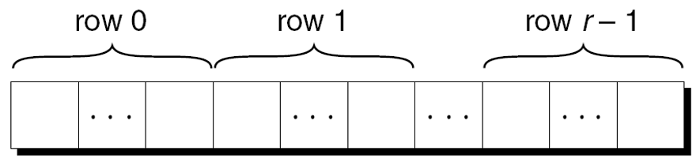

---
presentation:
  margin: 0
  center: false
  transition: "convex"
  enableSpeakerNotes: true
  slideNumber: "c/t"
  navigationMode: "linear"
---

@import "../css/font-awesome-4.7.0/css/font-awesome.css"
@import "../css/theme/solarized.css"
@import "../css/logo.css"
@import "../css/font.css"
@import "../css/color.css"
@import "../css/margin.css"
@import "../css/table.css"
@import "../css/main.css"
@import "../plugin/zoom/zoom.js"
@import "../plugin/customcontrols/plugin.js"
@import "../plugin/customcontrols/style.css"
@import "../plugin/chalkboard/plugin.js"
@import "../plugin/chalkboard/style.css"
@import "../plugin/menu/menu.js"
@import "../js/anychart/anychart-core.min.js"
@import "../js/anychart/anychart-venn.min.js"
@import "../js/anychart/pastel.min.js"
@import "../js/anychart/venn-ml.js"
@import "https://cdn.bootcdn.net/ajax/libs/jquery/3.5.0/jquery.js"

<!-- slide data-notes="" -->

<div class="bottom20"></div>

# 智能程序设计（C语言）

<hr class="width50 center">

## 指针与数组 (下)

<div class="bottom8"></div>

### 计算机学院 &nbsp;&nbsp; 杨已彪

#### [yangyibiao@nju.edu.cn](mailto:yangyibiao@nju.edu.cn)


<!-- slide data-notes="" -->

##### 提纲

---

- 数组名作为指针

- 案例: 数列反向 (指针版)

- 数组型实际参数

- 多维数组与指针

- 课堂小测

---


<!-- slide data-notes="" -->


##### 使用数组名称作为指针

---

<div style="display:flex;align-items:flex-start;gap:24px;">

<div style="flex:1.3;font-size:0.6em;">

```C
int a[10];
```

```C
*a = 7;      /* 将 7存储在a[0]中 */
*(a+1) = 12; /* 将12存储在a[1]中 */
```

```C{.line-numbers}
/* 原始版本 */
for (p = &a[0]; p < &a[N]; p++)
    sum += *p;

/* 简化版本 */
for (p = a; p < a + N; p++)
    sum += *p;
```

```C
while (*a != 0)
    a++; /*** 错误的 ***/
```

```C
p = a;
while (*p != 0)
    p++;
```

</div>

<div style="flex:1;font-size:0.6em;">

假设a声明如下:

把数组名 a 当指针用的示例:

一般情况, `a+i`与`&a[i]`相同, 都表示指向数组a中的元素i的指针. 

此外, `*(a+i)`等价于`a[i]`, 两者都代表元素i本身.


数组名称可以用作指针这一事实使得编写遍历数组的循环变得更加容易.

尽管数组名可以用作指针, 但==不能为数组名赋新值==. 

试图让数组名指向其他地方是错误的:

可以将a复制到指针变量中, 然后更改指针变量:


</div>

</div>

<!-- slide data-notes="" -->##### 程序: 数列反向(指针版)

---

==现场演示==: 用==指针==重写第 6 周的数列反向程序——不用下标 `a[i]`, 全部用指针完成

样例:

```
输入 10 个数: 34 82 49 102 7 94 23 11 50 31
逆序输出: 31 50 11 23 94 7 102 49 82 34
```

<span class="blue">:fa-lightbulb-o:</span> 提示: 两个循环——一个负责读入, 一个负责倒序输出; 全程不要出现 `a[i]`

---


<!-- slide data-notes="" -->


##### 程序: 数列反向(指针版 参考代码)

---

<div style="display:flex;align-items:flex-start;gap:24px;">

<div style="flex:1.3;font-size:0.55em;">

```C{.line-numbers}
/* 数列反向（指针版本） */
#include <stdio.h>
#define N 10
int main(void)
{
  int a[N], *p;
  printf("输入 %d 个数: ", N);
  for (p = a; p < a + N; p++)
    scanf("%d", p);
  printf("逆序输出:");
  for (p = a + N; p != a; )       /* 先回退再打印, p 不会走出数组 */
    printf(" %d", *--p);
  printf("\n");
  return 0;
}
```

</div>

<div style="flex:1;font-size:0.6em;">

- 正着读: `p` 从 `a` 到 `a + N` (注意 `p++` 就是下一个元素)

- 倒着打: `p` 从 `a + N` 开始, 先 `--p` 再打印, 走到 `a` 为止——p 始终==不走出数组== (指针跑到数组外是未定义行为)

- 对比第 6 周下标版: `a[i]` 与 `*p` 一一对应, 指针版没有下标变量 i

</div>

</div>

---

<!-- slide data-notes="" -->


##### 数组型实际参数: 数组名被视为指针

---

<div style="display:flex;align-items:flex-start;gap:24px;">

<div style="flex:1.3;font-size:0.55em;">

```C{.line-numbers}
#define N 10
int find_largest(int a[], int n)
{
    int i, max;

    max = a[0];
    for (i = 1; i < n; i++)
        if (a[i] > max)
            max = a[i];
    return max;
}

int main(){
    int b[N] = {0};
    ...
    /* 此调用导致将指向b的第一个元素的指针赋值给a, 数组本身不会被复制. */
    largest = find_largest(b, N); /* 调用find_largest */
    ...
}
```

```C
void store_zeros(int a[], int n)
{
    int i;

    for (i = 0; i < n; i++)
        a[i] = 0;
}
```

```C
int find_largest(const int a[], int n)
{
    …
}
```

</div>

<div style="flex:1;font-size:0.6em;">

数组名传递给函数时, 总是被视为指针. 例子:

把数组型形式参数视为指针会产生许多重要的结果: 

- 结果1: 普通变量传给函数时, 其值被复制, 对相应参数的任何更改都不会影响变量. 相反, 用作参数的数组是可能被改变的. 

比如下面这个函数, 把数组每个元素清零:

为了表明数组参数不会被修改, 我们可以在它的声明中包含单词const:

编译器会检查find_largest函数体没有对a中元素进行赋值.

</div>

</div>

<!-- slide data-notes="" -->


##### 数组型实际参数: 形参 int a[] 与 int *a 等价

---

<div style="display:flex;align-items:flex-start;gap:24px;">

<div style="flex:1.3;font-size:0.55em;">

```C
int find_largest(int *a, int n)
{
    …
}
```

```C
/* 等价 */
int find_largest(int *a, int n);
int find_largest(int a[], int n);
```

```C
/* 不等价 */
int a[10]; /* 编译器为数组a留出10个整数的空间 */
int *a; /* 编译器仅为指针变量分配空间 */
```

</div>

<div style="flex:1;font-size:0.6em;">

- 数组名传给函数时总被视为指针; ==数组可能被修改== (普通变量传值, 改参数不影响原变量)

- 用 `const` 声明表明不修改: 编译器会检查函数体没有对 a 中元素赋值

- ==第 9 周的悬念在这里揭晓==: 数组作参数为什么能改原数组——传的本来就是地址

</div>
</div>

<!-- slide data-notes="" -->


##### 数组型实际参数: 可以传数组的片段

---

后一种情况下, a不是数组; 试图将其用作数组可能会导致灾难性的后果. 

```C
int *a;
*a = 0; /*** 错误的 ***/
```

将0存到a指向的地方. 不清楚a指向哪, 所以对程序的影响不确定.


- 结果4: 可以给形式参数为数组的函数传递==数组的片段==——连续的数组元素组成的序列. 

对 b[5] ~ b[14] 调用 find_largest 的示例: 

```C
int b[20] = {0};
...
largest = find_largest(&b[5], 10);
```

---


<!-- slide data-notes="" -->


##### 使用指针作为数组名

---


---
C允许把指针看作数组名进行取下标操作:

```C{.line-numbers}
#define N 10
…
int a[N], i, sum = 0, *p = a;
…
for (i = 0; i < N; i++)
    sum += p[i];
```

编译器将p[i]视为*(p+i). 


---

指针可以指向一维数组的元素, 也可以指向多维数组的元素. 

本节探讨使用指针处理多维数组元素的常用方法.

---


<!-- slide data-notes="" -->


##### 处理多维数组的元素

---

<div style="display:flex;align-items:flex-start;gap:24px;">

<div style="flex:1.3;font-size:0.55em;">

```C{.line-numbers}
int a[NUM_ROWS][NUM_COLS];

/* 方法1: 使用嵌套的for循环来进行二维数组的初始化 */
int row, col;
…
for (row = 0; row < NUM_ROWS; row++)
    for (col = 0; col < NUM_COLS; col++)
        a[row][col] = 0;

/* 方法2: 将a视为一维的整型数组, 单个循环进行初始化 */
int * p;
…
for (p = &a[0][0]; p <= &a[NUM_ROWS-1][NUM_COLS-1]; p++)
    *p = 0;
```

</div>

<div style="flex:1;font-size:0.6em;">

第 6 周学过: C 以行优先顺序存储二维数组. 

r行的数组的布局: 
  
<div class="top-2">
    
</div>

p 一开始指向第 0 行第 0 列 ($a[0][0]$), 不断自增 p 就能挨个访问每个元素。


考虑将以下数组的所有元素初始化为0的问题:

严格说, 把二维数组当一维扁平遍历==依赖实现== (标准不保证可移植), 了解思路即可——正规写法是嵌套循环或下一节的行指针. 

该方法会损害程序的可读性, 对老的编译器可能产生效率提升. 

对于许多现代编译器, 速度优势通常不存在.

</div>

</div>

<!-- slide data-notes="" -->


##### 处理多维数组的行

---

<div style="display:flex;align-items:flex-start;gap:24px;">

<div style="flex:1.4;font-size:0.5em;">

```C 
/* 将p初始化为指向数组a中第i行的元素0 */
p = &a[i][0];

/* 可简化为 */
p = a[i];
```

```C
int a[NUM_ROWS][NUM_COLS], *p, i;
…
for (p = a[i]; p < a[i] + NUM_COLS; p++)
    *p = 0;
```

```C{.line-numbers}
int a[NUM_ROWS][NUM_COLS] = {0};
...
largest = find_largest(a[i], NUM_COLS);
```

</div>

<div style="flex:1;font-size:0.6em;">

指针变量p也可用于处理二维数组的一行中的元素. 

为访问第i行的元素:

对于任何二维数组a, 表达式a[i]是指向第i行第一个元素的指针. 

为了解原理, 回顾一下: 

- 表达式$a[i]$等价于$*(a + i)$. 

- `&a[i][0]`等同于`&(*(a[i] + 0))`, 而后者等价于`&*a[i]`. 

- &和*运算符可抵消, `&*a[i]`也就等同于$a[i]$ 

- `a[i][0]`为第i行第0个元素, &a[i][0]即为元素的地址. 

- `&a[i][0]`等价于`&(*(a[i]+0))`, 等价于`&*a[i]`


对数组a的第i行清零的循环:

由于a[i]是指向数组a的第i行的指针, 可将a[i]传递给一维数组作为参数的函数. 

换句话说, 处理一维数组的函数也可以处理二维数组的行.


考虑find_largest, 它最初设计用于查找一维数组的最大元素. 

这里使用find_largest来确定二维数组a的第i行中的最大元素:


</div>

</div>

<!-- slide data-notes="" -->


##### 处理多维数组的列

---

<div style="display:flex;align-items:flex-start;gap:24px;">

<div style="flex:1.3;font-size:0.55em;">

```C{.line-numbers}
/* 对数组a的第i列清零的循环 */
int a[NUM_ROWS][NUM_COLS],  (*p)[NUM_COLS], i;
…
for (p = &a[0]; p < &a[NUM_ROWS]; p++)
    (*p)[i] = 0;
```

```C
int a[NUM_ROWS][NUM_COLS];
```

</div>

<div style="flex:1;font-size:0.6em;">

处理二维数组一列的元素:

`int (*p)[NUM_COLS];`把p声明为指向长度为NUM_COLS的整形数组的指针

- `(*p)`括号是必需的, 若无括号则编译器将p看作指针数组, 而不是指向数组的指针

- p++把p移到下一行的开始位置

- 在`(*p)[i]`中, *p代表a的一整行, `(*p)[i]`选中该行的第i列的元素

- `(*p)[i]`中的括号是必要的, 无括号编译器会将`*p[i]`解释为`*(p[i])`


任何数组的名称都可以用作指针, 不管它有多少维, 但需要注意.

a不是指向a[0][0]的指针, 它是指向a[0]的指针. 

C将a视为一维数组, 其元素是一维数组. 

当用作指针时, a 的类型为int (*)[NUM_COLS] （指向长度为NUM_COLS的整数数组的指针）.

</div>

</div>

<!-- slide data-notes="" -->

##### 课堂小测

---

1. 数组名 `a` 在表达式中等价于什么？`a == &a[0]` 成立吗？

2. `a[i]` 与 `*(a + i)` 是什么关系？

3. `int *p = a;` 之后写 `p[i]` 合法吗？编译器怎么理解它？

4. 纠错: `int a[5]; a++;` 错在哪里？想"移动"应该怎么写？

---


<!-- slide data-notes="" -->

#####

---

<div class="bottom20"></div>

# 下周见!

<hr class="width50 center">

## 未完待续

---


