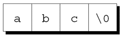
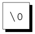
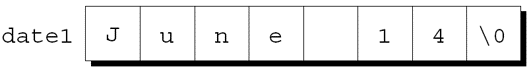
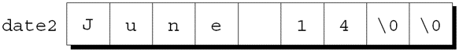
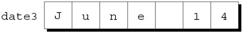
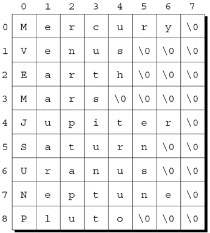

@import "../css/font-awesome-4.7.0/css/font-awesome.css"
@import "../css/theme/solarized.css"
@import "../css/logo.css"
@import "../css/font.css"
@import "../css/color.css"
@import "../css/margin.css"
@import "../css/table.css"
@import "../css/main.css"
@import "../plugin/zoom/zoom.js"
@import "../plugin/customcontrols/plugin.js"
@import "../plugin/customcontrols/style.css"
@import "../plugin/chalkboard/plugin.js"
@import "../plugin/chalkboard/style.css"
@import "../plugin/menu/menu.js"
@import "../js/anychart/anychart-core.min.js"
@import "../js/anychart/anychart-venn.min.js"
@import "../js/anychart/pastel.min.js"
@import "../js/anychart/venn-ml.js"
@import "https://cdn.bootcdn.net/ajax/libs/jquery/3.5.0/jquery.js"


<!-- slide data-notes="" -->

<div class="bottom20"></div>
<style>.reveal pre code{max-height:none!important;overflow:visible!important}.small-code pre{font-size:1em!important}</style>

# 智能程序设计（C语言）

<hr class="width50 center">

## 指针与字符串

<div class="bottom8"></div>

### 计算机学院 &nbsp;&nbsp; 杨已彪

#### [yangyibiao@nju.edu.cn](mailto:yangyibiao@nju.edu.cn)


<!-- slide data-notes="" -->

##### 提纲

---

- 字符串字面量与存储

- 字符串变量: 字符数组 vs 字符指针

- 字符串的读写

- 字符串库函数: strcpy 与 strlen

- 任务: 自己实现 strlen

- 更多库函数与综合案例

---


<!-- slide data-notes="" -->

##### 字符串字面量: 定义与转义

---

<div style="font-size:0.92em;">
==字符串字面量==: 用双引号括起来的字符序列. 程序处理的名字、句子、文件名……都是字符串; 本章讲字符串常量(字面量)与字符串变量.
</div>

<div style="display:grid;grid-template-columns:1.05fr 1fr;gap:26px;align-items:start;margin-top:4px;">

<div style="font-size:0.76em;">

这一串打印出来是四行诗 (诗只在这里出现一次):

```text
Candy
Is dandy
But liquor
Is quicker.
  --Ogden Nash
```

</div>

<div style="font-size:0.82em;">

字符串字面量可以包含==转义序列==; 转义字符经常出现在 `printf`/`scanf` 的格式串里.

最常用的是 `\n`: 每个 `\n` 使光标移到下一行.

```C
printf("one\ntwo\n");
```

输出为两行:

```text
one
two
```

</div>

</div>

字符串是字符数组, 用==空字符== `'\0'` 标记结束; C 库提供一组字符串处理函数.

<!-- slide data-notes="" -->


##### 字符串字面量的存储

---

<div style="display:flex;align-items:flex-start;gap:24px;">

<div style="flex:1.3;font-size:0.65em;">

当C编译器在程序中遇到长度为 ==$n$== 的字符串字面量时, 它会为该字符串分配 ==$n + 1$== 个字节的内存. 

这块空间存字符串的字符, 外加一个额外字符: 
==空字符== 标记字符串的结尾. 

空字符是所有位都为0的字节, 因此它用转义序列 =='\0'== 表示.

</div>

<div style="flex:1;font-size:0.62em;">

字符串字面量 "abc" 存储成 4 个字符的数组:

<div class="top-2">
  
</div>

空串 "" 只存一个空字符:

<div class="top-2">
  
</div>

</div>

</div>

---


<!-- slide data-notes="" -->

##### 对字符串字面量的操作

---

凡是能用 `char *` 指针的地方, 都能直接用字符串字面量; 字面量也可以像数组一样取下标.

<div style="display:grid;grid-template-columns:1.05fr 1fr;gap:24px;align-items:start;">

<div style="font-size:0.86em;">

```C
char *p;
p = "abc";          /* p 指向 'a' */

char ch;
ch = "abc"[1];      /* ch = 'b' */
```

赋值让 p 指向字符串的==第一个字符==; `"abc"[1]` 就是字符 `'b'`.

</div>

<div style="font-size:0.86em;">

把 0 ~ 15 的数字转成十六进制字符:

```C
char digit_to_hex_char(int digit)
{
  return "0123456789ABCDEF"[digit];
}
```

这里把字符串字面量当作==只读数组==: `digit` 是下标, 返回值是对应字符.

</div>

</div>

<!-- slide data-notes="" -->


##### 字符串字面量与字符常量

---

包含单个字符的字符串字面量与字符常量不同. 

- `"a"`由==指针==表示. 

- `'a'`由==整数==表示. 

合法调用: 
```C
printf("\n");
```

非法调用: 
```C
printf('\n'); /*** 错误的 ***/
```

---


<!-- slide data-notes="" -->

##### 字符串变量: 字符数组

---

<div class="split-rule" style="display:grid;grid-template-columns:1.05fr 1fr;gap:24px;align-items:start;">

<div style="font-size:0.68em;">

<div class="col-label">代码</div>

```C
#define STR_LEN 80

char str[STR_LEN + 1];
```

```C
str[0] = 'H';
str[1] = 'i';
str[2] = '\0';   /* 现在 str 是字符串 "Hi" */
```

</div>

<div style="font-size:0.8em;">

<div class="col-label">说明</div>

任何一维字符数组都可以用来存储字符串, 但必须以空字符 `'\0'` 结尾.

要存 80 个字符, 数组必须声明为 81: 多出的 1 个字节留给空字符; 先 `#define STR_LEN 80` 再加 1 是==惯用法==.

用数组存字符串的难点:

- 很难判断一个字符数组是否被当作字符串;
- 字符串处理函数必须小心处理空字符;
- 确定字符串长度需要搜索空字符.

</div>

</div>

`STR_LEN + 1` 的数组可保存长度 0 ~ `STR_LEN` 的字符串; ==实际长度取决于空字符的位置==. 不留空字符空间, 程序执行时可能得到不可预知的结果.

<!-- slide data-notes="" -->

##### 初始化字符串变量: 恰好、过短、过长

---

<div style="font-size:0.8em;">
声明时可以直接用字符串初始化. 编译器把 `"June 14"` 当作==字符数组初始化式==的缩写, 并自动补上空字符.
</div>

<div style="display:grid;grid-template-columns:1fr 1fr 1fr;gap:18px;align-items:start;margin:0 2rem;">

<div>
<div style="font-size:0.8em;color:#268bd2;"><strong>恰好</strong></div>

<div style="font-size:0.46em;">

```C
char date1[8] = "June 14";
```

</div>



<div style="font-size:0.68em;">7 个字符 + 1 个空字符, 正好填满 8 字节.</div>
</div>

<div>
<div style="font-size:0.8em;color:#268bd2;"><strong>过短</strong></div>

<div style="font-size:0.46em;">

```C
char date2[9] = "June 14";
```

</div>



<div style="font-size:0.68em;">空间有富余, 编译器补足额外的空字符.</div>
</div>

<div>
<div style="font-size:0.8em;color:#268bd2;"><strong>过长</strong></div>

<div style="font-size:0.46em;">

```C
char date3[7] = "June 14";
```

</div>



<div style="font-size:0.68em;">初始化式不能长于数组, 但可以一样长; 没有空间存空字符, 不能当字符串用.</div>
</div>

</div>

<!-- slide data-notes="" -->

##### 字符数组与字符指针

---

<div style="display:grid;grid-template-columns:1.02fr 1fr;gap:24px;align-items:start;">

<div style="font-size:0.82em;">

```C
char date[] = "June 14";   /* 数组 */
char *date = "June 14";    /* 指针 */
```

两种声明都能当字符串用, 但:

- 数组: date 是数组名, 内容==可以修改==, 存放的是自己的一份副本.
- 指针: date 是变量, 可以改指向; 指向==不应修改==的字符串字面量.

</div>

<div style="font-size:0.82em;">

```C
char *p;
char str[STR_LEN + 1];
p = str;        /* 让 p 指向字符数组 */
```

`char *p;` ==不会为字符串分配空间==. 使用 p 作为字符串前, 必须让它指向一个字符数组; 也可以指向以后动态分配的字符串.

</div>

</div>

<!-- slide data-notes="" -->


##### 写字符串: printf 与 puts

---

<div style="display:flex;align-items:flex-start;gap:24px;">

<div style="flex:1.2;font-size:0.62em;">

```C
char str[] = "Are we having fun yet?";
printf("%.6s\n", str);
puts(str);
```

</div>

<div style="flex:1;">

要打印字符串的一部分, 可以使用转换说明 ==%.ps==

==p== 是要打印的字符数量.

`printf("%.6s\n", str);` 将打印
`Are we`

`puts(str);` 打印整个字符串并自动换行 (相当于 `printf("%s\n", str)`).

</div>

</div>

<!-- slide data-notes="" -->

##### 写字符串: 字段宽度

---

转换说明 ==%ms== 将在大小为 ==m== 的字段内打印字符串.

如果字符串少于 ==m== 个字符, 则会在字段内右对齐输出.

如果要强制左对齐, 在 m 前面加一个减号.

m 和 p 可以组合使用:

转换说明 ==%m.ps== 会使字符串的前 ==p== 个字符打印在大小为 ==m== 的字段中.

例如:

```C
printf("%10.6s|\n", str);  /* 字段宽 10, 取前 6 个字符, 右对齐 */
printf("%-10.6s|\n", str); /* 左对齐 */
```

<!-- slide data-notes="" -->

##### 读字符串: scanf

---

<div style="display:grid;grid-template-columns:1.08fr 1fr;gap:24px;align-items:start;">

<div style="font-size:0.88em;">

转换说明 `%s` 允许 scanf 把字符串读入字符数组:

```C
char str[20];
scanf("%s", str);   /* str 是数组名, 无需 & */
```

- scanf 先==跳过空白字符==, 再读入字符, 直到遇到空白;
- 空格、制表符、换行符都会让它停止;
- 它在末尾自动存储一个空字符.

因此 scanf 通常==读不到整行==.

</div>

<div style="font-size:0.88em;">

要读取整行, 历史上常用 `gets`, 它的特点是:

- 不跳过开头的空白字符, 一直读到<u>换行符</u>才停止;
- 丢弃换行符, 用空字符代替.

但 gets 有严重缺陷, 下一页细讲; 现在应改用 `fgets`.

</div>

</div>

<!-- slide data-notes="" -->

##### 读字符串: 为什么不用 gets

---

<div style="display:flex;align-items:flex-start;gap:24px;">

<div style="flex:1.25;font-size:0.62em;">

不要使用 ==gets== 读取字符串:

- gets ==不检查缓冲区大小==, 输入过长会溢出 (缓冲区溢出漏洞的经典来源)

- ==C11 标准已把 gets 从语言中移除==; OJ 平台上的老题也要改用 fgets

==fgets== 会连换行符一起读入 (和 gets 不同), 需要时手工去掉末尾的 `\n`.

去掉换行符的写法 (`strlen` 声明在 `<string.h>` 中).

</div>

<div style="flex:1;font-size:0.62em;">

```C
char line[100];

/* Wrong: gets(line);  —— 危险且已移除 */
fgets(line, sizeof(line), stdin);   /* 正确: 带上限长度 */
```

```C
size_t l = strlen(line);
if (l > 0 && line[l - 1] == '\n')
  line[l - 1] = '\0';
```

</div>

</div>

---


<!-- slide data-notes="" -->

##### 逐个字符读字符串

---

<div style="display:flex;align-items:flex-start;gap:24px;">

<div style="flex:1;font-size:0.9em;">

程序员经常自己编写输入函数. 设计时要考虑:

- 是否在存储前==跳过空白字符==?
- 什么字符让函数==停止读取== (换行/任意空白/其他)? 这个字符存不存?
- 输入太长无法存储时, ==丢弃多余字符==还是留给下一次输入?

假设需要这样一个函数: 不跳过空白, 在第一个换行符处停止 (不存储), 并丢弃多余字符.

函数原型: `int read_line(char str[], int n);`

若输入行超过 n-1 个字符, 多出的字符被丢弃; 函数返回==实际存入的字符数==.

</div>

</div>

<!-- slide data-notes="" -->

##### 逐个字符读字符串 (实现)

---

<div style="display:flex;align-items:flex-start;gap:24px;" class="split-rule">

<div style="flex:1.3;font-size:0.55em;">

<div class="col-label">代码</div>


```C{.line-numbers}
int read_line(char str[], int n)
{
  int ch, i = 0;

  while ((ch = getchar()) != '\n' && ch != EOF) {
    if (i < n - 1)
      str[i++] = ch;
  }
  str[i] = '\0';
  return i;
}
```

</div>

<div style="flex:1;font-size:0.82em;">

<div class="col-label">要点</div>


- `getchar` 每次读入一个字符;
- 循环在换行符或 EOF 处停止, 换行符不存入数组;
- `i < n - 1` 给空字符留位置, 超出的字符读入后直接丢弃;
- 循环后补 `'\0'`, 返回实际存储的字符数 (输入过长时返回 n-1).

</div>

</div>

<!-- slide data-notes="" -->


##### 访问字符串中的字符

---

<div style="display:flex;align-items:flex-start;gap:24px;">

<div style="flex:1.3;font-size:0.6em;">

```C{.line-numbers}
int count_spaces(const char s[])
{
  int count = 0;
  for (int i = 0; s[i] != '\0'; i++) {
    if (s[i] == ' ')
      count++;
  }
  return count;
}
```

```C{.line-numbers}
int count_spaces(const char *s)
{
  int count = 0;
  for (; *s != '\0'; s++) {
    if (*s == ' ')
      count++;
  }
  return count;
}
```

</div>

<div style="flex:1;">

由于字符串是以数组的方式存储的, 可以使用下标来访问字符串中的字符.

要处理字符串 s 中的每个字符, 可以设置一个循环来对计数器 i 进行自增并通过表达式 s[i] 选择字符.

---

计算字符串中空格数的函数:

用指针运算代替下标:

</div>

</div>

<!-- slide data-notes="" -->


##### strcpy(字符串复制)

---

<div style="display:flex;align-items:flex-start;gap:24px;">

<div style="flex:1.2;font-size:0.62em;">

```C
strcpy(str2, "abcd");
/* str2 现在包含 "abcd" */
```

```C
strcpy(str1, str2);
/* str1 现在包含 "abcd" */
```

</div>

<div style="flex:1;font-size:0.75em;">

strcpy函数的原型: 

`char *strcpy(char *s1, const char *s2);`

strcpy、strlen、strcat、strcmp 都声明在 `<string.h>` 中, 使用前要 `#include <string.h>`.

strcpy将字符串s2复制到字符串s1中. 

准确地说, strcpy将 ==s2指向的字符串== 复制到 ==s1指向的数组中==. 

strcpy返回s1(指向目标字符串的指针).


调用strcpy, 把字符串"abcd"存储到str2中:

把str2的内容复制到str1:


</div>

</div>

<!-- slide data-notes="" -->


##### strlen(字符串长度)

---

strlen函数的原型: 

`size_t strlen(const char *s);`

size_t是一个typedef名称, 表示C的一种无符号整型.


strlen返回字符串s的长度, 不包括空字符. 例子: 

```C{.line-numbers}
int len;

len = strlen("abc");  /* len is now 3 */
len = strlen("");     /* len is now 0 */
strcpy(str1, "abc");
len = strlen(str1);   /* len is now 3 */
```

---


<!-- slide data-notes="" -->

##### 任务: 自己实现 strlen

---

<div style="font-size:0.9em;line-height:1.55;">

==任务==: 写 `int my_strlen(const char *s)`, 返回字符串长度 (==不含==结尾的 `'\0'`), 分别用==下标版==和==指针版==实现

在 main 中验证:

```
"abc" 的长度 = 3
"" 的长度 = 0
"hello world" 的长度 = 11
```

==提示==:

- 下标版: 从 `s[0]` 数到 `s[i] == '\0'` 为止

- 指针版: `*s` 非零就计数并 `s++`, 循环结束时走过的步数就是长度

- 不要调用 `<string.h>` 的 `strlen`, 自己数

<a href="vscode://file/Users/yangyibiao/Documents/Seafile/GitRepo/yangyibiao.github.io/cpl/slides/12-strings/code/task-strlen.c" style="display:inline-block;margin-top:3px;padding:5px 14px;background:#268bd2;color:#fff;border-radius:6px;font-size:0.85em;text-decoration:none;">⚡ 在 VS Code 中打开 task-strlen.c (骨架)</a>

</div>

<!-- slide data-notes="" -->

##### 任务: 参考代码与要点

---

<div style="display:flex;align-items:flex-start;gap:24px;">

<div class="small-code" style="flex:1.08;min-width:0;font-size:0.4em;">

```C{.line-numbers}
#include <stdio.h>

int my_strlen_index(const char *s)
{
  int n = 0;
  while (s[n] != '\0')      /* 下标版 */
    n++;
  return n;
}
int my_strlen_pointer(const char *s)
{
  const char *p = s;
  while (*p != '\0')        /* 指针版 */
    p++;
  return (int)(p - s);
}

int main(void)
{
  const char *tests[] = {"abc", "", "hello world"};
  for (int i = 0; i < 3; i++)
    printf("\"%s\" 的长度 = %d / %d\n", tests[i],
           my_strlen_index(tests[i]),
           my_strlen_pointer(tests[i]));
  return 0;
}
```

</div>

<div style="flex:1;min-width:0;font-size:0.66em;line-height:1.55;">

- 字符串以 `'\0'` 结尾, 长度==不包含==这个空字符

- `s[i]` 就是 `*(s + i)`: 下标版和指针版本质相同, 只是写法不同

- 指针版用 `p - s` 得到走过的元素个数——这就是 11-1 讲的指针相减

- 参数写 ==`const char *`== 表明函数不会修改字符串

- `<string.h>` 的 strlen 返回 `size_t` (无符号); 自己实现返回 `int` 便于 `%d` 打印

</div>

</div>

<!-- slide data-notes="" -->


##### strcat(字符串拼接)

---

<div style="display:flex;align-items:flex-start;gap:24px;">

<div style="flex:1.3;font-size:0.6em;">

```C{.line-numbers}
char str1[20], str2[20];
strcpy(str1, "abc");
strcat(str1, "def");
 /* str1 now contains "abcdef" */
strcpy(str1, "abc");
strcpy(str2, "def");
strcat(str1, str2);
 /* str1 now contains "abcdef" */ 
```

```C{.line-numbers}
char str1[20], str2[20];
strcpy(str1, "abc");
strcpy(str2, "def");
strcat(str1, strcat(str2, "ghi"));
/* str1 now contains "abcdefghi";
   str2 contains "defghi" */
```

</div>

<div style="flex:1;">

strcat函数的原型: 

`char *strcat(char *s1, const char *s2);`

strcat将字符串s2的内容附加到字符串s1的末尾. 

它返回s1(指向结果字符串的指针). strcat示例:

与strcpy一样, strcat返回的值通常会被丢弃. 

左侧最后一段代码使用了返回值:


</div>

</div>

<!-- slide data-notes="" -->


##### strcmp(字符串比较)

---

<div style="display:flex;align-items:flex-start;gap:24px;">

<div style="flex:1.2;font-size:0.62em;">

```C
int strcmp(const char *s1, const char *s2);
```

```C
if (strcmp(str1, str2) < 0)    /* is str1 < str2? */
  …
```

```C
if (strcmp(str1, str2) <= 0) /* is str1 <= str2? */
  …
```

</div>

<div style="flex:1;">

strcmp函数的原型:

strcmp比较字符串s1和s2, 根据s1是小于、等于还是大于s2, 返回一个小于、等于或大于0的值.


检查str1是否小于str2:

检查str1是否小于或等于str2 :

通过选择适当的运算符(<、 <=、 >、 >=、 ==、 !=), 可以测试str1和str2之间的任何可能的关系.

</div>

</div>

<!-- slide data-notes="" -->

##### 程序: 打印一个月的提醒列表

---

<div style="display:grid;grid-template-columns:1.12fr 1fr;gap:22px;align-items:start;">

<div style="font-size:0.48em;">

```
输入日期和提醒: 24 妈妈的生日
输入日期和提醒: 5 18:00 与朋友聚餐
输入日期和提醒: 26 看电影
输入日期和提醒: 7 10:30 看牙医
输入日期和提醒: 12 交作业
输入日期和提醒: 5 上课
输入日期和提醒: 12 上课
输入日期和提醒: 0

日期  提醒
  5 上课
  5 18:00 与朋友聚餐
  7 10:30 看牙医
 12 上课
 12 交作业
 24 妈妈的生日
 26 看电影
```

</div>

<div style="font-size:0.72em;">

`remind.c` 维护一个月的每日提醒列表: 用户逐条输入"日期 + 提醒", 输入 0 结束, 程序按日期排序打印全部提醒.

总体策略:

- 读入一系列日期和提醒;
- 按日期有序存储;
- 显示.

日期用 `scanf`, 整行提醒用 `read_line`: 排序要比较日期, 读提醒要保留空格.

</div>

</div>

<!-- slide data-notes="" -->

##### 程序: 打印一个月的提醒列表 (参考实现)

---

<div style="display:flex;align-items:flex-start;gap:24px;">

<div class="small-code" style="flex:1.42;min-width:0;font-size:0.5em;">

```C{.line-numbers}
#define MAX_REMIND 50
#define MSG_LEN 60
char reminders[MAX_REMIND][MSG_LEN + 3];
char day_str[3], msg_str[MSG_LEN + 1];
int day, i, j, num_remind = 0;

for (;;) {
  scanf("%2d", &day);               /* 读日期 */
  if (day == 0) break;              /* 0 结束 */
  sprintf(day_str, "%2d", day);
  read_line(msg_str, MSG_LEN + 1);

  for (i = 0; i < num_remind; i++)  /* 找插入位置 */
    if (strcmp(day_str, reminders[i]) < 0) break;
  for (j = num_remind; j > i; j--)  /* 从后往前腾位 */
    strcpy(reminders[j], reminders[j - 1]);
  strcpy(reminders[i], day_str);    /* 放入日期 */
  strcat(reminders[i], msg_str);    /* 拼上提醒 */
  num_remind++;
}
```

</div>

<div style="flex:1;min-width:0;font-size:0.6em;">

下面是 `main` 的核心代码 (节选), 完整程序见 `code/remind.c`.

- `reminders` 是二维字符数组, 每一行存"日期 + 提醒".
- 日期先用 `sprintf` 格式化成两位字符串, 再与提醒拼接.
- 插入时从后向前腾出位置, 保持按日期有序.
- 使用 `strcmp`、`strcpy`、`strcat`, 需要 `#include <string.h>`.
- 最后的按顺序打印循环省略了, 见 `remind.c`：`for (i = 0; i < num_remind; i++) printf(" %s\n", reminders[i]);`

<a href="vscode://file/Users/yangyibiao/Documents/Seafile/GitRepo/yangyibiao.github.io/cpl/slides/12-strings/code/remind.c" style="display:inline-block;margin-top:5px;padding:5px 14px;background:#268bd2;color:#fff;border-radius:6px;font-size:0.9em;text-decoration:none;">⚡ 在 VS Code 中打开 remind.c</a>

</div>

</div>

<!-- slide data-notes="" -->


##### 字符串惯用法: 搜索结尾与复制

---

<div style="display:flex;align-items:flex-start;gap:24px;">

<div style="flex:1.3;font-size:0.55em;">

```C{.line-numbers}
size_t strlen(const char *s)
{
  size_t n = 0;

  for (; *s != '\0'; s++) {
    n++;
  }

  return n;
}
```

```C{.line-numbers}
size_t strlen(const char *s)
{
  size_t n = 0;

  for (; *s; s++) {
    n++;
  }

  return n;
}
```

</div>

<div style="flex:1;">

n的初始化移到它的声明中:

条件`*s != '\0'`与`*s != 0`相同, 这又与`*s`相同. 

使用这些观察的strlen版本:

字符串复制的惯用法:

```C
while ((*s1++ = *s2++))
  ;
```

先把 `*s2` 赋给 `*s1`, 再让两个指针后移; 赋值为空字符时循环结束.

</div>

</div>

<!-- slide data-notes="" -->

##### 字符串数组

---

<div style="display:grid;grid-template-columns:1.12fr 1fr;gap:22px;align-items:start;">

<div style="font-size:0.76em;">

二维字符数组, 每行一个字符串:

```C
char planets[][8] = {"Mercury", "Venus", "Earth",
                     "Mars", "Jupiter", "Saturn",
                     "Uranus", "Neptune", "Pluto"};
```

行数可以省略, 但必须指定列数.

用==指针数组==模拟不规则数组:

```C
char *planets[] = {"Mercury", "Venus", "Earth",
                   "Mars", "Jupiter", "Saturn",
                   "Uranus", "Neptune", "Pluto"};
```

每个元素是一个指针, 指向对应字符串字面量; 各行长度可以不同.

</div>

<div style="text-align:center;">



<div style="font-size:0.66em;text-align:left;margin-top:4px;">

二维数组每行按最长的字符串分配, 大量空字符被浪费; 字符串长短不一时, 用==指针数组==模拟不规则数组.

</div>

</div>

</div>

<!-- slide data-notes="" -->

##### 课堂小测

---

<p style="margin:0.25rem 2rem;"><strong>1. 概念：</strong> <code>"abc"</code> 和 <code>'a'</code> 的区别是什么？<code>"abc"</code> 在内存里占几个字节？</p>

<p style="margin:0.25rem 2rem;"><strong>2. 概念：</strong> <code>char s[] = "hello";</code> 与 <code>char *p = "hello";</code> 有什么区别？</p>

<p style="margin:0.25rem 2rem;"><strong>3. 代码阅读：</strong> 下面的程序输出什么？</p>

<div style="font-size:0.72em;">

```C
char s1[20] = "abc", s2[] = "def";
strcpy(s1, s2);
strcat(s1, "ghi");
printf("%s %d\n", s1, (int)strlen(s1));
```

</div>

<p style="margin:0.25rem 2rem;"><strong>4. 纠错：</strong> 下面的代码有两处错误，找出来并改正。</p>

<div style="font-size:0.72em;">

```C
char s[3];
strcpy(s, "abc");

char *p;
strcpy(p, "hi");
```

</div>

---


<!-- slide data-notes="" -->

#####

---

<div class="bottom20"></div>

<hr class="width50 center">

## 未完待续

---


