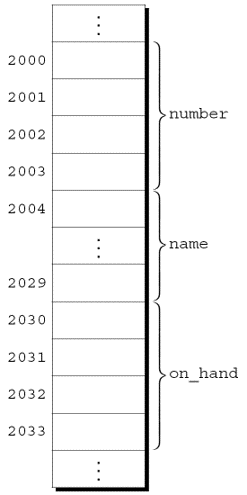
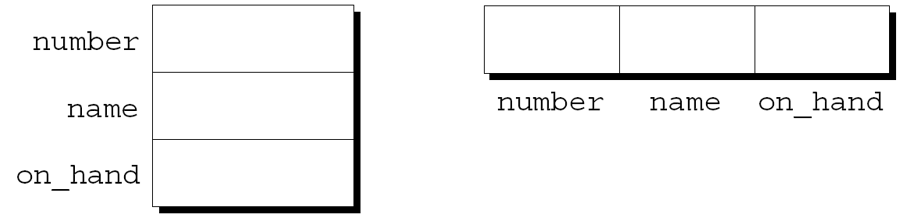
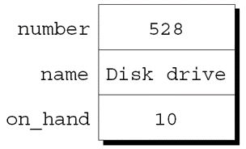

@import "../css/font-awesome-4.7.0/css/font-awesome.css"
@import "../css/theme/solarized.css"
@import "../css/logo.css"
@import "../css/font.css"
@import "../css/color.css"
@import "../css/margin.css"
@import "../css/table.css"
@import "../css/main.css"
@import "../plugin/zoom/zoom.js"
@import "../plugin/customcontrols/plugin.js"
@import "../plugin/customcontrols/style.css"
@import "../plugin/chalkboard/plugin.js"
@import "../plugin/chalkboard/style.css"
@import "../plugin/menu/menu.js"
@import "../js/anychart/anychart-core.min.js"
@import "../js/anychart/anychart-venn.min.js"
@import "../js/anychart/pastel.min.js"
@import "../js/anychart/venn-ml.js"
@import "https://cdn.bootcdn.net/ajax/libs/jquery/3.5.0/jquery.js"


<!-- slide data-notes="" -->

<div class="bottom20"></div>

# 智能程序设计（C语言）

<hr class="width50 center">

## 结构体

<div class="bottom8"></div>

### 计算机学院 &nbsp;&nbsp; 杨已彪

#### [yangyibiao@nju.edu.cn](mailto:yangyibiao@nju.edu.cn)


<!-- slide data-notes="" -->

##### 提纲

---

- 结构体变量: 把相关的数据打包

- 声明、初始化与操作

- 结构体类型与 typedef

- 枚举与 const

- 结构体作为参数和返回值

- 嵌套的结构体

- 结构体数组与案例: 零件数据库

---


<!-- slide data-notes="" -->


##### 结构体变量

---

<div style="display:flex;align-items:flex-start;gap:24px;">

<div style="flex:1.2;font-size:0.6em;">

```C{.line-numbers}
struct {
  int number;
  char name[NAME_LEN+1];
  int on_hand;
} part1, part2;
```

</div>

<div style="flex:1;font-size:0.6em;">

结构体与数组的特性不同. 

- 结构体的元素(成员)不需要具有相同的类型. 

- 成员有名字——访问时==写名字==, 不写位置。

在某些语言中, 结构体称为记录, 成员称为字段. 

一个零件有编号、名字、库存量——数组只能存同类型, 拆成三个数组就互不关联了。==结构体==把一件事物的信息==打包==在一起: 

声明两个结构体变量, 存仓库里零件的信息:

</div>

</div>

<svg viewBox="0 0 400 125" style="display:block;width:900px;max-width:100%;height:auto;flex-shrink:0;margin:0 auto;" role="img" aria-label="三个平行数组与一个结构体的对比">
  <defs>
    <marker id="struct-arrow" viewBox="0 0 10 10" refX="9" refY="5" markerWidth="5" markerHeight="5" orient="auto">
      <path d="M0,0 L10,5 L0,10 Z" fill="#268bd2"/>
    </marker>
  </defs>
  <g font-family="LXGWWenKai, 'Noto Sans SC', sans-serif">
    <text x="8" y="14" font-size="10" fill="#dc322f">拆成三个数组</text>
    <text x="210" y="14" font-size="10" fill="#268bd2">一个结构体 (打包)</text>

    <rect x="8" y="24" width="120" height="30" rx="3" fill="#fdf6e3" stroke="#93a1a1" stroke-width="1.2"/>
    <text x="14" y="43" font-size="8.5" fill="#073642">number: 528</text>
    <rect x="8" y="54" width="120" height="30" rx="3" fill="#fdf6e3" stroke="#93a1a1" stroke-width="1.2"/>
    <text x="14" y="73" font-size="8.5" fill="#073642">name: "Disk drive"</text>
    <rect x="8" y="84" width="120" height="30" rx="3" fill="#fdf6e3" stroke="#93a1a1" stroke-width="1.2"/>
    <text x="14" y="103" font-size="8.5" fill="#073642">on_hand: 10</text>

    <text x="134" y="64" font-size="8" fill="#dc322f" text-anchor="middle">三块</text>
    <text x="134" y="76" font-size="8" fill="#dc322f" text-anchor="middle">独立内存</text>

    <line x1="150" y1="69" x2="204" y2="69" stroke="#268bd2" stroke-width="1.6" marker-end="url(#struct-arrow)"/>
    <text x="177" y="61" font-size="8.5" fill="#268bd2" text-anchor="middle">打包</text>

    <rect x="210" y="24" width="150" height="90" rx="5" fill="#fdf6e3" stroke="#268bd2" stroke-width="2"/>
    <line x1="210" y1="54" x2="360" y2="54" stroke="#93a1a1" stroke-width="1"/>
    <line x1="210" y1="84" x2="360" y2="84" stroke="#93a1a1" stroke-width="1"/>
    <text x="220" y="43" font-size="8.5" fill="#073642">number: 528</text>
    <text x="220" y="73" font-size="8.5" fill="#073642">name: "Disk drive"</text>
    <text x="220" y="103" font-size="8.5" fill="#073642">on_hand: 10</text>

    <path d="M366,24 L374,24 L374,114 L366,114" fill="none" stroke="#859900" stroke-width="1.3"/>
    <text x="378" y="72" font-size="8" fill="#859900">连续</text>

    <text x="8" y="122" font-size="8.5" fill="#586e75">数组只能存同类型; 结构体成员可不同类型, 按名字访问</text>
  </g>
</svg>

<!-- slide data-notes="" -->


##### 结构体变量: 内存布局

---

<div style="display:flex;align-items:flex-start;gap:24px;">

<div style="flex:1;font-size:0.6em;">

<div style="text-align:center;">三个成员按==声明顺序==连续存放:</div>

<div class="top-2" style="text-align:center;">
  
</div>

</div>

<div style="flex:1.1;font-size:0.6em;">

- 数组是一段连续内存——结构体内部同样是"一段连续内存, 成员依次排开"

- 这也解释了结构体为什么能==整体赋值== (把整段内存复制过去)

</div>

</div>

<!-- slide data-notes="" -->


##### 声明结构体变量

---

<div style="display:flex;align-items:flex-start;gap:24px;">

<div style="flex:1.2;font-size:0.6em;">

```C{.line-numbers}
struct {
  int number;
  char name[NAME_LEN+1];
  int on_hand;
} part1, part2;

struct {
  char name[NAME_LEN+1];
  int number;
  char sex;
} employee1, employee2;
```

</div>

<div style="flex:1;font-size:0.5em;line-height:1.35;">

<div style="display:flex;align-items:flex-start;gap:24px;">


<div style="flex:1;">

假设: 

- part1位于地址2000. 

- 整数占用4个字节. 

- NAME_LEN的值为25. 

- 成员之间没有间隙.


结构体的抽象示意: 

<div class="top-2">
  
</div>

成员的值将在稍后放入盒子中.


每个结构体代表一种新的作用域. 

在该作用域内声明的任何名称都不会与程序中的其他名称冲突. 

每个结构体都为它的成员设置了独立的名字空间.

</div>

</div>

</div>

</div>

<!-- slide data-notes="" -->


##### 初始化结构体变量

---

<div style="display:flex;align-items:flex-start;gap:24px;">

<div style="flex:1.2;font-size:0.6em;">

```C
struct {
 int number;
 char name[NAME_LEN+1];
 int on_hand;
} part1 = {528, "Disk drive", 10},
  part2 = {914, "Printer cable", 5};
```

</div>

<div style="flex:1;font-size:0.6em;">

<div style="display:flex;align-items:flex-start;gap:24px;">


<div style="flex:1;">

声明结构体变量的同时可以初始化:

part1 初始化后的样子: 

<div class="top-2">
  
</div>


结构体初始化式遵循类似于数组初始化式的规则. 

结构体初始化式中使用的表达式必须是常量. (这个限制在 C99 中放宽了)

初始化式的成员数可以少于它所初始化的结构体. 

任何"剩余的"成员用 0 作为其初始值.

</div>

</div>

</div>

</div>

<!-- slide data-notes="" -->


##### 对结构体的操作

---

<div style="display:flex;align-items:flex-start;gap:24px;">

<div style="flex:1.3;font-size:0.6em;">

```C{.line-numbers}
printf("Part number: %d\n", part1.number);
printf("Part name: %s\n", part1.name);
printf("Quantity on hand: %d\n", part1.on_hand);
```

```C
part1.number = 258;     
 /* changes part1's part number */
part1.on_hand++;
 /* increments part1's quantity on hand */
```

```C
scanf("%d", &part1.on_hand);
```

</div>

<div style="flex:1;font-size:0.6em;">

<div style="display:flex;align-items:flex-start;gap:24px;">


<div style="flex:1;">

要访问结构体中的成员, 首先写出结构体的名称, 然后写一个句点, 再写出成员的名称. 

打印 part1 成员值的语句:

结构体的成员是左值. 

它们可以做赋值的目标, 也可以出现在自增/自减表达式里:

用于访问结构体成员的句点实际上是一个 C 运算符. 

它比几乎所有运算符优先级都高。例子:

`.`运算符优先级高于`&`运算符, 因此`&`计算part1.on_hand的地址.


结构体另一个常用操作是赋值: 

`part2 = part1;`

该语句的效果是将 part1.number 复制到part2.number, 将 part1.name 复制到 part2.name , 依此类推.

</div>

</div>

</div>

</div>

<!-- slide data-notes="" -->


##### 对结构体的操作 (续)

---

<div style="font-size:0.94em;">

`=`运算符无法用于复制数组, 但在复制结构体时也会复制嵌在结构体中的数组. 

有的程序员利用此属性创建"空"结构体来封装稍后将复制的数组: 

```C
struct { int a[10]; } a1, a2;
a1 = a2;
 /* legal, since a1 and a2 are structures */
```

</div>

---


<!-- slide data-notes="" -->


##### 演示: 结构体能赋值, 不能比

---

<div style="font-size:0.8em;">

```C
struct { int number; char name[20]; } a, b;

a = b;                  /* OK: 整体赋值 (连数组都复制) */
if (a == b)             /* 编译错误! C 不提供整体比较 */
    printf("same\n");
```

</div>

编译报错 (GCC): `invalid operands to binary '=='`

- 整体赋值 `a = b` 合法, 结构体里的数组也跟着复制了

- 但 `a == b` ==编译不通过==——C 只给了赋值, 没给比较

- 想比较就写函数, ==逐成员比==: `a.number == b.number && strcmp(a.name, b.name) == 0`

<a href="vscode://file/Users/yangyibiao/Documents/Seafile/GitRepo/yangyibiao.github.io/cpl/slides/13-struct-linked-list/code/struct-compare.c" style="display:inline-block;margin-top:8px;padding:5px 14px;background:#268bd2;color:#fff;border-radius:6px;font-size:0.85em;text-decoration:none;">⚡ 在 VS Code 中打开 struct-compare.c</a>

---

<!-- slide data-notes="" -->


##### 结构体类型

---

<div style="display:flex;align-items:flex-start;gap:24px;">

<div style="flex:1.4;font-size:0.55em;">

```C{.line-numbers}
struct part {
  int number;
  char name[NAME_LEN+1];
  int on_hand;
};
```

```C
struct part {
 int number;
 char name[NAME_LEN+1];
 int on_hand;
} part1, part2;
```

```C
struct part part1 = {528, "Disk drive", 10};
struct part part2;
part2 = part1; /* legal; both parts have the same type */
```

</div>

<div style="flex:1;font-size:0.5em;line-height:1.22;">

<div style="display:flex;align-items:flex-start;gap:24px;">


<div style="flex:1;">

要声明多个成员相同的结构体变量, 需要一个代表"类型"的名称:

- 声明一个"结构体标记"

- 使用typedef定义类型名

名为part的结构体标记的声明 (注意分号必须跟在右大括号后):

part标记可用于声明变量 (struct不能省略):

`struct part part1, part2;`

`part part1, part2;   /*** WRONG ***/`

part不是类型名; 结构体标记只在struct后有意义, 因此不会与其他名称冲突.

结构体标记的声明可与结构体变量的声明相结合; 所有声明为struct part类型的结构体相互兼容:


</div>

</div>

</div>

</div>

<!-- slide data-notes="" -->


##### 定义结构体类型 (typedef)

---

除了声明结构体标记, 还可以用typedef定义真实的类型名——一个名为Part的类型的定义: 

```C
typedef struct {
  int number;
  char name[NAME_LEN+1];
  int on_hand;
} Part;
```

Part的使用方式与内置类型相同: 

`Part part1, part2;`


命名结构体时可以选择结构体标记或typedef; 后面讲到链表时, 还会用到结构体标记.

---


<!-- slide data-notes="" -->


##### 枚举

---

<div style="display:flex;align-items:flex-start;gap:24px;">

<div style="flex:1.4;font-size:0.55em;">

```C
int s;   /* s will store a suit */
…
s = 2;   /* 2 represents "hearts" */
```

```C{.line-numbers}
#define SUIT     int
#define CLUBS    0
#define DIAMONDS 1
#define HEARTS   2
#define SPADES   3
```

</div>

<div style="flex:1;font-size:0.6em;">

在许多程序中, 我们需要只有少量有意义的值的变量.

存扑克牌花色的变量只该有 4 种值: 梅花、方片、红心、黑桃。

可以把花色声明成整数, 用一组编码表示四种花色:

这样做的问题:
- 读代码的人看不出 s 只有 4 种可能值。
- 2 的意义不明确.

用宏给花色"类型"和四个名字——思路可行, 但还有更好的办法:

</div>

</div>

<!-- slide data-notes="" -->

##### 枚举 (续)

---

<div style="display:flex;align-items:flex-start;gap:24px;">

<div style="flex:1.4;font-size:0.55em;">

```C
SUIT s;
…
s = HEARTS;
```

</div>

<div style="flex:1;font-size:0.6em;">

上一个示例的改进版本:

但宏的问题:
- 没有指出宏表示具有相同"类型"的值.
- 如果可能值的数量很多, 那么为每个值定义一个宏是很麻烦的.
- 预处理器会删除名称 CLUBS、DIAMONDS、HEARTS 和 SPADES, 因此它们在调试期间将不可用.

C 提供了一种特殊类型, 专为具有少量可能值的变量而设计.

**枚举类型**是其值由程序员列出("枚举")的类型.

每个值都必须有一个名称(枚举常量).

</div>

</div>

<!-- slide data-notes="" -->


##### 枚举标记和类型名称

---

与结构体一样, 有两种命名枚举的方法: 声明标记或使用typedef创建真正的类型名称. 

枚举标记类似于结构体标记: 
`enum suit {CLUBS, DIAMONDS, HEARTS, SPADES};`

suit变量将以下列方式声明: 
`enum suit s1, s2;`


也可以使用typedef把Suit定义为类型名称: 
```C
typedef enum {CLUBS, DIAMONDS, HEARTS, SPADES} Suit;
Suit s1, s2;
```

在 C89 中, 使用typedef命名枚举是创建布尔类型的极好方法: 
`typedef enum {FALSE, TRUE} Bool;`

---


<!-- slide data-notes="" -->


##### 枚举作为整数

---

<style>.enum-int pre{font-size:15px;line-height:1.25;padding:6px 10px;margin:4px 0;}.enum-int pre code{max-height:none;padding:2px 4px;overflow:hidden!important;}</style>

<div style="display:flex;align-items:flex-start;gap:24px;">

<div class="enum-int" style="flex:1.25;font-size:0.55em;">

```C
enum suit {CLUBS = 1, DIAMONDS = 2,
          HEARTS = 3, SPADES = 4};
```

```C
enum dept {RESEARCH = 20,
          PRODUCTION = 10, SALES = 25};
```

```C
enum EGA_colors {BLACK, LT_GRAY = 7,
                DK_GRAY, WHITE = 15};
```

```C{.line-numbers}
int i;
enum {CLUBS, DIAMONDS, HEARTS, SPADES} s;

i = DIAMONDS;   /* i is now 1            */
s = 0;          /* s is now 0 (CLUBS)    */
s++;            /* s is now 1 (DIAMONDS) */
i = s + 2;      /* i is now 3            */
```

</div>

<div style="flex:1;font-size:0.55em;">

在系统内部, C 将枚举变量和常量视为整数: 默认从 0 开始, 依次加 1——花色枚举中 CLUBS、DIAMONDS、HEARTS、SPADES 分别为 0、1、2、3.

- 可为枚举常量指定任意整数值, 不必按顺序; 两个常量取相同值也合法.

- 未指定值时, 比前一个常量大 1; 第一个默认为 0.

EGA_colors 中: BLACK 为 0, LT_GRAY 为 7, DK_GRAY 为 8, WHITE 为 15.

枚举值可与普通整数混合——s 被视为整型变量, 枚举常量就是整数 0、1、2、3 的名称:

`i = DIAMONDS;` (i 为 1) → `s = 0;` (CLUBS) → `s++;` (DIAMONDS) → `i = s + 2;` (i 为 3).

</div>

</div>

<!-- slide data-notes="" -->


##### 类型限定符 (const 等)

---

<div style="display:flex;align-items:flex-start;gap:24px;">

<div style="flex:1.3;font-size:0.6em;">

```C
const int n = 10;
const int tax_brackets[] =
  {750, 2250, 3750, 5250, 7000};
```

```C
const int n = 10;
static int a[n]; /*** 错误的: 静态数组长度必须是常量表达式 ***/
```

</div>

<div style="flex:1;font-size:0.6em;">

类型限定符: ==const== (只读) 与 ==volatile== (少见); C99 还有 ==restrict== (只用于指针). 例子:

把对象声明成 const 的好处: 
- ==const== 是一种文档（自说明）. 
- 允许编译器检查对象的值是否未更改. 
- 提醒编译器对象可以存储在ROM(只读存储器)中.


const 与 `#define` 不同: 宏只做==文本替换==（没有类型、没有作用域，调试器中不可见）；const 对象==有类型、有作用域、有地址==，但不是常量表达式，不能用作 static 数组长度等场合。

</div>

</div>

<!-- slide data-notes="" -->


##### 结构体作为参数和返回值

---

<style>.struct-param pre{font-size:15px;line-height:1.25;padding:6px 10px;margin:4px 0;}.struct-param pre code{max-height:none;padding:2px 4px;overflow:hidden!important;}</style>

<div style="display:flex;align-items:flex-start;gap:24px;">

<div class="struct-param" style="flex:1.35;font-size:0.55em;">

```C{.line-numbers}
void print_part(struct part p)
{
  printf("Part number: %d\n", p.number);
  printf("Part name: %s\n", p.name);
  printf("Quantity on hand: %d\n", p.on_hand);
}
```

```C
print_part(part1);
```

```C{.line-numbers}
struct part build_part(int number,
                       const char *name,
                       int on_hand)
{
  struct part p;

  p.number = number;
  strcpy(p.name, name);
  p.on_hand = on_hand;
  return p;
}
```

```C
part1 = build_part(528, "Disk drive", 10);
```

</div>

<div style="flex:1;font-size:0.6em;">

函数可以有结构体类型的参数和返回值.

- `print_part`: 调用时把 part1 的==所有成员复制==给形参 p.

- `build_part`: 构造并返回 `struct part`; 返回时同样复制所有成员.

- 结构体很大时复制开销大, 可以改用指向结构体的指针来代替结构体本身.

- 通过指针访问成员要用 `->` 运算符; 之前见过指针作参数/返回值 (swap、max_min), 用法完全一样, 后面讲链表时细讲.

</div>

</div>

<!-- slide data-notes="" -->


##### 嵌套的结构体

---

<div style="display:flex;align-items:flex-start;gap:24px;">

<div style="flex:1.3;font-size:0.6em;">

```C{.line-numbers}
struct person_name {
  char first[FIRST_NAME_LEN+1];
  char middle_initial;
  char last[LAST_NAME_LEN+1];
};
```

```C{.line-numbers}
struct student {
  struct person_name name;
  int id, age;
  char sex;
} student1, student2;
```

</div>

<div style="flex:1;font-size:0.6em;">

<div style="display:flex;align-items:flex-start;gap:24px;">


<div style="flex:1;">

结构体和数组可以无限制地组合. 

数组可以有结构体作为元素, 结构体可以包含数组和结构体作为成员. 

将一个结构体嵌套在另一个结构体中通常很有用. 

假设 person_name 是这样的结构体:

我们可以使用person_name作为更大结构体的一部分:

访问student1的名字、中间名首字母或姓氏需两次应用`.`运算符: 

`strcpy(student1.name.first, "Fred");`

</div>

</div>

</div>

</div>

<!-- slide data-notes="" -->


##### 结构体数组

---

数组和结构体的最常见组合之一是其元素是结构体的数组. 

这种数组可以作为一个简单的数据库. 

能够存储100个零件信息的结构体part数组: 

`struct part inventory[100];`


通过取下标来访问数组中的零件: 
`print_part(inventory[i]);`

访问结构体part中的成员需要结合使用下标和成员选择: 
`inventory[i].number = 883;`

访问零件名称中的单个字符需要先取下标, 然后是选择成员, 然后再取下标: 
`inventory[i].name[0] = '\0';`

---


<!-- slide data-notes="" -->


##### 初始化结构体数组

---

<div style="display:flex;align-items:flex-start;gap:24px;">

<div style="flex:1.4;font-size:0.55em;">

```C
struct dialing_code {
  char *country;
  int code;
};
```

```C
const struct dialing_code country_codes[] =
  { {"Argentina",            54}, {"Bangladesh",      880},
   {"Brazil",               55}, {"Burma (Myanmar)",  95},
   {"China",                86}, {"Colombia",         57},
   {"Congo, Dem. Rep. of", 243}, {"Egypt",            20},
   {"Ethiopia",            251}, {"France",           33},
   {"Germany",              49}, {"India",            91},
   {"Indonesia",            62}, {"Iran",             98},
   {"Italy",                39}, {"Japan",            81},
   {"Mexico",               52}, {"Nigeria",         234},
   {"Pakistan",             92}, {"Philippines",      63},
   {"Poland",               48}, {"Russia",            7},
   {"South Africa",         27}, {"South Korea",      82},
   {"Spain",                34}, {"Sudan",           249},
   {"Thailand",             66}, {"Turkey",           90},
   {"Ukraine",             380}, {"United Kingdom",   44},
   {"United States",         1}, {"Vietnam",          84} };
```

</div>

<div style="flex:1;font-size:0.6em;">

初始化结构体数组的方式与初始化多维数组的方式大致相同.

每个结构体都有自己的大括号括起来的初始化式; 数组的初始化式将另一组大括号包裹在结构体初始化式的外围.

初始化结构体数组的一个原因是它包含在程序执行期间不会改变的信息.

示例: 存储拨打国际电话时使用的国家/地区代码的数组.

数组的元素将是存储国家名称及其代码的结构体:

每个结构体值两边的内层大括号是可选的.

</div>

</div>

<!-- slide data-notes="" -->

##### 初始化结构体数组 (续)

---

C99 的指定初始化式允许每一项有多个指示符.

声明 inventory 数组, 使用指定初始化式来包含一个零件:

```C
struct part inventory[100] =
 {[0].number = 528, [0].on_hand = 10,
  [0].name[0] = '\0'};
```

初始化式中的前两项使用两个指示符; 最后一项使用三个.

<!-- slide data-notes="" -->


##### 程序: 维护零件数据库

---

<style>.io34 pre{font-size:13.5px;line-height:1.18;padding:8px 10px;margin:0;}.io34 pre code{max-height:none;padding:2px 4px;overflow:hidden!important;}</style>

<div style="display:flex;align-items:flex-start;gap:24px;">

<div class="io34" style="flex:1.15;font-size:0.46em;">

```
Enter operation code: i
Enter part number: 528
Enter part name: Disk drive
Enter quantity on hand: 10

Enter operation code: s
Enter part number: 528
Part name: Disk drive
Quantity on hand: 10

Enter operation code: s
Enter part number: 914
Part not found.

Enter operation code: i
Enter part number: 914
Enter part name: Printer cable
Enter quantity on hand: 5

Enter operation code: u
Enter part number: 528
Enter change in quantity on hand: -2

Enter operation code: s
Enter part number: 528
Part name: Disk drive
Quantity on hand: 8

Enter operation code: p
Part Number   Part Name             Quantity on Hand
   528       Disk drive                    8
   914       Printer cable                 5

Enter operation code: q
```

</div>

<div style="flex:1;font-size:0.6em;">

从 `inventory.c` 的框架开始写: 程序演示==嵌套数组与结构体==的实战——零件存在结构体数组中, 每个结构体含零件号、名称、数量.

支持的操作: 插入 (i)、搜索 (s)、更新 (u)、打印 (p)、退出 (q).

结构体存进 inventory 数组, num_parts 跟踪当前零件数.

- 主循环: 读操作码 → `switch` 分发到 `insert`/`search`/`update`/`print`; `q` 退出.

- 代码结构: `struct part` 定义 → 各操作函数 → `main` 主循环.

<a href="vscode://file/Users/yangyibiao/Documents/Seafile/GitRepo/yangyibiao.github.io/cpl/slides/13-struct-linked-list/code/inventory.c" style="display:inline-block;margin-top:8px;padding:5px 14px;background:#268bd2;color:#fff;border-radius:6px;font-size:0.85em;text-decoration:none;">⚡ 在 VS Code 中打开 inventory.c</a>

</div>
</div>


<!-- slide data-notes="" -->

##### 课堂编码

---

==现场演示==: 补全 `inventory.c` 的五个函数

<div style="display:flex;align-items:flex-start;gap:28px;">

<div style="flex:1.15;font-size:0.62em;">

1. `find_part`: 按零件号查找, 返回数组下标; 找不到返回 -1.

2. `insert`: 先判重、再判满, 然后读入 number、name、on_hand, `num_parts++`.

3. `search`: 读零件号, 找到则打印名称与数量, 否则输出 `Part not found.`

4. `update`: 读零件号与增减量, 找到则 `on_hand += change`, 否则输出 `Part not found.`

5. `print`: 打印表头, 再逐行打印每个零件的编号、名称、数量.

</div>

<div style="flex:1;font-size:0.6em;">

样例操作序列:

```C
i 528 Disk_drive 10
s 528
u 528 -2
p
q
```

<span class="blue">:fa-lightbulb-o:</span> 提示: 插入前先调用 `find_part` 判重, 再检查 `num_parts == MAX_PARTS`.

<a href="vscode://file/Users/yangyibiao/Documents/Seafile/GitRepo/yangyibiao.github.io/cpl/slides/13-struct-linked-list/code/inventory.c" style="display:inline-block;margin-top:8px;padding:5px 14px;background:#268bd2;color:#fff;border-radius:6px;font-size:0.85em;text-decoration:none;">⚡ 在 VS Code 中打开 inventory.c</a>

</div>
</div>

---

<!-- slide data-notes="" -->

##### 课堂小测

---

1. 用结构体标记 `point` 声明含 `int x, y;` 的类型，并定义变量 `pt`；再用 typedef 定义类型名 `Point` 怎么写？

2. 已知 `struct point { int x, y; } p;`，`p.x` 中的 `.` 运算符优先级如何？`scanf("%d", &p.x)` 为什么不能写成 `scanf("%d", p.x)`？

3. 代码阅读: `struct { int x; } a, b; a.x = 1; b = a; b.x = 2;` 执行后 `a.x` 是多少？这说明结构体赋值是"复制"还是"共享"？

4. 纠错: `struct part a, b; if (a == b) ...` 错在哪里？应怎么改？

---


<!-- slide data-notes="" -->

#####

---

<div class="bottom20"></div>

<hr class="width50 center">

## 未完待续

---


