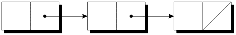
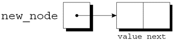
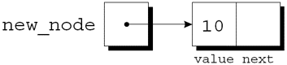

<!-- slide data-notes="" -->

<div class="bottom20"></div>

# 智能程序设计（C语言）

<hr class="width50 center">

## 链表 (I) · 动态内存与建表

<div class="bottom8"></div>

### 计算机学院 &nbsp;&nbsp; 杨已彪

#### [yangyibiao@nju.edu.cn](mailto:yangyibiao@nju.edu.cn)


<!-- slide data-notes="" -->

##### 提纲

---

- 为什么链表

- 动态内存: malloc 与 free

- 结点类型与创建结点

- `->` 运算符

- 课堂编码与小测

---


<!-- slide data-notes="" -->

##### 为什么链表

---

数组有两个局限: 大小==定死== (要么浪费、要么不够); 中间插入/删除要==搬移==整段元素

链表: 一串==结点==用指针串起来, 每个结点存数据 + ==指向下一个结点的指针==:

<div style="text-align:center;">
  
</div>

- 优点: 按需==逐个创建==, 插入、删除只需改指针; 最后结点的 next 是 `NULL` (空指针)

- 代价: 没有随机访问——找第 k 个元素必须==从头走 k 步==

---


<!-- slide data-notes="" -->


##### 动态内存: malloc 与 free

---

链表结点是==运行时逐个创建==的——用 `malloc` 向系统借内存。`struct node` 是下一页要定义的结点类型，这里先看 `malloc` 的用法：

```C
struct node *new_node;                    /* struct node 下一页定义 */
new_node = malloc(sizeof(struct node));   /* 借一块刚好放下一个结点的内存 */
if (new_node == NULL) {                   /* 借不到要检查 */
  printf("内存不足\n");
  exit(1);
}
```

`exit(1)` 直接终止程序，声明在 `<stdlib.h>` 中。

- `malloc(n)`: 借 n 字节, ==不清零==; 返回通用指针 `void *`; 需要 `<stdlib.h>`

- `free(p)`: 用完==归还==。忘记 free 就是"内存泄漏"——内存越用越多, 程序最终被系统杀掉

- free 之后 p 就是==悬空指针==, 不能再解引用; 习惯上立刻把 p 置为 `NULL`

---


<!-- slide data-notes="" -->


##### 声明结点类型

---

建链表, 先要有表示单个结点的结构体。

结点结构体: 数据 (本例是整数) + 指向下一个结点的指针: 
```C{.line-numbers}
struct node {
  int value;          /* data stored in the node  */
  struct node *next;  /* pointer to the next node */
};
```

`node` 必须是结构标记, 而不是 `typedef` 名称, 否则将无法声明 `next` 的类型。


还需要一个始终指向==第一个结点==的变量: 

`struct node *first = NULL;`

将 `first` 设置为 `NULL` 表示链表最初为空。

---


<!-- slide data-notes="" -->


##### 创建结点

---

<div style="display:flex;align-items:flex-start;gap:24px;">


<div style="flex:1;font-size:0.75em;">

构建链表 = 逐个创建结点, 再逐个挂上去。步骤: ① 为结点==分配内存== ② 在结点中==存储数据== ③ 将结点==插入==到链表中。先看前两步:

临时指针变量: `struct node *new_node;` 用 malloc 给新结点分配内存, 返回值存进 new_node: `new_node = malloc(sizeof(struct node));`——现在 new_node 指向一块刚好能放下一个结点的内存:

<div class="top-2" style="display:flex;gap:16px;">
  
  
</div>

接着把数据存进新结点的 value 成员: `(*new_node).value = 10;` (左图是分配内存, 右图是赋值后)

`*new_node` 周围的括号是强制要求的, 因为 `.` 运算符优先于 `*` 运算符.

</div>

</div>

<!-- slide data-notes="" -->


##### `->` 运算符

---

<div style="font-size:0.85em;line-height:1.5;">

为了便于使用指针访问结构体的成员, C 提供了名为==右箭头选择 (`->`)== 的运算符: `new_node->value = 10;` 来代替 `(*new_node).value = 10;`

`->` 运算符产生一个左值, 可以在任何允许普通变量的地方使用它。scanf 调用中的示例: `scanf("%d", &new_node->value);`——`&` 运算符仍然是必需的, 即使 new_node 是一个指针。

</div>

---


<!-- slide data-notes="" -->

##### 课堂编码

---

==现场演示==

1. 建两个结点 (value = 10 和 20), 用==头插法==连成链表, 打印每个结点的 value

2. 变体: 再建一个结点 (value = 30), 接到链表==末尾== (先找到最后结点)

<span class="blue">:fa-lightbulb-o:</span> 提示: 头插只要两条语句 (`new_node->next = first; first = new_node;`); 尾插要==先找尾==再改两个指针

<a href="vscode://file/Users/yangyibiao/Documents/Seafile/GitRepo/yangyibiao.github.io/cpl/slides/13-struct-linked-list/code/skeleton.c" style="display:inline-block;margin-top:8px;padding:5px 14px;background:#268bd2;color:#fff;border-radius:6px;font-size:0.85em;text-decoration:none;">⚡ 在 VS Code 中打开 skeleton.c</a>

---


<!-- slide data-notes="" -->

##### 课堂小测

---

1. 概念: 链表的一个 "结点" 至少包含哪两部分？

2. 概念: `struct node *next;` 中, 为什么必须写 `struct node *` 而不能只写 `node *`？

3. 阅读: `p->value` 等价于什么 (用 `*` 和 `.` 表示)？为什么 `->` 的左边必须是指针？

4. 纠错: `new_node = malloc(sizeof(struct node)); new_node->value = 10;` 少了什么检查？内存不足时这两条语句会有什么后果？应怎么改？

---


<!-- slide data-notes="" -->

#####

---

<div class="bottom20"></div>

<hr class="width50 center">

## 未完待续

---

