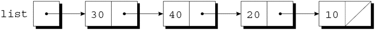
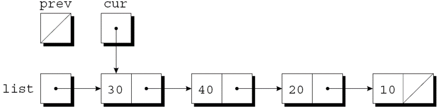

<!-- slide data-notes="" -->

<div class="bottom20"></div>

# 智能程序设计（C语言）

<hr class="width50 center">

## 链表 (II) · 插入、搜索与删除

<div class="bottom8"></div>

### 计算机学院 &nbsp;&nbsp; 杨已彪

#### [yangyibiao@nju.edu.cn](mailto:yangyibiao@nju.edu.cn)


<!-- slide data-notes="" -->

##### 提纲

---

- 链表的开头插入一个结点

- 搜索链表

- 从链表中删除结点

- 有序链表

- 课堂编码与小测

---


<!-- slide data-notes="" -->


##### 链表的开头插入一个结点

---

<div style="display:flex;align-items:flex-start;gap:24px;">


<div style="flex:1;font-size:0.6em;">

链表的优点之一是可以在任何位置添加结点, 但开头最容易插入. 

上一节课堂编码已用过这两条语句, 这里回顾一下: 顺序不能交换.

第一步是修改新结点的成员next, 使其指向之前在链表开头的结点: 

`new_node->next = first;`

第二步是使first指向新结点: 

`first = new_node;`

重点: ==即使链表为空, 这些语句也有效==——first 为 NULL 时, 新结点的 next 变成 NULL, 它自然成为唯一的结点.

</div>

</div>

<!-- slide data-notes="" -->


##### 搜索链表

---

问题: 在链表中搜索整数 n——找到则返回指向该结点的指针, 否则返回空指针.

<div style="display:flex;align-items:flex-start;gap:24px;">

<div style="flex:1.3;font-size:0.6em;">

```C
struct node *search_list(struct node *list, int n)
{
 for (struct node *p = list; p != NULL; p = p->next)
   if (p->value == n)
     return p;
 return NULL;
}
```

```C
struct node *search_list(struct node *list, int n)
{
 for (; list != NULL; list = list->next)
   if (list->value == n)
     return list;
 return NULL; 
}
```

</div>

<div style="flex:1;font-size:0.6em;">

虽然while循环也可以搜索链表, 但for语句通常是首选. 

访问链表中结点的循环, 使用指针变量p来跟踪"当前"结点:

该函数的初始版本:

还有很多其他的方法来编写search_list. 

一种替代方法是消除变量p, 用list本身来跟踪当前结点:

由于list是原始链表指针的副本, 因此在函数中更改它没有损害.

</div>

</div>

<!-- slide data-notes="" -->


##### 从链表中删除结点

---

<div style="display:flex;align-items:flex-start;gap:24px;">

<div style="flex:1.3;font-size:0.6em;">

```C
for (cur = list, prev = NULL;
    cur != NULL && cur->value != n;
    prev = cur, cur = cur->next)
  ;
```

</div>

<div style="flex:1;font-size:0.6em;">

链表的一大优势: 删除结点很方便.

删除结点分三步:

- 找到要删除的结点.
- 更改前一个结点, 使其"绕过"已删除的结点.
- 调用 free 回收被删除结点占用的空间.

第 1 步比看起来更难, 因为第 2 步需要更改前一个结点.

这个问题有多种解决方案.

"追踪指针"技术涉及保持指向前一个结点(prev)的指针以及指向当前结点(cur)的指针.

假设 list 指向要搜索的链表, n 是要删除的整数.

实现第 1 步的循环:

当循环终止时, 若找到 n, cur 指向要删除的结点, prev 指向前一个结点; 若 n 不在链表中, cur 为 NULL, 需先检查再删除.

</div>

</div>

<!-- slide data-notes="" -->

##### 从链表中删除结点 (续)

---

<div style="display:flex;align-items:flex-start;gap:20px;">

<div style="flex:1.25;font-size:0.55em;">

把前面的循环与第 2、3 步合起来, 得到完整的删除函数:

```C
struct node *delete_node(struct node *list, int n)
{
  struct node *cur, *prev;
  for (cur = list, prev = NULL;
      cur != NULL && cur->value != n;
      prev = cur, cur = cur->next)
    ;
  if (cur == NULL) return list;              /* n 不在链表中 */
  if (prev == NULL) list = cur->next;        /* 删的是头结点 */
  else prev->next = cur->next;               /* 绕过 cur */
  free(cur);                                 /* 回收内存 */
  return list;
}
```

</div>

<div style="flex:1;font-size:0.6em;">

- 删除头结点要==更新头指针==; free 之后 cur 不能再解引用

- 删除操作只改变==指针==, 不移动结点; 查找是 O(n), 删除本身 O(1)

<div class="top-2" style="text-align:center;">假设链表如下并且 n 为 20; 执行完 `cur = list, prev = NULL` 后:</div>

<div style="text-align:center;">
  
  
</div>

</div>

</div>

<!-- slide data-notes="" -->


##### 有序链表

---

<div style="font-size:0.8em;">

- 结点按数据排序的链表称为==有序链表==.

- 插入更难: 新结点并不总是放在链表的开头.

- 搜索更快: 到达期望结点应该出现的位置后即可停止查找.

</div>

<svg viewBox="0 0 400 175" style="display:block;width:660px;max-width:100%;height:auto;flex-shrink:0;margin:0 auto;" role="img" aria-label="有序链表插入 25">
  <defs>
    <marker id="ll-order-arrow" viewBox="0 0 10 10" refX="9" refY="5" markerWidth="5" markerHeight="5" orient="auto">
      <path d="M0,0 L10,5 L0,10 Z" fill="#268bd2"/>
    </marker>
  </defs>
  <g font-family="LXGWWenKai, 'Noto Sans SC', sans-serif">
    <text x="8" y="18" font-size="11" fill="#586e75">有序链表: 找到第一个比 25 大的结点</text>
    <text x="8" y="48" font-size="9" fill="#859900">list</text>
    <line x1="34" y1="44" x2="48" y2="44" stroke="#268bd2" stroke-width="1.6" marker-end="url(#ll-order-arrow)"/>

    <rect x="50" y="42" width="64" height="32" rx="4" fill="#fdf6e3" stroke="#93a1a1" stroke-width="1.5"/>
    <text x="82" y="63" font-size="13" fill="#073642" text-anchor="middle">10</text>
    <rect x="150" y="42" width="64" height="32" rx="4" fill="#fdf6e3" stroke="#268bd2" stroke-width="2"/>
    <text x="182" y="63" font-size="13" fill="#073642" text-anchor="middle">20</text>
    <rect x="270" y="42" width="64" height="32" rx="4" fill="#fdf6e3" stroke="#dc322f" stroke-width="2"/>
    <text x="302" y="63" font-size="13" fill="#073642" text-anchor="middle">30</text>

    <line x1="114" y1="58" x2="148" y2="58" stroke="#268bd2" stroke-width="1.6" marker-end="url(#ll-order-arrow)"/>
    <line x1="214" y1="58" x2="268" y2="58" stroke="#93a1a1" stroke-width="1.3" stroke-dasharray="4 3"/>
    <text x="240" y="63" font-size="12" fill="#dc322f" text-anchor="middle">×</text>
    <line x1="334" y1="58" x2="350" y2="58" stroke="#93a1a1" stroke-width="1.4" marker-end="url(#ll-order-arrow)"/>
    <text x="354" y="62" font-size="9" fill="#93a1a1">NULL</text>

    <text x="182" y="34" font-size="8.5" fill="#268bd2" text-anchor="middle">prev</text>
    <text x="302" y="34" font-size="8.5" fill="#dc322f" text-anchor="middle">cur</text>

    <rect x="190" y="108" width="64" height="32" rx="4" fill="#dceaf5" stroke="#268bd2" stroke-width="2"/>
    <text x="222" y="129" font-size="13" fill="#073642" text-anchor="middle">25</text>
    <text x="222" y="154" font-size="8.5" fill="#268bd2" text-anchor="middle">new_node</text>

    <line x1="200" y1="74" x2="212" y2="106" stroke="#268bd2" stroke-width="1.6" marker-end="url(#ll-order-arrow)"/>
    <line x1="254" y1="124" x2="282" y2="76" stroke="#268bd2" stroke-width="1.6" marker-end="url(#ll-order-arrow)"/>

    <text x="8" y="170" font-size="9" fill="#586e75">new_node-&gt;next = cur; prev-&gt;next = new_node</text>
  </g>
</svg>

插入时==先接后断==: 先让 `new_node->next = cur`, 再让 `prev->next = new_node`; 顺序反过来会先丢掉 cur 之后的链表.

---


<!-- slide data-notes="" -->

##### 课堂编码

---

==现场演示==

三个课时的任务共用同一份 `skeleton.c`, 按注释分组, 只写函数体.

1. 写 `void print_list(struct node *list)`: 从头到尾打印每个结点的 value

2. 写 `struct node *append(struct node *list, int n)`: 把新结点接到==末尾== (注意: 空链表时直接返回新结点)

3. 删除链表中==所有==值为 n 的结点 (删除头结点要更新头指针!)

<span class="blue">:fa-lightbulb-o:</span> 提示: 先想清楚 ==prev 和 cur 两个指针==怎么配合, 再动手

<a href="vscode://file/Users/yangyibiao/Documents/Seafile/GitRepo/yangyibiao.github.io/cpl/slides/13-struct-linked-list/code/skeleton.c" style="display:inline-block;margin-top:8px;padding:5px 14px;background:#268bd2;color:#fff;border-radius:6px;font-size:0.85em;text-decoration:none;">⚡ 在 VS Code 中打开 skeleton.c</a>

---


<!-- slide data-notes="" -->

##### 课堂小测

---

1. 概念: 在链表头部插入结点, 两条语句的顺序能交换吗？为什么？

2. 概念: 删除一个结点分哪三步？

3. 阅读: `search_list` 在==空链表==上调用会返回什么？

4. 纠错: `free(cur)` 之后, 又访问 `cur->next` 会怎样？

---


<!-- slide data-notes="" -->

#####

---

<div class="bottom20"></div>

<hr class="width50 center">

## 未完待续

---

