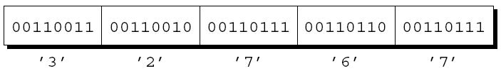

@import "../css/font-awesome-4.7.0/css/font-awesome.css"
@import "../css/theme/solarized.css"
@import "../css/logo.css"
@import "../css/font.css"
@import "../css/color.css"
@import "../css/margin.css"
@import "../css/table.css"
@import "../css/main.css"
@import "../plugin/zoom/zoom.js"
@import "../plugin/customcontrols/plugin.js"
@import "../plugin/customcontrols/style.css"
@import "../plugin/chalkboard/plugin.js"
@import "../plugin/chalkboard/style.css"
@import "../plugin/menu/menu.js"
@import "../js/anychart/anychart-core.min.js"
@import "../js/anychart/anychart-venn.min.js"
@import "../js/anychart/pastel.min.js"
@import "../js/anychart/venn-ml.js"
@import "https://cdn.bootcdn.net/ajax/libs/jquery/3.5.0/jquery.js"

<!-- slide data-notes="" -->

<div class="bottom20"></div>

# 智能程序设计（C语言）

<hr class="width50 center">

## 文件操作

<div class="bottom8"></div>

### 计算机学院 &nbsp;&nbsp; 杨已彪

#### [yangyibiao@nju.edu.cn](mailto:yangyibiao@nju.edu.cn)


<!-- slide data-notes="" -->

##### 提纲

---

- 流与标准流、重定向

- 文本文件与二进制文件

- 打开与关闭: fopen / fclose

- 格式化读写: fprintf / fscanf

- 字符与行读写: fgetc / fputc、fgets / fputs

- 块读写: fread / fwrite

- 文件定位: fseek / ftell / rewind

- 案例: 文件复制、修改零件记录

---


<!-- slide data-notes="" -->


##### 流

---

<div style="display:flex;align-items:flex-start;gap:24px;">


<div style="flex:1;font-size:0.92em;">

数据只存在内存里, 程序一关就没了——文件让数据==持久化==, 流就是进出程序的通道。

C 里, **流**就是任意输入的来源或输出的目的地。

许多小程序从一个流(键盘)获取所有输入, 并将其所有输出写入另一个流(屏幕). 

较大的程序可能需要额外的流. 

流通常表示存储在不同介质上的文件. 

但也很容易与网络端口和打印机等设备相关联. 


---

访问流是通过**文件指针**完成的, 该指针具有FILE *类型.

FILE类型在<stdio.h>中声明. 

某些流由具有标准名称的文件指针表示. 

需要时可以声明更多文件指针:  
`FILE *fp1, *fp2;`

</div>

</div>

<!-- slide data-notes="" -->


##### 标准流和重定向

---

<stdio.h> 自带三个标准流:

| 文件指针 | 流 | 默认含义 |
| ---- | ---- | ---- |
| stdin | 标准输入 | 键盘 |
| stdout | 标准输出| 屏幕 |
| stderr | 标准错误| 屏幕 |

这些流可以直接使用——我们不需要声明它们, 也不打开或关闭它们.

前面章节中讨论的 I/O 函数从 stdin 获取输入并将输出发送到 stdout.

<!-- slide data-notes="" -->

##### 标准流和重定向 (续)

---

许多操作系统允许通过称为**重定向**的机制更改这些默认含义.

让程序从文件而不是键盘读入的常用方法:

`demo <in.dat`

这种方法称为**输入重定向**.

**输出重定向**类似:

`demo >out.dat`

所有写入 stdout 的数据现在都将进入 out.dat 文件, 而不是出现在屏幕上.

<!-- slide data-notes="" -->

##### 标准流和重定向 (续 2)

---

输入、输出重定向可以一起用:

`demo <in.dat >out.dat`

`<`、`>` 和文件名之间有没有空格都行, 多个重定向文件的顺序也无所谓:

`demo <in.dat> out.dat`

等价于:

`demo >out.dat <in.dat`

输出重定向要注意: 所有写到 stdout 的内容都会进同一个文件.

将错误消息写入 stderr 而不是 stdout 可以保证即使 stdout 已被重定向, 错误信息也会出现在屏幕上.

<!-- slide data-notes="" -->


##### 文本文件与二进制文件

---

<stdio.h> 支持两种文件: 文本文件和二进制文件.

用文本模式 (模式串不带 `b`) 读写时, C 库可能在 `'\n'` 与系统行尾之间转换: Windows 上写文件时 `'\n'` 变成 `\r\n`, 读文件时相反. 二进制模式 (模式串带 `b`) 不做这种转换, 读写的字节与文件中的字节一一对应.

**文本文件**中的字节代表字符, 允许人们检查或编辑文件.

- C 程序的源代码存储在文本文件中.

在**二进制文件**中, 字节不一定代表字符.

- 字节组可能代表其他类型的数据, 例如整数和浮点数.
- 可执行的 C 程序存储在二进制文件中.

<!-- slide data-notes="" -->

##### 文本文件与二进制文件 (续)

---

文本文件具有二进制文件不具备的两个特征.

文本文件分为若干行. 文本文件中的每一行通常以一个或两个特殊字符结尾.

- Windows: 回车符('\x0d')后跟换行符('\x0a')
- UNIX 和较新版本的 Mac OS: 换行符
- 旧版本的 Mac OS: 回车符

文本文件可以包含一个特殊的"文件结束"标记.

- 在 Windows 中, 标记是 '\x1a' (Ctrl+Z), 但这不是必需的.
- 大多数其他操作系统, 包括 UNIX, 没有特殊的文件结束字符.

在二进制文件中, 没有行尾或文件结束标记; 所有字节都被平等对待.

<!-- slide data-notes="" -->

##### 文本文件与二进制文件 (续 2)

---

数据写入文件时, 可以选择以文本格式或二进制格式存储.

把数字 32767 存进文件, 一种方式是按文本写入字符 3、2、7、6、7:

<div class="top-2">
  
</div>

另一种是按二进制存, 只要两个字节:

<div class="top-2">
  
</div>

以二进制存储数字通常可以节省空间.

<!-- slide data-notes="" -->

##### 文本文件与二进制文件 (续 3)

---

从文件读取或写入文件的程序必须考虑它是文本还是二进制文件.

在屏幕上显示文件内容的程序可能会假设它是一个文本文件.

另一方面, 文件复制程序不能假设要复制的文件是文本文件.

- 如果按文本方式复制, 则不会完全复制包含文件结尾字符的二进制文件.

当无法确定文件是文本形式还是二进制形式时, 假设它是二进制文件会更安全.

<!-- slide data-notes="" -->


##### 文件操作

---

简单性是输入和输出重定向的魅力之一.

不幸的是, 重定向在许多应用中受到限制.

- 当程序依赖重定向时, 它无法控制自己的文件; 甚至不知道文件的名字.
- 如果程序需要同时读取两个文件或写入两个文件, 重定向将无法做到.

当重定向无法满足需要时, 我们将使用 <stdio.h> 提供的文件操作.

<!-- slide data-notes="" -->

##### 文件操作 (续)

---

<div style="display:flex;align-items:flex-start;gap:24px;">

<div style="flex:1.2;font-size:0.62em;">

```C
FILE *fopen(const char * restrict filename,
	          const char * restrict mode);
```

</div>

<div style="flex:1;">

如果要把文件用作流, 打开时需要调用 fopen 函数. fopen 的原型:

filename 是要打开的文件的名称.

- 这个参数可以带路径信息, 比如盘符或目录。

mode 是一个"模式字符串", 它指定打算对文件执行的操作.

原型中的 `restrict` 是 C99 关键字, 表示 filename 和 mode 不共享内存单元; 它对 fopen 的行为没有影响, 通常可以忽略.

</div>

</div>

<!-- slide data-notes="" -->

##### 打开文件

---

fopen 调用中的文件名包含 `\` 字符时要小心.

调用 `fopen("c:\project\test1.dat", "r")`

将失败: `\t` 被当作转义字符 (制表符), `\p` 也不是合法的转义序列, 编译器通常会报告 unknown escape sequence.

避开这个问题的一种写法: 用 `\\` 代替 `\`:

`fopen("c:\\project\\test1.dat", "r")`

另一种写法: 用 `/` 代替 `\`:

`fopen("c:/project/test1.dat", "r")`

<!-- slide data-notes="" -->

##### 打开文件 (续)

---

fopen 函数返回一个文件指针, 程序可以(并且通常会)把这个指针保存在变量中:

```C
fp = fopen("in.dat", "r");
/* 打开 in.dat 以供阅读 */
```

无法打开文件时, fopen 返回一个空指针.

因此, 打开文件后必须检查返回值:

```C
if ((fp = fopen("in.dat", "r")) == NULL) {
  /* 处理错误 */
}
```

<!-- slide data-notes="" -->


##### 打开模式

---

决定将哪个模式字符串传递给 fopen 的因素: 要对文件执行的操作; 文件中的数据是文本形式还是二进制形式.

用于文本文件的模式字符串:

| 字符串 | 含义 |
| ---- | ---- |
| "r" | 打开文件读 (文件必须存在) |
| "w" | 打开文件写 (不存在则创建, 存在则截断为 0 字节) |
| "a" | 打开文件追加 (不存在则创建, 写入总在末尾) |
| "r+" | 打开文件读写 (文件必须存在), 从文件头开始 |
| "w+" | 打开文件读写 (不存在则创建, 存在则截断为 0 字节) |
| "a+" | 打开文件读写 (不存在则创建, 写入总在末尾) |

`a` / `a+` 模式下, 即使调用 fseek 改变文件位置, 写入也总发生在文件末尾.

<!-- slide data-notes="" -->

##### 打开模式 (续)

---

用于二进制文件的模式字符串:

| 字符串 | 含义 |
| ---- | ---- |
| "rb" | 打开文件读 (文件必须存在) |
| "wb" | 打开文件写 (不存在则创建, 存在则截断为 0 字节) |
| "ab" | 打开文件追加 (不存在则创建, 写入总在末尾) |
| "r+b" 或者 "rb+" | 打开文件读写 (文件必须存在), 从文件头开始 |
| "w+b" 或者 "wb+" | 打开文件读写 (不存在则创建, 存在则截断为 0 字节) |
| "a+b" 或者 "ab+" | 打开文件读写 (不存在则创建, 写入总在末尾) |

二进制模式只是在文本模式字符串中加一个 `b`; 读写更新模式则再加一个 `+`.

<!-- slide data-notes="" -->

##### 打开模式 (续 2)

---

写数据和追加数据有不同的模式字符串.

当数据写入文件时, 它通常会覆盖以前存在的内容.

当打开文件进行追加时, 写入文件的数据将添加到末尾.

当打开文件进行读写时, 适用特殊规则.

- 除非读取操作遇到文件末尾, 否则不先调用后面讲的文件定位函数 (fseek 等) 就无法从读模式切换到写模式.
- 如果既没有调用 fflush 函数也没有调用后面讲的文件定位函数 (fseek 等), 则无法从写模式切换到读模式.

<!-- slide data-notes="" -->


##### 演示: "w" 模式会清空已有文件

---

<div style="font-size:0.72em;">

```C
/* grades.txt 里已经存了一学期的成绩 */
#include <stdio.h>

int main(void)
{
  FILE *fp = fopen("grades.txt", "w");  /* 打开瞬间, 旧内容没了! */
  if (fp == NULL) {
    return 1;
  }
  fprintf(fp, "new line\n");
  fclose(fp);
  return 0;
}
```

</div>

- ==`"w"`== 打开文件时, 已有内容==立即被清空== (截断为 0 字节), 不询问、不提醒

- 想接着写用 ==`"a"`== (追加, 内容保留); `"r+"` 只适合原地改写, 要从末尾写需先 `fseek(fp, 0L, SEEK_END)`

- 教训: 写代码前想清楚是"==覆盖重写=="还是"==追加=="——`"w"` 与 `"a"` 差一个字母, 后果天壤之别

---

<!-- slide data-notes="" -->

##### 格式化输入/输出: fprintf / fscanf

---

<div style="display:flex;align-items:flex-start;gap:24px;">

<div style="flex:1.2;font-size:0.62em;">

```C
int fprintf(FILE * restrict stream,
            const char * restrict format, ...);
int fscanf(FILE * restrict stream,
           const char * restrict format, ...);
```

</div>

<div style="flex:1;">

fprintf / fscanf 与 printf / scanf 用法相同, 只是第一个参数指定流.

- `fprintf(fp, "%d %s\n", n, name);` 把格式化数据写入 fp
- `fscanf(fp, "%d", &n);` 从 fp 按格式读取, 存入 n

返回值: fprintf 返回写入的字符数, 出错时返回负值; fscanf 返回成功匹配并赋值的项数, 在第一次转换前遇到输入结束或错误时返回 EOF.

</div>

</div>

<!-- slide data-notes="" -->


##### 关闭文件

---

<div style="display:flex;align-items:flex-start;gap:24px;">

<div style="flex:1.3;font-size:0.6em;">

```C
#include <stdio.h>
#include <stdlib.h>

#define FILE_NAME "example.dat"

int main(void)
{
  FILE *fp;

  fp = fopen(FILE_NAME, "r");
  if(fp == NULL) {
    printf("Can't open %s\n", FILE_NAME);
    exit(EXIT_FAILURE);
  }
  …
  fclose(fp);
  return 0;
}
```

</div>

<div style="flex:1;">

fclose 函数允许程序关闭不再使用的文件.

fclose 的参数必须是从调用 fopen 获得的文件指针.

如果文件成功关闭, fclose 返回零.

否则, 它返回错误代码 EOF(在 <stdio.h> 中定义的宏).

</div>

</div>

<!-- slide data-notes="" -->

##### 关闭文件 (续)

---

打开文件进行读取的程序框架已经在前一页给出. 可以把 fopen 的调用与 fp 的声明写在一起, 再单独判断返回值:

```C
FILE *fp = fopen(FILE_NAME, "r");
if (fp == NULL) {
  /* 处理错误 */
}
```

不要写成 `if (FILE *fp = fopen(...))`: C 的 if 条件里不能声明变量.

<!-- slide data-notes="" -->


##### 从命令行获取文件名

---

之前在指针部分讲过命令行参数, 这里简要回顾.

```C
int main(int argc, char *argv[])
```

- `argc` 是命令行参数的数量
- `argv` 是指向参数字符串的指针数组: `argv[0]` 是程序名, `argv[1]` 到 `argv[argc-1]` 是其余参数, `argv[argc]` 是空指针

例如运行 `./demo names.dat dates.dat`, 则 `argc` 为 3, `argv[1]` 是 `"names.dat"`, `argv[2]` 是 `"dates.dat"`.

让程序从命令行获取文件名, 比把文件名写死在程序里或提示用户输入更灵活.

<!-- slide data-notes="" -->

##### 程序: 检查文件是否可以打开

---

==现场演示==: 写一个程序 `canopen`, 判断命令行参数给出的文件能不能打开

样例:

```console
$ ./canopen demo.txt
demo.txt 可以打开
$ ./canopen 不存在.txt
不存在.txt 打不开
```

<a href="vscode://file/Users/yangyibiao/Documents/Seafile/GitRepo/yangyibiao.github.io/cpl/slides/14-files/code/canopen.c" style="display:inline-block;margin-top:8px;padding:5px 14px;background:#268bd2;color:#fff;border-radius:6px;font-size:0.85em;text-decoration:none;">⚡ 在 VS Code 中打开 canopen.c</a>

<span class="blue">:fa-lightbulb-o:</span> 提示: `fopen` 失败会返回 NULL——判断它; 参数个数不对要提示用法

---


<!-- slide data-notes="" -->


##### 程序: 检查文件是否可以打开 (参考代码)

---

<div style="display:flex;align-items:flex-start;gap:24px;">

<div style="flex:1.4;font-size:0.55em;">

```C{.line-numbers}
/* Checks whether a file can be opened for reading */

#include <stdio.h>
#include <stdlib.h>

int main(int argc, char *argv[])
{
  FILE *fp;
 
  if(argc != 2) {
    printf("用法: canopen 文件名\n");
    exit(EXIT_FAILURE);
  }
 
  if((fp = fopen(argv[1], "r")) == NULL) {
    printf("%s 打不开\n", argv[1]);
    exit(EXIT_FAILURE);
  }
 
  printf("%s 可以打开\n", argv[1]);
  fclose(fp);
  return 0;
}
```

</div>

<div style="flex:1;">

- `argc != 2` 先检查参数个数——命令行参数的第一个完整例子

- `fopen(..., "r")` 失败返回 ==NULL==——检查返回值是否为空是常规做法

- 失败用 `exit(EXIT_FAILURE)` 直接退出, 不再往下走

</div>

</div>

---

<!-- slide data-notes="" -->


##### 字符的输入/输出

---

<div style="display:flex;align-items:flex-start;gap:24px;">

<div style="flex:1.4;font-size:0.55em;">

```C
fputc(ch, fp); /* 将 ch 写入 fp */
putc(ch, fp); /* 将 ch 写入 fp */
```

```C
ch = fgetc(fp);
ch = getc(fp);
```

</div>

<div style="flex:1;">

下一组库函数读写单个字符, 文本流与二进制流通用; 字符被当作 `int` 而非 `char`——输入函数用返回 ==EOF== (负整数常量) 指示文件结束或错误.

putc 通常实现为宏(以及函数), 而 fputc 仅实现为函数.

C 标准允许 putc 宏对 stream 参数多次求值, 而 fputc 不可以.

</div>

</div>

<!-- slide data-notes="" -->

##### 字符的输入/输出 (续)

---

putchar 将一个字符写入标准输出流:

`putchar(ch); /* 将 ch 写入标准输出流 */`

fputc 和 putc 将一个字符写入任意流.

putchar 本身通常也定义为宏: `#define putchar(c) putc((c), stdout)`

宏的展开后面细讲.

程序员通常更喜欢 putc, 因为它速度更快.

如果发生写入错误, 上述这 3 个函数都会为流设置错误指示器并返回 EOF.

否则, 它们返回写入的字符.

<!-- slide data-notes="" -->

##### 字符的输入/输出 (续 2)

---

getchar 从 stdin 读取一个字符:

`ch = getchar();`

fgetc 和 getc 从任意流中读取一个字符:

`ch = fgetc(fp);`

这三个函数都将字符视为 unsigned char 类型的值(返回之前转换为 int 类型).

因此, 它们不会返回 EOF 以外的负值.

<!-- slide data-notes="" -->

##### 程序: 复制文件

---

==现场演示==: 写一个程序 `fcopy`, 把源文件复制到目标文件 (二进制安全)

样例:

```console
$ ./fcopy a.txt b.txt
复制完成
```

<a href="vscode://file/Users/yangyibiao/Documents/Seafile/GitRepo/yangyibiao.github.io/cpl/slides/14-files/code/fcopy.c" style="display:inline-block;margin-top:8px;padding:5px 14px;background:#268bd2;color:#fff;border-radius:6px;font-size:0.85em;text-decoration:none;">⚡ 在 VS Code 中打开 fcopy.c</a>

<span class="blue">:fa-lightbulb-o:</span> 提示: 用 `"rb"`/`"wb"` 二进制模式; 逐个字符读、逐个写——前面讲的 fgetc/fputc (代码中用等价的 getc/putc)

---


<!-- slide data-notes="" -->


##### 程序: 复制文件 (参考代码)

---

<div style="display:flex;align-items:flex-start;gap:24px;">

<div style="flex:1.4;font-size:0.5em;">

```C{.line-numbers}
/* Copies a file */
 
#include <stdio.h>
#include <stdlib.h>
 
int main(int argc, char *argv[])
{
  FILE *source_fp, *dest_fp;
  int ch;
 
  if(argc != 3) {
    fprintf(stderr, "用法: fcopy 源文件 目标文件\n");
    exit(EXIT_FAILURE);
  }

  if((source_fp = fopen(argv[1], "rb")) == NULL) {
    fprintf(stderr, "打不开 %s\n", argv[1]);
    exit(EXIT_FAILURE);
  }
 
  if((dest_fp = fopen(argv[2], "wb")) == NULL) {
    fprintf(stderr, "打不开 %s\n", argv[2]);
    fclose(source_fp);
    exit(EXIT_FAILURE);
  }
 
  while((ch = getc(source_fp)) != EOF)
    putc(ch, dest_fp);
 
  fclose(source_fp);
  fclose(dest_fp);
  printf("复制完成\n");
  return 0;
}
```

</div>

<div style="flex:1;">

- `"rb"`/`"wb"` 二进制模式——文本和二进制文件都能复制

- 逐个字符 `fgetc`/`fputc`, 直到 EOF——文件循环的标准写法

- 三个参数、两个 fopen 都判错——错误处理是文件程序的重要部分

</div>

</div>

---

<!-- slide data-notes="" -->


##### 行的输入/输出

---

下一组中的库函数能够读取和写入行.

这些函数主要用于文本流, 尽管它们也能用于二进制流.

puts 函数将字符串写入 stdout:

`puts("Hi, there!");  /* writes to stdout */`

在写入字符串中的字符后, puts 总是添加一个换行符.

<!-- slide data-notes="" -->

##### 行的输入/输出 (续)

---

fputs 是 puts 的更通用版本.

它的第二个参数指示输出应写入的流:

`fputs("Hi, there!", fp);  /* writes to fp */`

与 puts 不同, fputs 函数不会写入换行符, 除非字符串中本身存在换行符.

如果发生写入错误, 这两个函数都返回 EOF; 否则, 它们返回一个非负数.

<!-- slide data-notes="" -->

##### 行的输入/输出 (续 2)

---

<div style="display:flex;align-items:flex-start;gap:24px;">

<div style="flex:1;font-size:0.62em;">

```C
char line[100];
while (fgets(line, sizeof(line), fp) != NULL) {
  for (int i = 0; line[i] != '\0'; i++)
    if (line[i] == '\n') {
      line[i] = '\0';
      break;
    }
  printf("%s\n", line);
}
```

</div>

<div style="flex:1;font-size:0.92em;">

gets 函数从 stdin 读取一行输入 (C11 已从标准中移除, 不要使用):

`gets(str); /* reads a line from stdin */`

fgets 是更通用、更安全的版本, 可以从任意流中读取, 并限制存储的字符数.

- fgets 最多读 n-1 个字符; 读到换行符时把它==保留==在字符串中 (gets 会丢弃)
- 需要去掉行尾 `'\n'` 时, 可像左边那样找到后覆盖为 `'\0'`
- `sizeof(line)` 只对数组有效; 如果 line 是指针, 应显式传入缓冲区大小
- 现代 C 代码应使用 `fgets(str, sizeof(str), fp)`, 并检查返回值是否为 `NULL`

</div>

</div>

<!-- slide data-notes="" -->


##### 块的输入/输出

---

<div style="display:flex;align-items:flex-start;gap:24px;">

<div style="flex:1.2;font-size:0.5em;">

```C
fwrite(a, sizeof(a[0]), sizeof(a) / sizeof(a[0]), fp);
```

```C
n = fread(a, sizeof(a[0]),
          sizeof(a) / sizeof(a[0]), fp);
```

</div>

<div style="flex:1;">

`fread`/`fwrite` 一次读写==大块数据== (主要用于二进制流, 也可用于文本流).

`fwrite` 把数组从内存复制到流, 参数: 数组地址、元素大小 (字节)、元素个数、文件指针; 返回==实际写入的元素数== (出错时小于第三个参数).

`fread` 从流读数组元素, 返回值是实际读取的元素数 (除非到达文件末尾或出错, 否则应等于第三个参数). `a` 必须是数组 (或指向连续内存的指针), 元素个数类型为 `size_t`.

</div>
</div>

<!-- slide data-notes="" -->

##### 检测文件末尾和错误条件

---

如果要求 fscanf 函数读取并存储 n 个数据项, 那么期望它的返回值为 n.

如果返回值小于 n, 则出现问题:

- 文件末尾: 在完全匹配格式字符串之前遇到文件末尾
- 读取错误: 无法从流中读取字符
- 匹配失败: 数据项的格式错误

<!-- slide data-notes="" -->

##### 检测文件末尾和错误条件 (续)

---

每个流都有两个与之关联的指示器: **错误指示器**和**文件末尾指示器**.

打开流时, 这些指示器会被清除.

遇到文件末尾就设置文件末尾指示器, 读取错误就设置错误指示器.

- 当输出流上发生写错误时, 也会设置错误指示器.

匹配失败不会改变任意一个指示器.

<!-- slide data-notes="" -->

##### 检测文件末尾和错误条件 (续 2)

---

一旦设置了错误或文件末尾指示器, 它就会保持该状态直到被显式清除, 可能通过调用 clearerr 函数.

clearerr 清除文件末尾和错误指示器:

```C
clearerr(fp);
/* clears eof and error indicators for fp */
```

并不需要经常使用 clearerr, 因为其他一些库函数的副作用可以清除指示器.

feof 和 ferror 函数可用于测试流的指示器, 以确定先前对流的操作失败的原因.

如果为与 fp 关联的流设置了文件末尾指示器, 则调用 feof(fp) 将返回一个非零值.

如果设置了错误指示器, 调用 ferror(fp) 会返回一个非零值.

<!-- slide data-notes="" -->

##### 检测文件末尾和错误条件 (续 3)

---

当 fscanf 返回小于预期的值时, 可以使用 feof 和 ferror 来判断原因.

- 如果 feof 返回非零值, 则已到达输入文件的末尾
- 如果 ferror 返回非零值, 则在输入期间发生读取错误
- 如果两者都没有返回非零值, 则一定发生匹配失败

fscanf 的返回值表示在问题发生之前成功匹配并赋值的项数.

==注意==: 不要用 `while (!feof(fp))` 控制循环. feof 只有在一次读取尝试碰到文件末尾后才变为真, 循环体会多执行一次, 处理上一次留下的旧数据. 正确做法是检查读取函数的返回值:

```C
while (fgets(line, sizeof(line), fp) != NULL) { … }
while ((ch = fgetc(fp)) != EOF) { … }
```

<!-- slide data-notes="" -->

##### 检测文件末尾和错误条件 (续 4)

---

find_int 函数是一个示例, 它显示了如何使用 feof 和 ferror.

find_int 在文件中搜索以整数开头的行: `n = find_int("foo");`

find_int 返回它找到的整数的值或错误代码: -1 文件无法打开; -2 读取错误; -3 没有行以整数开头. 核心循环 (简化):

```C
int n, ch;
while (fscanf(fp, "%d", &n) != 1) {
  if (feof(fp)) return -3;      /* 没有找到 */
  if (ferror(fp)) return -2;    /* 读取出错 */
  /* 匹配失败: 跳过本行剩余字符, 读下一行 */
  while ((ch = fgetc(fp)) != '\n' && ch != EOF)
    ;
}
return n;
```

<!-- slide data-notes="" -->


##### 文件定位

---

每个流都有一个**文件位置**。

打开文件时, 文件位置在开头。

- "追加"模式下, 初始位置可能在开头也可能在结尾, 看具体实现。

每次读写后, 文件位置自动前进——所以是顺序访问。

尽管顺序访问对许多应用程序来说都很好, 但有些程序需要能够在文件中跳转. 如果文件包含一系列记录, 我们可能希望直接跳转到特定记录.

<stdio.h> 中常用的文件定位函数是 fseek / ftell / rewind.

`ftell(fp)` 返回当前文件位置 (距文件开头的字节数); `rewind(fp)` 把文件位置移到开头, 等价于 `fseek(fp, 0L, SEEK_SET)`.

<!-- slide data-notes="" -->

##### 文件定位 (续)

---

fseek 修改第一个参数(文件指针)的文件位置.

第三个参数是三个宏之一:

- SEEK_SET: 文件开头
- SEEK_CUR: 当前文件位置
- SEEK_END: 文件结尾

第二个参数, 类型为 long int, 是一个(可能是负数)字节计数.

<!-- slide data-notes="" -->

##### 文件定位 (续 2)

---

使用 fseek 移动到文件的开头:

`fseek(fp, 0L, SEEK_SET);`

使用 fseek 移动到文件末尾:

`fseek(fp, 0L, SEEK_END);`

使用 fseek 往回移动 10 个字节:

`fseek(fp, -10L, SEEK_CUR);`

<!-- slide data-notes="" -->

##### 文件定位 (续 3)

---

出错时 (比如请求的位置不存在), fseek 返回非零值.

三个基准点可以组合出各种定位:

- `SEEK_SET` + 偏移: 从文件开头向后
- `SEEK_CUR` + 偏移: 从当前位置向前或向后
- `SEEK_END` + 偏移: 从文件末尾向前或向后

<!-- slide data-notes="" -->


##### 程序: 修改零件记录文件

---

==问题==: `inventory.dat` 中按顺序存放若干 `struct part` 记录 (二进制). 写程序把每条记录的 `on_hand` 清零.

<div style="display:flex;align-items:flex-start;gap:20px;">

<div style="flex:1.3;font-size:0.46em;">

```C
/* Modifies a file of part records by setting the quantity
   on hand to zero for all records */
#include <stdio.h>
#include <stdlib.h>
#define NAME_LEN 25
#define MAX_PARTS 100
struct part {
  int number;
  char name[NAME_LEN+1];
  int on_hand;
} inventory[MAX_PARTS];
int num_parts;
int main(void)
{
  FILE *fp;
  if((fp = fopen("inventory.dat", "rb+")) == NULL) {
    fprintf(stderr, "Can't open inventory file\n");
    exit(EXIT_FAILURE);
  }
  num_parts = fread(inventory, sizeof(struct part),
                    MAX_PARTS, fp);
  for(int i = 0; i < num_parts; i++)
    inventory[i].on_hand = 0;
  rewind(fp);
  fwrite(inventory, sizeof(struct part), num_parts, fp);
  fclose(fp);
  return 0;
}
```

</div>

<div style="flex:1;font-size:0.82em;">

`invclear.c` 程序执行的操作:

- 打开包含 `struct part` 结构的二进制文件
- 将结构读入数组, 把每个结构的成员 `on_hand` 设置为 0
- 将结构写回文件

`"rb+"` 模式打开文件, 允许读写. ==样例==: 文件中原有两条记录, 运行前后:

```text
运行前: 1  Widget  10    2  Gadget  25
运行后: 1  Widget  0     2  Gadget  0
```

<a href="vscode://file/Users/yangyibiao/Documents/Seafile/GitRepo/yangyibiao.github.io/cpl/slides/14-files/code/invclear.c" style="display:inline-block;margin-top:8px;padding:5px 14px;background:#268bd2;color:#fff;border-radius:6px;font-size:0.85em;text-decoration:none;">⚡ 在 VS Code 中打开 invclear.c</a>

</div>

</div>

<!-- slide data-notes="" -->

##### 课堂编码

---

==现场演示== (在 skeleton.c 中完成):

1. `int count_lines(const char *filename)`: 用 `fgetc` 统计文件中的换行符个数; 文件打不开返回 -1

2. `void print_numbered(const char *filename)`: 用 `fgets` 逐行读文件, 每行前打印行号 (样例: `1 abc`)

3. 挑战: `int sum_ints(const char *filename)`: 用 `fscanf` 读文件中的所有整数并求和

<span class="blue">:fa-lightbulb-o:</span> 提示: 用读取函数的返回值判断循环是否结束, 不要用 `while (!feof(fp))`

<a href="vscode://file/Users/yangyibiao/Documents/Seafile/GitRepo/yangyibiao.github.io/cpl/slides/14-files/code/skeleton.c" style="display:inline-block;margin-top:8px;padding:5px 14px;background:#268bd2;color:#fff;border-radius:6px;font-size:0.85em;text-decoration:none;">⚡ 在 VS Code 中打开 skeleton.c (框架已备好)</a>

<!-- slide data-notes="" -->

##### 课堂小测

---

**1. 概念**: `fopen("data.txt", "r")` 与 `"w"` 有什么区别？各自返回什么？

**2. 概念**: `fgetc` / `fputc` 的返回值为什么是 `int` 而不是 `char`？

**3. 代码阅读**: `in.txt` 的内容为两行 `abc`、`def`, 下面的循环输出什么？

```C
char line[100];
while (fgets(line, sizeof(line), fp) != NULL)
  fprintf(stdout, "%s", line);
```

**4. 纠错**: 下面的循环有什么问题？应如何修改？

```C
while (!feof(fp)) {
  ch = fgetc(fp);
  putchar(ch);
}
```

---


<!-- slide data-notes="" -->

<div class="bottom20"></div>

<hr class="width50 center">

## 未完待续

---


