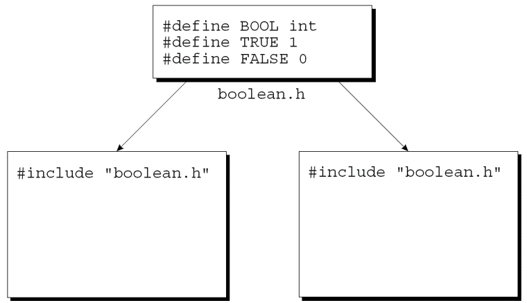
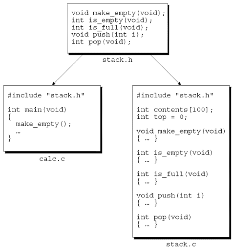
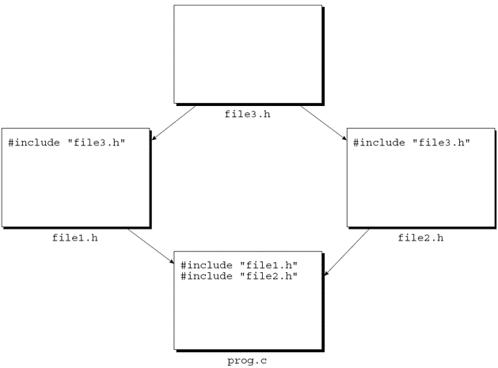

@import "../css/font-awesome-4.7.0/css/font-awesome.css"
@import "../css/theme/solarized.css"
@import "../css/logo.css"
@import "../css/font.css"
@import "../css/color.css"
@import "../css/margin.css"
@import "../css/table.css"
@import "../css/main.css"
@import "../plugin/zoom/zoom.js"
@import "../plugin/customcontrols/plugin.js"
@import "../plugin/customcontrols/style.css"
@import "../plugin/chalkboard/plugin.js"
@import "../plugin/chalkboard/style.css"
@import "../plugin/menu/menu.js"
@import "../js/anychart/anychart-core.min.js"
@import "../js/anychart/anychart-venn.min.js"
@import "../js/anychart/pastel.min.js"
@import "../js/anychart/venn-ml.js"
@import "https://cdn.bootcdn.net/ajax/libs/jquery/3.5.0/jquery.js"

<!-- slide data-notes="" -->

<div class="bottom20"></div>

# 智能程序设计（C语言）

<hr class="width50 center">

## 多文件组织

<div class="bottom8"></div>

### 计算机学院 &nbsp;&nbsp; 杨已彪

#### [yangyibiao@nju.edu.cn](mailto:yangyibiao@nju.edu.cn)


<!-- slide data-notes="" -->

##### 提纲

---

- 预处理与宏

- 带参宏

- 源文件与头文件

- `#include`、共享宏/类型/函数原型

- 保护头文件

- 构建多文件程序与 makefile


<!-- slide data-notes="" -->


##### 预处理: 编译前的文本加工

---

编译前的==预处理==阶段: 处理以 ==#== 开头的命令——`#include` 文件包含 (插入到指令处并继续预处理)、`#define` 宏定义 (文本替换)、`#if`/`#ifdef`/`#ifndef` 条件编译 (按条件选择编译)

宏 = ==纯文本替换==。用 `gcc -E` 观察展开前后:

```C
/* celsius.c */
#define FREEZING_PT 32.0
#define SCALE_FACTOR (5.0 / 9.0)
double to_celsius(double fahr)
{
  return (fahr - FREEZING_PT) * SCALE_FACTOR;
}
```

- 例如 `(fahr - FREEZING_PT) * SCALE_FACTOR` 预处理后变成 `(fahr - 32.0) * (5.0 / 9.0)`; 用 `gcc -E celsius.c` 可直接观察展开结果

<!-- slide data-notes="" -->

##### 预处理: 编译前的文本加工 (续)

---

- 记住“就是文本替换”，后面宏的各种看似异常的现象都能解释

- 经典错误: ==`#define N = 100`== (多了等号) 和 ==`#define N 100;`== (多了分号)——文本替换会把它们原样带进代码

- 宏行末==没有分号==, 宏名习惯==全大写==

<!-- slide data-notes="" -->

##### 宏定义: 带参宏

---

为 `int`、`double` 各写一个 max 函数太重复, 能否用文本替换解决?

```C
#define MAX(a, b) ((a) > (b) ? (a) : (b))

x = MAX(p + q, r + s);
/* 展开为 x = ((p + q) > (r + s) ? (p + q) : (r + s)); */
```

- ==每个参数和整个替换列表都要加括号==: 写成 `#define MAX(a,b) a>b?a:b` 时, `MAX(x & 1, y)` 会展开成 `x & 1>y?x & 1:y`, 运算顺序完全改变

- 宏在预处理阶段只做==文本替换==: 实参不会先求值, 也没有类型; 实参原样替换, 展开后可能求值多次, 也可能一次也不求值——`MAX(i++, j)` 在 `i++ > j` 时会自增两次, 所以==不要传带副作用的实参==

- <span class="yellow">:fa-weixin:</span> 宏名与左括号之间==不能有空格==: `#define MAX (a,b) ...` 会被当成“无参数的 MAX”, 报错位置与宏定义相距较远

<!-- slide data-notes="" -->


##### 源文件

---

<div style="display:flex;align-items:flex-start;gap:24px;">


<div style="flex:1;font-size:0.6em;">

C 程序可分割成任意数量的==源文件== (扩展名 `.c`), 每个源文件包含程序的一部分 (主要是函数和变量的定义); 其中一个必须包含 `main` 函数, 作为程序的起点.

例: 逆波兰记法 (RPN) 计算器 (`30 5 - 7 *` → 175)——读取操作数与运算符, 用栈跟踪中间结果, 下图是程序划分方案.

</div>
</div>

<svg viewBox="0 0 400 180" style="max-width:100%;height:180px;" role="img" aria-label="RPN 计算器拆分为三个源文件">
  <defs>
    <marker id="mf-src-arrow" viewBox="0 0 10 10" refX="9" refY="5" markerWidth="5" markerHeight="5" orient="auto">
      <path d="M0,0 L10,5 L0,10 Z" fill="#268bd2"/>
    </marker>
  </defs>
  <g font-family="LXGWWenKai, 'Noto Sans SC', sans-serif">
    <text x="200" y="14" font-size="11" fill="#586e75" text-anchor="middle">RPN 计算器: 按功能拆成三个源文件</text>

    <rect x="140" y="26" width="120" height="44" rx="6" fill="#dceaf5" stroke="#268bd2" stroke-width="2"/>
    <text x="200" y="45" font-size="12.5" font-weight="700" fill="#073642" text-anchor="middle">calc.c</text>
    <text x="200" y="61" font-size="9" fill="#586e75" text-anchor="middle">main · 主循环</text>

    <rect x="10" y="100" width="120" height="50" rx="6" fill="#fdf6e3" stroke="#93a1a1" stroke-width="1.5"/>
    <text x="70" y="119" font-size="12" font-weight="700" fill="#073642" text-anchor="middle">token.c</text>
    <text x="70" y="136" font-size="9.5" fill="#586e75" text-anchor="middle">get_token()</text>

    <rect x="252" y="94" width="138" height="76" rx="6" fill="#fdf6e3" stroke="#93a1a1" stroke-width="1.5"/>
    <text x="321" y="112" font-size="12" font-weight="700" fill="#073642" text-anchor="middle">stack.c</text>
    <text x="321" y="128" font-size="9.5" fill="#586e75" text-anchor="middle">push / pop / ...</text>
    <text x="321" y="145" font-size="8.5" fill="#93a1a1" text-anchor="middle">表示栈的变量</text>
    <text x="321" y="160" font-size="8.5" fill="#93a1a1" text-anchor="middle">(contents/top) 也放这里</text>

    <line x1="160" y1="70" x2="72" y2="98" stroke="#268bd2" stroke-width="1.6" marker-end="url(#mf-src-arrow)"/>
    <line x1="240" y1="70" x2="322" y2="92" stroke="#268bd2" stroke-width="1.6" marker-end="url(#mf-src-arrow)"/>
    <text x="103" y="87" font-size="8.5" fill="#268bd2" text-anchor="middle">调用</text>
    <text x="297" y="87" font-size="8.5" fill="#268bd2" text-anchor="middle">调用</text>
    <text x="200" y="174" font-size="9" fill="#586e75" text-anchor="middle">每个 .c 单独编译; 相关的函数和变量放在一起</text>
  </g>
</svg>

<!-- slide data-notes="" -->


##### 源文件 (续)

---

读取记号的函数可以与任何需要用到记号的函数一起放入一个源文件(例如`token.c`). 

与栈相关的函数, 如push, pop, make_empty, is_empty和is_full可以放入另一个文件`stack.c`中. 

代表栈的变量也放入stack.c. 

main函数放入另一个文件calc.c中.


把程序拆成多个源文件的好处: 

- 将相关函数和变量分组到一个文件中可以使程序的结构清晰. 

- 每个源文件都可以单独编译, 节省时间. 

- 将函数分组放在不同的源文件中更利于复用.


<!-- slide data-notes="" -->


##### 头文件

---

<div style="display:flex;align-items:flex-start;gap:24px;">


<div style="flex:1;font-size:0.6em;">

程序拆成几个源文件后, 随之而来的问题:

- 一个文件中的函数如何调用另一个文件中定义的函数？ 

- 函数如何访问另一个文件中的外部变量？ 

- 两个文件如何共享相同的宏定义或类型定义？

使用 `#include` 指令可以在任意数量的源文件之间共享信息.


---

`#include`指令告诉预处理器插入指定文件的内容. 

可以将要在多个源文件之间共享的信息放入这样的文件中. 

`#include`然后可用于将该文件的内容带入每个源文件. 

以这种方式包含的文件称为**头文件**(有时称为包含文件). 

按照惯例, 头文件的扩展名为`.h`.

</div>

</div>

<!-- slide data-notes="" -->


##### #include 指令

---

<div style="display:flex;align-items:flex-start;gap:24px;">

<div style="flex:1.5;font-size:0.5em;">

```C
#include <文件名>
```

```C
#include "文件名"
```

```C
#include <myheader.h>    /* 通常不要用尖括号包含自己写的头文件 */
```

</div>

<div style="flex:1;font-size:0.6em;">

`#include` 有两种写法: `<文件名>` 找 C 自带的库头文件, `"文件名"` 找其他头文件——区别在于编译器==去哪里找==:

- `<文件名>`: 搜索系统头文件目录
- `"文件名"`: 先搜源文件所在目录, 再搜系统头文件目录
- `-I 目录`: 追加 `<文件名>` 的搜索路径
- `-iquote 目录`: 追加 `"文件名"` 的搜索路径

通常: 自带库用尖括号, 自己写的头文件用引号; 不要用尖括号包含自己写的头文件.

</div>

</div>

<!-- slide data-notes="" -->

##### #include 指令 (续)

---

<div style="display:flex;align-items:flex-start;gap:24px;">

<div style="flex:1.5;font-size:0.5em;">

```C
#include "utils.h"                /* 推荐: 相对路径 */
#include "..\include\utils.h"     /* 推荐: 相对路径 (Windows 写法) */
#include "../include/utils.h"     /* 推荐: 相对路径 (UNIX 写法) */
```

```C
#include "d:utils.h"                    /* 不推荐: 依赖盘符 */
#include "\cprogs\include\utils.h"      /* 不推荐: 绝对路径 */
#include "d:\cprogs\include\utils.h"    /* 不推荐: 绝对路径 */
#include "c:\cprogs\utils.h"            /* 不推荐: 绝对路径 (Windows) */
#include "/cprogs/utils.h"              /* 不推荐: 绝对路径 (UNIX) */
```

</div>

<div style="flex:1;font-size:0.6em;">

路径可以写相对路径, 也可以写绝对路径; 但==推荐相对路径==: 项目整体移动或换机器后仍然有效, 依赖盘符或绝对路径的写法换环境就会失效.

`..` 表示上一级目录; 相对路径相对于==源文件所在目录==而言.

预处理器把 `#include "..."` 里的路径==原样保留==, 反斜杠不按转义序列处理——Windows 下可以直接写 `\`; 跨平台建议统一写 `/`.

</div>

</div>

<!-- slide data-notes="" -->

##### #include 指令 (续 2)

---

<div style="display:flex;align-items:flex-start;gap:24px;">

<div style="flex:1.5;font-size:0.5em;">

```C
#include 标记            /* 标记是宏名, 展开后须形如 <文件名> 或 "文件名" */
```

```C
#if defined(IA32)
  #define CPU_FILE "ia32.h"
#elif defined(IA64)
  #define CPU_FILE "ia64.h"
#elif defined(AMD64)
  #define CPU_FILE "amd64.h"
#endif

#include CPU_FILE
```

</div>

<div style="flex:1;font-size:0.6em;">

`#include` 后面也可以是一个宏名: 预处理器先展开宏, 再按展开结果包含文件.

条件编译常用来根据平台选择不同的头文件.

`#if` / `#elif` / `#else` / `#endif` 按常量表达式选择分支; `#ifdef` / `#ifndef` 检查宏是否已定义.

`defined(名字)` 在宏已定义时为真, 所以 `#if defined(IA32)` 与 `#ifdef IA32` 等价.

</div>

</div>

<!-- slide data-notes="" -->


##### 共享宏定义和类型定义

---

<div style="display:flex;align-items:flex-start;gap:24px;">

<div style="flex:1.4;font-size:0.55em;">

```C{.line-numbers}
/* boolean.h */
#define BOOL int
#define TRUE 1
#define FALSE 0
```

```C
/* prog.c */
#include "boolean.h"
```

</div>

<div style="flex:1;font-size:0.6em;">

大多数大型程序包含由多个源文件共享的宏定义和类型定义.

这些定义应该放入头文件.

假设一个程序使用名为 BOOL, TRUE 和 FALSE 的宏.

它们的定义可以放进一个叫 *boolean.h* 的头文件:

任何需要这些宏的源文件将只包含该行

两个文件都包含 boolean.h:

<div class="top-2">
  
</div>

</div>

</div>

<!-- slide data-notes="" -->

##### 共享宏定义和类型定义 (续)

---

<div style="display:flex;align-items:flex-start;gap:24px;">

<div style="flex:1.4;font-size:0.55em;">

```C
/* boolean.h */
#define TRUE 1
#define FALSE 0
typedef int Bool;
```

</div>

<div style="flex:1;font-size:0.6em;">

类型定义在头文件中也很常见.

例如可使用 typedef 来创建一个 Bool 类型, 而不是定义 BOOL 宏.

这么做了之后, boolean.h 里会是:

与宏相比, typedef 有==类型检查==, 调试器能看到类型名, 也遵守==作用域==规则.

把宏和类型定义放头文件的好处:

- 节省时间. 我们不必将定义复制到需要它们的源文件中.
- 使程序更容易修改. 更改宏或类型的定义只需要编辑单个头文件.
- 避免由源文件包含相同宏或类型的不同定义而导致的不一致.

</div>

</div>

<!-- slide data-notes="" -->


##### 共享函数原型

---

<div style="display:flex;align-items:flex-start;gap:24px;">

<div style="flex:1.4;font-size:0.55em;">

```C{.line-numbers}
/* stack.h */
void make_empty(void);
int is_empty(void);
int is_full(void);
void push(int i);
int pop(void);
```

</div>

<div style="flex:1;font-size:0.6em;">

左列以 stack.h 为例. 源文件调用另一个文件里定义的函数时, 不声明会直接报错——C99 起==标准不再支持隐式声明==; 现代 GCC 14+/Clang 16+ 默认报错, 旧版本仅警告. 即使编译通过, 编译器对返回类型与默认实参提升的假设也可能在运行时出错.

到处声明又造成维护负担. 更好的方案: ==原型放头文件==, 调用处都包含它; 定义文件也包含该头文件, 让编译器核对原型与定义一致.

对外提供的函数在头文件中声明; 只在文件内部使用的函数==不应==写进头文件 (会误导), 应加 `static`.

</div>

</div>

<!-- slide data-notes="" -->

##### 共享函数原型 (续)

---

RPN 计算器示例: `stack.c` 定义 make_empty / is_empty / is_full / push / pop, 原型放 stack.h; calc.c 包含 stack.h 检查调用, stack.c 也包含它核对定义一致:

<div class="top-2">
  
</div>

<!-- slide data-notes="" -->

##### 文件作用域的 static

---

<div style="display:flex;align-items:flex-start;gap:24px;">

<div style="flex:1.3;font-size:0.52em;">

```C
/* stack.c */
static int top;                 /* 只在本文件可见 */

static void stack_error(void)   /* 内部辅助函数, 不写进 stack.h */
{
  /* 只在 stack.c 内部使用 */
}
```

```C
/* token.c */
static void stack_error(void)   /* 与 stack.c 中的同名函数互不冲突 */
{
  /* 只在本文件内部使用 */
}
```

</div>

<div style="flex:1;font-size:0.6em;">

- 文件作用域的 `static` 把名字改为==内部链接==: 只在本==翻译单元== (一个 .c 连同它包含的头文件) 内可见, 链接器看不到.

- 用途: ==隐藏实现==——内部辅助函数不必写进头文件; ==避免重名==——不同 .c 可以有同名的 static 函数或变量.

- 与之前学过的 `static` 局部变量区分: 函数内的 static 改变的是==存储期== (程序运行期间一直存在); 文件作用域的 static 改变的是==可见性==.

- 只在文件内部使用的函数应加 `static`, 不写进头文件.

</div>

</div>

<!-- slide data-notes="" -->


##### 共享变量声明

---

<div style="display:flex;align-items:flex-start;gap:24px;">

<div style="flex:1.4;font-size:0.55em;">

```C
/* foo.h */
extern int i;             /* 声明: i 在别处定义 */
extern int a[];           /* 数组声明可省略长度 */
```

```C
/* file1.c */
#include "foo.h"
int i;                    /* 定义: 为 i 分配空间 */
int a[10];                /* 定义: 数组 */
```

```C
/* file2.c */
#include "foo.h"          /* 需要访问 i / a 的文件包含 foo.h */
```

```C
/* file3.c (错误示例) */
extern long i;            /* 与 foo.h 中 int 的类型不一致! */
```

</div>

<div style="flex:1;font-size:0.6em;">

共享函数: 定义放在一个源文件, 声明放在头文件中供其他文件包含; 共享外部变量的方式相同——`extern` 声明放进头文件 (如 foo.h), 定义 (`int i;`) 只在一个 .c 文件中; 定义文件也包含 foo.h, 编译器才能核对类型.

文件作用域下, 不带初始化式的 `extern` 声明不分配空间; 带初始化式则是定义 (如 `extern int i = 0;`).

==类型必须一致==: 某文件定义 `int i;`, 另一文件却写 `extern long i;`, 编译器可能查不出, 运行时行为异常.

</div>
</div>

<!-- slide data-notes="" -->


##### 嵌套包含

---

<div style="display:flex;align-items:flex-start;gap:24px;">

<div style="flex:1.2;font-size:0.62em;">

```C
/* stack.h */
int is_empty(void);
int is_full(void);
```

```C
/* stack.h */
Bool is_empty(void);
Bool is_full(void);
```

</div>

<div style="flex:1;font-size:0.6em;">

头文件可能包含 `#include` 指令.

stack.h 里的原型:

这些函数只返回 0 或 1, 返回类型最好声明成 Bool:

在 stack.h 中包含 boolean.h, 以便在编译时可以使用 Bool 的定义.

传统上, C 程序员避免使用嵌套包含.

如今, 嵌套包含在 C/C++ 中都很常见; 配合头文件保护即可安全使用.

</div>

</div>

<!-- slide data-notes="" -->


##### 保护头文件

---

<div style="display:flex;align-items:flex-start;gap:24px;">

<div style="flex:1.4;font-size:0.55em;">

```C{.line-numbers}
/* file3.h (未加保护) */
#define TRUE 1
#define FALSE 0
typedef int Bool;
```

</div>

<div style="flex:1;font-size:0.6em;">

如果一个源文件两次包含相同的头文件, 可能会导致编译错误.

以 file3.h 为例: file1.h 和 file2.h 都包含 file3.h, prog.c 又同时包含 file1.h 和 file2.h——编译 prog.c 时 file3.h 被==包含两次==:

<div class="top-2">
  
</div>

- 只含宏定义/函数原型/变量声明时, 重复包含不会出错; 含==结构体/枚举定义、变量定义或 typedef==时就可能编译错误

- 安全起见, ==所有头文件都加保护==: 以后往头文件里加类型定义也不用担心忘记保护

</div>

</div>

<!-- slide data-notes="" -->


##### 保护头文件: ifndef 写法

---

<div style="display:flex;align-items:flex-start;gap:24px;">

<div style="flex:1.4;font-size:0.55em;">

```C{.line-numbers}
/* file3.h */
#ifndef FILE3_H
#define FILE3_H

#define TRUE 1
#define FALSE 0
typedef int Bool;

#endif
```

</div>

<div style="flex:1;font-size:0.6em;">

把文件的内容包在 `#ifndef` - `#endif` 对里:

- 第一次包含: `FILE3_H` 未定义 → 定义它 + 展开内容

- 之后再包含: `FILE3_H` 已定义 → 直接跳过全部内容

宏名照头文件名取 (`FILE3.H` 不能作宏名, 用 `FILE3_H`), 避免与其他宏冲突

</div>

</div>

<svg viewBox="0 0 400 190" style="max-width:100%;height:190px;" role="img" aria-label="头文件保护宏的两次包含">
  <defs>
    <marker id="hdr-arrow-green" viewBox="0 0 10 10" refX="9" refY="5" markerWidth="5" markerHeight="5" orient="auto">
      <path d="M0,0 L10,5 L0,10 Z" fill="#859900"/>
    </marker>
    <marker id="hdr-arrow-red" viewBox="0 0 10 10" refX="9" refY="5" markerWidth="5" markerHeight="5" orient="auto">
      <path d="M0,0 L10,5 L0,10 Z" fill="#dc322f"/>
    </marker>
  </defs>
  <g font-family="LXGWWenKai, 'Noto Sans SC', sans-serif">
    <rect x="150" y="8" width="100" height="26" rx="5" fill="#fdf6e3" stroke="#93a1a1" stroke-width="1.5"/>
    <text x="200" y="25" font-size="11" fill="#073642" text-anchor="middle">prog.c</text>

    <rect x="30" y="52" width="95" height="26" rx="5" fill="#fdf6e3" stroke="#93a1a1" stroke-width="1.5"/>
    <text x="77" y="69" font-size="11" fill="#073642" text-anchor="middle">file1.h</text>
    <rect x="275" y="52" width="95" height="26" rx="5" fill="#fdf6e3" stroke="#93a1a1" stroke-width="1.5"/>
    <text x="322" y="69" font-size="11" fill="#073642" text-anchor="middle">file2.h</text>

    <line x1="180" y1="34" x2="80" y2="50" stroke="#93a1a1" stroke-width="1.4" marker-end="url(#hdr-arrow-green)"/>
    <line x1="220" y1="34" x2="320" y2="50" stroke="#93a1a1" stroke-width="1.4" marker-end="url(#hdr-arrow-red)"/>

    <rect x="150" y="104" width="100" height="32" rx="5" fill="#dceaf5" stroke="#268bd2" stroke-width="2"/>
    <text x="200" y="125" font-size="11.5" font-weight="700" fill="#268bd2" text-anchor="middle">file3.h</text>

    <path d="M77,78 L77,120 L148,120" fill="none" stroke="#859900" stroke-width="1.7" marker-end="url(#hdr-arrow-green)"/>
    <path d="M322,78 L322,120 L252,120" fill="none" stroke="#dc322f" stroke-width="1.7" marker-end="url(#hdr-arrow-red)"/>
    <text x="81" y="98" font-size="8.5" fill="#859900">第 1 次: 展开</text>
    <text x="318" y="98" font-size="8.5" fill="#dc322f" text-anchor="end">第 2 次: 跳过</text>

    <text x="200" y="152" font-size="9" fill="#586e75" text-anchor="middle">同一份 file3.h, 编译 prog.c 时被包含两次</text>
    <text x="8" y="170" font-size="9.3" fill="#859900">第一次: FILE3_H 未定义 → 定义它, 展开内容</text>
    <text x="8" y="184" font-size="9.3" fill="#dc322f">第二次: FILE3_H 已定义 → 整段跳过</text>
  </g>
</svg>

<!-- slide data-notes="" -->


##### 将程序划分为文件

---

<div style="display:flex;align-items:flex-start;gap:24px;">


<div style="flex:1;font-size:0.6em;">

设计程序需确定程序需要什么函数并将函数分为逻辑相关的组. 

一旦设计好程序, 就有一种简单的方法可以将其分成文件. 


---

每组函数都将放入一个单独的源文件(foo.c). 

为每个对外提供函数的源文件创建一个同名的头文件 (foo.h); 只含 main 的文件通常不需要. 

- foo.h将包含foo.c中定义的函数的原型. 

- 仅在foo.c中使用的函数不应在foo.h中声明. 

foo.h将包含在需要调用foo.c中定义的函数的每个源文件中. 

foo.c也将包含foo.h, 编译器检查函数原型与定义是否匹配.


main函数将放入一个名称与程序名称匹配的文件中. 

main所在的文件中也可以有其他函数, 只要程序中的其他文件不会调用它们.

</div>

</div>

<!-- slide data-notes="" -->##### 构建多文件程序

---

<div style="font-size:0.62em;">

以 RPN 计算器为例: 它由 calc.c、stack.c、token.c 三个源文件组成.

- 构建大型程序与小型程序步骤相同: ==编译== + ==链接==

- 每个源文件各自形成一个==翻译单元==, 编译器分别编译; 头文件==不单独编译==, 随包含它的源文件一起编译; 每个源文件生成一个目标文件 (`.o` / `.obj`)

- `gcc -c calc.c` 只编译不链接, 生成目标文件 `calc.o`; `gcc -E calc.c` 只做预处理, 输出展开后的源程序

- 链接器把目标文件与库函数代码组合成可执行文件, 并解决==外部引用== (一个文件调用另一个文件中的函数或变量)

- 也可以用一条命令自动完成编译 + 链接: `gcc -o calc calc.c stack.c token.c`——三个源文件先编译成目标文件, 自动传给链接器; `-o` 指定可执行文件名

</div>

<a href="vscode://file/Users/yangyibiao/Documents/Seafile/GitRepo/yangyibiao.github.io/cpl/slides/14-files/code/calc.c" style="display:inline-block;margin-top:8px;padding:5px 14px;background:#268bd2;color:#fff;border-radius:6px;font-size:0.85em;text-decoration:none;">⚡ 在 VS Code 中打开 calc.c (多文件框架)</a>

<svg viewBox="0 0 400 190" style="max-width:100%;height:190px;" role="img" aria-label="多文件编译与链接流程">
  <defs>
    <marker id="mf-build-arrow" viewBox="0 0 10 10" refX="9" refY="5" markerWidth="5" markerHeight="5" orient="auto">
      <path d="M0,0 L10,5 L0,10 Z" fill="#268bd2"/>
    </marker>
    <marker id="mf-build-arrow-g" viewBox="0 0 10 10" refX="9" refY="5" markerWidth="5" markerHeight="5" orient="auto">
      <path d="M0,0 L10,5 L0,10 Z" fill="#859900"/>
    </marker>
  </defs>
  <g font-family="LXGWWenKai, 'Noto Sans SC', sans-serif">
    <text x="90" y="14" font-size="12" font-weight="700" fill="#268bd2" text-anchor="middle">① 编译</text>
    <text x="330" y="14" font-size="12" font-weight="700" fill="#859900" text-anchor="middle">② 链接</text>

    <rect x="8" y="26" width="82" height="32" rx="5" fill="#fdf6e3" stroke="#93a1a1" stroke-width="1.5"/>
    <text x="49" y="46" font-size="11" fill="#073642" text-anchor="middle">calc.c</text>
    <rect x="8" y="82" width="82" height="32" rx="5" fill="#fdf6e3" stroke="#93a1a1" stroke-width="1.5"/>
    <text x="49" y="102" font-size="11" fill="#073642" text-anchor="middle">stack.c</text>
    <rect x="8" y="138" width="82" height="32" rx="5" fill="#fdf6e3" stroke="#93a1a1" stroke-width="1.5"/>
    <text x="49" y="158" font-size="11" fill="#073642" text-anchor="middle">token.c</text>

    <rect x="148" y="26" width="72" height="32" rx="5" fill="#eee8d5" stroke="#93a1a1" stroke-width="1.5"/>
    <text x="184" y="46" font-size="10.5" fill="#073642" text-anchor="middle">calc.o</text>
    <rect x="148" y="82" width="72" height="32" rx="5" fill="#eee8d5" stroke="#93a1a1" stroke-width="1.5"/>
    <text x="184" y="102" font-size="10.5" fill="#073642" text-anchor="middle">stack.o</text>
    <rect x="148" y="138" width="72" height="32" rx="5" fill="#eee8d5" stroke="#93a1a1" stroke-width="1.5"/>
    <text x="184" y="158" font-size="10.5" fill="#073642" text-anchor="middle">token.o</text>

    <line x1="90" y1="42" x2="146" y2="42" stroke="#268bd2" stroke-width="1.6" marker-end="url(#mf-build-arrow)"/>
    <line x1="90" y1="98" x2="146" y2="98" stroke="#268bd2" stroke-width="1.6" marker-end="url(#mf-build-arrow)"/>
    <line x1="90" y1="154" x2="146" y2="154" stroke="#268bd2" stroke-width="1.6" marker-end="url(#mf-build-arrow)"/>
    <text x="118" y="37" font-size="8" fill="#586e75" text-anchor="middle">gcc -c</text>

    <line x1="220" y1="42" x2="252" y2="42" stroke="#93a1a1" stroke-width="1.3"/>
    <line x1="220" y1="98" x2="252" y2="98" stroke="#93a1a1" stroke-width="1.3"/>
    <line x1="220" y1="154" x2="252" y2="154" stroke="#93a1a1" stroke-width="1.3"/>
    <line x1="252" y1="42" x2="252" y2="154" stroke="#93a1a1" stroke-width="1.3"/>
    <line x1="252" y1="98" x2="284" y2="98" stroke="#859900" stroke-width="1.8" marker-end="url(#mf-build-arrow-g)"/>

    <rect x="286" y="80" width="88" height="36" rx="6" fill="#dceaf5" stroke="#268bd2" stroke-width="2"/>
    <text x="330" y="103" font-size="13" font-weight="700" fill="#268bd2" text-anchor="middle">calc</text>

    <rect x="286" y="146" width="88" height="24" rx="4" fill="#eee8d5" stroke="#b58900" stroke-width="1.2"/>
    <text x="330" y="162" font-size="9.5" fill="#073642" text-anchor="middle">库函数 (libc)</text>
    <line x1="330" y1="146" x2="330" y2="120" stroke="#859900" stroke-width="1.6" marker-end="url(#mf-build-arrow-g)"/>

    <text x="8" y="186" font-size="9" fill="#586e75">头文件 (.h) 不单独编译, 随包含它的 .c 源文件一起编译</text>
  </g>
</svg>
<!-- slide data-notes="" -->


##### makefile

---

<div style="display:flex;align-items:flex-start;gap:24px;">

<div style="flex:1.4;font-size:0.55em;">

```
calc: calc.o stack.o token.o
	gcc -o calc calc.o stack.o token.o
calc.o: calc.c stack.h token.h
	gcc -c calc.c
stack.o: stack.c stack.h
	gcc -c stack.c
token.o: token.c token.h
	gcc -c token.c
```

</div>

<div style="flex:1;font-size:0.6em;">

为了更容易构建大型程序, UNIX 发明 makefile 的概念.

makefile 不仅列出了作为程序一部分的文件, 而且还描述了文件之间的依赖关系.

假设文件 foo.c 包含文件 bar.h.

我们说 foo.c "依赖于" bar.h, 因为修改 bar.h 之后需要重新编译 foo.c.

针对 calc 程序的 UNIX 系统的 makefile:

有 4 组代码行; 每个组称为一条规则.

每条规则的第一行给出==目标 (target)==和它所依赖的文件.

第二行是当依赖文件发生改变、需要重新构建目标时要执行的命令.

<a href="vscode://file/Users/yangyibiao/Documents/Seafile/GitRepo/yangyibiao.github.io/cpl/slides/14-files/code/Makefile" style="display:inline-block;margin-top:8px;padding:5px 14px;background:#268bd2;color:#fff;border-radius:6px;font-size:0.85em;text-decoration:none;">⚡ 在 VS Code 中打开 Makefile</a>

</div>

</div>

<!-- slide data-notes="" -->

##### makefile (续)

---

<div style="display:flex;align-items:flex-start;gap:24px;">

<div style="flex:1.4;font-size:0.55em;">

```
calc: calc.o stack.o token.o
        gcc -o calc calc.o stack.o token.o
```

<span class="red">上面第二行开头是 8 个空格, 不是 TAB——这就是错误所在.</span>

</div>

<div style="flex:1;font-size:0.6em;">

在第一条规则中, calc (最终可执行文件) 是目标 (target):

第一行说明 calc 依赖于文件 calc.o, stack.o 和 token.o.

如果自上次构建程序以来这些文件中的任何一个发生了更改, 则需要重新构建 calc.

下一行的命令显示了如何进行重新构建.

==每个命令行必须以 TAB 开头==——写 8 个空格, make 会报 `missing separator` 错误 (上面就是错误示范).

</div>

</div>

<!-- slide data-notes="" -->


##### 链接期间的错误

---

一些编译时检测不到的错误会在链接时发现. 

如果程序中缺少函数或变量的定义, 链接器将无法解析对其的外部引用

导致出现诸如"undefined symbol"或"undefined reference"之类的消息.


链接过程中常见的错误原因:

- 拼写错误. 如果变量或函数的名称拼写错误, 链接器将报告它丢失.

- 缺少文件. 忘记把 foo.c 编译出的目标文件交给链接器, 链接器就找不到其中的函数.

- 缺少库. 链接器可能无法找到程序中使用的所有库函数.

在 UNIX 中, 当程序使用 `<math.h>` 中的数学函数时, 可能需要加 `-lm` 选项——`-l` 表示链接库, `m` 是数学库 `libm`.


<!-- slide data-notes="" -->

##### 课堂小测

---

<div style="display:flex;align-items:flex-start;gap:24px;">

<div style="flex:1.15;font-size:0.5em;">

```C
/* a.c */
#include <stdio.h>
extern int n;
int main(void) { printf("%d\n", n); return 0; }

/* b.c */
int n = 1;

/* c.c */
static int n = 2;
```

</div>

<div style="flex:1;font-size:0.6em;">

**概念 1**: 头文件里通常放什么？源文件 (.c) 里放什么？

**概念 2**: 为什么头文件要加保护宏 (`#ifndef` … `#define` … `#endif`)？

**阅读**: 左列是三个源文件. 把 a.c、b.c、c.c 一起编译链接, 输出什么？如果漏掉 b.c, 只链接 a.c 和 c.c, 会在哪一步出错？为什么？

**纠错**: make 报 `missing separator`, 最可能是什么原因？应该改成什么？

</div>

</div>


<!-- slide data-notes="" -->

<div class="bottom20"></div>

<hr class="width50 center">

## 未完待续
