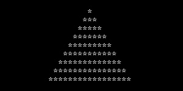
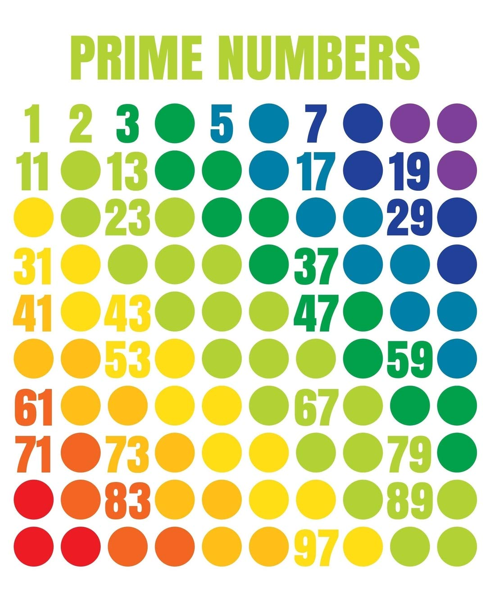
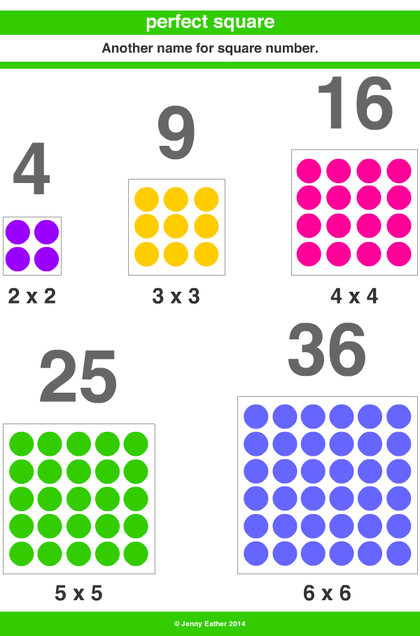

---
presentation:
  width: 1280
  height: 720
  margin: 0
  center: false
  transition: "convex"
  enableSpeakerNotes: true
  slideNumber: "c/t"
  navigationMode: "linear"
---

@import "../../css/font-awesome-4.7.0/css/font-awesome.css"
@import "../../css/theme/solarized.css"
@import "../../css/logo.css"
@import "../../css/font.css"
@import "../../css/color.css"
@import "../../css/margin.css"
@import "../../css/table.css"
@import "../../css/main.css"
@import "../../plugin/zoom/zoom.js"
@import "../../plugin/customcontrols/plugin.js"
@import "../../plugin/customcontrols/style.css"
@import "../../plugin/chalkboard/plugin.js"
@import "../../plugin/chalkboard/style.css"
@import "../../plugin/menu/menu.js"
@import "../../js/anychart/anychart-core.min.js"
@import "../../js/anychart/anychart-venn.min.js"
@import "../../js/anychart/pastel.min.js"
@import "../../js/anychart/venn-ml.js"


<!-- slide data-notes="" -->

<div class="bottom20"></div>

# 智能程序设计（C语言）

<hr class="width50 center">

## 循环结构 (下)

<div class="bottom8"></div>

### 计算机学院 &nbsp;&nbsp; 杨已彪

#### [yangyibiao@nju.edu.cn](mailto:yangyibiao@nju.edu.cn)


<!-- slide data-notes="" -->

##### 提纲

---

- for 语句与常见用法

- C99 的 for 与逗号运算符

- 嵌套循环: 打印星号塔

- 循环惯用法与案例: 累加累乘、素数、非完全平方数

---


<!-- slide data-notes="" -->


##### for语句

---

<div style="display:flex;align-items:flex-start;gap:24px;">

<div style="flex:1.2;font-size:0.7em;">

```C
for (表达式1; 表达式2; 表达式3) 语句
```

```C
for (i = 10; i > 0; i--) {
    printf("%d\n", i);
}
```

```C
表达式1;
while (表达式2) {
  语句
  表达式3;
}
```

</div>

<div style="flex:1;">

`for` 特别适合==次数已知==的循环 ("重复 n 次"型)——三件事 (从几开始、到哪停、每次加几) 排在一行, 一眼看清; 也能用于其他循环。一般形式:

- 表达式1: ==初始化==——只在循环开始前执行一次

- 表达式2: ==条件==——非零就继续, 为零结束

- 表达式3: ==递增/递减==——每轮最后执行

`for` 和 `while` 几乎总能互相改写 (如左)

</div>

</div>

<!-- slide data-notes="" -->


##### for语句

---

<div style="display:flex;align-items:flex-start;gap:24px;">

<div style="flex:1.05;">

表达式1 和表达式3 都是==语句==, 它们的==值==无关紧要——起作用的是==副作用== (赋值、自增自减)

所以表达式3 ==不一定非要是 `i++`/`i--`==——步长 2、累加之类都行:

<span class="blue">:fa-weixin:</span> 表达式3 写 `i--` 还是 `--i`, 结果==完全一样==: `for (i = 10; i > 0; i--)` 和 `for (i = 10; i > 0; --i)` 输出相同——表达式3 只看副作用, 不看值 (但在==复杂表达式==里二者不同: `i--` 用旧值, `--i` 用新值——第 3 周讲过)

</div>

<div style="flex:1;font-size:0.72em;">

```C
/* 求 2+4+6+...+n 的偶数和 */
int sum = 0;
for (i = 2; i <= n; i += 2) {
    sum += i;
}
```

```C
/* 表达式3 也可以是累加: 一行写完累加循环 */
for (i = 1; i <= n; sum += i++)
    ;
```

</div>

</div>

---

<!-- slide data-notes="" -->


##### for语句常见用法

---

`for` 最适合==向上计数==或==向下计数==, 四种常见写法:

```C{.line-numbers}
/* 从0到n-1, 共n次 */   for (i = 0; i < n; i++)
                            printf("%d ", i);     /* 0 1 2 ... n-1 */
/* 从1到n, 共n次 */     for (i = 1; i <= n; i++)
                            printf("%d ", i);     /* 1 2 3 ... n */
/* 从n-1倒数到0 */      for (i = n - 1; i >= 0; i--)
                            printf("%d ", i);     /* n-1 n-2 ... 0 */
/* 从n倒数到1 */        for (i = n; i > 0; i--)
                            printf("%d ", i);     /* n n-1 ... 1 */
```

常见的 for 错误:

- 方向写反: 向上计数用 `<` 或 `<=`, 向下计数用 `>` 或 `>=`——把 `>` 写成 `<` 方向就反了

- 把比较符写成 `==`: 初始值就不成立, 循环体一次都不执行

- ==差一错误== (off-by-one): 把 `i < n` 写成 `i <= n` 会多循环一次

---

<!-- slide data-notes="" -->


##### 演示: 浮点计数循环的陷阱

---

<div style="font-size:0.8em;">

```C
#include <stdio.h>
int main(void) {
    int i;
    double x;
    for (i = 0, x = 0.0; i <= 10; i++, x += 0.1) {
        printf("%2d 次累加后: %.17f\n", i, x);
    }
    return 0;
}
```

</div>

运行结果 (节选): 

```
 1 次累加后: 0.10000000000000001
 2 次累加后: 0.20000000000000001
 3 次累加后: 0.30000000000000004
...
10 次累加后: 0.99999999999999989
```

- `0.1` 在二进制里是无限循环小数 (第2周讲过), 累加 ==10 次并不是 1.0==

- 若用 ==`for (x = 0.0; x != 1.0; x += 0.1)`==: 第 10 次后 `x` 并不等于 `1.0`, 循环==停不下来== (或次数不对)

- 教训: ==不要用浮点数计数/判等==; 循环次数用整数控制、浮点只参与运算; 比较浮点用 `x < 1.0` 而不是 `x != 1.0`

---

<!-- slide data-notes="" -->


##### for语句省略表达式 (省略1)

---

<div style="display:flex;align-items:flex-start;gap:24px;">

<div style="flex:1.2;font-size:0.7em;">

==省略表达式 1==: 初始化挪到循环前

```C{.line-numbers}
#include <stdio.h>
int main(void) {
    int n = 100, i = 1, sum = 0;
    for (; i <= n; ++i) {
        sum += i;
    }
    printf("1+...+%d = %d\n", n, sum);
    return 0;
}
```

</div>

<div style="flex:1;">

- 循环变量的初值==已经在前面算好了==, 表达式 1 的位置就空着 (分号照写)

- 运行结果: `1+...+100 = 5050`

- 常见于初值来自前面计算结果的循环

</div>

</div>

---


<!-- slide data-notes="" -->


##### for语句省略表达式 (省略3)

---

<div style="display:flex;align-items:flex-start;gap:24px;">

<div style="flex:1.2;font-size:0.7em;">

==省略表达式 3==: 递增/递减写进循环体

```C{.line-numbers}
#include <stdio.h>
int main(void) {
    int n = 100, i, sum = 0;
    for (i = 1; i <= n;) {
        sum += i++;
    }
    printf("1+...+%d = %d\n", n, sum);
    return 0;
}
```

</div>

<div style="flex:1;">

- 递增==挪进循环体== (藏在 `sum += i++` 里), 表达式 3 的位置空着

- ==风险==: 循环体必须保证条件最终变假——忘了递增就是死循环

- 运行结果: 同样 `1+...+100 = 5050`

</div>

</div>

---


<!-- slide data-notes="" -->
##### for语句省略表达式 (省1+3)

---

<div style="display:flex;align-items:flex-start;gap:24px;">

<div style="flex:1;font-size:0.62em;">

==省 1 又省 3 的 for==: 两个分号之间只剩条件:

```C{.line-numbers}
#include <stdio.h>
int main(void) {
    int n = 100, i = 1, sum = 0;
    for (; i <= n;) {
        sum += i++;
    }
    printf("1+...+%d = %d\n", n, sum);
    return 0;
}
```

</div>

<div style="flex:1;font-size:0.62em;">

==等价 while 版==:

```C{.line-numbers}
#include <stdio.h>
int main(void) {
    int n = 100, i = 1, sum = 0;
    while (i <= n) {
        sum += i++;
    }
    printf("1+...+%d = %d\n", n, sum);
    return 0;
}
```

</div>

</div>

- 两版输出相同: `1+...+100 = 5050`——都省了初始化与递增, 语义完全等价

- 这种场合 ==while 更清晰, 更推荐==——看到 `for (; …;)` 时想想是不是 while 更合适

---<!-- slide data-notes="" -->


##### for语句省略表达式 (全省: 省略2)

---

<div style="display:flex;align-items:flex-start;gap:24px;">

<div style="flex:1.25;font-size:0.7em;">

==三个表达式全省==: 条件==默认为真==——`for(;;)` 是最常见的无限循环写法

```C{.line-numbers}
#include <stdio.h>
int main(void) {
    int n;
    for (;;) {
        printf("输入一个数 (0 结束): ");
        scanf("%d", &n);
        if (n == 0)
            break;      /* 靠 break 跳出 */
        printf("%d 的平方是 %d\n", n, n * n);
    }
    return 0;
}
```

</div>

<div style="flex:1;">

- 分号不能少: `for(;;)` 里两个分号都在

- 没有 `break`/`return`, 循环永远不停——==试试把 break 删掉再跑==, 用 ==Ctrl+C== 打断

- `break` 下页细讲; 和 5-1 的 `while (1)` 是同类写法, 习惯用哪个都行

</div>

</div>

---

<!-- slide data-notes="" -->
##### C99中的for语句 (声明循环变量)

---

<div style="display:flex;align-items:flex-start;gap:24px;">

<div style="flex:1.2;font-size:0.7em;">

C99 里, for 的表达式1 可以换成==声明==——循环变量直接在 for 里声明:

```C{.line-numbers}
#include <stdio.h>
int main(void) {
    int n = 100, sum = 0;
    for (int i = 1; i <= n; i++) {
        sum += i;
    }
    printf("1+...+%d = %d\n", n, sum);
    return 0;
}
```

</div>

<div style="flex:1;">

- 变量 `i` 不用提前声明, 在 for 里==声明即用==

- 运行结果: `1+...+100 = 5050`

- 好处: 循环变量成了循环的"私有变量", 外面看不见也改不了

</div>

</div>

---


<!-- slide data-notes="" -->


##### C99中的for语句 (作用域)

---

<div style="display:flex;align-items:flex-start;gap:24px;">

<div style="flex:1.2;font-size:0.7em;">

循环内声明的变量==出了循环就用不了==:

```C{.line-numbers}
#include <stdio.h>
int main(void) {
    int n = 100, sum = 0;
    for (int i = 1; i <= n; i++) {
        sum += i;
    }
    /* printf("%d", i);  编译错误: i 出了循环不可见 */
    printf("1+...+%d = %d\n", n, sum);
    return 0;
}
```

</div>

<div style="flex:1;">

- 变量 `i` 的作用域==只在循环内==——循环结束后访问会编译报错 (把注释打开试试)

- 如果要循环结束后==还要用==这个变量, 就只能在循环外声明

- 多数情况下 for 自管循环变量更方便、可读性更好

</div>

</div>

---


<!-- slide data-notes="" -->


##### 逗号运算符

---

`for` 需要两个初始化表达式或一次递增多个变量时, 可用==逗号表达式==作第一或第三个表达式, 形式为:

```C
表达式1, 表达式2
```

计算逗号表达式的步骤:

- 首先计算表达式1并且丢弃计算出的值
- 然后计算表达式2, 并把它的值作为整个表达式的值

<span class="blue">:fa-weixin:</span> 逗号运算符的优先级==低于==所有其他运算符, 结合方向为左结合

例子: 

```C
i = 1, j = 2, k = i + j   /* (i=1), (j=2), (k=i+j) */
```

---

<!-- slide data-notes="" -->


##### C99中的for语句 (多变量声明)

---

<div style="display:flex;align-items:flex-start;gap:24px;">

<div style="flex:1.2;font-size:0.7em;">

for 可以一次声明多个变量 (类型相同), 用逗号分隔:

```C{.line-numbers}
#include <stdio.h>
int main(void) {
    int n = 5, sum = 0;
    for (int i = 1, j = 1; i <= n; i++, j += 2) {
        sum += j;
    }
    printf("前 %d 个奇数之和 = %d\n", n, sum);
    return 0;
}
```

</div>

<div style="flex:1;">

- 两个变量 `i`、`j` 都在表达式 1 声明, 表达式 3 同时递增 (`i++`、`j += 2`)

- 运行结果: `前 5 个奇数之和 = 25` (1+3+5+7+9)

- 表达式3 的 `i++, j += 2` 正是==刚讲的逗号运算符==——概念立刻兑现

- 常见场景: 一个循环里需要==两个同步变化的变量== (计数的 + 参与的)

</div>

</div>

---<!-- slide data-notes="" -->


##### 程序: 打印平方表 (for 版)

---

==现场演示==: 用 `for` 重写上一课的平方表程序——输出一模一样

样例 (输入 5):

```
请输入行数: 5
         1         1
         2         4
         3         9
         4        16
         5        25
```

<span class="blue">:fa-lightbulb-o:</span> 提示: while 版的三件事 (初始化、判定、递增) 怎么搬进 for 的三个表达式?

---


<!-- slide data-notes="" -->


##### 程序: 打印平方表 (for 版 参考代码)

---

<div style="display:flex;align-items:flex-start;gap:24px;">

<div style="flex:1.3;font-size:0.6em;">

```C{.line-numbers}
/* 打印平方表 (for 版) */
#include <stdio.h>

int main(void)
{
  int i, n;

  printf("请输入行数: ");
  scanf("%d", &n);

  for (i = 1; i <= n; i++) {
    printf("%10d%10d\n", i, i * i);
  }

  return 0;
}
```

</div>

<div style="flex:1;">

- 三件事搬进三个表达式: `i = 1` → 表达式1; `i <= n` → 表达式2; `i++` → 表达式3

- 输出与 while 版完全一致 (输入 5 → 5 行平方表)

- for 把三件事集中一行, 计数循环更清晰——这正是 ==for 的主场==

</div>

</div>

<!-- slide data-notes="" -->


##### 嵌套循环: 打印星号塔

---

==现场演示==: 输入高度 n, 打印 n 行的星号塔 (第 i 行有 i 颗星)

<div class="top-2">
  
</div>

<span class="blue">:fa-lightbulb-o:</span> 提示: 需要==两层循环==——外层控制行数, 内层控制每行星号个数; 外层每执行一次, 内层完整跑一轮

---


<!-- slide data-notes="" -->


##### 嵌套循环: 打印星号塔 (参考代码)

---

<div style="display:flex;align-items:flex-start;gap:24px;">

<div style="flex:1.3;font-size:0.55em;">

```C
/* stars.c: 打印星号塔 */
#include <stdio.h>

int main(void)
{
    int n;
    printf("输入高度: ");
    scanf("%d", &n);

    for (int i = 1; i <= n; i++) {        /* 外层: 控制行数 */
        for (int j = 1; j <= i; j++)      /* 内层: 控制每行星号个数 */
            printf("*");
        printf("\n");
    }
    return 0;
}
```

</div>

<div style="flex:1;">

- 外层 `i` 从 1 到 n: 第 i 行

- 内层 `j` 从 1 到 i: 打印 i 颗星——内层的上限==依赖外层变量==, 这是嵌套循环的精髓

- 输入 `5` → 5 行星号塔

</div>

</div>

<!-- slide data-notes="" -->


##### 循环惯用法: 累加与累乘

---

<div style="display:flex;align-items:flex-start;gap:24px;">

<div style="flex:1;">

==累加==: 计算 1+2+...+n

==累乘==: 计算 n! (注意: 初始值为 1, 且很快溢出)

<span class="blue">:fa-weixin:</span> 累加器初始化为 ==0==, 累乘器初始化为 ==1==——这是循环的经典写法, 初值写错结果全错

</div>

<div style="flex:1;font-size:0.8em;">

```C
int sum = 0;
for (int i = 1; i <= n; i++) {
    sum += i;
}
```

```C
int product = 1;
for (int i = 1; i <= n; i++) {
    product *= i;
}
```

</div>

</div>

---

<!-- slide data-notes="" -->


##### 算法案例: 素数判断

---

==现场演示==: 输入一个整数, 判断它是不是素数 (只能被 1 和自己整除)

样例:

```
输入一个数: 13
13 是素数
```

<span class="blue">:fa-lightbulb-o:</span> 提示: 检查 2 ~ n-1 里有没有约数; ==找到第一个约数就可以停了==——想一想用什么

---


<!-- slide data-notes="" -->


##### 算法案例: 素数判断 (参考代码)

---

<div style="display:flex;align-items:flex-start;gap:24px;">

<div style="flex:1.3;font-size:0.55em;">

```C
/* primes.c: 判断 n 是否为素数 */
#include <stdio.h>

int main(void) {
    int n, d;
    printf("输入一个数: ");
    scanf("%d", &n);

    for (d = 2; d < n; d++) {
        if (n % d == 0)
            break;        /* 找到约数, 提前退出 */
    }

    if (d < n)
        printf("%d 不是素数\n", n);
    else
        printf("%d 是素数\n", n);
    return 0;
}
```

</div>

<div style="flex:1;">

- 循环两种退法: 找到约数 break (==提前退出==) 或跑完 2~n-1 (==正常结束==)——用 `d < n` 区分

<div class="top-2">
  
</div>

- 改进: 只需检查到 $\sqrt{n}$ (下节课配合 sqrt 函数实现)

</div>

</div>

<!-- slide data-notes="" -->


##### 综合案例: 非完全平方数的和

---

==现场演示==: 输入 n, 计算 1~n 中所有==非完全平方数==的和 (完全平方数: 1、4、9、16、…)

样例 (n = 10):

```
输入 n: 10
非完全平方数之和 = 41
```

(1~10 的和 55, 减去完全平方数 1+4+9 = 41)

<span class="blue">:fa-lightbulb-o:</span> 提示: 怎么判断一个数是不是完全平方数? (第 3 周的 sqrt + 强制转换); 遇到完全平方数要跳过——用什么?

---


<!-- slide data-notes="" -->


##### 综合案例: 非完全平方数的和 (参考代码)

---

<div style="display:flex;align-items:flex-start;gap:24px;">

<div style="flex:1.3;font-size:0.55em;">

```C
/* perfectsquare.c: 1~n 中非完全平方数之和 */
#include <stdio.h>
#include <math.h>

int main(void) {
    int n, sum = 0;
    printf("输入 n: ");
    scanf("%d", &n);

    for (int i = 1; i <= n; i++) {
        int r = (int) sqrt(i);
        if (r * r == i)
            continue;          /* 完全平方数, 跳过 */
        sum += i;
    }
    printf("非完全平方数之和 = %d\n", sum);
    return 0;
}
```

</div>

<div style="flex:1;">

- `r = (int) sqrt(i)` + `r * r == i`: 第 3 周的强制转换在这里兑现

- `continue` 跳过完全平方数——==循环与数学库函数的第一次合作==

<div class="top-2">
  
</div>

</div>

</div>

<!-- slide data-notes="" -->


##### 课堂小测

---

1. (概念) `for (i = 0; i < n; i++)` 循环体执行了多少次？

2. (概念) `for (;;)` 是什么循环？怎么停下来？

3. (编码·上台) 用 `for` 求 1+2+...+n——坑: 累加器初值、差一错误

4. (编码·上台) 打印乘法口诀表: 第 i 行输出 i 个式子 (如 `3×2=6`)——坑: 内层上限 `j <= i`、换行放在内外层之间


<!-- slide data-notes="" -->


#####

---

<div class="top-2">
  
</div>

---


