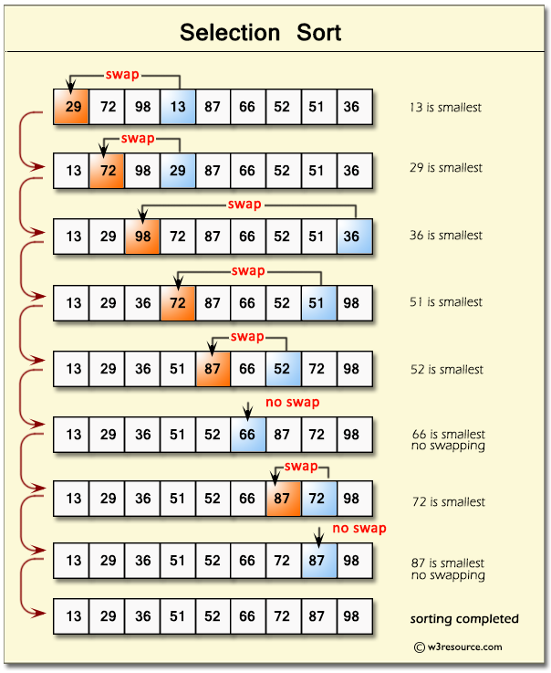

---
presentation:
  margin: 0
  center: false
  transition: "convex"
  enableSpeakerNotes: true
  slideNumber: "c/t"
  navigationMode: "linear"
---

@import "../../css/font-awesome-4.7.0/css/font-awesome.css"
@import "../../css/theme/solarized.css"
@import "../../css/logo.css"
@import "../../css/font.css"
@import "../../css/color.css"
@import "../../css/margin.css"
@import "../../css/table.css"
@import "../../css/main.css"
@import "../../plugin/zoom/zoom.js"
@import "../../plugin/customcontrols/plugin.js"
@import "../../plugin/customcontrols/style.css"
@import "../../plugin/chalkboard/plugin.js"
@import "../../plugin/chalkboard/style.css"
@import "../../plugin/menu/menu.js"
@import "../../js/anychart/anychart-core.min.js"
@import "../../js/anychart/anychart-venn.min.js"
@import "../../js/anychart/pastel.min.js"
@import "../../js/anychart/venn-ml.js"

<!-- slide data-notes="" -->

<div class="bottom20"></div>

# 智能程序设计（C语言）

<hr class="width50 center">

## 排序

<div class="bottom8"></div>

### 计算机学院 &nbsp;&nbsp; 杨已彪

#### [yangyibiao@nju.edu.cn](mailto:yangyibiao@nju.edu.cn)


<!-- slide data-notes="" -->

##### 提纲

---

- 为什么排序

- 三种排序: 选择、冒泡、插入

- 课堂编码

- 课堂小测

---


<!-- slide data-notes="" -->


##### 为什么排序

---

成绩排名、字典、数据库……==排序==是程序处理数据的基本功

- 排序: 把一组数据按大小整理好

- 第 6 周我们把数据装进了数组——今天给它们排队

<span class="blue">:fa-lightbulb-o:</span> 第 1 周的冒泡排序预告, 今天正式实现!

---


<!-- slide data-notes="" -->


##### 选择排序

---

每一轮从剩余元素中==选出最小==的, 放到前面

<div class="top-2">
  
</div>

```C
/* 选择排序: 把 a[0..n-1] 从小到大排好 (约定: 数组已读入 n 个元素) */
for (int i = 0; i < n - 1; i++) {         /* 第 i 轮: 选出最小放到 a[i] */
  int min = i;
  for (int j = i + 1; j < n; j++)
    if (a[j] < a[min])
      min = j;
  int t = a[i]; a[i] = a[min]; a[min] = t;  /* 交换 */
}
```

- 一共 n-1 轮, 第 i 轮结束后 a[0..i] 已经有序

<span class="blue">:fa-lightbulb-o:</span> 第 9 周学了函数, 就能把这整段封装成 `sort(a, n)` 随时调用

---


<!-- slide data-notes="" -->


##### 冒泡排序

---

相邻元素两两比较, 顺序不对就交换, 一轮后最大的元素"沉"到最后

```C
/* 冒泡排序: 把 a[0..n-1] 从小到大排好 */
for (int i = 0; i < n - 1; i++)           /* 共 n-1 轮 */
  for (int j = 0; j < n - 1 - i; j++)     /* 每轮少比一个 */
    if (a[j] > a[j + 1]) {
      int t = a[j];
      a[j] = a[j + 1];
      a[j + 1] = t;
    }
```

- 每一轮结束, 本轮==未排序部分的最大元素"沉"到最后==

- 第 1 周预告过的正是它——现在每个细节都能读懂了

---


<!-- slide data-notes="" -->


##### 插入排序

---

像打牌理手牌: 每次拿起一张, 插到已排序部分的正确位置

```C
/* 插入排序: 把 a[0..n-1] 从小到大排好 */
for (int i = 1; i < n; i++) {
  int key = a[i];                          /* 拿起的"牌" */
  int j = i - 1;
  while (j >= 0 && a[j] > key) {           /* 比 key 大的往后挪 */
    a[j + 1] = a[j];
    j--;
  }
  a[j + 1] = key;                          /* 放进去 */
}
```

- 三种排序都是 ==O(n²)==——数据量不大时完全够用 (第 9 周还有更快的)

---


<!-- slide data-notes="" -->


##### 课堂编码

---

==现场演示==

1. 输入 10 个数, 用冒泡排序从小到大输出

2. 把选择排序写出来, 并统计一共交换了多少次

---

<!-- slide data-notes="" -->


##### 课堂小测

---

1. 选择排序每一轮做什么？总共需要几轮？

2. 冒泡排序一轮结束后，什么元素"就位"了？

3. 插入排序的思路是什么？（打牌时你怎么理手牌？）

4. 三种排序的时间复杂度都是多少？适合多大的数据？

---


<!-- slide data-notes="" -->


#####

---

<div class="bottom20"></div>

# 周三见!

<hr class="width50 center">

## 未完待续

---


