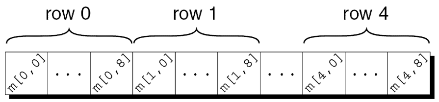

---
presentation:
  margin: 0
  center: false
  transition: "convex"
  enableSpeakerNotes: true
  slideNumber: "c/t"
  navigationMode: "linear"
---

@import "../../css/font-awesome-4.7.0/css/font-awesome.css"
@import "../../css/theme/solarized.css"
@import "../../css/logo.css"
@import "../../css/font.css"
@import "../../css/color.css"
@import "../../css/margin.css"
@import "../../css/table.css"
@import "../../css/main.css"
@import "../../plugin/zoom/zoom.js"
@import "../../plugin/customcontrols/plugin.js"
@import "../../plugin/customcontrols/style.css"
@import "../../plugin/chalkboard/plugin.js"
@import "../../plugin/chalkboard/style.css"
@import "../../plugin/menu/menu.js"
@import "../../js/anychart/anychart-core.min.js"
@import "../../js/anychart/anychart-venn.min.js"
@import "../../js/anychart/pastel.min.js"
@import "../../js/anychart/venn-ml.js"

<!-- slide data-notes="" -->

<div class="bottom20"></div>

# 智能程序设计（C语言）

<hr class="width50 center">

## 二维数组与矩阵运算

<div class="bottom8"></div>

### 计算机学院 &nbsp;&nbsp; 杨已彪

#### [yangyibiao@nju.edu.cn](mailto:yangyibiao@nju.edu.cn)


<!-- slide data-notes="" -->

##### 提纲

---

<div style="font-size:1.3em;">

- 多维数组: 声明、访问与存储

- 多维数组初始化

- ==矩阵运算==: 转置、乘法、统计

- 案例: 发牌程序

</div>

---


<!-- slide data-notes="" -->


##### 多维数组: 声明与访问

---

表格类数据天然是"行×列": 成绩表、棋盘、矩阵……==二维数组==就是一张表

下面的声明创建了一个 5 行 9 列的二维数组 (数学上叫矩阵):

```C
int m[5][9];
```

行、列下标都从 0 开始:

<div class="row1-5-column2-10-fullborder">

|     |   0    |   1    |   2    |   3    |   4    |   5    |   6    |   7    |   8    |
| :-: | :----: | :----: | :----: | :----: | :----: | :----: | :----: | :----: | :----: |
|  0  | &zwnj; | &zwnj; | &zwnj; | &zwnj; | &zwnj; | &zwnj; | &zwnj; | &zwnj; | &zwnj; |
|  1  | &zwnj; | &zwnj; | &zwnj; | &zwnj; | &zwnj; | &zwnj; | &zwnj; | &zwnj; | &zwnj; |
|  2  | &zwnj; | &zwnj; | &zwnj; | &zwnj; | &zwnj; | &zwnj; | &zwnj; | &zwnj; | &zwnj; |
|  3  | &zwnj; | &zwnj; | &zwnj; | &zwnj; | &zwnj; | &zwnj; | &zwnj; | &zwnj; | &zwnj; |
|  4  | &zwnj; | &zwnj; | &zwnj; | &zwnj; | &zwnj; | &zwnj; | &zwnj; | &zwnj; | &zwnj; |

</div>

---

访问 i 行 j 列的元素, 写成 `m[i][j]`:

- `m[i]` 指定第 i 行, `m[i][j]` 是这一行里的第 j 个元素

---

<!-- slide data-notes="" -->


##### 陷阱: m[i,j] 不是 m[i][j]

---

```C
m[i][j]    /* 第 i 行第 j 列 */
m[i,j]     /*** WRONG: 不是二维访问! ***/
```

`m[i,j]` 里的逗号是==逗号运算符==: 先算 i、再算 j, 整个表达式等于 `m[j]`——只取了第 j 行, 根本不是二维访问

- C 编译不报错——又是"能编译但答非所问"的坑

- 键盘上多打一个逗号, 程序就悄悄错了

---


<!-- slide data-notes="" -->


##### 多维数组的存储: 行主序

---

虽然我们以表格形式显示二维数组, 但这并不是它们在计算机内存中实际存储的方式. 
行主序存储数组, 从第 0 行开始, 接着第 1 行, 依此类推. 
数组m的存储方式: 

<div class="top-2">
    
</div>

---


<!-- slide data-notes="" -->


##### 二维数组与嵌套循环

---

<div style="display:flex;align-items:flex-start;gap:24px;">

<div style="flex:1.3;font-size:0.6em;">

```C{.line-numbers}
#define N 10

double ident[N][N];
int row, col;
 
for (row = 0; row < N; row++) {
  for (col = 0; col < N; col++) {
    if (row == col)
      ident[row][col] = 1.0;
    else
      ident[row][col] = 0.0;
  }
}
```

</div>

<div style="flex:1;">

嵌套 for 循环非常适合处理多维数组——==外层行, 内层列==

单位矩阵: `row == col` 放 1, 其余放 0

想只处理对角线以上? 改 `if` 的条件就行


</div>

</div>

<!-- slide data-notes="" -->


##### 多维数组初始化

---

<div style="display:flex;align-items:flex-start;gap:24px;">

<div style="flex:1.3;font-size:0.62em;">

```C
int m[5][9] = { {1, 1, 1, 1, 1, 0, 1, 1, 1},
                {0, 1, 0, 1, 0, 1, 0, 1, 0},
                {0, 1, 0, 1, 1, 0, 0, 1, 0},
                {1, 1, 0, 1, 0, 0, 0, 1, 0},
                {1, 1, 0, 1, 0, 0, 1, 1, 1} };
```

```C
int m[5][9] = { {1, 1, 1, 1, 1, 0, 1, 1, 1},
                {0, 1, 0, 1, 0, 1, 0, 1, 0},
                {0, 1, 0, 1, 1, 0, 0, 1, 0} };
```

</div>

<div style="flex:1;">

把一维初始化式==嵌套==起来, 就得到二维数组的初始化式

高维数组以此类推

---

初始化式不足以填满时, 其余元素==自动补 0==:

下面的初始化式只填了前三行——后两行自动为 0


</div>

</div>

<!-- slide data-notes="" -->


##### 多维数组初始化: 省略与指定

---

<div style="display:flex;align-items:flex-start;gap:24px;">

<div style="flex:1.3;font-size:0.62em;">

```C
/* ① 内层不够填满一行: 该行剩下自动补 0 */
int m[5][9] = { {1, 1, 1, 1, 1, 0, 1, 1, 1},
                {0, 1, 0, 1, 0, 1, 0, 1},
                {0, 1, 0, 1, 1, 0, 0, 1},
                {1, 1, 0, 1, 0, 0, 0, 1},
                {1, 1, 0, 1, 0, 0, 1, 1, 1} };

/* ② 内层花括号可以省略: 填满一行自动换行 */
int m[5][9] = {1, 1, 1, 1, 1, 0, 1, 1, 1,
               0, 1, 0, 1, 0, 1, 0, 1, 0,
               0, 1, 0, 1, 1, 0, 0, 1, 0,
               1, 1, 0, 1, 0, 0, 0, 1, 0,
               1, 1, 0, 1, 0, 0, 1, 1, 1};

/* ③ C99 指定初始化式同样适用 */
double ident[2][2] = {[0][0] = 1.0, [1][1] = 1.0};
```

</div>

<div style="flex:1;">

- ① 内层不够填满一行时, 该行剩下的元素自动为 `0`

- ② 内层花括号可以==省略==——填满一行, 自动开始下一行

- ② 省略有==风险==: 多一个或少一个元素, 后面的全乱, 编译器会告警

- ③ C99 指定初始化式也适用: 创建 2×2 单位矩阵, 未指定的默认为 0

</div>

</div>

<!-- slide data-notes="" -->

##### 矩阵运算: 转置

---

转置: 行列互换, ==b[j][i] = a[i][j]==

```C
int a[3][4] = { {1, 2, 3, 4},
                  {5, 6, 7, 8},
                  {9, 10, 11, 12} };
int b[4][3];

for (int i = 0; i < 3; i++)
  for (int j = 0; j < 4; j++)
    b[j][i] = a[i][j];   /* 行列互换 */
```

- 3×4 的矩阵 a 转置后是 4×3 的矩阵 b

- 注意 b 的行列数与 a ==正好相反==

---


<!-- slide data-notes="" -->

##### 矩阵运算: 乘法

---

矩阵乘法: $c_{ij} = \sum_k a_{ik} \times b_{kj}$ (a 的列数必须等于 b 的行数)

```C
/* a: m×n, b: n×p, c: m×p */
for (int i = 0; i < m; i++)
  for (int j = 0; j < p; j++) {
    c[i][j] = 0;
    for (int k = 0; k < n; k++)
      c[i][j] += a[i][k] * b[k][j];
  }
```

- ==三层循环==: 外层两重选行与列, 最内层求和

- 机器学习库底层干的就是这个——三层循环, 一个不差

---


<!-- slide data-notes="" -->

##### 矩阵运算: 按行/按列统计

---

统计每行的和、每列的和 (成绩表场景):

```C
/* scores: 5 名学生 × 3 门课 */
int row_sum[5] = {0}, col_sum[3] = {0};

for (int i = 0; i < 5; i++)
  for (int j = 0; j < 3; j++) {
    row_sum[i] += scores[i][j];   /* 每行: 某学生的总分 */
    col_sum[j] += scores[i][j];   /* 每列: 某门课的总分 */
  }
```

- ==一次遍历同时算两个方向==: 行和进 row_sum[i], 列和进 col_sum[j]

---


<!-- slide data-notes="" -->


##### 常量数组

---

声明数组时加 ==const==, 数组就变成==只读==: 

```C
const char hex_chars[] =
  {'0', '1', '2', '3', '4', '5', '6', '7', '8', '9',
   'A', 'B', 'C', 'D', 'E', 'F'};
```

程序不应修改声明为const的数组.


声明成 const 的好处: 

- 表明程序不会更改数组. 

- 帮助编译器捕获错误. 

- const不仅限于数组, 也可用于任何别的变量. 

- const常用于数组的声明, 以保护在程序执行过程中不变的信息.

---


<!-- slide data-notes="" -->


##### 程序: 发牌

---

`deal.c`程序说明了二维数组和常量数组的用法. 

该程序从一副标准的扑克牌中随机处理一手牌. 

标准套牌中的每张牌都有花色{梅花&clubs;(`c`), 方块&diams;(`d`), 红桃&hearts;(`h`), 黑桃&spades;(`s`)}和等级{$2, 3, 4, 5, 6, 7, 8, 9, 10, J, Q, K, A$}.


用户将指定手中应该有多少张牌: 

输入手牌数量: <u>5</u>
你的牌: 7c 2s 5d as 2h

需要解决的问题: 

- 如何从牌组中随机挑选牌？

- 如何避免两次选择同一张牌？

---


<!-- slide data-notes="" -->


##### 程序: 发牌 (代码)

---

<div style="display:flex;align-items:flex-start;gap:24px;">

<div style="flex:1.4;font-size:0.55em;">

```C{.line-numbers}
/* 随机发牌 */
#include <stdio.h>
#include <stdlib.h>
#include <time.h>

#define NUM_SUITS 4
#define NUM_RANKS 13

int main(void)
{
  int in_hand[NUM_SUITS][NUM_RANKS] = {0};   /* 52 张牌, 0=还没发 */
  int num_cards, rank, suit;
  const char rank_code[] = {'2','3','4','5','6','7','8',
                            '9','t','j','q','k','a'};   /* t 代表 10 */
  const char suit_code[] = {'c','d','h','s'};

  srand((unsigned) time(NULL));
  printf("输入手牌数量: ");
  scanf("%d", &num_cards);
  printf("你的牌:");
  while (num_cards > 0) {
    suit = rand() % NUM_SUITS;    /* 随机花色 0~3 */
    rank = rand() % NUM_RANKS;    /* 随机等级 0~12 */
    if (!in_hand[suit][rank]) {
      in_hand[suit][rank] = 1;
      num_cards--;
      printf(" %c%c", rank_code[rank], suit_code[suit]);
    }
  }
  printf("\n");
  return 0;
}
```

</div>

<div style="flex:1;">

- 随机: `srand(time)` 播种 + `rand() % 4` / `% 13` 把返回值缩放到 0~3 / 0~12

- 去重: `in_hand` 是 4×13 的==标志数组==——每张牌一个格子, 发过置 1, 重复就重抽

- 查表: `rank_code[rank]`、`suit_code[suit]`——下标取字符, 数组当==对照表==用

- `const`: 两张表全程不变, 声明成只读——编译器帮你看住

- 10 用 `'t'` 表示: 两位数会破坏"两字符一张牌"的格式

<a href="code/deal.c" target="_blank">deal.c</a>

</div>

</div>

<!-- slide data-notes="" -->

##### 课堂小测 (1/2)

---

1. 声明一个 3 行 4 列的整型二维数组，怎么写？访问第 2 行第 3 列的元素怎么写？

2. `m[i,j]` 与 `m[i][j]` 有什么区别？

---

<!-- slide data-notes="" -->


##### 课堂小测 (2/2)

---

3. 二维数组在内存中是怎么存储的（行主序是什么意思）？

4. 矩阵乘法的三层循环里，最内层的循环在做什么？

---


<!-- slide data-notes="" -->

#####

---

<div class="bottom20"></div>

# 周三见!

<hr class="width50 center">

## 未完待续

---


