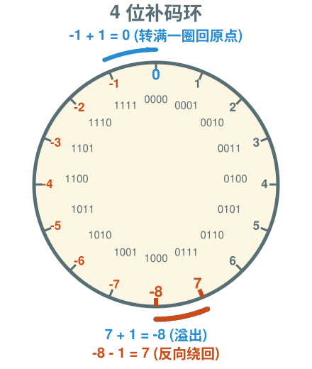
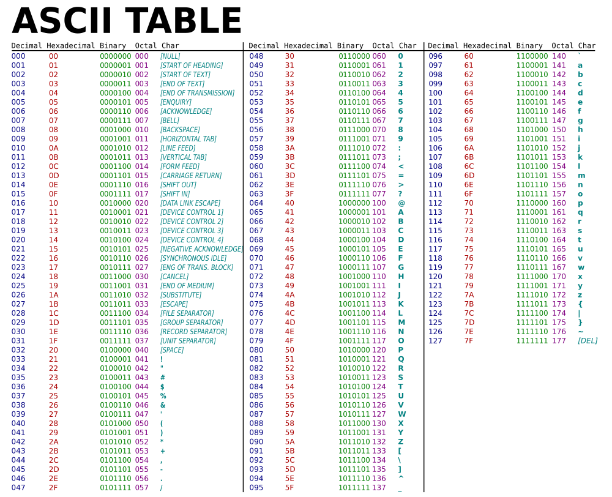
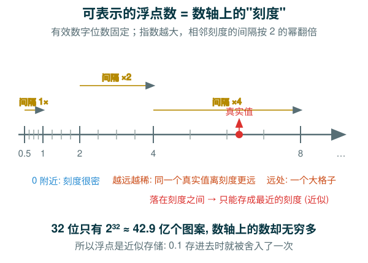

---
presentation:
  width: 1280
  height: 720
  margin: 0
  center: false
  transition: "convex"
  enableSpeakerNotes: true
  slideNumber: "c/t"
  navigationMode: "linear"
---

@import "../../css/font-awesome-4.7.0/css/font-awesome.css"
@import "../../css/theme/solarized.css"
@import "../../css/logo.css"
@import "../../css/font.css"
@import "../../css/color.css"
@import "../../css/margin.css"
@import "../../css/table.css"
@import "../../css/main.css"
@import "../../plugin/zoom/zoom.js"
@import "../../plugin/customcontrols/plugin.js"
@import "../../plugin/customcontrols/style.css"
@import "../../plugin/chalkboard/plugin.js"
@import "../../plugin/chalkboard/style.css"
@import "../../plugin/menu/menu.js"
@import "../../js/anychart/anychart-core.min.js"
@import "../../js/anychart/anychart-venn.min.js"
@import "../../js/anychart/pastel.min.js"
@import "../../js/anychart/venn-ml.js"


<!-- slide data-notes="" -->

<div class="bottom20"></div>

# 智能程序设计（C语言）

<hr class="width50 center">

## 数据类型深化

<div class="bottom8"></div>

### 计算机学院 &nbsp;&nbsp; 杨已彪

#### [yangyibiao@nju.edu.cn](mailto:yangyibiao@nju.edu.cn)


<!-- slide data-notes="" -->

##### 提纲

---

- 任务 1: 看看你的机器有多大 (类型修饰符与 `sizeof`)

- 任务 2: 整数溢出实验 (补码与 4 位环)

- 任务 3: 同一个数, 三种进制 (进制与 ASCII)

- 任务 4: 浮点精度实验 (IEEE 754 与近似存储)

- 综合案例: Circle 与 Sphere (常量与赋值细节)

---

<!-- slide data-notes="" -->


##### 类型修饰符: 调整整数范围与符号

---

在讨论类型大小之前, 先看能改变整数范围的修饰符:

==修饰符==: 改变整数类型的取值范围, 或是否允许负号

<div class="fullborder">

| 修饰符           | 含义                                    |
| :--             | :--                                     |
| `short` / `long` | 短整型 / 长整型                          |
| `signed`         | 有符号 (默认, 可表示负数)                 |
| `unsigned`       | 无符号 (只表示 0 与正数, 范围更大)         |

</div>

常见组合: `short int`, `long int`, `unsigned int`, `unsigned long`

- 位数: `short` ≤ `int` ≤ `long`

<!-- slide data-notes="" -->

##### sizeof: 查类型占多少字节

---

修饰符改变了范围; 范围由类型占几个字节决定:

用 ==sizeof== 运算符可查看类型占用的==字节数==

- `sizeof` 用法: 写类型用 `sizeof(int)`, 写变量用 `sizeof x` (括号可省)

下面一行同时量三种类型:

```C
printf("%zu %zu %zu\n", sizeof(int), sizeof(double), sizeof(char));
```

- 打印 sizeof 的结果用 ==`%zu`== (它不是 int)

知道怎么量了, 在自己机器上量一量四种类型:


---
<!-- slide data-notes="" -->##### 任务 1: 看看你的机器有多大
---
<div style="font-size:1.0em;line-height:1.75;">

==任务==: 用 `sizeof` 打印 `int`、`char`、`float`、`double` 各占多少==字节==

样例输出 (常见 64 位机器):

```
int: 4 字节
char: 1 字节
float: 4 字节
double: 8 字节
```

==提示==: `sizeof(int)` 是运算符不是函数; 打印结果用 ==`%zu`==

<a href="vscode://file/Users/yangyibiao/Documents/Seafile/GitRepo/yangyibiao.github.io/cpl/slides/2-types-io/code/task-sizeof.c" style="display:inline-block;margin-top:8px;padding:5px 14px;background:#268bd2;color:#fff;border-radius:6px;font-size:0.85em;text-decoration:none;">⚡ 在 VS Code 中打开 task-sizeof.c (骨架)</a>

</div>

---

<!-- slide data-notes="" -->##### 任务 1: 参考代码与要点
---
<div style="display:flex;align-items:flex-start;gap:24px;">
<div style="flex:1.1;font-size:0.6em;">

```C{.line-numbers}
#include <stdio.h>

int main(void)
{
  printf("int: %zu 字节\n", sizeof(int));
  printf("char: %zu 字节\n", sizeof(char));
  printf("float: %zu 字节\n", sizeof(float));
  printf("double: %zu 字节\n", sizeof(double));
  return 0;
}
```

</div>
<div style="flex:1;font-size:0.9em;line-height:1.7;">

- `sizeof` 的结果类型是 ==`size_t`==, 对应占位符 ==`%zu`==

- 结果==随平台变化==, 以你机器上的输出为准

- `sizeof x` 与 `sizeof(int)` 都可以

- `int` 的范围限制就来自它只有 4 个字节 (32 位)

</div>
</div>

那么 4 个字节到底能装多大?

---


<!-- slide data-notes="" -->

##### int 的上限: 21 亿, 再加 1 就溢出

---

- int 通常是 ==32 位==(4 字节), 最大整数 $2^{31}-1$ = ==2 147 483 647==(约 21 亿)

- ==INT_MAX== / ==INT_MIN== 定义在 `limits.h` 中

下面把 INT_MAX 加 1, 看它绕到哪里:

<div style="font-size:0.8em;">

```C
#include <stdio.h>
#include <limits.h>

int main(void) {
  int x = INT_MAX;
  printf("INT_MAX     = %d\n", INT_MAX);
  printf("INT_MAX + 1 = %d\n", x + 1);   /* 溢出! */
  return 0;
}
```

</div>

- <span class="yellow">:fa-weixin:</span> 溢出==不会报错==, 会"绕回"成负数——C 不做检查

---

<!-- slide data-notes="" -->

##### 补码与溢出: 12 小时钟 → 4 位补码环

---

为什么 INT_MAX 加 1 会变成负数? 把 32 位想成一个钟面:

<div style="display:flex;align-items:flex-start;gap:24px;">

<div style="flex:1.05;">

<div class="top-2">
  
</div>

<div style="text-align:center;font-size:0.72em;color:#657b83;">0 起 16 格, 加 1 顺时针走一格</div>

</div>

<div style="flex:1.15;font-size:0.85em;line-height:1.62;">

- 像 ==12 小时钟== 一样绕圈: 1~12 首尾相接, ==12 ≡ 0==——"12 + 1 = 1" 其实是 0 + 1; 绕圈只是==改名==

- 负数用 ==补码== 存: ==按位取反再加 1== (如 -1 的位模式全 1); 最高位是==符号位== (0 正 1 负); 环上负数在左半圈, 正数在右半圈

- 为什么 `5 + (-5) = 0`: `5 = 0101`, `-5 = 1011` (取反加 1); 相加得 `1 0000`, 丢掉溢出位就是 `0000`——补码让减法变加法

- 溢出 = 跨过底部分界: ==0111 + 1 = 1000== (7 → -8), 反向 ==-8 - 1 = 7==; 顶部 -1 + 1 = 0 回原点; C 不检查溢出

- 同样 32 位, 解释方式不同: `int` 为 $-2^{31}$ ~ $2^{31}-1$ (±21 亿); `unsigned` 为 $0$ ~ $2^{32}-1$ (42 亿)

</div>

</div>

<!-- slide data-notes="" -->##### 任务 2: 整数溢出实验
---
<div style="font-size:1.0em;line-height:1.75;">

==任务==:

1. 打印 `INT_MAX`, 再打印 `INT_MAX + 1`, 观察结果

2. 读入一个很大的整数并乘以 2, 看会发生什么

样例 (常见 32 位 int):

```
INT_MAX     = 2147483647
INT_MAX + 1 = -2147483648
```

==提示==: `#include <limits.h>` 后可用 `INT_MAX`; 想想补码环——最大数加一会绕到哪里?

<a href="vscode://file/Users/yangyibiao/Documents/Seafile/GitRepo/yangyibiao.github.io/cpl/slides/2-types-io/code/task-overflow.c" style="display:inline-block;margin-top:8px;padding:5px 14px;background:#268bd2;color:#fff;border-radius:6px;font-size:0.85em;text-decoration:none;">⚡ 在 VS Code 中打开 task-overflow.c (骨架)</a>

</div>

---

<!-- slide data-notes="" -->##### 任务 2: 参考代码与要点
---
<div style="display:flex;align-items:flex-start;gap:24px;">
<div style="flex:1.1;font-size:0.6em;">

```C{.line-numbers}
#include <stdio.h>
#include <limits.h>

int main(void)
{
  printf("INT_MAX     = %d\n", INT_MAX);
  printf("INT_MAX + 1 = %d\n", INT_MAX + 1);

  int n;
  scanf("%d", &n);
  printf("n * 2 = %d\n", n * 2);
  return 0;
}
```

</div>
<div style="flex:1;font-size:0.9em;line-height:1.7;">

- `INT_MAX + 1` 回到 `INT_MIN`——正好是==补码环==绕了一圈

- ==有符号整数溢出在 C 标准里是未定义行为==: 这里只是观察常见实现, 不能依赖

- 输入很大时 `n * 2` 同样绕圈——实际程序要==先判断范围==

- 无符号整数溢出是==定义良好==的 (按 2 的幂取模), 与有符号不同

</div>
</div>

溢出实验做完, 再看整数的写法:

---


<!-- slide data-notes="" -->


##### 整数的三种写法: 十进制 / 八进制 / 十六进制

---

同一个整数有三种写法:

```C{.line-numbers}
int a = 17;      /* 十进制 */
int b = 021;     /* 八进制: 以 0 开头, 021 = 17 */
int c = 0x11;    /* 十六进制: 以 0x 开头, 0x11 = 17 */
```

- <span class="yellow">:fa-weixin:</span> ==坑==: `010` 不是 10, 而是 ==8== (前导 0 表示八进制)

- 打印时用不同转换说明看同一数字的"不同面孔":

```C
printf("%d %o %x\n", 17, 17, 17);   /* 输出: 17 21 11 */
```

- 十六进制在==位运算、内存地址、颜色码==中很常见 (如 `0xFF0000` 表示红色)

用一个任务把三种进制串起来:

<!-- slide data-notes="" -->##### 任务 3: 同一个数, 三种进制
---
<div style="font-size:1.0em;line-height:1.75;">

==任务==: 读入一个整数 `n`, 分别用 `%d`、`%o`、`%x` 打印; 再打印常量 `0x2a`、`052`、`42` 的十进制值

样例 (输入 42):

```
输入: 42
十进制: 42
八进制: 52
十六进制: 2a
0x2a = 42
052  = 42
42   = 42
```

==提示==: `%o` 八进制、`%x` 十六进制 (小写); `0x` 开头是十六进制常量, ==前导 0 是八进制==——`052` 不是 52

<a href="vscode://file/Users/yangyibiao/Documents/Seafile/GitRepo/yangyibiao.github.io/cpl/slides/2-types-io/code/task-radix.c" style="display:inline-block;margin-top:8px;padding:5px 14px;background:#268bd2;color:#fff;border-radius:6px;font-size:0.85em;text-decoration:none;">⚡ 在 VS Code 中打开 task-radix.c (骨架)</a>

</div>

---

<!-- slide data-notes="" -->##### 任务 3: 参考代码与要点
---
<div style="display:flex;align-items:flex-start;gap:24px;">
<div style="flex:1.1;font-size:0.6em;">

```C{.line-numbers}
#include <stdio.h>

int main(void)
{
  int n;
  scanf("%d", &n);

  printf("十进制: %d\n", n);
  printf("八进制: %o\n", n);
  printf("十六进制: %x\n", n);

  printf("0x2a = %d\n", 0x2a);
  printf("052  = %d\n", 052);
  printf("42   = %d\n", 42);
  return 0;
}
```

</div>
<div style="flex:1;font-size:0.9em;line-height:1.7;">

- `%d` / `%o` / `%x` 是同一个整数的三种==显示方式==, 内存里存的值不变

- `0x2a`、`052`、`42` 都是==同一个数 42==——前缀只影响源码写法, 不影响值

- ==前导 0 是八进制==: `010` 是 8, `052` 是 42; 别把 `052` 当 52

- 输出十六进制默认小写 (`2a`); 要大写用 ==`%X`== (`2A`)

- 进制只是"面孔": `%o` / `%x` 输出都不带前缀

</div>
</div>

数字的"面孔"会变, 字符呢? 它其实也是整数:

---


<!-- slide data-notes="" -->

##### 字符与 ASCII: char 其实是小整数

---

<div style="display:flex;align-items:flex-start;gap:24px;">

<div style="flex:1;">

char 存的是==编码==; 今天把它当整数用

- 'a'=97, 'A'=65, '0'=48, ' '=32——大写字母与小写字母==差 32==

- 同一个变量, ==%c== 打字符 / ==%d== 打编码

```C
char ch = 'a';
printf("%c  %d\n", ch, ch);   /* a 97 */
printf("%c\n", ch - 32);      /* A */
printf("%d\n", '9' - '0');    /* 9 */
```

- 常用技巧: ==toupper/tolower== (ctype.h); '9'-'0' 把字符数字变成整数

</div>

<div style="flex:1.35;">

<div class="top-2">
  
</div>

<span class="blue">:fa-lightbulb-o:</span> Hex 列是==两位 16 进制==; ==大写 + 32 = 小写== (如 0x41 + 0x20 = 0x61)

</div>

</div>

<!-- slide data-notes="" -->

##### float 与 double: 6 位 vs 15 位有效数字

---

整数和字符都看完了, 再看带小数的类型:

- ==float==: 约 6 位有效数字; ==double==: 约 15 位有效数字

```C
float f = 1.0f / 3.0f;   /* 0.333333            */
double d = 1.0 / 3.0;    /* 0.333333333333333   */
```

- 为什么默认用 ==double==? 精度高, 且字面量 `3.14` 本来就是 double

- float 字面量要加 ==`f`== 后缀 (`1.0f`); 不加就是 double (赋给 float 会有转换警告)

- float 一般只在==内存紧张==时用 (如嵌入式)

- 浮点运算==有误差==: 0.1 + 0.2 不等于 0.3——下一页看它在内存里怎么存

---

<!-- slide data-notes="" -->

##### IEEE 754: 符号 + 指数 + 尾数 (了解)

---

<div style="display:flex;align-items:flex-start;gap:24px;font-size:0.86em;">

<div style="flex:1.05;">

浮点数按 ==IEEE 754== 存: "二进制的科学计数法"——==符号 + 指数 + 尾数==

<div class="fullborder">

| 类型 | 总位数 | 符号位 | 指数位 | 尾数位 |
| :-- | :-- | :-- | :-- | :-- |
| float | 32 | 1 | 8 | 23 |
| double | 64 | 1 | 11 | 52 |

</div>

- ==规范化==: 存成 $1.b_1b_2\cdots \times 2^e$; 开头的 1 必然出现, ==隐含不存==——白赚一位精度

- 指数用==移码==存 (float 加 127): 让位模式的顺序与数值顺序一致

- 位数决定精度: float 24 位有效 ≈ 7 位十进制 (保守说 6-7 位); double 53 位 ≈ 16 位 (说 15-16 位)

</div>

<div style="flex:1.1;">

==例: 0.75 怎么存==

1. 拆: ==0.75 = 0.11₂ = 1.1₂ × 2⁻¹==

2. 符号 ==0==; 指数 $-1 + 127 = 126$, 即 ==01111110==; 尾数 ==1==, 后面补 0 到 23 位 (隐含的 1 不存)

3. 拼起来: `0 01111110 10000000000000000000000`

4. 验算: 指数 $126 - 127 = -1$, 尾数补回 1 得 $1.1_2$, 即 $1.1_2 \times 2^{-1} = 0.75$ ✓

==特殊值 (选讲)==: 指数段==全 0 / 全 1== 保留——全 0 给 `±0` 与极小非规格化数, 全 1 给 `±∞` (尾数 0) 或 `NaN` (尾数非 0)

<span class="blue">:fa-lightbulb-o:</span> 32 位只有 42.9 亿个图案, 约==一半的 float 挤在 -1 到 1 之间==——0 附近密, 越远越稀

</div>

</div>

存法看清了, 再算算 32 位能表示多少个数:

<!-- slide data-notes="" -->##### 42.9 亿个刻度 vs 无穷多的数

---

<div style="display:flex;align-items:flex-start;gap:24px;">

<div style="flex:1.15;">

<div class="top-2">
  
</div>

</div>

<div style="flex:1;font-size:0.95em;line-height:1.5;">

- 32 位图案只有 ==2³² ≈ 42.9 亿个==, 数轴上的数却==无穷多==——只能挑出其中有限个"刻度"

- ==为什么越远越稀==: 浮点 = 固定位数的有效数字 × 2 的指数; 指数每大一级, 相邻刻度的间隔就==翻倍==

- ==1 到 2、2 到 4 各有 $2^{23}$ ≈ 840 万个 float==——区间翻倍, 格子数不变

- 比如 0.1: 落在两个刻度之间, 只能存成==最近的刻度==——这就是"近似存储"

- 所以比较浮点数不要用 `==`, 用 `fabs(a - b) < 1e-9` (`fabs` 是 math.h 的绝对值函数)

<span class="blue">:fa-lightbulb-o:</span> 0 附近密、越远越稀——刻度间隔随指数翻倍

</div>

</div>
<!-- slide data-notes="" -->##### 任务 4: 浮点精度实验
---
<div style="font-size:1.0em;line-height:1.75;">

==任务==:

1. 打印 `0.1 + 0.2` (保留 17 位小数), 再与 `0.3` 比较是否相等

2. 把 `0.1` 连加三次, 看结果和 `0.3` 差多少

样例 (常见结果):

```
0.1 + 0.2 = 0.30000000000000004
(0.1 + 0.2) == 0.3 ? 0
```

==提示==: `printf("%.17f", x)` 看全部小数; 用 `==` 比较会得到 0

<a href="vscode://file/Users/yangyibiao/Documents/Seafile/GitRepo/yangyibiao.github.io/cpl/slides/2-types-io/code/task-float.c" style="display:inline-block;margin-top:8px;padding:5px 14px;background:#268bd2;color:#fff;border-radius:6px;font-size:0.85em;text-decoration:none;">⚡ 在 VS Code 中打开 task-float.c (骨架)</a>

</div>

---

<!-- slide data-notes="" -->##### 任务 4: 参考代码与要点
---
<div style="display:flex;align-items:flex-start;gap:24px;">
<div style="flex:1.1;font-size:0.6em;">

```C{.line-numbers}
#include <stdio.h>

int main(void)
{
  double a = 0.1, b = 0.2;
  printf("0.1 + 0.2 = %.17f\n", a + b);
  printf("(0.1 + 0.2) == 0.3 ? %d\n", a + b == 0.3);

  double s = a + a + a;
  printf("0.1 连加三次 = %.17f\n", s);
  printf("s == 0.3 ? %d\n", s == 0.3);
  return 0;
}
```

</div>
<div style="flex:1;font-size:0.9em;line-height:1.7;">

- 结果是 `0.30000000000000004`——浮点是==近似存储==

- 所以==不要用 `==` 比较浮点数==; 判近似相等用 `fabs(a - b) < 1e-9`

- 为什么存不准? `0.1` 落在两个刻度之间, 只能取最近的刻度 (IEEE 754)

- 金额等精确计算常见做法: ==放大成整数== (以分为单位)

</div>
</div>

浮点的存储与比较讲完, 回到赋值本身——还有类型匹配与常量的细节:

---


<!-- slide data-notes="" -->

##### 赋值与常量: 类型要匹配, 宏要加括号

---

<div style="display:flex;align-items:flex-start;gap:24px;font-size:0.84em;">

<div style="flex:1;">

==赋值==: 把值存进变量 (`height = 8;`); 浮点常量==float 加 f==, double 不加

```C
float profit = 2150.48f;  /* float 加 f */
double pi = 3.14159;      /* double 不加 f */
```

</div>

<div style="flex:1;">

==常量==: 值不能改变 (`8`, `'M'`); ==符号常量==: 给常量起名字, 可读、好改

```C
#define PI 3.14159          /* 宏: 结尾没有分号 */
const double MOL = 6.02E23;  /* const: 只读变量 */
```

</div>

</div>

<span class="yellow">:fa-weixin:</span> 赋的值==超出目标类型范围==时, 结果==无意义== (不会自动截到最大/最小):

<div style="font-size:0.82em;">

```C
char c = 10000;      /* 无意义 */
int i = 1.0e20;      /* 无意义: 超出 int 范围 */
float f = 1.0e100;   /* 无意义: 超出 float 范围 */
```

</div>

- 宏是==文本替换==: 含运算符时==整体加括号==, 如 `#define SCALE_FACTOR (5.0f / 9.0f)`

- `const` 声明的是==只读变量==: 有类型、有作用域; 宏没有类型, 只是文本

---

<!-- slide data-notes="" -->

##### 综合案例: Circle 与 Sphere

---

把常量、类型和格式化输出串起来, 算两个几何量:

<div style="display:flex;align-items:flex-start;gap:20px;">

<div style="flex:1;font-size:0.84em;">

**Circle** (半径 $r = 10$)

<div style="text-align:center;">$L = 2\pi r \qquad S = \pi r^2$</div>

- 每个结果各占一行

- 小数点后保留==两位==

样例输出:

```text
circumference = 62.83
area = 314.16
```

<a href="vscode://file/Users/yangyibiao/Documents/Seafile/GitRepo/yangyibiao.github.io/cpl/slides/2-types-io/code/circle.c" style="display:inline-block;margin-top:8px;padding:5px 14px;background:#268bd2;color:#fff;border-radius:6px;font-size:0.85em;text-decoration:none;">⚡ 在 VS Code 中打开 circle.c</a>

</div>

<div style="flex:1;font-size:0.84em;">

**Sphere** (半径 $r = 100$)

<div style="text-align:center;">$A = 4\pi r^2 \qquad V = \frac{4}{3}\pi r^3$</div>

- 每个结果占一行, 保留==4 位==小数

- 每个结果至少占 ==15 字符==, 左对齐

样例输出:

```text
125663.6000     : surface_area
4188786.6667    : volume
```

<a href="vscode://file/Users/yangyibiao/Documents/Seafile/GitRepo/yangyibiao.github.io/cpl/slides/2-types-io/code/sphere.c" style="display:inline-block;margin-top:8px;padding:5px 14px;background:#268bd2;color:#fff;border-radius:6px;font-size:0.85em;text-decoration:none;">⚡ 在 VS Code 中打开 sphere.c</a>

</div>

</div>

---

<!-- slide data-notes="" -->

##### Circle 与 Sphere: 参考代码与要点

---

<div style="display:flex;align-items:flex-start;gap:20px;">

<div style="flex:1;font-size:0.6em;">

```C{.line-numbers}
#include <stdio.h>
#define PI 3.14159

int main(void)
{
  int r = 10;
  double l = 2 * PI * r;
  double s = PI * r * r;
  printf("circumference = %.2f\n", l);
  printf("area = %.2f\n", s);
  return 0;
}
```

</div>

<div style="flex:1;font-size:0.6em;">

```C{.line-numbers}
#include <stdio.h>
#define PI 3.14159

int main(void)
{
  int r = 100;
  double a = 4 * PI * r * r;
  double v = 4.0 / 3 * PI * r * r * r;
  printf("%-15.4f : surface_area\n", a);
  printf("%-15.4f : volume\n", v);
  return 0;
}
```

</div>

</div>

<div style="font-size:0.88em;line-height:1.65;">

- ==宏常量== `PI`: 只写一处, 改取值/精度只改一行; 宏结尾==不加分号==

- 圆: $L = 2\pi r$, $S = \pi r^2$; 球: $A = 4\pi r^2$, $V = \frac{4}{3}\pi r^3$

- ==整数除法坑==: `4 / 3` 得 1, 必须写 `4.0 / 3`

- `%.2f` 保留 2 位; `%-15.4f` = 宽 15、4 位小数、==左对齐==

</div>

---

<!-- slide data-notes="" -->


##### 课堂小测

---

1. `unsigned int` 与 `int` 的区别是什么？查看类型占用字节数用什么运算符？

2. 用 `#define` 定义符号常量时行末要不要分号？`const` 呢？

3. `INT_MAX` 在哪个头文件中定义？它代表什么？

4. 计算圆的面积时为什么要用符号常量 `PI` 而不是直接写 `3.14159`？

<!-- slide data-notes="" -->


#####

---

<div class="bottom20"></div>

<hr class="width50 center">

## 未完待续

---


