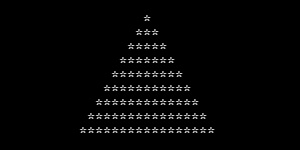

---
presentation:
  width: 1280
  height: 720
  margin: 0
  center: false
  transition: "convex"
  enableSpeakerNotes: true
  slideNumber: "c/t"
  navigationMode: "linear"
---

@import "../../css/font-awesome-4.7.0/css/font-awesome.css"
@import "../../css/theme/solarized.css"
@import "../../css/logo.css"
@import "../../css/font.css"
@import "../../css/color.css"
@import "../../css/margin.css"
@import "../../css/table.css"
@import "../../css/main.css"
@import "../../plugin/zoom/zoom.js"
@import "../../plugin/customcontrols/plugin.js"
@import "../../plugin/customcontrols/style.css"
@import "../../plugin/chalkboard/plugin.js"
@import "../../plugin/chalkboard/style.css"
@import "../../plugin/menu/menu.js"
@import "../../js/anychart/anychart-core.min.js"
@import "../../js/anychart/anychart-venn.min.js"
@import "../../js/anychart/pastel.min.js"
@import "../../js/anychart/venn-ml.js"


<!-- slide data-notes="" -->

<div class="bottom20"></div>
<style>.reveal pre code{max-height:none!important}</style>

# 智能程序设计（C语言）

<hr class="width50 center">

## 循环结构 (下)

<div class="bottom8"></div>

### 计算机学院 &nbsp;&nbsp; 杨已彪

#### [yangyibiao@nju.edu.cn](mailto:yangyibiao@nju.edu.cn)


<!-- slide data-notes="" -->

##### 提纲

---

- for 语句: 形式、常见用法与陷阱

- 省略表达式与 C99 的 for

- 逗号运算符

- 嵌套循环: 打印星号塔

- 循环惯用法与案例: 累加累乘、素数、非完全平方数

- 课堂小测: 概念、编码、纠错与分析

---


<!-- slide data-notes="" -->
##### for语句

---

<div style="display:flex;align-items:flex-start;gap:24px;">

<div style="flex:1.2;font-size:0.7em;">

`for` 特别适合==次数已知==的循环 ("重复 n 次"型), 一般形式:

```C
for (表达式1; 表达式2; 表达式3) 语句
```

```C{.line-numbers}
#include <stdio.h>
int main(void) {
    int i;
    for (i = 10; i > 0; i--) {
        printf("%d\n", i);
    }
    printf("发射!\n");
    return 0;
}
```

</div>

<div style="flex:1;">

三个表达式各司其职:

- 表达式1: ==初始化==——只在循环开始前执行一次

- 表达式2: ==条件==——非零就继续, 为零结束

- 表达式3: ==递增/递减==——每轮最后执行

三件事排在一行, 起点、终点、步长一目了然——这就是 for 的==主场==

</div>

</div>

---<!-- slide data-notes="" -->
##### for语句

---

<div style="display:flex;align-items:flex-start;gap:24px;">

<div style="flex:1.05;">

表达式1 和表达式3 都是==语句==, 它们的==值==无关紧要——起作用的是==副作用== (赋值、自增自减)

所以表达式3 ==不一定非要是 `i++`/`i--`==——步长 2 也行 (如右):

<span class="blue">:fa-weixin:</span> 表达式3 写 `i--` 还是 `--i` 结果一样 (只看副作用, 不看值); 但在复杂表达式里二者不同——之前讲过

</div>

<div style="flex:1;font-size:0.72em;">

```C
/* 求 2+4+6+...+n 的偶数和 */
#include <stdio.h>
int main(void) {
    int n = 100, sum = 0;
    int i;
    for (i = 2; i <= n; i += 2) {
        sum += i;
    }
    printf("偶数和 = %d\n", sum);
    return 0;
}
```

</div>

</div>

---<!-- slide data-notes="" -->
##### for语句常见用法

---

<div style="display:flex;align-items:flex-start;gap:24px;">

<div style="flex:1.15;font-size:0.62em;">

`for` 最适合==向上计数==或==向下计数==, 四种常见写法:

```C{.line-numbers}
/* 从0到n-1, 共n次 */  for (i = 0; i < n; i++)
                           printf("%d ", i);
/* 从1到n, 共n次 */    for (i = 1; i <= n; i++)
                           printf("%d ", i);
/* 从n-1倒数到0 */     for (i = n - 1; i >= 0; i--)
                           printf("%d ", i);
/* 从n倒数到1 */       for (i = n; i > 0; i--)
                           printf("%d ", i);
```

输出依次为 `0 1 2 …`、`1 2 3 …`、`n-1 … 0`、`n … 1`

</div>

<div style="flex:1;">

常见的 for 错误:

- ==方向写反==: 向上计数用 `<`/`<=`, 向下计数用 `>`/`>=`——把 `>` 写成 `<` 方向就反了

- ==把比较符写成 `==`==: 初始值就不成立, 循环体一次都不执行

- ==差一错误== (off-by-one): 把 `i < n` 写成 `i <= n` 会多循环一次

</div>

</div>

---<!-- slide data-notes="" -->
##### 演示: 浮点计数循环的陷阱

---

<div style="display:flex;align-items:flex-start;gap:24px;">

<div style="flex:1.05;font-size:0.7em;">

```C
#include <stdio.h>
int main(void) {
    int i;
    double x;
    for (i = 0, x = 0.0; i <= 10; i++, x += 0.1) {
        printf("%2d 次累加后: %.17f\n", i, x);
    }
    return 0;
}
```

</div>

<div style="flex:1;">

运行结果 (节选): 

```
 1 次累加后: 0.10000000000000001
 2 次累加后: 0.20000000000000001
 3 次累加后: 0.30000000000000004
...
10 次累加后: 0.99999999999999989
```

</div>

</div>

- `0.1` 在二进制里是无限循环小数 (之前讲过), 累加 ==10 次并不是 1.0==

- 若用 ==`for (x = 0.0; x != 1.0; x += 0.1)`==: 第 10 次后 `x` 并不等于 `1.0`, 循环==停不下来== (或次数不对)

- 教训: ==不要用浮点数计数/判等==; 循环次数用整数控制、浮点只参与运算; 比较浮点用 `x < 1.0` 而不是 `x != 1.0`

---<!-- slide data-notes="" -->

##### for语句省略表达式 (省 1 / 省 3)

---

<div style="display:flex;align-items:flex-start;gap:24px;" class="split-rule">

<div style="flex:1.1;font-size:0.7em;">

<div class="col-label">代码</div>


==省略表达式 1==: 初始化挪到循环前

```C{.line-numbers}
int n = 100, i = 1, sum = 0;
for (; i <= n; ++i) {
    sum += i;
}
printf("1+...+%d = %d\n", n, sum);
```

==省略表达式 3==: 递增挪进循环体

```C{.line-numbers}
int n = 100, i = 1, sum = 0;
for (; i <= n;) {
    sum += i++;
}
printf("1+...+%d = %d\n", n, sum);
```

</div>

<div style="flex:1;font-size:0.82em;line-height:1.55;">

<div class="col-label">要点</div>


- 表达式 1 的初值==已经在前面算好==时, 位置空着; ==两个分号不能省==; 常见于初值来自前面计算结果的循环
- 表达式 3 的递增==藏进循环体== (`sum += i++`); 风险: 循环体必须保证条件最终变假——==忘了递增就是死循环==
- 省 1 又省 3 (`for (; i <= n;)`) 与 `while (i <= n)` 语义等价
- 这种场合 ==while 更清晰、更推荐==——看到 `for (; …;)` 先想想是不是 while 更合适

<span class="blue">:fa-weixin:</span> 两版输出都是 `1+...+100 = 5050`

</div>

</div>

---

<!-- slide data-notes="" -->


##### for语句省略表达式 (全省: 省略2)

---

<div style="display:flex;align-items:flex-start;gap:24px;" class="split-rule">

<div style="flex:1.25;font-size:0.7em;">

<div class="col-label">代码</div>


==三个表达式全省==: 条件==默认为真==——`for(;;)` 是最常见的无限循环写法

```C{.line-numbers}
#include <stdio.h>
int main(void) {
    int n;
    for (;;) {
        printf("输入一个数 (0 结束): ");
        scanf("%d", &n);
        if (n == 0) {
            break;      /* 靠 break 跳出 */
        }
        printf("%d 的平方是 %d\n", n, n * n);
    }
    return 0;
}
```

</div>

<div style="flex:1;">

<div class="col-label">要点</div>


- 分号不能少: `for(;;)` 里两个分号都在

- 没有 `break`/`return`, 循环永远不停——==试试把 break 删掉再跑==, 用 ==Ctrl+C== 打断

- `break` 的用法已在 5-1 细讲; 和 `while (1)` 是同类写法, 习惯用哪个都行

</div>

</div>

---

<!-- slide data-notes="" -->
##### C99中的for语句 (声明循环变量)

---

<div style="display:flex;align-items:flex-start;gap:24px;" class="split-rule">

<div style="flex:1.2;font-size:0.7em;">

<div class="col-label">代码</div>


C99 里, for 的表达式1 可以换成==声明==——循环变量直接在 for 里声明:

```C{.line-numbers}
#include <stdio.h>
int main(void) {
    int n = 100, sum = 0;
    for (int i = 1; i <= n; i++) {
        sum += i;
    }
    printf("1+...+%d = %d\n", n, sum);
    return 0;
}
```

</div>

<div style="flex:1;">

<div class="col-label">要点</div>


- 变量 `i` 不用提前声明, 在 for 里==声明即用==

- 运行结果: `1+...+100 = 5050`

- 好处: 循环变量成了循环的"私有变量", 外面看不见也改不了

</div>

</div>

---


<!-- slide data-notes="" -->


##### C99中的for语句 (作用域)

---

<div style="display:flex;align-items:flex-start;gap:24px;" class="split-rule">

<div style="flex:1.2;font-size:0.7em;">

<div class="col-label">代码</div>


循环内声明的变量==出了循环就用不了==:

```C{.line-numbers}
#include <stdio.h>
int main(void) {
    int n = 100, sum = 0;
    for (int i = 1; i <= n; i++) {
        sum += i;
    }
    /* printf("%d", i);  编译错误: i 出了循环不可见 */
    printf("1+...+%d = %d\n", n, sum);
    return 0;
}
```

</div>

<div style="flex:1;">

<div class="col-label">要点</div>


- 变量 `i` 的作用域==只在循环内==——循环结束后访问会编译报错 (把注释打开试试)

- 如果要循环结束后==还要用==这个变量, 就只能在循环外声明

- 多数情况下 for 自管循环变量更方便、可读性更好

</div>

</div>

---


<!-- slide data-notes="" -->


##### 逗号运算符

---

`for` 需要两个初始化表达式或一次递增多个变量时, 可用==逗号表达式==作第一或第三个表达式, 形式为:

```C
表达式1, 表达式2
```

- 首先计算表达式1并且丢弃计算出的值
- 然后计算表达式2, 并把它的值作为整个表达式的值

<span class="blue">:fa-weixin:</span> 逗号运算符的优先级==低于==所有其他运算符, 结合方向为左结合

例子: 

```C
i = 1, j = 2, k = i + j   /* (i=1), (j=2), (k=i+j) */
```

---

<!-- slide data-notes="" -->


##### C99中的for语句 (多变量声明)

---

<div style="display:flex;align-items:flex-start;gap:24px;" class="split-rule">

<div style="flex:1.2;font-size:0.7em;">

<div class="col-label">代码</div>


for 可以一次声明多个变量 (类型相同), 用逗号分隔:

```C{.line-numbers}
#include <stdio.h>
int main(void) {
    int n = 5, sum = 0;
    for (int i = 1, j = 1; i <= n; i++, j += 2) {
        sum += j;
    }
    printf("前 %d 个奇数之和 = %d\n", n, sum);
    return 0;
}
```

</div>

<div style="flex:1;">

<div class="col-label">要点</div>


- 两个变量 `i`、`j` 都在表达式 1 声明, 表达式 3 同时递增 (`i++`、`j += 2`)

- 运行结果: `前 5 个奇数之和 = 25` (1+3+5+7+9)

- 表达式3 的 `i++, j += 2` 正是==刚讲的逗号运算符==——概念立刻兑现

- 常见场景: 一个循环里需要==两个同步变化的变量== (计数的 + 参与的)

</div>

</div>

---<!-- slide data-notes="" -->


##### 程序: 打印平方表 (for 版)

---

==现场演示==: 用 `for` 重写上一课的平方表程序——输出一模一样

<a href="vscode://file/Users/yangyibiao/Documents/Seafile/GitRepo/yangyibiao.github.io/cpl/slides/5-if-for-array/code/skeleton.c" style="display:inline-block;margin:4px 0 0;padding:3px 10px;background:#268bd2;color:#fff;border-radius:6px;font-size:0.75em;text-decoration:none;">⚡ 打开 skeleton.c</a>

样例 (输入 5):

```
请输入行数: 5
         1         1
         2         4
         3         9
         4        16
         5        25
```

<span class="blue">:fa-lightbulb-o:</span> 提示: while 版的三件事 (初始化、判定、递增) 怎么搬进 for 的三个表达式?

---


<!-- slide data-notes="" -->


##### 程序: 打印平方表 (for 版 参考代码)

---

<div style="display:flex;align-items:flex-start;gap:24px;" class="split-rule">

<div style="flex:1.3;font-size:0.6em;">

<div class="col-label">代码</div>


```C{.line-numbers}
/* 打印平方表 (for 版) */
#include <stdio.h>

int main(void)
{
  int i, n;

  printf("请输入行数: ");
  scanf("%d", &n);

  for (i = 1; i <= n; i++) {
    printf("%10d%10d\n", i, i * i);
  }

  return 0;
}
```

</div>

<div style="flex:1;">

<div class="col-label">要点</div>


- 三件事搬进三个表达式: `i = 1` → 表达式1; `i <= n` → 表达式2; `i++` → 表达式3

- 输出与 while 版完全一致 (输入 5 → 5 行平方表)

- for 把三件事集中一行, 计数循环更清晰——这正是 ==for 的主场==

</div>

</div>

<!-- slide data-notes="" -->


##### 嵌套循环: 打印星号塔

---

<div style="display:flex;align-items:flex-start;gap:24px;">

<div style="flex:1;">

==现场演示==: 输入高度 n, 打印 n 行的==居中星号塔== (第 i 行: 前面补空格, 星号 2i-1 颗)

<a href="vscode://file/Users/yangyibiao/Documents/Seafile/GitRepo/yangyibiao.github.io/cpl/slides/5-if-for-array/code/skeleton.c" style="display:inline-block;margin:4px 0 0;padding:3px 10px;background:#268bd2;color:#fff;border-radius:6px;font-size:0.75em;text-decoration:none;">⚡ 打开 skeleton.c</a>

<span class="blue">:fa-lightbulb-o:</span> 提示: 每行 = ==空格 + 星号==——空格负责居中 (第 i 行 n-i 个), 星号第 i 行 2i-1 颗; 加上外层, 一共三层循环

</div>

<div style="flex:1.1;">

<div class="top-2">
  
</div>

</div>

</div>

---


<!-- slide data-notes="" -->


##### 嵌套循环: 打印星号塔 (参考代码)

---

<div style="display:flex;align-items:flex-start;gap:24px;" class="split-rule">

<div style="flex:1.3;font-size:0.55em;">

<div class="col-label">代码</div>


```C
/* stars.c: 打印居中星号塔 */
#include <stdio.h>

int main(void)
{
    int n;
    printf("输入高度: ");
    scanf("%d", &n);

    for (int i = 1; i <= n; i++) {          /* 外层: 控制行数 */
        for (int j = 1; j <= n - i; j++) {  /* 空格: 居中 */
            printf(" ");
        }
        for (int j = 1; j <= 2 * i - 1; j++) { /* 星号: 2i-1 颗 */
            printf("*");
        }
        printf("\n");
    }
    return 0;
}
```

</div>

<div style="flex:1;">

<div class="col-label">要点</div>


- 外层 `i` 管行数; 两个内层分别管==空格==和==星号==——三层的上限都依赖 `i`

- 空格数 `n - i` 递减、星号数 `2 * i - 1` 递增——居中的数学

- 内层上限==依赖外层变量==是嵌套循环的精髓; 输入 `5` → 5 层金字塔

</div>

</div>

<!-- slide data-notes="" -->##### 任务 3: 星号塔 (倒三角)

---

<div style="font-size:0.95em;line-height:1.6;">

==任务==: 输入高度 n, 打印 n 行倒置星号塔: 第 i 行先 i-1 个空格, 再 2×(n-i)+1 颗星

样例 (n = 5):

```
*********
 *******
  *****
   ***
    *
```

==提示==:

- 外层管行, 内层两个: 先打空格, 再打星号

- 第 i 行: 空格 `i - 1` 个, 星号 `2 * (n - i) + 1` 颗

- 和正三角相比, 两个内层的上限都反过来了

<a href="vscode://file/Users/yangyibiao/Documents/Seafile/GitRepo/yangyibiao.github.io/cpl/slides/5-if-for-array/code/task3-star.c" style="display:inline-block;margin-top:8px;padding:5px 14px;background:#268bd2;color:#fff;border-radius:6px;font-size:0.85em;text-decoration:none;">⚡ 在 VS Code 中打开 task3-star.c (骨架)</a>

</div>

---

<!-- slide data-notes="" -->##### 任务 3: 参考代码与要点

---

<div style="display:flex;align-items:flex-start;gap:24px;">

<div style="flex:1.1;font-size:0.6em;">

```C{.line-numbers}
/* stars-inv.c: 倒置星号塔 */
#include <stdio.h>
int main(void) {
  int n;
  printf("输入高度: ");
  scanf("%d", &n);

  for (int i = 1; i <= n; i++) {
    for (int j = 1; j <= i - 1; j++)
      printf(" ");
    for (int j = 1; j <= 2 * (n - i) + 1; j++)
      printf("*");
    printf("\n");
  }
  return 0;
}
```

</div>

<div style="flex:1;font-size:0.9em;line-height:1.7;">

- 外层 `i` 管行: 第 i 行空格 ==i-1== 个、星号 ==2(n-i)+1== 颗, 一个递增一个递减

- 与正三角对照: 正三角是空格 n-i、星号 2i-1——倒三角把两者==互换==, 循环仍然从小到大

- 内层上限==依赖外层变量== i, 这是嵌套循环的精髓; 输入 5 → 星号数 9/7/5/3/1

- 每行最后别忘了 `printf("\n")`——否则所有行会挤成一行

</div>

</div>

<!-- slide data-notes="" -->


##### 循环惯用法: 累加与累乘

---

<div style="display:flex;align-items:flex-start;gap:24px;">

<div style="flex:1;">

==累加==: 计算 1+2+...+n

==累乘==: 计算 n! (注意: 初始值为 1, 且很快溢出)

<span class="blue">:fa-weixin:</span> 累加器初始化为 ==0==, 累乘器初始化为 ==1==——这是循环的经典写法, 初值写错结果全错

</div>

<div style="flex:1;font-size:0.8em;">

```C
int sum = 0;
for (int i = 1; i <= n; i++) {
    sum += i;
}
```

```C
int product = 1;
for (int i = 1; i <= n; i++) {
    product *= i;
}
```

</div>

</div>

---

<!-- slide data-notes="" -->

##### 算法案例: 素数判断

---

<style>#prime-merged pre code{font-size:17px!important;line-height:1.2!important}</style>

<div style="font-size:0.72em;line-height:1.45;">

==现场演示==: 输入一个整数, 判断它是不是素数 (只能被 1 和自己整除); 样例: `13` → `13 是素数` <a href="vscode://file/Users/yangyibiao/Documents/Seafile/GitRepo/yangyibiao.github.io/cpl/slides/5-if-for-array/code/skeleton.c" style="color:#268bd2;text-decoration:underline;">⚡ skeleton.c</a>

</div>

<div id="prime-merged" style="display:flex;align-items:flex-start;gap:24px;" class="split-rule">

<div style="flex:1.15;font-size:0.6em;">

<div class="col-label">代码</div>


```C{.line-numbers}
#include <stdio.h>
int main(void) {
    int n, d;
    printf("输入一个数: ");
    scanf("%d", &n);
    if (n < 2) {                  /* 0、1 和负数都不是素数 */
        printf("%d 不是素数\n", n);
        return 0;
    }
    for (d = 2; d < n; d++) {
        if (n % d == 0) {
            break;                /* 找到约数, 提前退出 */
        }
    }
    if (d < n) {
        printf("%d 不是素数\n", n);
    } else {
        printf("%d 是素数\n", n);
    }
    return 0;
}
```

</div>

<div style="flex:0.85;font-size:0.78em;line-height:1.5;">

<div class="col-label">要点</div>


- 检查 2 ~ n-1 有没有约数; ==找到第一个约数就可以停==——用 `break` 提前退出
- 循环两种退法: 找到约数 `break` (==提前退出==) 或跑完 2~n-1 (==正常结束==)——用 `d < n` 区分
- 改进: 只需检查到 $\sqrt{n}$——循环条件改为 `d * d <= n` (不用 math.h); ==现场试写== `d <= sqrt(n)` 对比效果
- 别忘了 n < 2: 0、1 和负数都不是素数

</div>

</div>

---

<!-- slide data-notes="" -->##### 任务 4: 素数判断

---

<div style="font-size:0.9em;line-height:1.55;">

==任务==: 输入一个整数 n, 判断它是不是素数; 不是素数时, 再输出它的最小约数

样例:

```
输入一个整数: 91
91 不是素数, 最小约数是 7
输入一个整数: 13
13 是素数
输入一个整数: 1
1 不是素数
```

==提示==:

- 用 `for` 从 2 试到 n-1, `n % d == 0` 就 `break`

- `break` 之后 d 停在第一个约数上——正好是最小约数

- 别忘了 n < 2: 0、1 和负数都不是素数

<a href="vscode://file/Users/yangyibiao/Documents/Seafile/GitRepo/yangyibiao.github.io/cpl/slides/5-if-for-array/code/task4-prime.c" style="display:inline-block;margin-top:8px;padding:5px 14px;background:#268bd2;color:#fff;border-radius:6px;font-size:0.85em;text-decoration:none;">⚡ 在 VS Code 中打开 task4-prime.c (骨架)</a>

</div>

---

<!-- slide data-notes="" -->##### 任务 4: 参考代码与要点

---

<div style="display:flex;align-items:flex-start;gap:24px;">

<div style="flex:1.1;font-size:0.6em;">

```C{.line-numbers}
/* prime.c: 判断素数, 不是则给出最小约数 */
#include <stdio.h>
int main(void) {
  int n, d;
  printf("输入一个整数: ");
  scanf("%d", &n);
  if (n < 2) {
    printf("%d 不是素数\n", n);
    return 0;
  }
  for (d = 2; d < n; d++)
    if (n % d == 0) break;
  if (d < n)
    printf("%d 不是素数, 最小约数是 %d\n", n, d);
  else
    printf("%d 是素数\n", n);
  return 0;
}
```

</div>

<div style="flex:1;font-size:0.9em;line-height:1.7;">

- `for` 从 2 试到 n-1: 一旦 `n % d == 0` 就 `break`——找到第一个约数就停, 不必检查完

- 循环结束时 d 有两种身份: 提前退出 → ==最小约数==; 正常跑完 → d 等于 n

- `if (d < n)` 就是"是否提前退出"的判据——和前面课件的素数参考代码同一套路

- n < 2 必须提前处理: 0、1 和负数直接判"不是素数", 不进循环

</div>

</div>

<!-- slide data-notes="" -->

##### 综合案例: 非完全平方数的和

---

<div style="font-size:0.72em;line-height:1.45;">

==现场演示==: 输入 n, 计算 1~n 中所有==非完全平方数==的和 (完全平方数: 1、4、9、16、…); 样例 n=10 → `41` <a href="vscode://file/Users/yangyibiao/Documents/Seafile/GitRepo/yangyibiao.github.io/cpl/slides/5-if-for-array/code/skeleton.c" style="color:#268bd2;text-decoration:underline;">⚡ skeleton.c</a>

</div>

<div style="display:flex;align-items:flex-start;gap:24px;" class="split-rule">

<div style="flex:1.1;font-size:0.6em;">

<div class="col-label">代码</div>


```C{.line-numbers}
#include <stdio.h>
#include <math.h>

int main(void) {
    int n, sum = 0;
    printf("输入 n: ");
    scanf("%d", &n);
    for (int i = 1; i <= n; i++) {
        int r = (int) sqrt(i);
        if (r * r == i) {
            continue;          /* 完全平方数, 跳过 */
        }
        sum += i;
    }
    printf("非完全平方数之和 = %d\n", sum);
    return 0;
}
```

</div>

<div style="flex:0.9;font-size:0.8em;line-height:1.5;">

<div class="col-label">要点</div>


- 枚举 1~n; `r = (int) sqrt(i)` 后 `r * r == i` 判断完全平方数——==强制转换在这里兑现==
- `continue` 跳过完全平方数, 直接进入下一轮——==循环与数学库函数的第一次合作==
- 样例 n=10: 1~10 的和 55, 减去 1+4+9 = 41
- `continue` 只跳过本轮, 循环照常继续; 与 `break` 区分

</div>

</div>

---

<!-- slide data-notes="" -->

##### 课堂小测 1~2 (概念)

---

<div style="display:flex;align-items:flex-start;gap:24px;">

<div style="flex:1;font-size:0.72em;line-height:1.45;">

**1. (概念)** 看代码, 回答: 循环体执行了多少次? 输出会是从几到几? 一共几个数?

```C
int i;
for (i = 0; i < n; i++) {
    printf("%d ", i);
}
```

</div>

<div style="flex:1;font-size:0.72em;line-height:1.45;">

**2. (概念)** 看代码, 回答: 这是什么循环? 怎么停下来? `for(;;)` 省略的三个表达式分别默认什么?

```C
for (;;) {
    scanf("%d", &n);
    if (n == 0) {
        break;
    }
    printf("%d 的平方是 %d\n", n, n * n);
}
```

</div>

</div>

---

<!-- slide data-notes="" -->

##### 课堂小测 3~4 (编码)

---

<div style="display:flex;align-items:flex-start;gap:24px;">

<div style="flex:1;font-size:0.75em;line-height:1.45;">

**3. (编码)** 用 `for` 求 1+2+...+n; 样例 (n = 100):

```text
1+...+100 = 5050
```

写完后编译运行验证。

</div>

<div style="flex:1;font-size:0.75em;line-height:1.45;">

**4. (编码)** 打印乘法口诀表: 第 i 行输出 i 个式子; 样例 (前 3 行):

```text
1×1=1
1×2=2 2×2=4
1×3=3 2×3=6 3×3=9
```

写完后编译运行验证。

</div>

</div>

---

<!-- slide data-notes="" -->

##### 课堂小测 5~6 (纠错)

---

<div style="display:flex;align-items:flex-start;gap:24px;">

<div style="flex:1;font-size:0.75em;line-height:1.45;">

**5. (纠错)** ==找错==: 下面代码哪里错了? 想想 `i` 的值怎么变化, 循环什么时候停?

```C
int sum = 0;
for (i = 1; i <= n; i--) {
    sum += i;
}
```

</div>

<div style="flex:1;font-size:0.75em;line-height:1.45;">

**6. (纠错)** ==找错==: 想打印乘法口诀表, 下面代码哪里错了? 运行一下会看到什么? 和真正的口诀表差在哪?

```C
for (int i = 1; i <= 9; i++) {
    for (int j = 1; j <= i; j++) {
        printf("%d×%d=%d\n", j, i, j * i);
    }
}
```

</div>

</div>

---

<!-- slide data-notes="" -->

##### 课堂小测 7~8 (分析)

---

<div style="display:flex;align-items:flex-start;gap:24px;">

<div style="flex:1;font-size:0.75em;line-height:1.45;">

**7. (分析)** 分析运行结果: 下面嵌套循环输出什么?

```C
for (int i = 1; i <= 3; i++) {
    int j = 1;
    while (j <= i) {
        printf("*");
        j++;
    }
    printf("\n");
}
```

</div>

<div style="flex:1;font-size:0.75em;line-height:1.45;">

**8. (分析)** 分析运行结果: `count` 最后是多少?

```C
int count = 0;
for (int i = 1; i <= 3; i++) {
    for (int j = 1; j <= 2; j++) {
        count++;
    }
}
printf("%d\n", count);
```

</div>

</div>

---

<!-- slide data-notes="" -->

#####

---

<div class="bottom20"></div>

<hr class="width50 center">

## 未完待续

---
