---
presentation:
  margin: 0
  center: false
  transition: "convex"
  enableSpeakerNotes: true
  slideNumber: "c/t"
  navigationMode: "linear"
---

@import "../css/font-awesome-4.7.0/css/font-awesome.css"
@import "../css/theme/solarized.css"
@import "../css/logo.css"
@import "../css/font.css"
@import "../css/color.css"
@import "../css/margin.css"
@import "../css/table.css"
@import "../css/main.css"
@import "../plugin/zoom/zoom.js"
@import "../plugin/customcontrols/plugin.js"
@import "../plugin/customcontrols/style.css"
@import "../plugin/chalkboard/plugin.js"
@import "../plugin/chalkboard/style.css"
@import "../plugin/menu/menu.js"
@import "../js/anychart/anychart-core.min.js"
@import "../js/anychart/anychart-venn.min.js"
@import "../js/anychart/pastel.min.js"
@import "../js/anychart/venn-ml.js"
@import "https://cdn.bootcdn.net/ajax/libs/jquery/3.5.0/jquery.js"

<!-- slide data-notes="" -->

<div class="bottom20"></div>

# 智能程序设计（C语言）

<hr class="width50 center">

## 指针基础 (上)

<div class="bottom8"></div>

### 计算机学院 &nbsp;&nbsp; 杨已彪

#### [yangyibiao@nju.edu.cn](mailto:yangyibiao@nju.edu.cn)


<!-- slide data-notes="" -->

##### 提纲

---

- 指针变量: 什么是地址

- 声明指针变量

- & 和 * 两个运算符

- 指针赋值

- 课堂小测

---


<!-- slide data-notes="" -->


##### 指针变量

---

理解指针的第一步是在机器级别观察它们表示的内容. 
内存按==字节==划分, 每个字节存 8 位: 

<div class="top-2">
    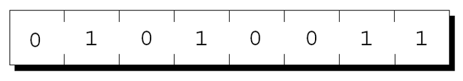
</div>

每个字节都有==唯一的地址==。


内存共 n 个字节, 地址就是从 $0$ 到 $n-1$ 的编号: 

<div class="top-2">
    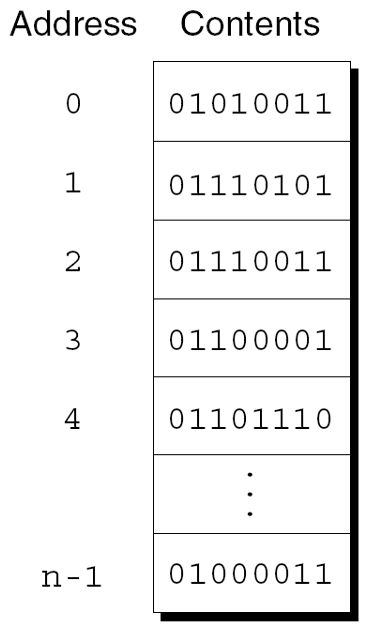
</div>

---


<!-- slide data-notes="" -->


##### 指针变量: 为什么需要地址

---

程序中的每个变量都占用一个或多个字节的内存. 
变量占的第一个字节的地址, 就是==变量的地址==。
下图中变量 i 的地址是 2000: 

<div class="top-2">
    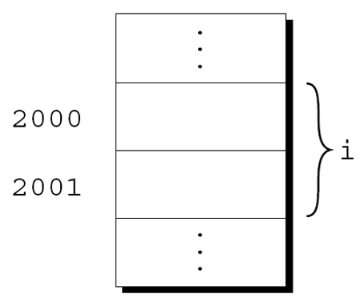
</div>


地址可以存储在特殊的指针变量中. 
把变量 i 的地址存进指针变量 p, 就说 p==指向==i。
图形表示: 

<div class="top-2">
    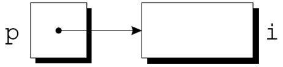
</div>

---


<!-- slide data-notes="" -->


##### 声明指针变量

---

<div style="display:flex;align-items:flex-start;gap:24px;">

<div style="flex:1.2;font-size:0.62em;">

```C
int* p;
```

```C
int i, j, a[10], b[20], *p, *q;
```

```C
int* p; /* 只指向整数 */
double *q; /* 只指向双精度 */
char *r; /* 只指向字符 */
```

</div>

<div style="flex:1;">

声明指针变量时, 名字前面==必须有星号==:

p是一个指针变量, 能够指向int类型的对象. 

使用术语==对象==而不是变量, 因p可能指向不属于变量的内存区域.


指针变量可以与其他变量一起出现在声明中:

C 要求每个指针变量只能指向特定类型(引用类型)的对象:

对引用类型没有限制.

</div>

</div>

<!-- slide data-notes="" -->


##### 取地址运算符 &

---

<div style="display:flex;align-items:flex-start;gap:24px;">

<div style="flex:1.2;font-size:0.62em;">

```C
int *p;  /* 没有指向特定对象 */
```

```C
int i, * p;
…
p = &i;
```

```C
int i;
int *p = &i;
```

```C
int i, *p = &i;
```

</div>

<div style="flex:1;">

声明指针只给它==留了空间==, 还没指向任何对象:

在使用p之前需要初始化它.


初始化指针的一种方法: 把变量的地址赋给它:

把 i 的地址赋给 p, 让 p 指向 i: 

<div class="top-2">
    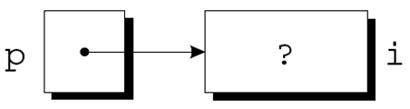
</div>


也可以在声明时就初始化:

i的声明甚至可以与p的声明合并:


</div>

</div>

<!-- slide data-notes="" -->


##### 间接寻址运算符 *

---

<div style="display:flex;align-items:flex-start;gap:24px;">

<div style="flex:1.2;font-size:0.62em;">

```C
printf("%d\n", *p);
```

```C
j = *&i; /* 等同于 j = i; */
```

</div>

<div style="flex:1;">

一旦指针变量指向一个对象, 就可以使用`*`(间接寻址)运算符来访问对象中存储的内容. 

如果p指向i, 我们可以打印i的值如下:

对变量使用`&`运算符生成指向变量的指针

- 对指针使用`*`运算符则可以返回原始变量

只要p指向i, `*p`就是i的别名. 
`*p`与i具有相同的值. 
更改`*p`的值会更改i的值. 
下一张幻灯片上的示例说明了`*p`和i的等价性.

</div>

</div>

<!-- slide data-notes="" -->##### 间接寻址运算符 * (上)

---

<div style="display:flex;align-items:flex-start;gap:24px;">

<div style="flex:1.2;font-size:0.62em;">

```C
printf("%d\n", i); /* 打印 1 */
printf("%d\n", *p); /* 打印 1 */
*p = 2;
```

```C
printf("%d\n", i); /* 打印 2 */
printf("%d\n", *p); /* 打印 2 */
```

</div>

<div style="flex:1;">

`p = &i;`


`i = 1;`


<div class="top-2">
  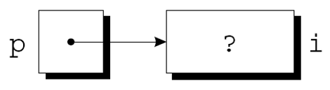
</div><div class="top-2">
  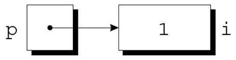
</div><div class="top-2">
  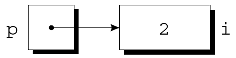
</div>

将间接寻址运算符应用于未初始化的指针变量会导致未定义的行为:

</div>

</div>
<!-- slide data-notes="" -->##### 间接寻址运算符 * (下)

---

<div style="display:flex;align-items:flex-start;gap:24px;">

<div style="flex:1.2;font-size:0.62em;">

```C
int* p;
printf("%d", *p); /*** 错误的 ***/
```

```C
int* p;
*p = 1; /*** 错误的 ***/
```

</div>

<div style="flex:1;">

给*p赋值是特别危险的:


</div>

</div>
<!-- slide data-notes="" -->


##### 指针赋值 (上)

---

<div style="display:flex;align-items:flex-start;gap:24px;">

<div style="flex:1.2;font-size:0.62em;">

```C
int i, j, *p, *q;
```

```C
p = &i;
```

```C
q = p;
```

```C
*p = 1;
```

```C
*q = 2;
```

</div>

<div style="flex:1;">

C 允许使用赋值运算符来复制相同类型的指针. 
假设有以下声明:

指针赋值示例:

指针赋值的另一个例子:

q现在指向与p相同的位置: 
<div class="top-2">
    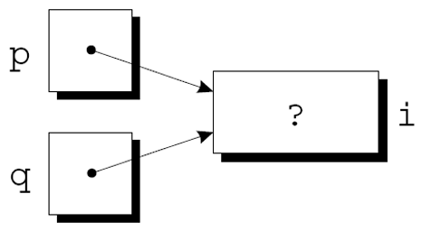
</div>


如果p和q都指向i, 就可以通过为`*p`或`*q`赋一个新值来更改i:

<div class="top-2">
    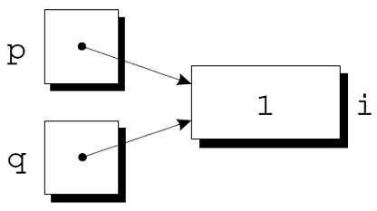
</div>

<div class="top-2">
    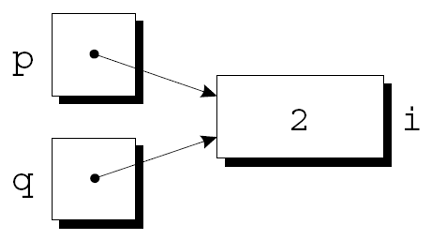
</div>

任意数量的指针变量都可以指向同一个对象.

</div>

</div>

<!-- slide data-notes="" -->


##### 指针赋值 (下): 不要混淆 q=p 与 *q=*p

---

注意不要混淆

```C
q = p;
```
和
```C
*q = *p;
```
第一条语句是指针赋值, 但第二条不是. 
下一张幻灯片上的示例显示了第二个语句的效果.


```C
p = &i;
q = &j;
i = 1;
```
<div class="top-2">
    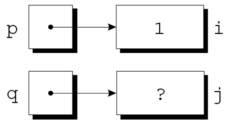
</div>

```C
*q = *p;
```
<div class="top-2">
    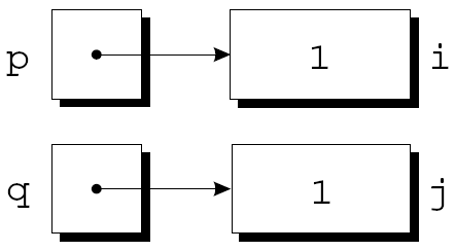
</div>

---


<!-- slide data-notes="" -->

##### 课堂小测

---

1. 指针变量里存的是什么？`int *p;` 中 p 的类型是什么？

2. `&x` 和 `*p` 分别做什么？它们互为逆运算吗？

3. `*p = 10;` 与 `p = &x;` 的区别是什么？

4. 对未初始化的指针变量做 `*p = 1;` 会发生什么？

---


<!-- slide data-notes="" -->

#####

---

<div class="bottom20"></div>

# 周三见!

<hr class="width50 center">

## 未完待续

---


