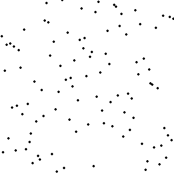
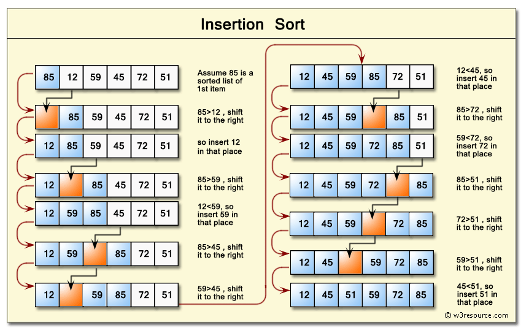
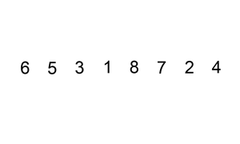
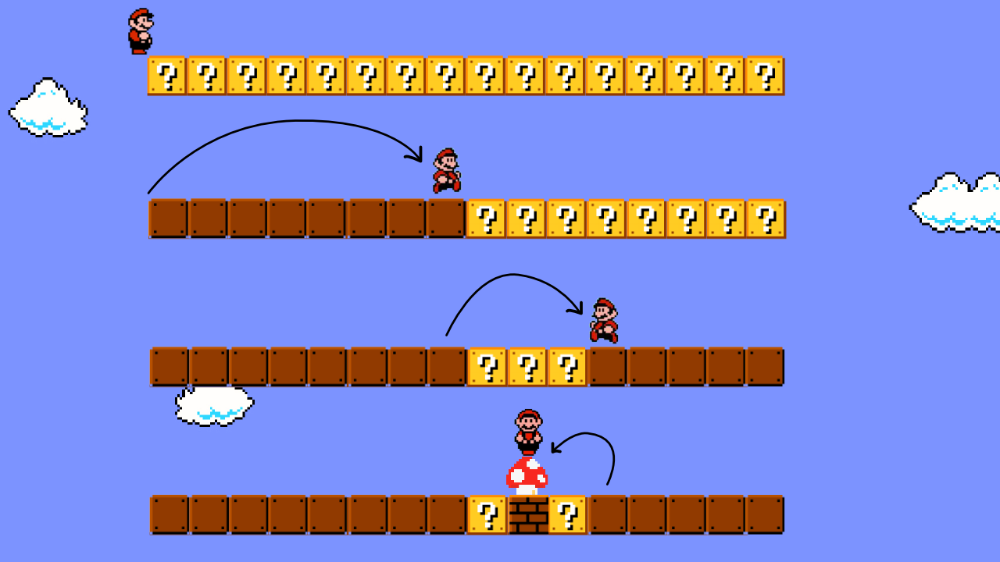
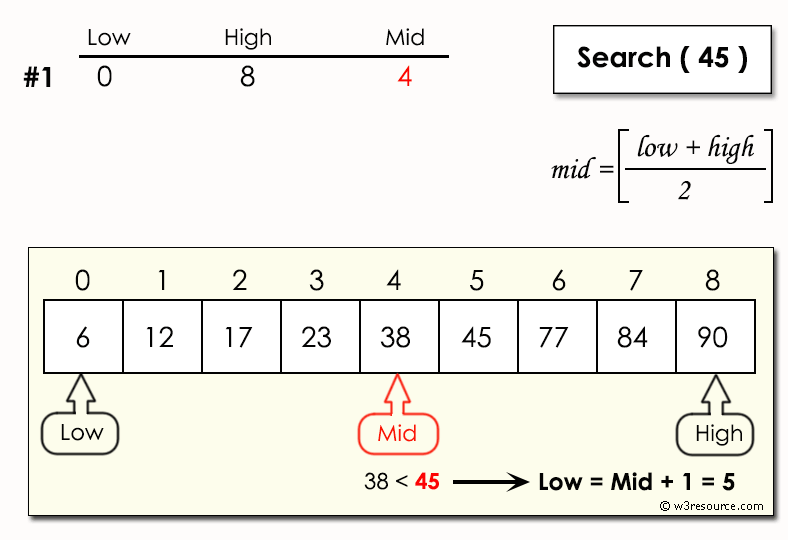

---
presentation:
  margin: 0
  center: false
  transition: "convex"
  enableSpeakerNotes: true
  slideNumber: "c/t"
  navigationMode: "linear"
---

@import "../../css/font-awesome-4.7.0/css/font-awesome.css"
@import "../../css/theme/solarized.css"
@import "../../css/logo.css"
@import "../../css/font.css"
@import "../../css/color.css"
@import "../../css/margin.css"
@import "../../css/table.css"
@import "../../css/main.css"
@import "../../plugin/zoom/zoom.js"
@import "../../plugin/customcontrols/plugin.js"
@import "../../plugin/customcontrols/style.css"
@import "../../plugin/chalkboard/plugin.js"
@import "../../plugin/chalkboard/style.css"
@import "../../plugin/menu/menu.js"
@import "../../js/anychart/anychart-core.min.js"
@import "../../js/anychart/anychart-venn.min.js"
@import "../../js/anychart/pastel.min.js"
@import "../../js/anychart/venn-ml.js"

<!-- slide data-notes="" -->

<div class="bottom20"></div>

# 智能程序设计（C语言）

<hr class="width50 center">

## 排序

<div class="bottom8"></div>

### 计算机学院 &nbsp;&nbsp; 杨已彪

#### [yangyibiao@nju.edu.cn](mailto:yangyibiao@nju.edu.cn)


<!-- slide data-notes="" -->

##### 提纲

---

<div style="font-size:1.3em;text-align:left;margin-left:2rem;">

- 什么是排序、为什么需要排序

- 三种排序: 选择、冒泡、插入 (原理与图示 → 代码)

- 顺序查找: 逐个比; 二分查找: 排好序, 每次砍掉一半

- 案例: 众数统计 (排序 + 扫描)

- 课堂编码

- 课堂小测
</div>

---


<!-- slide data-notes="" -->


##### 什么是排序

---

==排序==: 把一组数据按某种规则整理成有序

- 数值: 从小到大(升序)或从大到小(降序)

- 字符串: 按字典序

<div style="font-size:0.7em;color:var(--solarized-base00);margin-top:4px;">
字典序 = 像查字典那样逐字符比较: 先比第一个字符, 相同再比下一个 —— 如 "apple" 排在 "banana" 前, "zhang" 排在 "zhao" 前
</div>

<div style="margin-top:8px;font-size:0.85em;">
例: [8, 3, 5] 升序 → [3, 5, 8]; 降序 → [8, 5, 3]
</div>

---


<!-- slide data-notes="" -->


##### 为什么需要排序

---

成绩排名、字典、电话簿……==有序==的数据才好用

- 排名: 全班机试成绩乱序, 谁第 1、前 10 是谁? —— 排了才知道

- 查找: 排好序才能用二分查找, 100 万个数据从约 50 万次比较降到约 20 次

- 地基: 去重、统计、合并都建立在有序之上

<span class="blue">:fa-lightbulb-o:</span> 第 6 周把数据装进数组, 今天给它们排队; 第 1 周 "程序能做什么" 里的排序, 今天实现出来

---


<!-- slide data-notes="" -->


##### 选择排序

---

<div style="display:grid;grid-template-columns:1fr 1fr;gap:16px;align-items:center;">

<div>

每一轮从剩余元素中==选出最小==的, 放到前面

- 第 1 轮: 在 a[0..n-1] 里找最小, 换到 a[0]

- 第 2 轮: 在 a[1..n-1] 里找最小, 换到 a[1]

- 依此类推, 共 n-1 轮; 第 i 轮结束时 a[0..i] 已经有序

<div style="font-size:0.7em;color:var(--solarized-base00);margin-top:6px;">
每一轮: 在未排序部分挑出最小的, 与未排序部分的第一个交换
</div>

</div>

<div style="text-align:center;">
  
</div>

</div>

---


<!-- slide data-notes="" -->


##### 选择排序 · 代码

---

<div style="display:grid;grid-template-columns:1.5fr 1fr;gap:14px;align-items:center;">

<div>

```C
/* 选择排序 (约定: a[0..n-1] 已读入 n 个元素) */
for (int i = 0; i < n - 1; i++) {
  int min = i;                       /* 先假设 a[i] 最小 */
  for (int j = i + 1; j < n; j++) {  /* 往后找更小的 */
    if (a[j] < a[min]) {
      min = j;
    }
  }
  int t = a[i]; a[i] = a[min]; a[min] = t;  /* 交换 */
}
```

- 一共 n-1 轮, 第 i 轮结束后 a[0..i] 已经有序

</div>

<div style="text-align:center;">
  
</div>

</div>

<span class="blue">:fa-lightbulb-o:</span> 后面学了函数, 就能把这整段封装成 `sort(a, n)` 随时调用

---


<!-- slide data-notes="" -->


##### 冒泡排序

---

<div style="display:grid;grid-template-columns:1fr 1.3fr;gap:16px;align-items:center;">

<div>

相邻元素两两比较, 顺序不对就交换

- 第 1 轮: 从头比到尾, 最大的元素一路"沉"到 a[n-1]

- 第 2 轮: 再比一遍, 次大的沉到 a[n-2] (末尾已就位, 少比一个)

- 共 n-1 轮; 每一轮结束, 本轮最大的元素"沉底"

<div style="font-size:0.7em;color:var(--solarized-base00);margin-top:6px;">
相邻比较、逐个交换, 最大的逐步"沉"到末尾
</div>

</div>

<div style="text-align:center;">
  
</div>

</div>

---


<!-- slide data-notes="" -->


##### 冒泡排序 · 代码

---

<div style="display:grid;grid-template-columns:1.5fr 1fr;gap:14px;align-items:center;">

<div>

```C
/* 冒泡排序: 把 a[0..n-1] 从小到大排好 */
for (int i = 0; i < n - 1; i++) {         /* 共 n-1 轮 */
  for (int j = 0; j < n - 1 - i; j++) {   /* 每轮少比一个 */
    if (a[j] > a[j + 1]) {
      int t = a[j];
      a[j] = a[j + 1];
      a[j + 1] = t;
    }
  }
}
```

- 每一轮结束, 本轮==未排序部分的最大元素"沉"到最后==

- 三种排序里过程最形象的一种——相邻比较、逐轮沉底

</div>

<div style="text-align:center;">
  
</div>

</div>

---


<!-- slide data-notes="" -->


##### 插入排序

---

<div style="display:grid;grid-template-columns:1fr 1.3fr;gap:16px;align-items:center;">

<div>

像打牌理手牌: 每次拿起一张, 插到已排序部分的正确位置

- 左手: 已排序的牌, 起初只有 a[0]

- 右手: 每次拿起下一张 key = a[i]

- 从右往左比: 比 key 大的往后挪一格, 找到位置把 key 放进去

<div style="font-size:0.7em;color:var(--solarized-base00);margin-top:6px;">
已排序部分逐步变长, 每个 key 与前面的元素比较、右移, 再插到正确位置
</div>

</div>

<div style="text-align:center;">
  
</div>

</div>

---


<!-- slide data-notes="" -->


##### 插入排序 · 代码

---

<div style="display:grid;grid-template-columns:1.5fr 1fr;gap:14px;align-items:center;">

<div>

```C
/* 插入排序: 把 a[0..n-1] 从小到大排好 */
for (int i = 1; i < n; i++) {
  int key = a[i];                          /* 拿起的"牌" */
  int j;                                   /* 循环后还要用 j */
  for (j = i - 1; j >= 0 && a[j] > key; j--) {  /* 比 key 大的往后挪 */
    a[j + 1] = a[j];
  }
  a[j + 1] = key;                          /* 放进去 */
}
```

- 三种排序都是 ==O(n²)==——数据量不大时完全够用

<div style="margin-top:6px;font-size:0.7em;background:rgba(38,139,210,0.06);border-left:4px solid #268bd2;border-radius:4px;padding:4px 10px;line-height:1.6;">
内层 for 退出时: j 停在第一个 ==≤ key== 的元素 (或 -1), 位置 a[j+1] 已空出, key 正好放进去。<br>
例: [2, 5] 插 key=4 —— j 从 1 开始: a[1]=5 &gt; 4 → 右移, j 变 0; a[0]=2 ≤ 4 → 停, 退出时 j = 0, 放入 a[1] → [2, 4, 5]
</div>

</div>

<div style="text-align:center;">
  
</div>

</div>

---


<!-- slide data-notes="" -->


##### 排序与查找

---

==排序==: 把数据按大小整理好 —— 今天前半段已经做完

==查找==: 在数据里找到目标 —— 今天后半段

- 排好序, 查找才能 "快" 起来:

- 无序只能一个个比: 顺序查找, 平均比较 n/2 次

- 有序可以每次砍掉一半: 二分查找, 约 log2(n) 次

<span class="blue">:fa-lightbulb-o:</span> 接下来就用排序的成果, 先看顺序查找, 再学二分查找

---


<!-- slide data-notes="" -->


##### 顺序查找

---

从第一个元素开始==逐个比较==, 找到即停

```C
/* 顺序查找: 在 a[0..n-1] 中找 key (约定: 数组已读入 n 个元素) */
int i;
for (i = 0; i < n; i++) {
  if (a[i] == key) {
    break;                    /* 找到, 提前退出 */
  }
}
if (i < n) {
  printf("找到, 下标 %d\n", i);
} else {
  printf("没找到\n");
}
```

- `i < n` 说明是==提前退出==(找到); `i == n` 说明是==正常结束==(没找到)——第 5 周素数判断用过同样的写法

- 适合无序数据; 平均比较 n/2 次, 最坏 n 次

---


<!-- slide data-notes="" -->


##### 二分查找

---

数据==排好序==后, 可以每次砍掉一半: 和中间元素比较, 决定去左半边还是右半边

<div style="text-align:center;">
  
</div>

<div style="text-align:center;font-size:0.7em;color:var(--solarized-base00);margin-top:2px;">
每次和中间元素比较, 砍掉不可能的一半
</div>

---


<!-- slide data-notes="" -->


##### 二分查找 · 代码

---

<div style="display:grid;grid-template-columns:1.5fr 1fr;gap:14px;align-items:center;">

<div>

```C
/* 二分查找: a 必须已从小到大排好序 */
int low = 0, high = n - 1;
while (low <= high) {
  int mid = (low + high) / 2;
  if (a[mid] == key) {
    printf("找到, 下标 %d\n", mid);
    break;
  }
  if (a[mid] < key) {
    low = mid + 1;
  } else {
    high = mid - 1;
  }
}
if (low > high) {
  printf("没找到\n");
}
```

- n 个元素最多比较 log2(n)+1 次——100 万个数也只要约 20 次!

</div>

<div style="text-align:center;">
  
</div>

</div>

---


<!-- slide data-notes="" -->


##### 课堂编码

---

==现场演示==

1. 输入 10 个数, 用冒泡排序从小到大输出

2. 变体: 把冒泡排序改成==从大到小==, 并输出==每一轮结束后==的数组 (观察"沉底"过程)

3. 排好序后, 输入一个数, 用二分查找输出它的下标; 找不到输出 `not found`

---


<!-- slide data-notes="" -->


##### 众数统计 · 问题

---

输入 n 个==无序==的数 (1 ≤ n ≤ 100), 输出出现次数最多的数(众数)及其出现次数; 若多个数并列, 输出==最小==的那个

<div style="margin-top:8px;font-size:0.8em;line-height:1.8;">

样例输入: `7` 与 `1 2 2 3 2 5 7`

样例输出: `2 3`

</div>

<span class="blue">:fa-lightbulb-o:</span> 提示: 先==排序==, 再观察有序数组里 "相同的数" 有什么特点

---


<!-- slide data-notes="" -->


##### 众数统计 · 现场编码

---

==现场演示==

1. 思路: 先排序 (任选一种, 正好复习) → 相同的数相邻 → 一遍扫描统计每段长度 → 找最长段

2. 学生先写 10 分钟, 再一起看参考代码

3. 引导提问: 最后一段什么时候 "结算"? 并列时怎么保证输出最小的?

---


<!-- slide data-notes="" -->


##### 众数统计 · 代码

---

```C
/* 众数统计 (约定: a[0..n-1] 已读入 n 个数, 且已从小到大排好序) */
int best = a[0], best_cnt = 1;    /* 众数与出现次数 */
int cur = a[0], cur_cnt = 1;      /* 当前这一段 */
for (int i = 1; i <= n; i++) {
  if (i < n && a[i] == cur) {
    cur_cnt++;
  } else {                        /* 这一段结束了 */
    if (cur_cnt > best_cnt) {     /* 只更新更大的, 并列保留最小的 */
      best = cur;
      best_cnt = cur_cnt;
    }
    if (i < n) {
      cur = a[i];
      cur_cnt = 1;
    }
  }
}
printf("%d %d\n", best, best_cnt);
```

- 循环条件 `i <= n`: i == n 时也要==结算最后一段==

- 用 `>` 而不是 `>=`: 升序下从左往右扫, 并列时自然保留==最小==的众数

---

<!-- slide data-notes="" -->


##### 课堂小测

---

1. 选择排序每一轮做什么？总共需要几轮？

2. 冒泡排序一轮结束后，什么元素"就位"了？

3. 代码阅读: 冒泡排序内层循环写成 `for (j = 0; j < n - 1; j++)` (漏了 `- i`)，会发生什么？

4. 纠错: 交换写成了 `int t = a[i]; a[i] = a[min]; a[min] = a[i];`——交换为什么没生效？

5. 二分查找的前提条件是什么？

6. 纠错: 二分查找里写 `int mid = low + high / 2;` 有什么问题？

---


<!-- slide data-notes="" -->


#####

---

<div class="bottom20"></div>

# 周三见!

<hr class="width50 center">

## 未完待续

---


