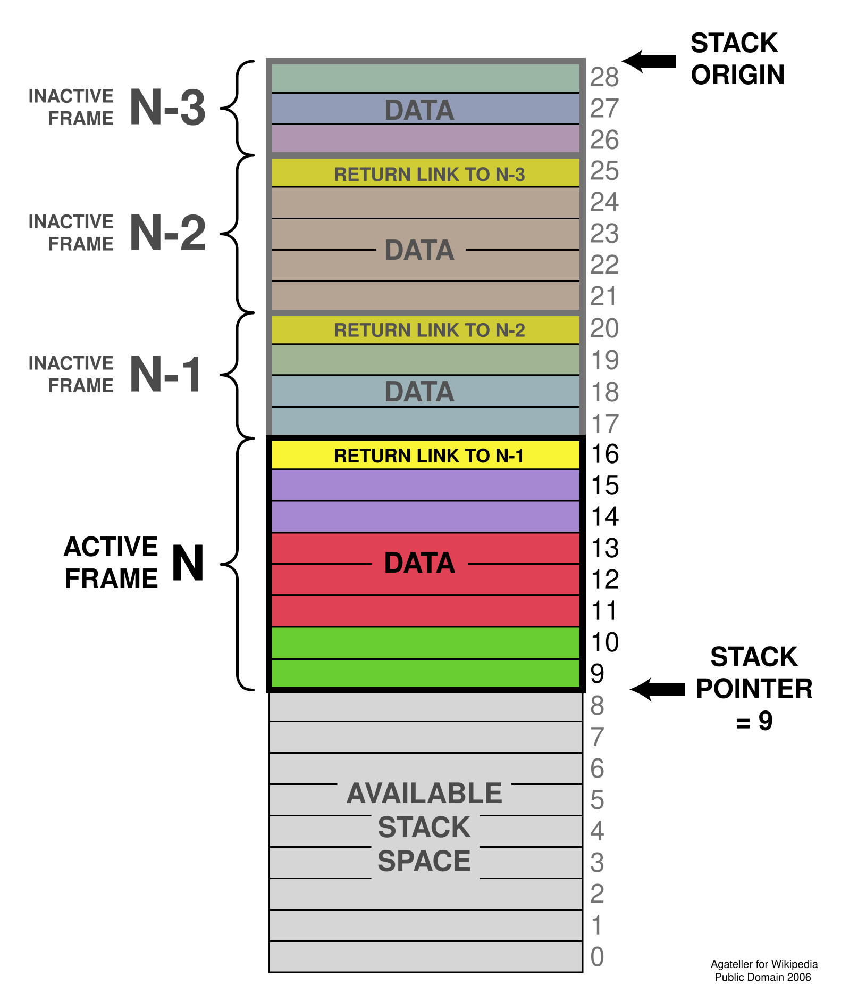

---
presentation:
  margin: 0
  center: false
  transition: "convex"
  enableSpeakerNotes: true
  slideNumber: "c/t"
  navigationMode: "linear"
---

@import "../../css/font-awesome-4.7.0/css/font-awesome.css"
@import "../../css/theme/solarized.css"
@import "../../css/logo.css"
@import "../../css/font.css"
@import "../../css/color.css"
@import "../../css/margin.css"
@import "../../css/table.css"
@import "../../css/main.css"
@import "../../plugin/zoom/zoom.js"
@import "../../plugin/customcontrols/plugin.js"
@import "../../plugin/customcontrols/style.css"
@import "../../plugin/chalkboard/plugin.js"
@import "../../plugin/chalkboard/style.css"
@import "../../plugin/menu/menu.js"
@import "../../js/anychart/anychart-core.min.js"
@import "../../js/anychart/anychart-venn.min.js"
@import "../../js/anychart/pastel.min.js"
@import "../../js/anychart/venn-ml.js"

<!-- slide data-notes="" -->

<div class="bottom20"></div>

# 智能程序设计（C语言）

<hr class="width50 center">

## 函数 (II) · 声明、参数与函数化改造

<div class="bottom8"></div>

### 计算机学院 &nbsp;&nbsp; 杨已彪

#### [yangyibiao@nju.edu.cn](mailto:yangyibiao@nju.edu.cn)


<!-- slide data-notes="" -->

##### 提纲

---

- 回顾: 形式参数 vs 实际参数、如何理解按值传递、swap 为什么不生效

- 函数化改造: 素数、leap、primes、stars

- 数组作参数: 一维、二维、排序封装、矩阵与成绩案例

- 函数调用栈 (概念与例子)

- 课堂编码

- 课堂小测

---


<!-- slide data-notes="" -->##### 回顾: 形式参数 vs 实际参数

---

<div style="display:flex;align-items:flex-start;gap:24px;">

<div style="flex:1.3;font-size:0.65em;">

```C{.line-numbers}
int is_prime(int n)      /* n 是==形式参数==: 定义里的占位名 */
{
  int d;

  for (d = 2; d <= n / d; d++) {
    if (n % d == 0) {
      return 0;
    }
  }
  return 1;
}
```

```C
int flag1 = is_prime(97);   /* 97 是==实际参数==: 返回值可保存 */
int flag2 = is_prime(m);   /* 变量也行: 把 m 的值复制给形参 n */
```

</div>

<div style="flex:1;font-size:0.9em;line-height:1.6;">

- ==形式参数==: 函数定义里的占位名; 调用时拿到的是实参的==副本==

- ==实际参数==: 调用时传进去的值——可以是常量、变量、任意同类型的表达式

- 标量按值传: 改形参==不影响==实参 (swap 陷阱, 上周讲过)

</div>

</div>

---

<!-- slide data-notes="" -->##### 如何理解按值传递

---

==按值传递==: 调用时, 把实参的==值==复制一份赋给形参——之后两者==互不影响==

<div style="display:flex;align-items:flex-start;gap:24px;">

<div style="flex:1.3;font-size:0.65em;">

```C{.line-numbers}
void f(int n)
{
  n = n + 1;              /* 改的是副本 */
  printf("n = %d\n", n);
}

int main(void)
{
  int x = 10;
  f(x);                   /* ≈ 函数开头先执行 n = x */
  printf("x = %d\n", x); /* 10, 不是 11 */
}
```

</div>

<div style="flex:1;font-size:1.0em;line-height:1.7;">

- 调用 `f(x)` 相当于函数开头先执行 ==`n = x`==——x 是赋值表达式的==右值== (只读它的值); 形参 n 拿到的是 x 的==值==, 不是 x 本身

- 类比: 把文件==复印==一份交给函数——复印件上的修改不会影响原件

- 数组是==例外==: 数组作参数时函数却能改到原数组——为什么是例外, 后面==指针部分==会详细介绍和分析

</div>

</div>

---

<!-- slide data-notes="" -->##### 回顾: swap 为什么不生效

---

<div style="display:flex;align-items:flex-start;gap:24px;">

<div style="flex:1.3;font-size:0.62em;">

```C
void swap(int a, int b) {
    int t = a;  a = b;  b = t;      /* 交换的是 a、b 的值 */
}

int main(void) {
    int x = 3, y = 5;
    swap(x, y);
    printf("x = %d, y = %d\n", x, y);
    return 0;
}
```

运行结果:

```
x = 3, y = 5
```

</div>

<div style="flex:1;font-size:1.0em;line-height:1.7;">

- 按值传递的直接体现: `a`、`b` 拿到 `x`、`y` 的==值== (即副本)——函数内交换的是 a、b 的值, 与外面的 x、y ==没有关系==

- 换个角度看: 调用 `swap(x + 6, y + 5)` 传进去的是表达式的==值==, 没人指望 x、y 被改; `swap(x, y)` 传的同样是值, 不是变量本身

- 这是新手最困惑的现象之一: 函数明明执行了, 外界却看不到任何变化

- 记住这个结论——后面==指针部分==会用 `swap(&x, &y)` 真正交换两个变量

</div>

</div>

---

<!-- slide data-notes="" -->##### 程序: 判定素数

---

==现场演示==: 写一个函数 `is_prime(n)` 判断素数, 主函数读入并输出结果

样例:

```
输入一个数: 34
不是素数
```

<span class="blue">:fa-lightbulb-o:</span> 提示: 判断逻辑第 5 周写过 (break 版)——这次把它==做成函数==

---


<!-- slide data-notes="" -->


##### 程序: 判定素数 (参考代码)

---

<div style="display:flex;align-items:flex-start;gap:24px;">

<div style="flex:1.3;font-size:0.5em;">

```C{.line-numbers}
/* 判断一个数是否为素数 */
#include <stdio.h>

int is_prime(int n)
{
  int divisor;

  if (n <= 1) {
    return 0;
  }
  for (divisor = 2; divisor <= n / divisor; divisor++) {
    if (n % divisor == 0) {
      return 0;
    }
  }
  return 1;
}

int main(void)
{
  int n;

  printf("输入一个数: ");
  scanf("%d", &n);
  if (is_prime(n)) {
    printf("是素数\n");
  } else {
    printf("不是素数\n");
  }
  return 0;
}
```

</div>

<div style="flex:1;">

- 判断逻辑封装进 `is_prime`——main 只剩输入输出, 一目了然

- `divisor <= n / divisor` 是检查到 $\sqrt{n}$ 的等价写法 (不用 math.h), 而且==不会溢出==

- 反例: 判断 n = 2147483647 (int 上限, 本身是素数), divisor 试到 46341 时 `46341 × 46341 = 2147488281` 超出 int 上限 2147483647, 溢出变成==负数== → 条件变 false, 循环提前结束, 素数被误判

- 返回 1/0, 调用处 `if (is_prime(n))` 直接当条件——与 8-1 的写法一致

</div>

</div>

---

<!-- slide data-notes="" -->


##### leap.c: 原版 vs 函数版

---

<div style="display:grid;grid-template-columns:1fr 1fr;gap:14px;align-items:start;font-size:0.5em;">

<div>

```C
/* 原版: 判断逻辑在 main 里 */
#include <stdio.h>
int main(void) {
  int year = 0;
  scanf("%d", &year);
  int leap = 0;
  if ((year % 4 == 0 && year % 100 != 0) || (year % 400 == 0)) {
    leap = 1;
  }
  if (leap == 0) {
    printf("%d 是平年\n", year);
  } else {
    printf("%d 是闰年\n", year);
  }
  return 0;
}
```

</div>

<div>

```C
/* 函数版: 判断逻辑抽成函数 */
#include <stdio.h>
int is_leap_year(int);
int main(void) {
  int year = 0;
  scanf("%d", &year);
  int leap = is_leap_year(year);
  if (leap == 0) {
    printf("%d 是平年\n", year);
  } else {
    printf("%d 是闰年\n", year);
  }
  return 0;
}
int is_leap_year(int n) {
  if ((n % 4 == 0 && n % 100 != 0) || (n % 400 == 0)) {
    return 1;
  }
  return 0;
}
```

</div>

</div>

<div style="margin-top:8px;">

- 判断逻辑抽成 `is_leap_year(year)`, main 只剩输入输出

- 返回 1/0, `if (is_leap_year(year))` 直接当条件

- 以后想再判断闰年, 调函数即可——不用重写条件

<a href="code/leap.c" target="_blank">leap.c</a> · <a href="code/leap-re.c" target="_blank">leap-re.c</a>

</div>

---

<!-- slide data-notes="" -->##### primes.c: 原版 vs 函数版

---

<div style="display:grid;grid-template-columns:1fr 1fr;gap:14px;align-items:start;font-size:0.5em;">

<div>

```C
/* 原版: 判断逻辑埋在 main 里 */
#include <stdio.h>

int main() {
  int max;
  scanf("%d", &max);

  int count = 0;
  for (int i = 2; i <= max; i++) {
    // 判断 i 是否素数
    int prime = 1;
    for (int j = 2; j <= i / j; j++) {
      if (i % j == 0) {
        prime = 0;
        break;
      }
    }
    if (prime == 1) {
      count++;
    }
  }
  printf("\n素数个数: %d", count);
  return 0;
}
```

</div>

<div>

```C
/* 函数版: is_prime 抽出来 */
#include <stdio.h>

int is_prime(int n) {
  for (int j = 2; j <= n / j; j++) {
    if (n % j == 0) {
      return 0;
    }
  }
  return 1;
}

int main() {
  int max;
  scanf("%d", &max);

  int count = 0;
  for (int i = 2; i <= max; i++) {
    if (is_prime(i) == 1) {
      count++;
    }
  }
  printf("\n素数个数: %d", count);
  return 0;
}
```

</div>

</div>

<div style="margin-top:8px;">

- 原版: 素数逻辑埋在 main 的两层循环里; 函数版: `is_prime(i)` 一行调用——和第 4 页是同一个函数

- 函数化改造的步骤: 把 "一块逻辑" 抽出来 → 起名字 → 参数进、返回值出

<a href="code/primes.c" target="_blank">primes.c</a> · <a href="code/primes-re.c" target="_blank">primes-re.c</a>

</div>

---

<!-- slide data-notes="" -->


##### stars.c

---

<div style="display:flex;align-items:flex-start;gap:24px;">

<div style="flex:1.3;font-size:0.55em;">

```C
#include <stdio.h>

int main() {
  int lines = 0;
  scanf("%d", &lines);

  for (int i = 0; i < lines; i++) {
    // 打印空格 (居中)
    for (int j = 0; j < lines - 1 - i; j++) {
      printf(" ");
    }
    // 打印 2*i+1 颗星
    for (int j = 0; j < 2 * i + 1; j++) {
      printf("*");
    }
    if (i != lines - 1) {
      printf("\n");
    }
  }

  return 0;
}
```

</div>

<div style="flex:1;">

- 程序里 "打印一行 2*i+1 颗星" 的循环, 就是可以抽出来的函数 `print_stars(n)`

- 留到课堂编码: 你来做这个改造

- 提示: 打印空格的循环也可以抽成 `print_spaces(n)`——每个函数只做==一件事==

<a href="code/stars.c" target="_blank">stars.c</a>

</div>

</div>

<!-- slide data-notes="" -->


##### 函数化改造: 把排序封装成函数

---

第 7 周的排序把整段循环写在 main 里——想给另一组数据排序, 就得再抄一遍

```C
void sort(int a[], int n)          /* 把选择排序装进函数 */
{
  for (int i = 0; i < n - 1; i++) {
    int min = i;
    for (int j = i + 1; j < n; j++) {
      if (a[j] < a[min]) {
        min = j;
      }
    }
    int t = a[i]; a[i] = a[min]; a[min] = t;
  }
}
```

```C
sort(a, 10);     /* 排 a 的前 10 个元素 */
sort(b, 5);      /* 同一段逻辑, 换个数组再用 */
```

- ==函数化改造==: 把重复的逻辑抽出来封装成函数——本周的核心任务

---


<!-- slide data-notes="" -->


##### 一维数组作参数

---

函数要操作数组, 就把数组传给函数:

```C
int sum_array(int a[], int n)    /* 1. 形参: int a[], 长度单独传 */
{
  int i, sum = 0;
  for (i = 0; i < n; i++) {
    sum += a[i];
  }
  return sum;
}

total = sum_array(b, LEN);       /* 2. 调用: 只写数组名, 不加 [] */
```

- ==函数里改数组 = 改原数组==: 排序函数正是这样工作的

- 原因第 11 周指针与数组揭晓 (数组名传的是地址)

---


<!-- slide data-notes="" -->


##### 二维数组作参数

---

二维数组作参数时, ==只能省略第一维==的长度——列数必须写出来:

```C
int sum_matrix(int a[][4], int rows)   /* 列数 4 不能省 */
{
  int i, j, sum = 0;
  for (i = 0; i < rows; i++) {
    for (j = 0; j < 4; j++) {
      sum += a[i][j];
    }
  }
  return sum;
}
```

- 调用: `sum_matrix(m, 3)`——传数组名 + 行数 (m 是 `int[3][4]`)

- 为什么列数不能省? 编译器要知道"==一行有多长=="才能算出 `a[i][j]` 的位置

---


<!-- slide data-notes="" -->


##### 案例: 矩阵转置函数化

---

把第 6 周的转置逻辑封装成函数:

```C{.line-numbers}
/* a: 3×4 的矩阵, b: 4×3 的转置结果 */
void transpose(int a[][4], int b[][3], int rows)
{
  for (int i = 0; i < rows; i++) {
    for (int j = 0; j < 4; j++) {
      b[j][i] = a[i][j];
    }
  }
}
```

```C
int a[3][4] = { ... }, b[4][3];
transpose(a, b, 3);        /* b 得到 a 的转置 */
```

- 形参里两个二维数组: `a[][4]` 和 `b[][3]`——各自写清自己的==列数==

---


<!-- slide data-notes="" -->


##### 案例: 成绩统计函数化

---

<div style="display:flex;align-items:flex-start;gap:24px;">

<div style="flex:1.3;font-size:0.62em;">

```C{.line-numbers}
/* scores: n 名学生 × 3 门课; sums: 存每个人的总分 */
void row_sums(int scores[][3], int n, int sums[])
{
  for (int i = 0; i < n; i++) {
    sums[i] = 0;
    for (int j = 0; j < 3; j++) {
      sums[i] += scores[i][j];
    }
  }
}
```

```C
int scores[5][3] = { ... };
int totals[5];
row_sums(scores, 5, totals);    /* totals 里是 5 个学生的总分 */
```

</div>

<div style="flex:1;">

求每个学生的总分 (每行求和), 结果写回一个一维数组:

二维数组进 (`scores`)、一维数组出 (`sums`)——都是"数组作参数"

- 按列统计要单独写: `sums[j]` 的清零放在==行循环之外== (只清一次), 累加行改成 `sums[j] += scores[i][j]` (结果数组长度变成 3)

</div>

</div>

---


<!-- slide data-notes="" -->##### 函数调用栈 · 概念

---

先想一个问题: 函数返回之后, 它里面的局部变量==去哪儿了==? 下次再调用, 为什么又是全新的?

<div style="display:grid;grid-template-columns:0.9fr 1.1fr;gap:16px;align-items:center;">

<div style="text-align:center;">
  
</div>

<div style="font-size:0.9em;line-height:1.7;">

- 每次函数调用, 系统在==调用栈==(call stack) 上放一张 "便签": 记下==返回地址==、==参数==、==局部变量==

- 函数返回时揭掉这张便签——局部变量 "出了函数就没了", 就是这个原因

- 栈是==后进先出==: 最后调用的函数最先返回——像一摞盘子, 只能从最上面拿

<span class="blue">:fa-lightbulb-o:</span> 周三的递归: 函数一层层调用自己, 栈上便签一层层叠高——今天先记住这张图

</div>

</div>

---


<!-- slide data-notes="" -->##### 函数调用栈 · 便签上放了什么

---

<div style="display:flex;align-items:flex-start;gap:24px;">

<div style="flex:1.1;font-size:0.62em;">

```C{.line-numbers}
double average(double a, double b)
{
  double sum;              /* 局部变量 */
  sum = (a + b) / 2;
  return sum;
}

int main(void)
{
  double x = 3.0, y = 5.0;
  printf("%g\n", average(x, y));
  return 0;
}
```

</div>

<div style="flex:1;">

<svg viewBox="0 0 460 400" style="max-width:100%;height:auto;">
<g font-family="LXGWWenKai, 'Noto Sans SC', sans-serif" font-weight="700">
<rect x="30" y="286" width="180" height="54" rx="8" fill="#fdf6e3" stroke="#93a1a1" stroke-width="2"/>
<text x="120" y="309" font-size="18" fill="#073642" text-anchor="middle">main · x, y</text>
<text x="120" y="329" font-size="11" fill="#586e75" text-anchor="middle">返回地址</text>
<rect x="30" y="232" width="180" height="54" rx="8" fill="#dceaf5" stroke="#268bd2" stroke-width="3"/>
<text x="120" y="255" font-size="18" fill="#073642" text-anchor="middle">average · a, b, sum</text>
<text x="120" y="275" font-size="11" fill="#586e75" text-anchor="middle">返回地址</text>
<line x1="120" y1="232" x2="120" y2="212" stroke="#268bd2" stroke-width="2"/>
<text x="120" y="205" font-size="14" fill="#268bd2" text-anchor="middle">栈顶</text>
<rect x="250" y="286" width="180" height="54" rx="8" fill="#fdf6e3" stroke="#93a1a1" stroke-width="2"/>
<text x="340" y="309" font-size="18" fill="#073642" text-anchor="middle">main · x, y</text>
<text x="340" y="329" font-size="11" fill="#586e75" text-anchor="middle">返回地址</text>
<line x1="340" y1="232" x2="340" y2="212" stroke="#268bd2" stroke-width="2" stroke-dasharray="6 4"/>
<text x="340" y="205" font-size="14" fill="#b58900" text-anchor="middle">已撕掉</text>
<path d="M 220 259 Q 240 259 245 259" stroke="#586e75" stroke-width="2" fill="none" marker-end="url(#arr4)"/>
<text x="232" y="248" font-size="12" fill="#586e75" text-anchor="middle">返回</text>
<defs>
<marker id="arr4" markerWidth="8" markerHeight="8" refX="7" refY="4" orient="auto">
<path d="M 0 0 L 8 4 L 0 8 z" fill="#586e75"/>
</marker>
</defs>
</g>
</svg>

</div>

</div>

- average 返回时, 栈顶的便签被==撕掉==: sum 随之消失, 控制权按 "返回地址" 回到 main

- 下次再调用 average, 系统放一张==全新的便签==——所以每次的局部变量都是新的

<span class="blue">:fa-lightbulb-o:</span> 周三的递归: 函数一层层调用自己, 栈上便签一层层叠高——今天先记住这张图

---

<!-- slide data-notes="" -->


##### 课堂编码 1: 平均值改写

---

把下面的程序改写成 "主函数 + 函数" 的结构:

```C{.line-numbers}
#include <stdio.h>

int main(void)
{
  double x = 3.5, y = 9.6, z = 10.2;

  printf("Average of %g and %g: %g\n", x, y, (x + y) / 2);
  printf("Average of %g and %g: %g\n", y, z, (y + z) / 2);
  printf("Average of %g and %g: %g\n", x, z, (x + z) / 2);
  return 0;
}
```

任务: 抽出 `double average(double a, double b)`, main 里改为一调用

<span class="blue">:fa-lightbulb-o:</span> 提示: `(x + y) / 2` 出现三处——先想函数长什么样, 再动手

---


<!-- slide data-notes="" -->

##### 课堂编码 2: 星号塔改写

---

把下面的程序改写成 "主函数 + 函数" 的结构:

```C{.line-numbers}
#include <stdio.h>

int main(void)
{
  int lines, i, j;

  printf("输入行数: ");
  scanf("%d", &lines);

  for (i = 0; i < lines; i++) {
    for (j = 0; j < lines - 1 - i; j++) {    /* 打印空格 */
      printf(" ");
    }
    for (j = 0; j < 2 * i + 1; j++) {        /* 打印一行星号 */
      printf("*");
    }
    printf("\n");
  }
  return 0;
}
```

任务: 抽出 `void print_stars(int n)` (打印一行 n 颗星), 空格的循环也抽成 `void print_spaces(int n)`

<span class="blue">:fa-lightbulb-o:</span> 提示: 每个函数只做==一件事==

---


<!-- slide data-notes="" -->

##### 课堂编码 3: 阶乘改写 (挑战)

---

把下面的程序改写成 "主函数 + 函数" 的结构:

```C{.line-numbers}
#include <stdio.h>

int main(void)
{
  int n, i;
  long f = 1;

  printf("输入 n: ");
  scanf("%d", &n);

  for (i = 1; i <= n; i++) {    /* 计算 n! */
    f = f * i;
  }
  printf("%d! = %ld\n", n, f);
  return 0;
}
```

任务: 抽出 `long factorial(int n)`, main 只剩输入、调用、输出

<span class="blue">:fa-lightbulb-o:</span> 提示: 阶乘函数明天还会在递归课上==再次登场== (n! = n × (n-1)!)

---


<!-- slide data-notes="" -->


##### 课堂小测

---

1. 概念: 函数调用时栈上发生了什么？局部变量在函数返回后会怎样？

2. 概念: 函数化改造后, `main` 里应该剩下什么？`is_prime(n)` 返回什么类型？

3. 代码阅读: 阅读 leap.c 函数版, `is_leap_year(1900)` 返回什么？为什么？

4. 纠错: 闰年判断写成 `year % 4 == 0 || year % 400 == 0` (少了 `&& year % 100 != 0`) 会怎样？

---
<!-- slide data-notes="" -->


#####

---

<div class="bottom20"></div>

<hr class="width50 center">

## 未完待续

---


