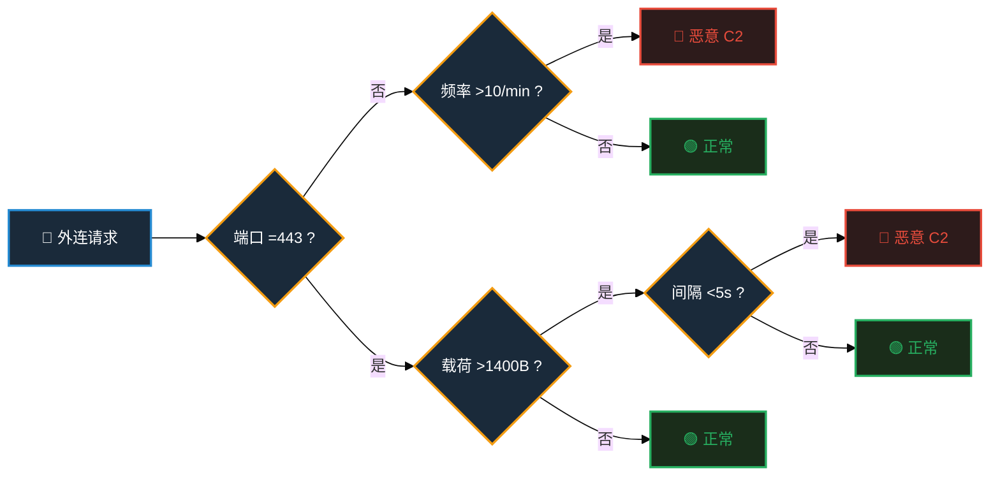

---
presentation:
  margin: 0
  center: false
  transition: "convex"
  enableSpeakerNotes: true
  slideNumber: "c/t"
  navigationMode: "linear"
  math: false
---

@import "../../css/theme/solarized.css"
@import "../../css/logo.css"
@import "../../css/font.css"
@import "../../css/color.css"
@import "../../css/margin.css"
@import "../../css/table.css"
@import "../../css/main.css"
@import "../../css/datamining.css"

# @import "../../plugin/zoom/zoom.js"
# @import "../../plugin/customcontrols/plugin.js"
# @import "../../plugin/chalkboard/plugin.js"
# @import "../../plugin/chalkboard/style.css"
# @import "../../plugin/menu/menu.js"
# @import "../../js/anychart/anychart-core.min.js"
# @import "../../js/anychart/anychart-venn.min.js"
# @import "../../js/anychart/pastel.min.js"
# @import "../../js/anychart/venn-ml.js"

<!-- slide -->

<div class="bottom8"></div>

<h1 style="text-align:center;">经典数据挖掘算法</h1>

<hr class="width50 center">

<h2 style="text-align:center;">从规则发现到异常检测</h2>

<div class="bottom8"></div>

<h3 style="text-align:center;">南京大学计算机学院 &nbsp;&nbsp; 杨已彪</h3>

<h4 style="text-align:center;">计算机软件新技术全国重点实验室</h4>

<h4 style="text-align:center;"><a href="mailto:yangyibiao@nju.edu.cn">yangyibiao@nju.edu.cn</a></h4>

<div style="margin-top:26px;text-align:center;font-size:20pt;color:var(--solarized-base00);letter-spacing:3px;">
2026 年 10 月
</div>

---

<!-- slide -->

## 一个真实的网空场景

<div style="display:grid;grid-template-columns:1fr 1.2fr;gap:20px;">
<div style="background:rgba(38,139,210,0.06);padding:14px 16px;border-radius:6px;border:1px solid #268bd2;">
### 📡 数据态势

- 某内网:数千个监测节点
- 日产生日志:**千万级**
- 告警类型:上百类
- 状态变化:毫秒级高频

</div>
<div style="background:rgba(38,139,210,0.06);padding:14px 16px;border-radius:6px;border:1px solid #f39c12;">
### 🚨 指挥员要回答

- 哪些告警**最致命**,必须优先处置?
- 哪些行为**从未见过**,可能是 0-day ?
- 如何在**30 秒内**给出辅助判断?

</div>
</div>

<div style="margin-top:16px;padding:12px 16px;background:rgba(231,76,60,0.06);border-left:4px solid #e74c3c;border-radius:4px;font-size:0.75em;">
⚠ 数据规模已经远超人工处理能力 → **算法不是选择,是刚需**
</div>

---

<!-- slide -->

## 人工分析 vs 算法分析

假设:每天 **1000 万条日志**,查看一条需要 **1 秒**

<div style="text-align:center; margin:20px 0;">
### 人工需要: **115 天**

而攻击者完成一次渗透,平均只需要 **< 24 小时**
</div>

<div style="background:rgba(38,139,210,0.10);padding:16px;border-left:4px solid #e74c3c;">
**结论:** 人追不上数据,必须让算法先跑一遍,人来做 "最后 100 米" 的决策。
</div>

---

<!-- slide -->

## 从问题出发,而不是从算法出发

**人类专家的经验是这样形成的:**

<div class="twocol">

<div>

### 👨‍🔬 人类专家

1. 发现规律 (观察)
2. 总结经验 (归纳)
3. 制定规则 (经验)
4. 识别异常 (直觉)

</div>

<div>

### 🤖 数据挖掘

1. **自动**发现规律
2. **自动**学习经验
3. **自动**生成规则
4. **自动**识别异常

</div>

</div>

<div style="margin-top:6px;padding:14px 16px;background:rgba(38,139,210,0.10);border-left:4px solid #268bd2;">
算法 ≠ 替代专家,而是 **扩展专家能力的 "数字参谋"**
</div>

---

<!-- slide -->

## 四种思维 · 四把 "战术武器"

**数据挖掘的四大经典任务,各选一个代表性算法**

<div style="font-size:1.05em;margin-top:16px;">

| 思维方式 | 核心问题 | 对应算法 | 网空应用场景 |
|----------|----------|----------|--------------|
| 📜 **规则思维** | 如何自动判定? | 决策树 | 恶意流量判据提取 |
| 📏 **距离思维** | 谁和谁 "像"? | K-Means | 僵尸网络主机群发现 |
| 🎲 **概率思维** | 可能性多大? | 朴素贝叶斯 | 邮件/URL 先验筛查 |
| 🚨 **异常思维** | 谁 "格格不入"? | 孤立森林 | 未知威胁/0-day 发现 |

</div>

<div style="font-size:1.15em;margin-top:20px;">
> **一句话记忆:** 规则找判据,距离找团伙,概率算风险,孤立抓异常。
</div>

---

<!-- slide -->

## 数据挖掘 vs 机器学习 · 区别

**同一个数据,两种目标** —— 以 "用户会不会流失?" 为例

<div class="twocol">

<div>

### 🤖 机器学习 · 预测未来

> 这个用户会流失吗?

输出:会 / 不会

关注:

- 准确率
- 泛化能力

</div>

<div>

### 🔍 数据挖掘 · 发现规律

> 哪些用户容易流失?为什么?

输出:流失人群画像、流失因素

关注:

- 知识发现
- 可解释性

</div>

</div>

> **一句话:** 机器学习关心 "预测得准不准",数据挖掘关心 "发现了什么规律"。

---

<!-- slide -->

## 数据挖掘 vs 机器学习 · 联系

**学科视角 —— 包含关系:**

人工智能 ⊃ 机器学习 ⊃ 数据挖掘

数据挖掘是机器学习的**应用领域**。

**项目视角 —— 数据挖掘是完整过程:**

机器学习算法(建模找模式) → 领域知识(解释定意义) → 可视化(呈现供研判) → 产出**知识**

<div style="margin-top:10px;padding:10px 14px;background:rgba(38,139,210,0.06);border-left:4px solid #268bd2;border-radius:4px;font-size:0.65em;">
**例:** 孤立森林(算法)圈出异常主机 → 安全经验(领域知识)判定 "C2 心跳" → 态势图(可视化)呈现 → 形成可行动的知识。
</div>

> **本课程定位:** 本课程要讲的经典算法,正是机器学习最核心的方法,也是数据挖掘 "发现规律" 的常用武器。

---

<!-- slide -->

## 大模型时代,为什么还学 "经典数据挖掘"?

| 理由 | 为什么重要 | 网空战场含义 |
|------|-----------|-------------|
| **1 结构化数据仍是主流** | 日志、传感器、告警 —— 都是表格,不是自然语言 | 经典算法原生适配,无需微调 |
| **2 可解释性是刚需** | 决策链路必须透明,不能给 "黑盒结论" | 指挥员要的是 "为什么",不是 "是什么" |
| **3 响应速度决定胜负** | 推理以**毫秒**计,无需 GPU | 端侧/边缘节点直接部署 |
| **4 理解原理才能创新** | 不懂底层原理,只能在别人框架上调参 | 面对新型威胁,能自己设计检测方法 |

> **一句话:** 深度学习解决 "看得准",经典算法解决 "说得清、跑得快"。战场需要的是 **确定性 > 准确率**。

---

<!-- slide -->

## 大模型 ≠ 替代,而是 "站在经典肩膀上"

<div class="twocol">

<div>

### 🔬 大模型的底层,仍是经典

| 大模型组件 | 背后的经典原理 |
|------------|---------------|
| 梯度下降训练 | 1986 年提出的经典优化算法 |
| 注意力机制 | 本质是**加权求和** + softmax |
| 自回归生成 | 每一步本质是**重复做分类** |
| Dropout | 集成学习的**投票思想** |
| RLHF | 基于**强化学习**的奖励优化 |

</div>

<div>

### 🎯 经典是地基,大模型是高楼

- 数学基础没变:线性代数、概率论、微积分
- 优化逻辑没变:梯度下降仍是最核心的训练方式
- 评估方式没变:准确率、召回率、F1 仍在用

</div>

</div>

<div class="important info">
不了解经典,就无法理解大模型为什么有效、何时会失效 —— 更无法在需要时**创新**。
</div>

---

<!-- slide -->

## 从 "专用工具" 到 "通用引擎"

<div class="twocol" style="font-size:0.85em;">

<div>

### 📐 经典算法范式

- 为**每个任务**单独设计特征
- 为**每个任务**单独选择模型
- 需要**标注数据**训练
- 输出**确定性规则**或**精确标签**
- 代表:决策树、K-Means、朴素贝叶斯、孤立森林

</div>

<div>

### 🧠 大模型范式

- **一个模型**覆盖多种任务
- **自监督预训练** + 少量微调
- 自动学习**隐式特征表示**
- 输出**概率性生成**内容
- 代表:GPT、BERT、LLaMA

</div>

</div>

<div class="important">
**范式变了,但数学没变。** 大模型是对经典原理的**规模化复用**,而非**颠覆**。
</div>

---

<!-- slide -->

## 两者互补,而非替代

<div class="twocol">

<div>

### 🎯 经典 · 精确制导武器

| 优势 | 场景 |
|------|------|
| 推理**毫秒级** | 实时检测、端侧部署 |
| **完全可解释** | 审计追溯、合规要求 |
| 无需 GPU | 边缘节点、嵌入式设备 |
| 规则透明 | 一线人员可直接执行 |

</div>

<div>

### 🧠 大模型 · 战略研判系统

| 优势 | 场景 |
|------|------|
| **语义理解**强 | 威胁情报分析、报告生成 |
| **泛化能力**强 | 零样本/少样本任务 |
| 处理**非结构化** | 文本、代码、对话 |
| **创造性**输出 | 攻击路径推演、辅助决策 |

</div>

</div>

<div style="margin-top:14px;padding:12px 16px;background:rgba(38,139,210,0.08);border:1px solid rgba(38,139,210,0.15);border-radius:6px;text-align:center;">
**网空战场上,两者协同:** 大模型做 "宏观研判" → 经典算法做 "精确验证" → **人做最终决策**
</div>

---

<!-- slide -->

## 数据挖掘的 "五步作战流程"


<div style="margin-top:16px;padding:12px;background:rgba(38,139,210,0.10);border-left:4px solid #f39c12;">
经验规律: 数据处理(C 步骤)通常占项目 **80%** 的时间。算法选型只占 **20%**。
</div>

---

<!-- slide -->

## 今天课程路线图 · 2.5 小时火力分配

| 时段 | 内容 | 战术目标 |
|------|------|----------|
| 0-15' | 开场总览(当前页 → 结束) | 建立全局认知框架 |
| 15'-40' | 📜 决策树 · 规则思维 | 能从日志中 "榨出" 可执行判据 |
| 40'-65' | 📏 K-Means · 距离思维 | 能发现 "无形" 的主机群组 |
| 65'-90' | 🎲 朴素贝叶斯 · 概率思维 | 能给出威胁的 "先验概率" |
| 90'-115' | 🚨 孤立森林 · 异常思维 | 能找到 "从未见过" 的威胁 |
| 115'-135' | 综合回顾 + 互动答疑 | 打通四把武器协同使用 |
| 135'-150' | 总结收尾 | 从问题出发选择方法 |

贯穿案例: 某部内网异常流量事件 —— 每讲完一个算法,回来 "拼一块拼图"。

---

<!-- slide -->

## 希望大家带走什么?

❌ 不是背住数学公式

❌ 不是记住 Python 代码

✅ 理解 "问题-算法" 的匹配关系

✅ 理解每种算法背后的 "思维原型"

✅ 在真实场景中,能独立完成武器选型

<div style="text-align:center; font-size:1.4em; font-weight:600; color:#f39c12;">
从问题出发选择方法
<span style="color:#888;font-weight:400;">而不是</span>
从算法出发寻找问题
</div>

---

<!-- slide -->

# 决策树 · Decision Tree

<hr class="width30 center" style="margin-top:0.2rem;margin-bottom:0.2rem;">

<div style="text-align:center;font-size:0.75em;color:var(--solarized-base00);letter-spacing:2px;">
从 "专家经验" 到 "自动判据" 的桥梁
</div>

<div style="margin-top:30px;text-align:center;font-size:0.65em;color:var(--solarized-base00);">
**网空关键词:** 恶意流量判据提取 · 告警规则自动生成 · 白盒可解释
</div>

<div style="margin-top:100px;text-align:center;line-height:2.2;">
<div style="font-size:1.05em;font-weight:600;letter-spacing:1px;">
杨已彪
</div>
<div style="font-size:0.6em;color:var(--solarized-base00);">
yangyibiao@nju.edu.cn
</div>
<div style="font-size:0.55em;color:var(--solarized-base00);margin-top:4px;">
南京大学计算机学院 · 计算机软件新技术全国重点实验室
</div>
<div style="margin-top:20px;font-size:0.5em;color:var(--solarized-base01);letter-spacing:3px;">
2026 年 10 月
</div>
</div>

---

<!-- slide -->

## 一个网空场景

<div style="margin-bottom:8px;">
某部**物理隔离**内网,监测节点持续上报流量特征。
**核心任务:** 判定某条外连请求是否为 **恶意 C2 通信**?
</div>

<div class="twocol" style="font-size:0.9em;">

<div>

### 🔓 入侵路径(已发生案例)

- 通过 **U 盘摆渡** 植入(震网病毒)
- 通过 **固件预置后门** 植入
- 通过 **供应链攻击** 植入
- 通过 **运维通道** 渗透

</div>

<div>

### 🕵️‍♂️ 隐蔽方式

- **伪装成合法协议**(HTTPS/DNS)
- **利用正常软件更新**通道
- **通过加密隧道**传输指令
- **低频心跳**长期潜伏

</div>

</div>

<div class="important" style="margin-top:4px;">
物理隔离 ≠ 绝对安全。攻击者已多次证明:**物理边界可以被技术手段穿透**。算法检测成为最后一道防线。
</div>

---

<!-- slide -->

## 决策树的核心思想

> 不断提问,逐层判定。以流量检测为例:



> **本质:** 自动寻找 "最有价值的问题",形成判定链条。

---

<!-- slide -->

## 什么是 "好特征"?

**网空场景:** 某内网采集了 1000 条外连日志(500 正常 + 500 恶意)

| 特征 | 划分效果 | 评价 |
|------|----------|------|
| **目标端口是否为 443 ?** | 左:450 恶意 +50 正常<br>右:50 恶意 +450 正常 | ✅ **好特征** |
| **协议是否为 TCP ?** | 左:250 恶意 +250 正常<br>右:250 恶意 +250 正常 | ❌ **差特征** |

> **好特征 = 能把 "混杂" 快速降为 "纯净"**

---

<!-- slide -->

## 熵 · 衡量 "混乱程度"

<div class="twocol">

<div>

📐 公式

\[
H=-\sum p_i \log_2 p_i
\]

</div>

<div>

📊 直观理解

| 数据状态 | 熵值 |
|----------|------|
| 全是正常流量 | 0(纯净) |
| 正常/恶意各半 | 最大(混乱) |
| 全是恶意流量 | 0(纯净) |

</div>

</div>

<div class="important info" style="margin-top:8px;">
网空含义: 熵越低,规则越精准,误报越少。
</div>

---

<!-- slide -->

## 信息增益 · 特征 "好" 的量化指标

定义:

\[
Gain = H(划分前) - H(划分后)
\]

| 划分效果 | 信息增益 |
|----------|----------|
| 划分后仍然混乱 | 小 |
| 划分后非常纯净 | 大 |

> 翻译成人话: 划分前多乱,划分后多不乱 —— 差值越大,这个特征越值得用。

---

<!-- slide -->

## 决策树算法演进


| 算法 | 年份 | 核心逻辑 |
|------|------|----------|
| ID3 | 1986 | 选择信息增益最大的特征 |
| C4.5 | 1993 | 使用 "增益率" |

**本课程重点: ID3(理解原理) + C4.5(工业常用)**

---

<!-- slide -->

## ID3 的问题:偏爱 "取值多" 的特征

假设某内网采集了 **1000 条外连日志**,每条都有唯一的 **Log ID**

| 特征 | 取值数量 | 信息增益 | 真实价值 |
|------|----------|----------|----------|
| **Log ID** | 1000 个 | 🔥 **最大** | ❌ 毫无价值 |
| **目标端口** | 少量 | 中等 | ✅ 很有价值 |

> ID3 会被 "Log ID" 这种无用特征欺骗 → 过拟合

---

<!-- slide -->

## C4.5 的改进:增益率

**增益率 = 信息增益 ÷ 固有值(惩罚项)**

| 特征 | 信息增益 | 固有值 | 增益率 | 效果 |
|------|----------|--------|--------|------|
| Log ID | 最大 | 最大 | ⬇ 被压低 | 不再被误选 |
| 目标端口 | 中等 | 小 | ⬆ 相对更高 | 公平竞争 |

> **类比:** ID3 是第一代预警系统,容易被 "花哨" 特征欺骗; C4.5 是第二代,加了 "公平性检查",更可靠。

---

<!-- slide -->

## ID3 与 C4.5

| 算法 | 核心逻辑 | 特点 |
|------|----------|------|
| **ID3** | 选择信息增益最大的特征 | 奠基,但偏好取值多的特征 |
| **C4.5** | 使用 "增益率" | 支持连续值/缺失值,工业更常用 |

> **一句话:** ID3 是先驱, C4.5 是升级版。两者差异 ≈ "第一代预警系统" vs "具备抗干扰能力的第二代预警系统"。

---

<!-- slide -->

## 决策树如何生成检测规则?

<div style="font-size:0.7em;color:var(--solarized-base00);margin-bottom:0.5rem;">
从历史数据中自动提取判据的五个步骤
</div>


<div style="margin-top:4px;font-size:0.5em;color:var(--solarized-base00);text-align:center;">
步骤详解:历史流量日志(已标注) → 选择最佳判据特征(信息增益最大) → 按阈值切分生成规则节点 → 递归生成子规则构建完整树 → 输出白盒可追溯的判据链
</div>

<div style="margin-top:12px;padding:12px 16px;background:rgba(38,139,210,0.08);border-left:4px solid var(--solarized-blue);border-radius:4px;font-size:0.55em;">
❓ **标注数据从哪来?**
开源威胁情报: VirusTotal、AbuseIPDB 等已标注的 IP/域名黑名单 ·
公开数据集: CIC-IDS、UNSW-NB15 等带有攻击标签的流量数据集 ·
历史告警日志:安全分析师已确认的告警记录
⚠ 标注数据是监督学习的前提。数据质量 > 算法选择。
</div>

---

<!-- slide -->

## Sklearn 实践 · 核心代码

```python
from sklearn.datasets import make_classification
from sklearn.model_selection import train_test_split
from sklearn.tree import DecisionTreeClassifier

# 1. 生成模拟数据(10 维特征, 2000 样本)
X, y = make_classification(n_samples=2000, n_features=10,
                           n_informative=6, random_state=42)
# 2. 划分训练/测试集
X_train, X_test, y_train, y_test = train_test_split(
    X, y, test_size=0.3, random_state=42)
# 3. 训练决策树(限制深度防过拟合)
model = DecisionTreeClassifier(max_depth=5, random_state=42)
model.fit(X_train, y_train)
# 4. 评估
print(f"Accuracy = {model.score(X_test, y_test):.4f}")
```

典型输出: Accuracy = 0.8833

---

<!-- slide -->

## 核心优势 · 可解释性

```python
from sklearn.tree import export_text
rules = export_text(model, feature_names=[
    'feature_0', 'feature_1', ..., 'feature_9'
])
print(rules)
```

输出:

```text
|--- feature_3 <= 0.75
|   |--- feature_7 <= -0.23
|   |   |--- class: 0
|   |--- feature_7 > -0.23
|   |   |--- feature_1 <= 0.45
|   |   |   |--- class: 1
|   |   |--- feature_1 > 0.45
|   |   |   |--- class: 0
|--- feature_3 > 0.75
|   |--- feature_5 <= 0.32
|   |   |--- class: 1
|   |--- feature_5 > 0.32
|   |   |--- class: 0
```

每条规则都可追溯: 为什么拦截这个 IP ? —— 因为满足规则链 A → B → C。

---

<!-- slide -->

## 决策树 · 优缺点(网空视角)

<div class="twocol">

<div>

✅ 优点

| 优势 | 网空含义 |
|------|----------|
| 易理解 | 一线人员可直接执行 |
| 可解释 | 指挥员知道 "为什么" |
| 推理快 | 毫秒级,适合端侧部署 |
| 无需 GPU | 边缘节点可直接运行 |

</div>

<div>

⚠ 缺点

| 劣势 | 应对策略 |
|------|----------|
| 易过拟合 | 限制深度 + 剪枝 |
| 对噪声敏感 | 集成方法平滑 |
| 稳定性差 | 随机森林/XGBoost |

</div>

</div>

<div class="important warning" style="margin-top:8px;">
网空启示: 深度学习做 "看得准",决策树做 "说得清、跑得快"。战场需要的是 确定性 > 准确率。
</div>

---

<!-- slide -->

## 决策树在网空领域的典型应用

| 场景 | 决策树做什么 |
|------|-------------|
| 🚨 **入侵检测** | 从流量特征提取可执行判据 |
| 🎯 **钓鱼 URL 识别** | 生成 "如果是 → 则拦截" 的规则链 |
| 🧠 **告警降噪** | 判断哪些告警真正值得关注 |
| 🔗 **攻击链还原** | 逐层判定每个环节的恶意概率 |
| 📋 **合规审计** | 提供白盒可追溯的判定依据 |

---

<!-- slide -->

## 随堂思考题

某部内网部署流量检测系统。

**方案 A:** 深度学习模型(准确率 92%,黑盒)

**方案 B:** 决策树模型(准确率 87%,白盒)

作为技术负责人,你倾向哪个?为什么?

---

<!-- slide -->

## 参考答案 · 决策树的价值在哪?

| 考量维度 | 深度学习 | 决策树 |
|----------|----------|--------|
| 准确率 | ✅ 略高 | ⚠ 略低 |
| 可解释性 | ❌ 黑盒 | ✅ 完全透明 |
| 审计追溯 | ❌ 无法追溯 | ✅ 每条规则可追溯 |
| 一线执行 | ❌ 依赖专家解读 | ✅ 直接可操作 |
| 部署门槛 | ❌ 需 GPU 集群 | ✅ 单机/边缘可跑 |
| 合规要求 | ⚠ 难通过 | ✅ 天然满足 |

> **网空核心命题:** 我们要的是 "确定性的可执行规则",而非 "概率性的黑盒判断"。

---

<!-- slide -->

## 本部分总结 · 决策树

✅ 核心思想:用 "最好的问题" 逐层切分数据

✅ 灵魂指标:信息增益 = 混乱减少的程度

✅ 最大优势:规则透明,一线可直接执行

✅ 网空定位:从 "专家经验" 到 "自动判据" 的桥梁

<div style="text-align:center;font-size:1.2em;color:var(--solarized-blue);">
规则 ≠ 替代专家 · 规则 = 固化专家经验
</div>

---

<!-- slide -->

## 下一部分预告

<div style="text-align:center;">
📏 K-Means 聚类
当你不确定恶意行为 "长什么样" 的时候
—— 让数据自己 "抱团" 说话
</div>

---
