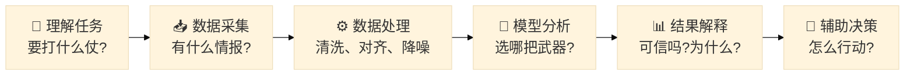

---
presentation:
  margin: 0
  center: false
  transition: "convex"
  enableSpeakerNotes: true
  slideNumber: "c/t"
  navigationMode: "linear"
  math: false
---

@import "../css/theme/solarized.css"
@import "../css/logo.css"
@import "../css/font.css"
@import "../css/color.css"
@import "../css/margin.css"
@import "../css/table.css"
@import "../css/main.css"
@import "../css/datamining.css"

# @import "../../plugin/zoom/zoom.js"
# @import "../../plugin/customcontrols/plugin.js"
# @import "../../plugin/chalkboard/plugin.js"
# @import "../../plugin/chalkboard/style.css"
# @import "../../plugin/menu/menu.js"
# @import "../../js/anychart/anychart-core.min.js"
# @import "../../js/anychart/anychart-venn.min.js"
# @import "../../js/anychart/pastel.min.js"
# @import "../../js/anychart/venn-ml.js"

<!-- slide -->

<h1 style="text-align:center;">经典数据挖掘算法</h1>

<h2 style="text-align:center;">从规则发现到异常检测</h2>

<h3 style="text-align:center;">南京大学计算机学院 &nbsp;&nbsp; 杨已彪</h3>

<h4 style="text-align:center;">计算机软件新技术全国重点实验室</h4>

<h4 style="text-align:center;"><a href="mailto:yangyibiao@nju.edu.cn">yangyibiao@nju.edu.cn</a></h4>

2026 年 10 月

---

<!-- slide -->

## 一个真实的网空场景

### 📡 数据态势

- 某内网:数千个监测节点
- 日产生日志:**千万级**
- 告警类型:上百类
- 状态变化:毫秒级高频

### 🚨 指挥员要回答

- 哪些告警**最致命**,必须优先处置?
- 哪些行为**从未见过**,可能是 0-day ?
- 如何在**30 秒内**给出辅助判断?

🎯 数据规模已经远超人工处理能力 → **算法不是选择,是刚需**

---

<!-- slide -->

## 人工分析 vs 算法分析

假设:每天 **1000 万条日志**,查看一条需要 **1 秒**

人工查看 1000 万条日志

115 天

1000 万条 × 1 秒/条 ÷ 86,400 秒/天 ≈ 115.7 天

攻击者完成一次渗透

&lt; 24 小时

从入侵到得手,平均不到一天

**结论:** 人追不上数据,必须让算法先跑一遍,人来做 "最后 100 米" 的决策。

---

<!-- slide -->

## 从问题出发,而不是从算法出发

**既然必须用算法,选哪一种?** 先看人类专家做的四件事:

👨‍🔬 发现规律 (观察) &nbsp;&nbsp;⟶&nbsp;&nbsp; 🤖 **自动**发现规律

👨‍🔬 总结经验 (归纳) &nbsp;&nbsp;⟶&nbsp;&nbsp; 🤖 **自动**学习经验

👨‍🔬 制定规则 (经验) &nbsp;&nbsp;⟶&nbsp;&nbsp; 🤖 **自动**生成规则

👨‍🔬 识别异常 (直觉) &nbsp;&nbsp;⟶&nbsp;&nbsp; 🤖 **自动**识别异常

🎯 算法 ≠ 替代专家,而是 **扩展专家能力的 "数字参谋"**

---

<!-- slide -->

## 四种思维 · 四把 "战术武器"

**数据挖掘的四类经典问题,各选一个代表性算法**

📜 规则思维

核心问题: 如何自动判定?
**决策树** · 恶意流量判据提取

📏 距离思维

核心问题: 谁和谁 "像"?
**K-Means** · 僵尸网络主机群发现

🎲 概率思维

核心问题: 可能性多大?
**朴素贝叶斯** · 邮件/URL 先验筛查

🚨 异常思维

核心问题: 谁 "格格不入"?
**孤立森林** · 未知威胁/0-day 发现

💡 **一句话记忆:** 规则找判据,距离找团伙,概率算风险,孤立抓异常。

---

<!-- slide -->

## 数据挖掘 vs 机器学习 · 区别

**四把武器都来自数据挖掘。它和常听到的 "机器学习" 是什么关系?** 同一个数据,两种目标 —— 以 "用户会不会流失?" 为例

### 🤖 机器学习 · 预测未来

> 这个用户会流失吗?

输出:会 / 不会

关注:

- 准确率
- 泛化能力

### 🔍 数据挖掘 · 发现规律

> 哪些用户容易流失?为什么?

输出:流失人群画像、流失因素

关注:

- 知识发现
- 可解释性

💡 **一句话:** 机器学习求 "预测得准",数据挖掘求 "发现有规律"。

---

<!-- slide -->

## 数据挖掘 vs 机器学习 · 联系

### 📚 学科视角 · 包含关系

人工智能 ↓ 机器学习 ↓ 数据挖掘

机器学习包含数据挖掘 —— 数据挖掘是机器学习的**应用领域**。

### 🛠 项目视角 · 完整过程

机器学习算法(建模) → 领域知识(解释) → 可视化(呈现) → 产出**知识**

**例:** 孤立森林圈出异常主机 → 安全经验判定 "C2 心跳" → 态势图呈现 → 可行动的知识。

🎯 **本课程定位:** 本课程要讲的经典算法,正是机器学习最核心的方法,也是数据挖掘 "发现规律" 的常用武器。

---

<!-- slide -->

## 大模型时代,为什么还学 "经典数据挖掘"?

1 结构化数据仍是主流

日志、传感器、告警 —— 都是表格,不是自然语言
→ 经典算法原生适配,无需微调

2 可解释性是刚需

决策链路必须透明,不能给 "黑盒结论"
→ 指挥员要的是 "为什么",不是 "是什么"

3 响应速度决定胜负

推理以**毫秒**计,无需 GPU
→ 端侧/边缘节点直接部署

4 理解原理才能创新

不懂底层原理,只能在别人框架上调参
→ 面对新型威胁,能自己设计检测方法

💡 **一句话:** 深度学习解决 "看得准",经典算法解决 "说得清、跑得快"。战场需要的是 **确定性 > 准确率**。

---

<!-- slide -->

## 大模型 ≠ 替代,而是 "站在经典肩膀上"

### 🔬 大模型的底层,仍是经典

反向传播 ⟶ 梯度下降 + 链式法则(1986)
 
注意力机制 ⟶ 加权求和 + softmax
 
自回归生成 ⟶ 每一步都是重复做分类
 
Dropout ⟶ 集成学习的投票思想
 
RLHF ⟶ 强化学习的奖励优化

### 🎯 经典是地基,大模型是高楼

- 数学基础没变:线性代数、概率论、微积分
- 优化逻辑没变:梯度下降仍是最核心的训练方式
- 评估方式没变:准确率、召回率、F1 仍在用

💡 不了解经典,就无法理解大模型为什么有效、何时会失效 —— 更无法在需要时**创新**。

---

<!-- slide -->

## 从 "专用工具" 到 "通用引擎"

### 📐 经典算法范式

- 为**每个任务**单独设计特征
- 为**每个任务**单独选择模型
- 需要**标注数据**训练
- 输出**确定性规则**或**精确标签**
- 代表:决策树、K-Means、朴素贝叶斯、孤立森林

### 🧠 大模型范式

- **一个模型**覆盖多种任务
- **自监督预训练** + 少量微调
- 自动学习**隐式特征表示**
- 输出**概率性生成**内容
- 代表:GPT、BERT、LLaMA

💡 **范式变了,但数学没变。** 大模型是对经典原理的**规模化复用**,而非**颠覆**。

---

<!-- slide -->

## 两者互补,而非替代

### 🎯 经典 · 精确制导武器

| 优势 | 场景 |
|------|------|
| 推理**毫秒级** | 实时检测、端侧部署 |
| **完全可解释** | 审计追溯、合规要求 |
| 无需 GPU | 边缘节点、嵌入式设备 |
| 规则透明 | 一线人员可直接执行 |

### 🧠 大模型 · 战略研判系统

| 优势 | 场景 |
|------|------|
| **语义理解**强 | 威胁情报分析、报告生成 |
| **泛化能力**强 | 零样本/少样本任务 |
| 处理**非结构化** | 文本、代码、对话 |
| **创造性**输出 | 攻击路径推演、辅助决策 |

🎯 **网空战场上,两者协同:** 大模型做 "宏观研判" → 经典算法做 "精确验证" → **人做最终决策**

---

<!-- slide -->

## 数据挖掘的 "六步作战流程"

武器选好了,一仗具体怎么打?

⚠ 经验规律: 数据处理(C 步骤)通常占项目 **80%** 的时间。算法选型只占 **20%**。

---

<!-- slide -->

## 今天课程路线图 · 2.5 小时火力分配

| 时段 | 内容 | 战术目标 |
|------|------|----------|
| 0-15' | 开场总览(当前页 → 结束) | 建立全局认知框架 |
| 15'-40' | 📜 决策树 · 规则思维 | 能从日志中 "榨出" 可执行判据 |
| 40'-65' | 📏 K-Means · 距离思维 | 能发现 "无形" 的主机群组 |
| 65'-90' | 🎲 朴素贝叶斯 · 概率思维 | 能给出威胁的 "先验概率" |
| 90'-115' | 🚨 孤立森林 · 异常思维 | 能找到 "从未见过" 的威胁 |
| 115'-135' | 综合回顾 + 互动答疑 | 打通四把武器协同使用 |
| 135'-150' | 总结收尾 | 从问题出发选择方法 |

🎯 **贯穿案例:** 某部内网异常流量事件 —— 每讲完一个算法,回来 "拼一块拼图"。

---

<!-- slide -->

## 希望大家带走什么?

❌ 不带走的

- 背住数学公式
- 记住 Python 代码

✅ 带走的

- 理解 "问题-算法" 的匹配关系
- 理解每种算法背后的 "思维原型"
- 在真实场景中,能独立完成武器选型

从问题出发选择方法
而不是
从算法出发寻找问题

---

