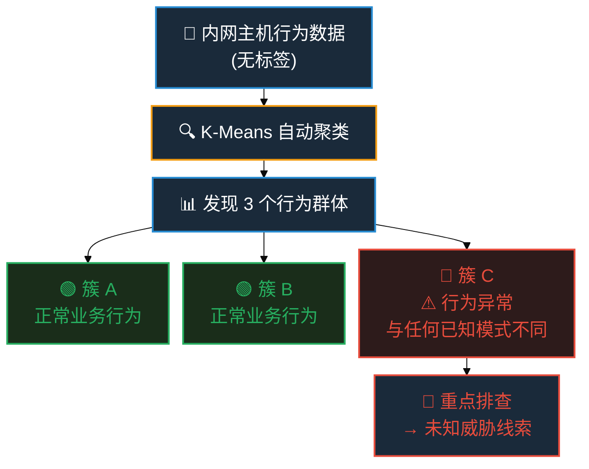
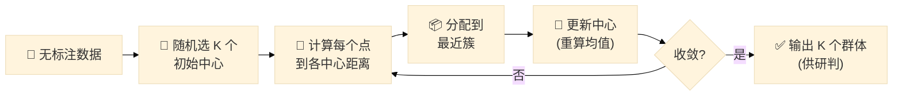

---
presentation:
  margin: 0
  center: false
  transition: "convex"
  enableSpeakerNotes: true
  slideNumber: "c/t"
  navigationMode: "linear"
  math: false
---

@import "../css/theme/solarized.css"
@import "../css/logo.css"
@import "../css/font.css"
@import "../css/color.css"
@import "../css/margin.css"
@import "../css/table.css"
@import "../css/main.css"
@import "../css/datamining.css"

# @import "../../plugin/zoom/zoom.js"
# @import "../../plugin/customcontrols/plugin.js"
# @import "../../plugin/chalkboard/plugin.js"
# @import "../../plugin/chalkboard/style.css"
# @import "../../plugin/menu/menu.js"
# @import "../../js/anychart/anychart-core.min.js"
# @import "../../js/anychart/anychart-venn.min.js"
# @import "../../js/anychart/pastel.min.js"
# @import "../../js/anychart/venn-ml.js"

<!-- slide -->

<div class="bottom8"></div>

<h1 style="text-align:center;">K-Means · 让数据自己 "抱团"</h1>

<hr class="width50 center">

<h2 style="text-align:center;">当你不确定恶意行为 "长什么样" 的时候</h2>

<div class="bottom8"></div>

<h3 style="text-align:center;">南京大学计算机学院 &nbsp;&nbsp; 杨已彪</h3>

<h4 style="text-align:center;">计算机软件新技术全国重点实验室</h4>

<h4 style="text-align:center;"><a href="mailto:yangyibiao@nju.edu.cn">yangyibiao@nju.edu.cn</a></h4>

<div style="margin-top:26px;text-align:center;font-size:20pt;color:var(--solarized-base00);letter-spacing:3px;">
2026 年 10 月
</div>

---

<!-- slide -->

## 从决策树到 K-Means · 一个自然的追问

| 决策树帮我们解决了 | 但还有一个问题 |
|-------------------|---------------|
| 已知恶意样本 → 提取判据规则 | **如果不知道恶意行为长什么样呢?** |
| 有标注数据 → 监督学习 | **没有标注数据怎么办?** |
| 能回答 "是/否" | **能发现 "未知的未知" 吗?** |

> **核心转折:** 决策树需要 "有答案" 的数据。但网空场景中,大量数据是**没有标签**的。

<div style="margin-top:10px;padding:12px 16px;background:rgba(181,137,0,0.10);border-left:4px solid #b58900;border-radius:4px;">
🎯 **K-Means 就是解决这类问题的算法 —— 聚类(Clustering)· 无监督学习: 让数据自己 "抱团",而不是由人告诉它 "正确答案"。**
</div>

---

<!-- slide -->

## 一个网空场景:未知威胁的发现

某部内网,数千台主机产生海量流量日志。

**已知:** 部分主机已被标记为恶意(已知家族)

**未知:** 是否存在**从未被发现**的异常行为模式?

<div class="twocol" style="font-size:0.85em;">

<div style="background:rgba(133,153,0,0.08);padding:14px;border-radius:8px;border:1px solid #27ae60;">

### ✅ 有标注 → 用决策树

- 已知恶意样本
- 提取判据规则
- 检测已知威胁

</div>

<div style="background:rgba(220,50,47,0.08);padding:14px;border-radius:8px;border:1px solid #e74c3c;">

### ❓ 无标注 → 用 K-Means

- 不知道恶意什么样
- **让数据自己 "抱团"**
- 发现异常群体

</div>

</div>

<br>

**一句话理解聚类:** 分类是 "对答案",聚类是 "找朋友"。

> **本部分目标:** 没有 "标准答案" 时,让算法自动发现数据中的结构。

---

<!-- slide -->

<div style="text-align:center;">

## 什么是聚类? · 物以类聚,人以群分

</div>

| 有监督学习(决策树) | 无监督学习(K-Means) |
|---------------------|----------------------|
| 数据有标签(正常/恶意) | 数据无标签 |
| 学习 "输入 → 输出" 的映射 | 发现数据**内在的结构** |
| 目标是**预测** | 目标是**发现** |

<div class="twocol" style="margin-top:14px;">

<div style="background:rgba(38,139,210,0.10);padding:12px;border-radius:6px;border:1px solid #268bd2;">

### 🌍 生活中的聚类

- 超市按消费行为给会员分群
- 城市按出行模式划分功能区
- 新闻网站按主题聚合文章

</div>

<div style="background:rgba(38,139,210,0.10);padding:12px;border-radius:6px;border:1px solid #268bd2;">

### 🎯 共同点

- 事先不知道分几组、每组叫什么
- 先分组,**再命名**
- 这正是 "无监督" 的含义

</div>

</div>

---

<!-- slide -->

## 聚类 vs 分类 · 一个直观对比

<div class="twocol">

<div style="background:rgba(38,139,210,0.10);padding:14px;border-radius:8px;border:1px solid #268bd2;">

### ✅ 分类(决策树)

已知:

- ✅ 正常流量(已标注)
- ✅ 恶意流量(已标注)

**目标:** 新来的流量属于哪一类?

<div style="margin-top:8px;font-size:0.7em;color:#268bd2;text-align:center;">
⬅ 有参考答案
</div>

</div>

<div style="background:rgba(38,139,210,0.10);padding:14px;border-radius:8px;border:1px solid #f39c12;">

### ❓ 聚类(K-Means)

已知:

- ❌ 不知道谁正常
- ❌ 不知道谁恶意

**目标:** 流量天然分成几组?每组有什么特点?

<div style="margin-top:8px;font-size:0.7em;color:#f39c12;text-align:center;">
⬅ 没有参考答案
</div>

</div>

</div>

<div class="important info" style="margin-top:10px;">
网空含义: 分类是 "已知威胁的检测",聚类是 "未知威胁的发现"。
</div>

---

<!-- slide -->

## K-Means 的核心思想

> **一句话:让相似的数据聚在一起,形成 "团伙"。**



---

<!-- slide -->

## K-Means 的 "K" 是什么?

**K = 你想要分成几组(簇)**

以网空场景为例:

| K | 分组 | 适用 |
|---|------|------|
| K=2 | 正常 / 异常 | 初步筛查 |
| K=3 | 正常 / 可疑 / 异常 | 分层研判 |

<div style="margin-top:10px;padding:10px 16px;background:rgba(181,137,0,0.10);border-left:4px solid #b58900;border-radius:4px;">
❓ **K 怎么定?** 两条路:① **业务经验** —— 安全场景常用 K=2(正常/异常)或 K=3(分层研判);② **数据驱动** —— 肘部法(后文细讲)。
</div>

---

<!-- slide -->

## K-Means 的 "Means" 是什么?

> **Means = 每个簇的 "中心点" (均值)**

每个簇用**平均特征**代表 —— 群体的 "典型画像"。

<div class="twocol" style="margin-top:4px;font-size:0.8em;">

<div style="background:rgba(133,153,0,0.08);padding:6px 10px;border-radius:8px;border:1px solid #27ae60;text-align:center;flex:1;">

### 🟢 簇 A · 中心点

特征 1 平均值 = **0.82**  
特征 2 平均值 = **-1.34**  
特征 3 平均值 = **2.15**

</div>

<div style="background:rgba(133,153,0,0.08);padding:6px 10px;border-radius:8px;border:1px solid #27ae60;text-align:center;flex:1;">

### 🟢 簇 B · 中心点

特征 1 平均值 = **-2.31**  
特征 2 平均值 = **0.57**  
特征 3 平均值 = **-0.98**

</div>

<div style="background:rgba(220,50,47,0.08);padding:6px 10px;border-radius:8px;border:1px solid #e74c3c;text-align:center;flex:1;">

### 🔴 簇 C · 中心点

特征 1 平均值 = **3.47**  
特征 2 平均值 = **2.18**  
特征 3 平均值 = **-3.02**

</div>

</div>

<div style="margin-top:2px;padding:6px 16px;background:rgba(38,139,210,0.08);border-radius:6px;text-align:center;font-size:0.9em;">
📌 每个中心点就是该簇所有点的 "平均画像" —— **Means 就是这些中心点的统称**
</div>

---

<!-- slide -->

## K-Means 工作流程 · 网空版



<div style="margin-top:4px;font-size:0.6em;color:var(--solarized-base00);text-align:center;line-height:1.8;">
**核心逻辑:** 分配 → 更新 → 再分配 → 再更新 ... 直到中心点不再移动。
**收敛条件:** 所有 K 个中心点移动距离的**最大值** < 预设阈值(如 0.0001)
即最 "活跃" 的中心点也几乎不动了 → 算法停止
</div>

---

<!-- slide -->

## 第一步:随机选 K 个初始中心

<div style="display:grid;grid-template-columns:1fr 1fr;gap:16px;">

<div>

### 📊 10 台主机数据

| 主机 | 外连频率 | 数据外传量 |
|------|----------|------------|
| H1 | 2 | 50 |
| H2 | 3 | 45 |
| H3 | 2 | 55 |
| H4 | 8 | 150 |
| H5 | 9 | 140 |
| H6 | 7 | 160 |
| H7 | 20 | 30 |
| H8 | 22 | 25 |
| H9 | 18 | 35 |
| H10 | 25 | 20 |

</div>

<div>

### 🎯 随机初始中心(K=3)

在数据范围内**完全随机**选 3 个点:

| 中心 | 坐标 | 说明 |
|------|------|------|
| ✦ 中心 1 | (2, 80) | 频率低 · 流量中 |
| ✦ 中心 2 | (15, 180) | 频率中 · 流量高 |
| ✦ 中心 3 | (12, 10) | 频率中 · 流量低 |

<div style="margin-top:8px;padding:6px 10px;background:rgba(241,196,15,0.08);border-left:3px solid #f39c12;font-size:0.65em;">
⚡ 初始位置是**完全随机**的猜测,算法会逐步迭代优化
</div>

</div>

</div>

---

<!-- slide -->

## 第二步:分配每个点到最近的簇

计算每个点到 3 个中心的距离(欧氏距离,后文详解),加入最近的那个:

<div style="display:grid;grid-template-columns:1fr 1fr 1fr;gap:6px;font-size:0.7em;">

<div style="background:rgba(38,139,210,0.06);padding:6px 8px;border-radius:6px;border:1px solid #27ae60;">
<div style="font-size:0.85em;font-weight:700;color:#27ae60;">🟢 簇 A · 中心 (2,80)</div>

| 主机 | 坐标 | 距离 |
|------|------|------|
| H1 | (2,50) | 30.0 |
| H2 | (3,45) | 35.0 |
| H3 | (2,55) | 25.0 |

</div>

<div style="background:rgba(38,139,210,0.06);padding:6px 8px;border-radius:6px;border:1px solid #f39c12;">
<div style="font-size:0.85em;font-weight:700;color:#f39c12;">🟡 簇 B · 中心 (15,180)</div>

| 主机 | 坐标 | 距离 |
|------|------|------|
| H4 | (8,150) | 30.8 |
| H5 | (9,140) | 40.4 |
| H6 | (7,160) | 21.5 |

</div>

<div style="background:rgba(38,139,210,0.06);padding:6px 8px;border-radius:6px;border:1px solid #e74c3c;">
<div style="font-size:0.85em;font-weight:700;color:#e74c3c;">🔴 簇 C · 中心 (12,10)</div>

| 主机 | 坐标 | 距离 |
|------|------|------|
| H7 | (20,30) | 21.5 |
| H8 | (22,25) | 18.0 |
| H9 | (18,35) | 25.7 |
| H10 | (25,20) | 16.4 |

</div>

</div>

<div style="margin-top:4px;padding:4px 10px;background:rgba(38,139,210,0.06);border-radius:4px;font-size:0.6em;color:var(--solarized-base00);text-align:center;">
📌 初步形成 3 个群体,但中心位置仍不准确(中心点尚未稳定)
</div>

---

<!-- slide -->

## 第三步:更新中心点(向重心移动)

每个簇重新计算中心 = 该簇所有点的**平均值**:

<div style="display:grid;grid-template-columns:1fr 1fr 1fr;gap:8px;font-size:0.65em;">

<div style="background:rgba(38,139,210,0.06);padding:6px 10px;border-radius:6px;border:1px solid #27ae60;">
<div style="font-size:0.85em;font-weight:700;color:#27ae60;">🟢 簇 A</div>
H1 (2,50) + H2 (3,45) + H3 (2,55)
**旧中心:** (2, 80)
**新中心:** (2.3, 50)
⬇ 向下移动 30
</div>

<div style="background:rgba(38,139,210,0.06);padding:6px 10px;border-radius:6px;border:1px solid #f39c12;">
<div style="font-size:0.85em;font-weight:700;color:#f39c12;">🟡 簇 B</div>
H4 (8,150) + H5 (9,140) + H6 (7,160)
**旧中心:** (15, 180)
**新中心:** (8, 150)
⬇ 向左 7 · 向下 30
</div>

<div style="background:rgba(38,139,210,0.06);padding:6px 10px;border-radius:6px;border:1px solid #e74c3c;">
<div style="font-size:0.85em;font-weight:700;color:#e74c3c;">🔴 簇 C</div>
H7 (20,30) + H8 (22,25) + H9 (18,35) + H10 (25,20)
**旧中心:** (12, 10)
**新中心:** (21.3, 27.5)
↗ 向右 9.3 · 向上 17.5
</div>

</div>

<div style="margin-top:4px;padding:4px 10px;background:rgba(38,139,210,0.06);border-radius:4px;font-size:0.6em;color:var(--solarized-base00);text-align:center;">
🔄 三个中心都向数据密集区域移动了 → 重复 "分配 → 更新" 直到收敛
</div>

---

<!-- slide -->

## 第四步:收敛!最终聚类结果

经过 2 轮迭代,中心点不再移动:

<div style="display:grid;grid-template-columns:1fr 1fr 1fr;gap:8px;font-size:0.6em;">

<div style="background:rgba(38,139,210,0.06);padding:6px 10px;border-radius:6px;border:2px solid #27ae60;">
<div style="font-size:0.9em;font-weight:700;color:#27ae60;">🟢 簇 A</div>
H1 (2,50)  
H2 (3,45)  
H3 (2,55)  
**中心:** (2.3, 50)  
✅ 低频率 · 低流量  
→ 正常业务
</div>

<div style="background:rgba(38,139,210,0.06);padding:6px 10px;border-radius:6px;border:2px solid #f39c12;">
<div style="font-size:0.9em;font-weight:700;color:#f39c12;">🟡 簇 B</div>
H4 (8,150)  
H5 (9,140)  
H6 (7,160)  
**中心:** (8, 150)  
⚠ 中频率 · 高流量  
→ 疑似数据外泄
</div>

<div style="background:rgba(38,139,210,0.06);padding:6px 10px;border-radius:6px;border:2px solid #e74c3c;">
<div style="font-size:0.9em;font-weight:700;color:#e74c3c;">🔴 簇 C</div>
H7 (20,30)  
H8 (22,25)  
H9 (18,35)  
H10 (25,20)  
**中心:** (21.3, 27.5)  
⚠ 高频率 · 低流量  
→ 疑似 C2 心跳
</div>

</div>

**迭代过程追踪:**

| 轮次 | 中心 1 | 中心 2 | 中心 3 | 状态 |
|------|--------|--------|--------|------|
| 初始 | (2, 80) | (15, 180) | (12, 10) | — |
| 第 1 轮 | (2.3, 50) | (8, 150) | (21.3, 27.5) | 更新 |
| 第 2 轮 | (2.3, 50) | (8, 150) | (21.3, 27.5) | ✓ 收敛 |

<div style="margin-top:2px;padding:4px 12px;background:rgba(231,76,60,0.06);border-left:4px solid #e74c3c;font-size:0.65em;">
🎯 **网空发现:** 簇 B 和簇 C 行为异常,建议立即深入排查!
</div>

---

<!-- slide -->

## 距离如何计算? —— 欧氏距离

<div style="font-size:0.7em;">
\[
d(x,y)=\sqrt{\sum_{i=1}^{n}(x_i-y_i)^2}
\]
</div>

**网空场景示例:** 两台主机的行为特征:

| 主机 | 外连频率 | 数据外传量 |
|------|----------|------------|
| H1 | 2 | 50 |
| H4 | 8 | 150 |

<div style="font-size:0.7em;">
\[
d(H1, H4) = \sqrt{(2-8)^2 + (50-150)^2} = \sqrt{36 + 10000} \approx 100.2
\]
</div>

> 距离越大 → 两台主机行为差异越大

---

<!-- slide -->

## K-Means 的优化目标

<div style="font-size:0.75em;color:var(--solarized-base00);line-height:1.6;">
⚠ 初始中心是**随机**选的 → 每次运行可能收敛到**不同的结果**(局部最优)。目标函数就是一把 "尺子": 用来判断该不该停、哪种结果更好。
</div>

### 为什么需要优化目标?

| 作用 | 说明 |
|------|------|
| **判断收敛** | 目标函数值不再下降 → 算法停止 |
| **比较结果** | 多次运行,选目标函数最低的那个 |

### 目标函数

<div style="font-size:0.8em;">
\[
\min_{\mu_1,\dots,\mu_K} \sum_{k=1}^{K}\sum_{x \in C_k} \|x - \mu_k\|^2
\]
</div>

> **人话:** 让每个点都离自己的中心点尽可能近。

---

<!-- slide -->

## 实际做法:多次运行,选最优

<div style="display:grid;grid-template-columns:auto 1fr;gap:4px 16px;font-size:0.7em;background:rgba(38,139,210,0.06);padding:8px 12px;border-radius:6px;margin:6px 0;">
<div style="font-weight:700;color:var(--solarized-base00);">第 1 次</div>
<div>随机 → 收敛 → 目标值 1500 <span style="color:#27ae60;">✓ 最优</span></div>
<div style="font-weight:700;color:var(--solarized-base00);">第 2 次</div>
<div>随机 → 收敛 → 目标值 3500 <span style="color:#e74c3c;">✗ 较差</span></div>
<div style="font-weight:700;color:var(--solarized-base00);">第 3 次</div>
<div>随机 → 收敛 → 目标值 2800 <span style="color:#f39c12;">△ 一般</span></div>
<div style="font-weight:700;color:var(--solarized-base00);">...</div>
<div>...</div>
<div style="font-weight:700;color:var(--solarized-base00);">第 10 次</div>
<div>随机 → 收敛 → 目标值 1600 <span style="color:#27ae60;">✓ 次优</span></div>
</div>

<div style="padding:6px 12px;background:rgba(38,139,210,0.06);border-left:4px solid #268bd2;border-radius:4px;font-size:0.6em;">
💡 Sklearn 中 `n_init=10` 默认运行 10 次,返回目标函数最低的结果
</div>

---

<!-- slide -->

## K-Means 为什么有效?

算法不断重复两步:


<div style="display:grid;grid-template-columns:1fr 1.2fr;gap:12px;margin-top:8px;font-size:0.7em;">

<div style="background:rgba(38,139,210,0.06);padding:6px 12px;border-radius:6px;border-left:4px solid #268bd2;">
**数学保证:** 每一步都会使目标函数下降或不变
</div>

<div style="background:rgba(181,137,0,0.10);padding:6px 12px;border-radius:6px;border-left:4px solid #b58900;">
**收敛性质:** ✅ 保证收敛到局部最优解 ｜ ⚠ 不能保证全局最优解
</div>

</div>

<div style="margin-top:8px;padding:8px 14px;background:rgba(38,139,210,0.06);border-left:4px solid #268bd2;border-radius:4px;font-size:0.65em;">
💡 这就是为什么需要 多次运行(n_init) 或使用 k-means++ 来获得更好的初始中心
</div>

---

<!-- slide -->

## 如何选择 K ? —— 肘部法

绘制: K 值 → 误差平方和(簇内距离平方和)

<div style="text-align:center;">

<svg viewBox="0 0 960 320" style="max-width:100%;height:auto;">
<g font-family="LXGWWenKai, 'Noto Sans SC', sans-serif" font-weight="700">
<g stroke="#93a1a1" stroke-width="1.5">
<line x1="90" y1="20" x2="90" y2="252"/>
<line x1="70" y1="252" x2="895" y2="252"/>
</g>
<path d="M 90 20 l -5 10 l 10 0 z" fill="#93a1a1"/>
<path d="M 895 252 l -10 -5 l 0 10 z" fill="#93a1a1"/>
<text x="34" y="152" transform="rotate(-90 34 152)" fill="#586e75" font-size="16" text-anchor="middle">误差平方和</text>
<text x="898" y="288" fill="#586e75" font-size="18">K</text>
<g fill="#586e75" font-size="16" text-anchor="middle">
<text x="90" y="276">1</text>
<text x="248" y="276">2</text>
<text x="406" y="276">3</text>
<text x="564" y="276">4</text>
<text x="722" y="276">5</text>
<text x="880" y="276">6</text>
</g>
<polyline points="90,20 248,145 406,193 564,214 722,224 880,229" fill="none" stroke="#268bd2" stroke-width="3"/>
<g fill="#268bd2">
<circle cx="90" cy="20" r="5"/>
<circle cx="248" cy="145" r="5"/>
<circle cx="406" cy="193" r="5"/>
<circle cx="564" cy="214" r="5"/>
<circle cx="722" cy="224" r="5"/>
<circle cx="880" cy="229" r="5"/>
</g>
<circle cx="406" cy="193" r="9" fill="#b58900"/>
<line x1="406" y1="193" x2="406" y2="252" stroke="#b58900" stroke-width="1.5" stroke-dasharray="5 4"/>
<line x1="90" y1="193" x2="406" y2="193" stroke="#b58900" stroke-width="1.5" stroke-dasharray="5 4"/>
<line x1="406" y1="193" x2="472" y2="112" stroke="#b58900" stroke-width="1.5"/>
<text x="480" y="108" fill="#b58900" font-size="18">拐点("肘部"): K=3</text>
<text x="150" y="98" fill="#586e75" font-size="16">下降快 · 加簇划算</text>
<text x="636" y="258" fill="#586e75" font-size="16">下降慢 · 加簇不划算</text>
</g>
</svg>

</div>

随着 K 增加,误差持续下降。

<span style="color:#b58900;font-weight:700;">出现明显拐点 → 即较优 K 值。</span>

拐点之前,增加 K 收益大;拐点之后,收益递减。

> 肘部法回答 "选几个 K";下一个问题:分出来的簇,质量到底好不好?

---

<!-- slide -->

## 如何衡量聚类质量?

<div style="display:grid;grid-template-columns:1fr 1fr;gap:14px;margin-top:8px;font-size:0.7em;">

<div style="background:rgba(38,139,210,0.06);padding:10px 16px;border-radius:6px;border:1px solid #268bd2;">

**簇内紧密度 (a)**<br>

同一个簇内的点彼此距离有多近

<div style="font-size:1.2em;text-align:center;">
\[ a = \frac{1}{n}\sum_{x \in C} \|x - \mu\|^2 \]
</div>

理想状态:**越小越好**(紧凑)

</div>

<div style="background:rgba(38,139,210,0.06);padding:10px 16px;border-radius:6px;border:1px solid #268bd2;">

**簇间分离度 (b)**<br>

不同簇之间的距离有多远

<div style="font-size:1.2em;text-align:center;">
\[ b = \min_{j \neq k} \|\mu_k - \mu_j\|^2 \]
</div>

理想状态:**越大越好**(分离)

</div>

</div>

<div style="margin-top:8px;padding:8px 14px;background:rgba(181,137,0,0.10);border-left:4px solid #b58900;border-radius:4px;font-size:0.7em;">
💡 **好的聚类 = 监狱管理**:牢房内囚犯行为相似(簇内紧密),牢房之间界限分明(簇间分离)
</div>

---

<!-- slide -->

## 轮廓系数 · 综合评分

将 "紧密度(a)" 和 "分离度(b)" 合并为 **一个数值**:

\[
s = \frac{b - a}{\max(a, b)}
\]

<div style="margin-top:2px;font-size:0.75em;color:#073642;line-height:1.6;">
🧭 **直觉:** 每个点问自己 —— "我在自己簇里挨得紧吗(a 小)? 我离最近的隔壁簇够远吗(b 大)?" \(s\) 把答案合并成一个 [-1, 1] 的分数。
</div>

取值范围: [-1, 1]

| 取值 | 含义 |
|------|------|
| 接近 **1** | ✅ a 很小, b 很大 → 聚类质量好 |
| 接近 **0** | ⚠ a ≈ b → 簇之间有重叠 |
| 接近 **-1** | ❌ a 很大, b 很小 → 样本分错了簇 |

> 💡 整体轮廓系数 = 所有样本轮廓系数的平均值,越高越好(通常 > 0.5 为良好)。

---

<!-- slide -->

## Sklearn 实践 · 生成数据 + 训练模型

```python
from sklearn.datasets import make_blobs
from sklearn.cluster import KMeans
# 生成 1000 个样本, 4 个 "团伙"
X, y_true = make_blobs(n_samples=1000, centers=4,
                       cluster_std=1.0, random_state=42)
# 训练 K-Means (K=4)
model = KMeans(n_clusters=4, random_state=42)
model.fit(X)
# 查看每个点的簇标签
labels = model.labels_
print(labels[:20])  # 输出: [0 0 0 1 1 2 ...]
```

---

<!-- slide -->

## Sklearn 实践 · 聚类中心与可视化

```python
# 查看聚类中心
print(model.cluster_centers_)
```

输出:

```text
[[-1.2  7.8]
 [ 5.3  0.9]
 [-7.1 -6.4]
 [ 3.5 -4.2]]
```

```python
import matplotlib.pyplot as plt
plt.scatter(X[:, 0], X[:, 1], c=labels, cmap='viridis')
plt.scatter(model.cluster_centers_[:, 0],
            model.cluster_centers_[:, 1],
            marker='X', s=200, color='red')
plt.title('K-Means Clustering (K=4)')
plt.show()
```

---

<!-- slide -->

## Sklearn 实践 · 肘部法选 K

```python
inertia = []
for k in range(1, 11):
    model = KMeans(n_clusters=k, random_state=42)
    model.fit(X)
    inertia.append(model.inertia_)
plt.plot(range(1, 11), inertia, 'bo-')
plt.xlabel('K')
plt.ylabel('误差平方和')
plt.show()
```

---

<!-- slide -->

## K-Means 优点 · 网空视角

<div style="display:grid;grid-template-columns:1fr 1fr;gap:16px;">

<div style="background:rgba(38,139,210,0.06);padding:14px 18px;border-radius:8px;border:1px solid #27ae60;">

### ✅ 通用优点

- 简单、直观、易实现
- 计算高效,适合大规模数据
- 可解释性强

</div>

<div style="background:rgba(38,139,210,0.06);padding:14px 18px;border-radius:8px;border:1px solid #268bd2;">

### 🎯 网空场景价值

| 优势 | 价值 |
|------|------|
| 快速 | 海量日志分钟级完成粗聚类 |
| 无需标注 | 不需要预先知道恶意样本 |
| 可解释 | 每个簇中心可被 "画像" |
| 可扩展 | 数千台主机数万特征可处理 |

</div>

</div>

<div style="margin-top:8px;padding:6px 12px;background:rgba(181,137,0,0.10);border-left:4px solid #b58900;border-radius:4px;font-size:0.65em;text-align:center;">
💡 通用优点让 K-Means **"好用"**,网空价值让它 **"有用"**
</div>

---

<!-- slide -->

## K-Means 固有局限 · 网空视角

<div style="display:grid;grid-template-columns:1fr 1fr;gap:16px;">

<div style="background:rgba(38,139,210,0.06);padding:14px 18px;border-radius:8px;border:1px solid #e74c3c;">

### ⚠ 固有局限

- 需要提前指定 K
- 对异常值敏感
- 只能发现球状簇
- 结果不稳定(受初始中心影响)

</div>

<div style="background:rgba(38,139,210,0.06);padding:14px 18px;border-radius:8px;border:1px solid #f39c12;">

### 🎯 网空场景下的应对

| 局限 | 应对策略 |
|------|----------|
| K 值难选 | 肘部法 + 领域知识结合 |
| 异常值敏感 | 预处理阶段剔除极端离群点 |
| 只能发现球状簇 | 配合 DBSCAN/谱聚类 |
| 不稳定 | 多次运行取稳定结果(k-means++) |

</div>

</div>

<div style="margin-top:8px;padding:6px 12px;background:rgba(231,76,60,0.06);border-left:4px solid #e74c3c;border-radius:4px;font-size:0.6em;text-align:center;">
💡 了解局限是为了**在实战中规避它们** —— 没有完美的算法,只有合适的用法
</div>

---

<!-- slide -->

## K-Means 在网空领域的典型应用

| 场景 | K-Means 做什么 | 实战价值 |
|------|---------------|----------|
| 🕵 **主机行为画像** | 按流量模式聚类,发现 "行为异常" 的主机组 | 定位潜在失陷主机 |
| 🔗 **僵尸网络发现** | 聚类出通信模式相似的主机群 | 识别受控主机 |
| 📊 **日志压缩** | 将海量日志聚类为有限几类模式 | 辅助人工筛选 |
| 🚨 **告警关联** | 聚合同类告警,减少重复 | 告警降噪 |
| 👤 **用户行为基线** | 按访问模式聚类,发现异常访问者 | 内部威胁发现 |

---

<!-- slide -->

## 随堂思考题

某部内网采集了主机行为数据:

K-Means 聚类后发现一个簇:

- 外连频率:极高
- 数据外传量:极低
- 工作时间占比:几乎为 0
- 通信目标数:极少

问题: 这个簇可能代表什么?如果你是分析人员,下一步怎么做?

---

<!-- slide -->

## 参考答案:疑似 C2 受控主机

<div style="padding:6px 12px;background:rgba(231,76,60,0.08);border-left:4px solid #e74c3c;border-radius:4px;font-size:0.7em;display:flex;align-items:center;gap:8px;">
🚨 <strong>综合研判:</strong>高度疑似 <strong>C2 受控主机</strong>(被攻击者远程控制的 "肉鸡")
</div>

<div style="display:grid;grid-template-columns:1fr 1fr;gap:12px;margin-top:6px;">

<div style="background:rgba(38,139,210,0.06);padding:8px 12px;border-radius:6px;border:1px solid #268bd2;">
<div style="font-weight:700;color:#268bd2;font-size:0.75em;">📊 行为解读</div>

| 行为模式 | 可能的含义 |
|----------|-----------|
| 外连频率 **极高** | 维持心跳连接 |
| 数据外传量 **极低** | 传递控制指令,非数据泄露 |
| 工作时间占比 **为 0** | 自动化脚本,非人工操作 |
| 通信目标数 **极少** | 只与固定 C2 服务器通信 |

</div>

<div style="background:rgba(38,139,210,0.06);padding:8px 12px;border-radius:6px;border:1px solid #f39c12;">
<div style="font-weight:700;color:#268bd2;font-size:0.75em;">🚨 处置流程</div>

<div style="display:flex;flex-direction:column;gap:2px;font-size:0.65em;margin-top:2px;">
<div>🔍 <strong>深入排查</strong> — 提取进程日志</div>
<div>⬇</div>
<div>📡 <strong>溯源分析</strong> — IP 归属 + 威胁情报</div>
<div>⬇</div>
<div>🔗 <strong>态势关联</strong> — 是否存在横向移动</div>
<div>⬇</div>
<div>⚡ <strong>应急响应</strong> — 确认后启动处置</div>
</div>

</div>

</div>

<div style="margin-top:6px;padding:6px 12px;background:rgba(38,139,210,0.06);border-radius:4px;font-size:0.6em;text-align:center;">
🎯 K-Means 的价值:从海量主机中**缩小目标范围** — 让安全专家从 1000 台聚焦到 10 台
</div>

---

<!-- slide -->

## 本部分总结 · K-Means

<div style="display:grid;grid-template-columns:1fr 1fr;gap:8px;font-size:0.7em;">

<div style="background:rgba(38,139,210,0.06);padding:8px 12px;border-radius:6px;border:1px solid #268bd2;">
**💡 核心思想**  
让数据自己 "抱团" —— **物以类聚**
</div>

<div style="background:rgba(38,139,210,0.06);padding:8px 12px;border-radius:6px;border:1px solid #f39c12;">
**🔑 关键区别**  
**无监督学习** — 不需要标注,发现未知结构
</div>

<div style="background:rgba(38,139,210,0.06);padding:8px 12px;border-radius:6px;border:1px solid #27ae60;">
**❓ 两大关键问题**  
距离怎么算? K 怎么选?
</div>

<div style="background:rgba(38,139,210,0.06);padding:8px 12px;border-radius:6px;border:1px solid #e74c3c;">
**🎯 网空定位**  
从 "已知威胁检测" 到 **"未知威胁发现"** 的认知跃迁
</div>

</div>

<div style="margin-top:8px;padding:8px 14px;background:rgba(38,139,210,0.08);border-radius:6px;text-align:center;font-size:0.7em;border:1px solid rgba(38,139,210,0.15);">
K-Means 不做 "判断",只做 "发现" —— **判断留给专家。**
</div>

---

<!-- slide -->

## 下一部分预告

<div style="text-align:center;">
🎲 朴素贝叶斯 · 概率的推断
当判定需要 "可信度" 而非 "是/否" 的时候
</div>

---
